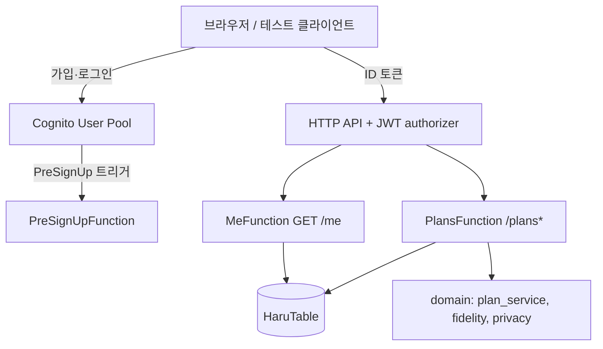
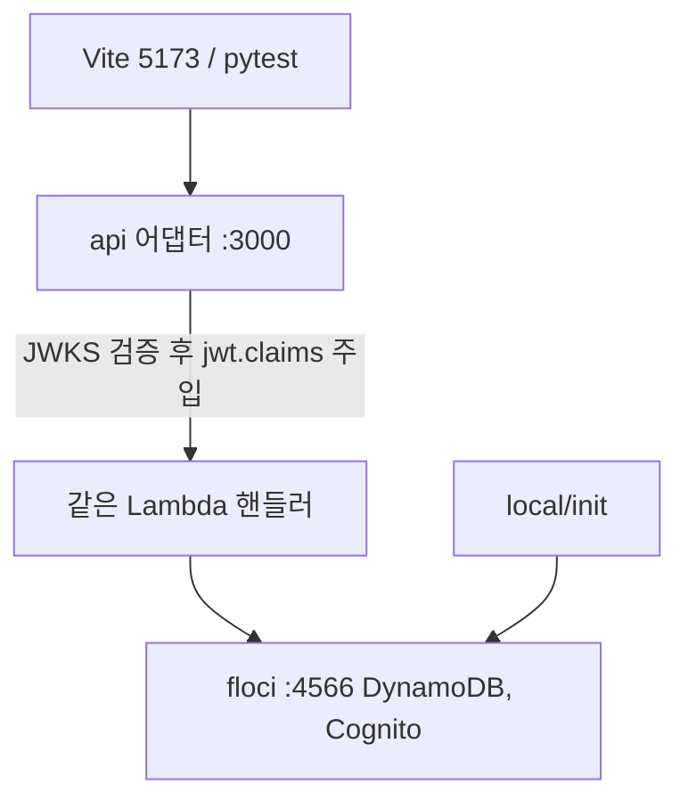

# Design Document: backend-stage1-2-foundation

## Overview

백엔드 1단계(SAM 골격, 인증, 단일 테이블, 로컬 환경, `GET /me`)와 2단계(계획 생성·목록·상세, 멱등 키, `find_not_in_source`, `privacy.py`)를 `backend/` 아래에 구현한다. 근거는 `docs/07-development-plan.md` §7.3 1·2단계, `docs/02-architecture.md` §2.4–§2.6·§2.8–§2.10, `docs/03-api-contract.md` §3.1·§3.3, `docs/06-requirements.md`의 BE-* 요구사항이다.

코드는 Python 3.12다(`docs/02-architecture.md` §2.2). 사용자 요청에 언어 언급은 없지만 프로젝트 문서가 Python으로 고정하고 있어 Python과 pydantic을 쓴다.

**범위 밖(3단계 이후)**: 이어받기·포기·완료 트랜잭션(`claim_service`), 방문 기록, 사진 파이프라인, 수신함·답장, `/ai/card-sessions*`, LangGraph 에이전트, `HaruAgentCheckpoints` 사용 코드, CloudFront·웹 버킷, 알람·대시보드, `seed.py`·`report.py`. `AiCardFunction`, `ClaimsFunction`, `InboxFunction`, `PhotoProcessorFunction`은 만들지 않는다.
다만 `HaruAgentCheckpoints` 테이블 생성은 1단계 로컬 init 스크립트에 명시돼 있으므로(§7.3 1단계) 로컬 init에서만 만들고 SAM 리소스는 6b에서 추가한다. 이 테이블에 `DynamoDBSaver`를 연결해 보는 확인은 `langgraph-checkpoint-aws` 의존성을 고정하는 6a에서 한다(§7.3 6a, BE-Q21). 이번 범위에는 LangGraph 의존성을 넣지 않는다.

**완료 조건**: T1(토큰 없이 모든 경로 401), T13(같은 `Idempotency-Key`로 `POST /plans` 3회 → Plan 1건), 가입 직후 로그인 가능, `GET /me` 닉네임 확인, 2단계 단위 테스트 통과(§7.3).

### 요구사항 매핑

| 영역 | 요구사항 ID |
|---|---|
| 인증·사용자 | BE-AUTH-01–05 |
| 계획 | BE-PLAN-01–09 |
| 충실도·개인정보 함수 | BE-AI-06 (함수 `find_not_in_source`, `scan_privacy`만. 세션·에이전트 제외) |
| 인프라 | BE-INFRA-01(골격), 03, 04(`ApiUrl`·`UserPoolId`·`UserPoolClientId`만), 05(해당 설정값), 08 |
| 비기능 | BE-NFR-02, 05, 07 |

BE-INFRA-04의 `WebBucketName`, `DistributionId`, `DistributionDomain`은 7단계다. BE-INFRA-02(CloudFront)와 BE-INFRA-06의 `AiCardFunction` 권한도 이번 범위가 아니다. BE-INFRA-06 중 이번 Lambda(`MeFunction`, `PlansFunction`, `PreSignUpFunction`)의 최소 권한은 포함한다.

## Architecture



로컬 환경은 같은 핸들러를 어댑터로 호출한다.



### 배포 단위

| 함수 | 트리거 | 이번 구현 |
|---|---|---|
| `MeFunction` | `GET /me` | 구현. `GET /me/claims`·`/me/plans`는 3단계·P1이라 경로를 등록하지 않는다 |
| `PlansFunction` | `POST /plans`, `GET /plans`, `GET /plans/{planId}` | 구현. `POST /plans/{planId}/claims`는 3단계 |
| `PreSignUpFunction` | Cognito PreSignUp | 구현 |

### 결정 사항 (문서에 이미 있는 것만)

- 단일 테이블 `HaruTable`: PK/SK, GSI1, GSI2, TTL 속성 `ttl`(§2.6).
- 권한 판단은 JWT `sub`와 저장된 `ownerId` 비교(BE-AUTH-04, BE-NFR-02).
- 모든 API 경로를 JWT authorizer로 보호한다. 기본 authorizer를 HttpApi에 걸어 새 경로가 보호에서 빠지지 않게 한다(BE-AUTH-03, T1).
- 로컬은 floci 이미지 태그를 고정한다(`floci/floci:2.5.0-compat`, §2.4.1 예시). `latest` 금지(BE-INFRA-08).

## 디렉터리 (backend/ 기준, §2.10 중 이번 범위)

```
backend/
  template.yaml  samconfig.toml  docker-compose.yml  .env.example  requirements.txt
  src/
    common/   auth.py ddb.py errors.py responses.py validation.py ids.py
    handlers/ me.py plans.py pre_signup.py
    domain/   plan_service.py fidelity.py privacy.py
  local/
    init/     (HaruTable+GSI+TTL, HaruAgentCheckpoints, 유저 풀+시드 사용자)
    adapter/  (Dockerfile, app.py)
  tests/
    unit/  local/  integration/(test_authz.py[T1], test_idempotency.py[T13])
    fixtures/
```

`metrics.py`(EMF), `agent/`, `workers/`, `layers/`는 만들지 않는다. `ClaimConflict` 등 EMF 지표는 3단계 이후다(BE-OBS-01).

## Components and Interfaces

### `common/errors.py`

```python
class ApiError(Exception):
    def __init__(self, code: str, status: int, message: str, details: dict[str, str] | None = None): ...
# 이번 범위에서 쓰는 코드: VALIDATION_ERROR(400), UNAUTHORIZED(401), NOT_FOUND(404),
# IDEMPOTENCY_CONFLICT(409), TRY_AGAIN(503)
```

### `common/responses.py`

```python
def ok(status: int, body: dict | None) -> dict          # API Gateway payload 2.0 응답
def error_response(e: ApiError) -> dict                  # {"error":{"code","message","details"?}} (BE-NFR-05)
def serialize_plan(item: dict, *, is_owner: bool, status_override: str | None = None) -> dict
def serialize_plan_summary(item: dict, status_override: str | None = None) -> dict
```
`serialize_plan`은 **허용 목록**으로 필드를 고르고(BE-PLAN-08), `metrics`는 `is_owner`일 때만 포함한다. 내부 속성(`PK`, `SK`, `claimerId`, `currentClaimId`, `dueAt`, `GSI*`, `version`, `ttl`)은 허용 목록에 없으므로 나가지 않는다.

### `common/auth.py`

```python
def get_user(event: dict) -> tuple[str, str]:
    """requestContext.authorizer.jwt.claims 에서 (sub, nickname). 본문의 사용자 ID는 읽지 않는다 (BE-AUTH-04)."""
```
`sub`가 없으면 `ApiError("UNAUTHORIZED", 401)`. `nickname`은 ID 토큰 클레임이다(액세스 토큰에는 없음).

### `common/ddb.py`

```python
def table() -> Table                                   # AWS_ENDPOINT_URL은 SDK가 읽는다. 앱 코드는 엔드포인트를 직접 다루지 않는다
class ConditionFailed(Exception):                      # TransactionConflict 없이 실패 사유가 모두 ConditionalCheckFailed일 때
    reasons: list[str]                                  # 항목별 CancellationReasons.Code
def transact_with_retry(items: list[dict]) -> None
    # TransactWriteItems. TransactionConflict면 50·100·200ms 백오프로 최대 3회 재시도 후 ApiError("TRY_AGAIN", 503).
    # 취소 사유에 TransactionConflict가 하나라도 있으면 재시도한다. 실패 사유가 모두 ConditionalCheckFailed일 때만
    # 재시도하지 않고 ConditionFailed를 올려 서비스 계층이 분기한다(§2.6, BE-REC-10).
```
`transact_with_retry`는 이번 범위의 `POST /plans`(Plan + 멱등 키를 한 트랜잭션으로 저장)에서 처음 만들고, 3단계 이어받기·포기·완료 트랜잭션이 그대로 재사용한다.

### `common/validation.py`

pydantic 모델과 경로 변환.

```python
class PlaceIn(BaseModel):  name: str(1..30); activity: str(1..60); whyChosen: str(0..120)
class AuthoringIn(BaseModel): mode: Literal["MANUAL","AI_EDITED"]; durationMs: int(>=0); aiSessionId: str|None; story: str(1..1000)
class PlanCreate(BaseModel):
    title: str(1..40); summary: str(1..120); reason: str(1..300)
    estimatedMinutes: int(10..240); places: list[PlaceIn](1..3)
    question: str(1..80); authoring: AuthoringIn

def to_details(err: ValidationError) -> dict[str, str]   # loc → "places[0].name" 표기 (§3 공통 규칙)
```
`aiSessionId`는 형식만 받는다. 2단계에는 `AiSession` 저장소가 없으므로 세션 지표(BE-PLAN-03 후반)는 계산하지 않는다(아래 "미결·유예").

### `domain/fidelity.py` (BE-AI-06)

```python
def normalize(text: str) -> str
def find_not_in_source(sources: list[str], targets: list[Target]) -> list[NotInSourceHit]
# Target = (path: str, text: str);  path 예: "places[0].name"
```

### `domain/privacy.py` (BE-AI-06)

```python
@dataclass(frozen=True)
class PrivacyHit: path: str; kind: str; severity: Literal["HIGH","MEDIUM"]
def scan_privacy(texts: dict[str, str]) -> list[PrivacyHit]   # key = path
def mask(text: str) -> str                                    # HIGH 항목 마스킹
```
`kind`: `PHONE`, `EMAIL`, `RRN`(주민번호), `PLATE`(차량번호), `UNIT`(동/호수), `LOT`(번지), `PRIVATE_PLACE`(사전), `PERSON_NAME`(제3자 실명 후보). `HIGH` = 연락처(`PHONE`, `EMAIL`, `RRN`)와 동·호수(`UNIT`). 문서가 `HIGH`를 "연락처, 동·호수"로 정의하므로 이 범위로 한정하고, 나머지는 `MEDIUM`으로 둔다(`PLATE`·`LOT`의 심각도는 BE-Q22로 확정, 아래).

### `domain/plan_service.py`

```python
def create_plan(user: User, idem_key: str, body: PlanCreate) -> tuple[dict, bool]   # (plan, created)
def list_plans(status: str, limit: int, now: datetime) -> list[dict]               # PlanSummary 항목들
def get_plan(plan_id: str, user: User, now: datetime) -> dict                      # {plan, isOwner, myClaim, claimable}
```

### `handlers/*`

```python
def handler(event, context) -> dict   # 라우팅 → 서비스 호출 → ApiError는 error_response로 변환
```
핸들러는 `ApiError`와 pydantic `ValidationError`, 예상치 못한 `Exception`(코드 `INTERNAL`이 아니라 500 + 에러 형식)을 모두 잡아 에러 형식으로 응답한다(BE-NFR-05). 500은 계약 에러 코드 표에 없으므로 코드 값은 BE-Q23으로 둔다.

### `handlers/pre_signup.py` (BE-AUTH-02)

```python
def handler(event, context):
    event["response"]["autoConfirmUser"] = True
    event["response"]["autoVerifyEmail"] = True
    return event
```

## Data Models

### 키 설계 (§2.6 중 이번 범위)

| 엔티티 | PK | SK | GSI1PK / GSI1SK | GSI2PK / GSI2SK |
|---|---|---|---|---|
| Plan | `PLAN#{planId}` | `META` | `AREA#{areaId}#STATUS#{status}` / `{createdAt}` | `USER#{ownerId}` / `PLAN#{createdAt}` |
| Claim(읽기만) | `PLAN#{planId}` | `CLAIM#{claimId}` | — | `USER#{claimerId}` / `CLAIM#{claimedAt}` |
| IdempotencyKey | `IDEM#{userId}#{key}` | `META` (TTL 24시간) | — | — |

Claim은 이번 단계에서 **쓰지 않는다**. 목록·상세가 Claim을 읽는 경로(`myClaim`, `CLAIMED` 상태 표시)만 구현하고, 데이터가 없으면 `OPEN` 계획만 존재하므로 `myClaim = null`이다. 3단계 테스트 픽스처가 Claim을 넣어도 읽기 로직이 동작하도록 만든다.

### Plan 항목

```json
{
  "PK": "PLAN#pln_...", "SK": "META",
  "planId": "pln_...", "areaId": "default",
  "ownerId": "sub", "ownerNickname": "지연",
  "title": "", "summary": "", "reason": "", "estimatedMinutes": 45,
  "places": [{ "order": 1, "name": "", "activity": "", "whyChosen": "" }],
  "question": "", "status": "OPEN",
  "createdAt": "ISO8601Z", "version": 1,
  "metrics": { "authoringMode": "MANUAL", "durationMs": 0, "addedNotInSource": 0, "privacyInPublished": 0 },
  "GSI1PK": "AREA#default#STATUS#OPEN", "GSI1SK": "createdAt",
  "GSI2PK": "USER#sub", "GSI2SK": "PLAN#createdAt"
}
```
- `currentClaimId`, `claimerId`, `dueAt`, `completedAt`은 OPEN일 때 **속성 자체를 쓰지 않는다**(null로 쓰지 않음, 3단계의 조건식과 `REMOVE` 규칙과 일관).
- 응답의 `owner`는 `{ userId, nickname }` 형태로 만든다(§2.5 예시). `completedAt`은 값이 없으면 `null`로 직렬화한다. `currentClaimId`는 내부 속성이므로 응답에 내보내지 않는다(BE-PLAN-08, BE-Q33). (미결: requirements 8.1은 `currentClaimId`를 응답에서 걸러내는 쪽으로 적었고 §2.5 Plan 예시는 `currentClaimId: null`을 보여 준다. 충돌이라 확정 전까지 설계 동작은 바꾸지 않는다. requirements 미결 사항 참고.)
- `areaId`는 `"default"` 고정(동네 한 곳, `areaId` 필드만 예약, §1.6).
- `planId = "pln_" + ULID`, `claimId`·`sessionId`는 이번 범위가 아니다. ID 생성기는 `common/ids.py`.

### IdempotencyKey 항목

```json
{ "PK": "IDEM#{userId}#{key}", "SK": "META", "bodyHash": "sha256 hex", "planId": "pln_...", "ttl": 1234567890 }
```
`ttl` = 생성 시각 + 24시간(epoch 초).

### 응답 타입

`PlanSummary`: `planId, title, summary, estimatedMinutes, placeCount, status, ownerNickname, createdAt` (§3.3).
`GET /plans/{planId}`: `{ plan, isOwner, myClaim, claimable }`.
`GET /me`: `{ userId, nickname, unreadInboxCount }`. 수신함은 4단계이므로 `unreadInboxCount`는 `0`을 고정 반환한다(§7.3 4단계에서 계산 구현, BE-AUTH-05 완성은 4단계). 4단계 구현 배포부터는 요청자의 `read = false`인 InboxItem 수로 계산한다(requirements 2.6).

### metrics (BE-PLAN-03 중 이번 범위)

모든 모드에 대해 저장: `authoringMode`, `durationMs`, `addedNotInSource`(= `find_not_in_source([story], 최종 places)` 개수), `privacyInPublished`(= 최종 Plan 텍스트의 `scan_privacy` 탐지 수).
`AI_EDITED`의 세션 기반 지표(`addedNotInSourceOrAnswers`, `firstProposalNotInSource` 등)는 `AiSession`이 있어야 하므로 6a에서 추가한다. 이번에는 저장하지 않는다.

## Algorithmic Pseudocode

### POST /plans (BE-PLAN-01, 02, 03 / T13)

```python
def create_plan(user, idem_key, body):
    # 1. 멱등 키 헤더 필수
    if not idem_key: raise ApiError("VALIDATION_ERROR", 400, ..., {"Idempotency-Key": "필수 헤더예요."})
    body_hash = sha256(canonical_json(body_dict))        # 키 정렬, 공백 없음
    key_pk = f"IDEM#{user.id}#{idem_key}"

    existing = get_item(key_pk, "META", consistent=True)
    if existing:
        return _replay(existing, body_hash)              # 순차 재요청: 트랜잭션 없이 바로 재생

    plan = build_plan(user, body)                        # ID·시각·metrics 계산
    # 2. Plan과 멱등 키를 한 트랜잭션으로 저장한다
    try:
        transact_with_retry([
            Put(plan,                                                    Condition="attribute_not_exists(PK)"),
            Put({PK: key_pk, SK: "META", bodyHash: body_hash,
                 planId: plan.planId, ttl: now + 24h},                  Condition="attribute_not_exists(PK)"),
        ])
    except ConditionFailed:
        # 동시 요청에서 진 쪽: 같은 키를 다른 요청이 먼저 커밋했다
        existing = get_item(key_pk, "META", consistent=True)
        return _replay(existing, body_hash)
    return plan, True                                     # TransactionConflict 재시도 소진은 transact_with_retry가 503 TRY_AGAIN

def _replay(existing, body_hash):
    if existing.bodyHash != body_hash: raise ApiError("IDEMPOTENCY_CONFLICT", 409)
    plan = get_item(f"PLAN#{existing.planId}", "META", consistent=True)
    return plan, False                                    # 트랜잭션이라 키가 있으면 Plan도 있다

# create_plan의 except ConditionFailed 분기에서 다시 읽은 키 항목이 없으면(취소 원인을 판정할 수 없음)
# _replay를 부르지 않고 ApiError("TRY_AGAIN", 503)을 던진다(요구사항 4.12).
```

**Preconditions**: `user.id`는 JWT `sub`. `body`는 pydantic 검증을 통과.
**Postconditions**: 같은 `(user, key, body)`의 호출은 몇 번이든 동일한 `planId`를 반환하고 Plan 항목은 1건이다(T13). 같은 키·다른 본문은 409. 처음 생성하면 201, 재요청도 **201로 처음 만든 Plan을 그대로 반환**한다(§3.3은 "처음 생성한 Plan을 그대로 반환"이라고만 하고 재요청 상태 코드는 정하지 않았다 → BE-Q24).
**설계 근거**: Plan과 멱등 키를 TransactWriteItems 한 번으로 쓰므로 "키만 있고 Plan은 없는" 상태가 생기지 않는다. 키를 먼저 쓰고 Plan을 나중에 쓰는 두 단계 방식은 그 사이에 Lambda가 죽으면 24시간(TTL) 동안 재시도가 실패하므로 쓰지 않는다. 트랜잭션은 `common/ddb.py`의 `transact_with_retry`로 실행하며, `TransactionConflict`는 50·100·200ms 백오프로 최대 3회 재시도 후 503 `TRY_AGAIN`, 실패 사유가 모두 `ConditionalCheckFailed`이면 재시도 없이 `ConditionFailed`로 올라와 위 `except`에서 재생한다(§2.6 공통 실패 처리). planId는 매 요청 새 ULID라 Plan 쪽 조건은 실패하지 않으며, 조건 실패는 키 항목에서만 생긴다.

### build_plan 의 metrics 계산

```python
def build_plan(user, body):
    final_texts = {f"places[{i}].name": p.name, f"places[{i}].activity": p.activity, ...,
                   "title": body.title, "summary": body.summary, "reason": body.reason, "question": body.question}
    targets = [(f"places[{i}].name", p.name) ... , (f"places[{i}].activity", p.activity) ...]
    added = len(find_not_in_source([body.authoring.story], targets))
    privacy = len(scan_privacy(final_texts))
    ...
```

### find_not_in_source (BE-AI-06)

```python
def find_not_in_source(sources, targets):
    corpus = normalize(" ".join(sources))
    hits = []
    for (path, text) in targets:
        nouns = core_nouns(text)                 # 정규화 후 핵심 명사
        if nouns and not all_present(nouns, corpus):
            hits.append(NotInSourceHit(path, text))
    return hits
```
**Preconditions**: `sources`는 사연(+이후 단계에서 계획자 답변). 모델이 만든 문장은 넣지 않는다.
**Postconditions**: 순수 함수, 입력 불변. `targets`가 `null`/빈 문자열이면 판정하지 않는다(`MISSING`은 `check_draft` 몫, 6b). 같은 입력은 같은 결과.
**정규화**: 공백 제거·소문자화, 조사 제거(은/는/이/가/을/를/에/에서/으로/로/의/와/과/도/만/까지/부터 등 말미 조사 사전), 결과 길이 1 이하 토큰은 무시. **핵심 명사 추출 규칙**(토큰화, 조사 사전, 일치 판정이 "전부 포함"인지 "하나라도 포함"인지)은 문서에 없으므로 BE-Q25로 두고, 기본안은 아래와 같다.
- 텍스트를 공백으로 나눠 토큰별로 말미 조사를 떼고, 토큰이 말뭉치(공백 제거 본문)에 부분 문자열로 있으면 통과.
- 활동(`activity`)은 서술어 꼴 토큰(끝이 -기, -고, -서, -며)을 빼고 남은 핵심 명사만 대조한다("빵 사기" → "빵"). 남는 토큰이 없으면 판정하지 않는다. 장소 이름(`name`)에는 이 규칙을 쓰지 않는다("경찰서" 같은 명사가 빠지지 않게).
- 장소 `name`/`activity`의 남은 토큰이 모두 통과하면 원문에 있는 것으로 본다.
- 프롬프트의 "빵집·빵 가게" 같은 동의어는 정규화 사전(`src/domain/normalization.json`)에 있는 것만 허용한다. 서비스 코드와 테스트가 같은 파일을 쓴다(§7.3 2단계 "정규화 사전").
UI 배지 문구는 이번 범위가 아니다(명사 휴리스틱이므로 '0건 보장'이 아니다).

### scan_privacy (BE-AI-06)

```python
PATTERNS = [
  ("PHONE", HIGH,  r"01[016789][-\s.]?\d{3,4}[-\s.]?\d{4}|0\d{1,2}[-\s.]?\d{3,4}[-\s.]?\d{4}"),
  ("EMAIL", HIGH,  r"[\w.+-]+@[\w-]+(\.[\w-]+)+"),
  ("RRN",   HIGH,  r"\d{6}[-\s]?[1-4]\d{6}"),
  ("UNIT",  HIGH,  r"\d{1,4}\s*동\s*\d{1,4}\s*호|\d{1,4}\s*호(?!수)"),   # 동/호수
  ("PLATE", MEDIUM,r"\d{2,3}\s?[가-힣]\s?\d{4}"),
  ("LOT",   MEDIUM,r"\d{1,5}(-\d{1,4})?\s*번지"),
]
PRIVATE_PLACE_DICT = ["우리 집", "집 앞", "사무실 안", ...]            # + "~네 집" 정규식
def scan_privacy(texts):
    for path, text in texts.items():
        for kind, sev, rx in PATTERNS: yield hits
        for term in PRIVATE_PLACE_DICT: ...
        yield 제3자 실명 후보 (BE-Q26)
```
**Postconditions**: 로그에는 원문 대신 `kind`와 개수만 남긴다(BE-NFR-03). `HIGH`는 `mask()`로 마스킹 가능. 정규식 패턴 값은 구현 단계 단위 테스트(전화·이메일·주민번호·차량번호·동/호수·번지, §7.3 2단계)로 확정한다. **제3자 실명 후보**의 판정 방법은 문서에 없어 BE-Q26이다(기본안: 구현하지 않고 `PERSON_NAME`을 빈 결과로 두고 사전 항목만 허용).

### GET /plans (BE-PLAN-04 / T16 일부)

```python
def list_plans(status, limit, now):
    assert status == "OPEN"                                  # 다른 값은 VALIDATION_ERROR
    limit = min(limit or 20, 50)                             # BE-Q3 제안: 최대 50
    open_items    = query(GSI1, GSI1PK="AREA#default#STATUS#OPEN",    desc)
    claimed_items = query(GSI1, GSI1PK="AREA#default#STATUS#CLAIMED", desc)
    expired = [p for p in claimed_items if p.dueAt < now]    # 기한 지난 CLAIMED는 OPEN으로 노출
    merged = sorted(open_items + expired, key=createdAt, reverse=True)[:limit]
    return [serialize_plan_summary(p, status_override="OPEN") for p in merged]   # nextCursor: null
```
**Postconditions**: `createdAt` 역순, 길이 ≤ limit, 모든 항목의 `status`가 `"OPEN"`, `nextCursor = null`(BE-Q3 제안안 채택 전까지는 제안으로 구현하고 미결로 표시).
**주의**: GSI는 최종 일관성이다. 방금 생성한 계획이 목록에 안 보일 수 있다. 상세 조회는 기본 키 GetItem(`ConsistentRead`)이라 영향 없다.
**성능**: 두 Query 모두 `limit`만큼만 읽는다(MVP 규모에서 충분, §3.3).

### GET /plans/{planId} (BE-PLAN-05–07)

```python
def get_plan(plan_id, user, now):
    plan = get_item(PLAN, META, consistent=True)
    if plan is None: raise NOT_FOUND
    is_owner = plan.ownerId == user.id
    claims = query(PK=PLAN#id, SK begins_with CLAIM#)          # 요청자의 Claim만 필터
    my_claim = first(c for c in claims if c.claimerId == user.id and c.status in (ACTIVE, COMPLETED))
    # COMPLETED 계획: 소유자와 해당 실행자만
    if plan.status == "COMPLETED" and not (is_owner or my_claim): raise NOT_FOUND
    shown = plan.status
    if plan.status == "CLAIMED" and plan.dueAt < now and not (plan.claimerId == user.id): shown = "OPEN"
    claimable = (not is_owner) and my_claim is None and (shown == "OPEN")
    return {plan: serialize_plan(plan, is_owner, shown), isOwner: is_owner,
            myClaim: serialize_claim(my_claim), claimable: claimable}
```
**Postconditions**: `claimable`은 §3.3 정의와 같다. 다른 사람이 기한 내 이어받은 `CLAIMED`는 실행자 정보를 응답에서 뺀다(`serialize_plan`이 `claimerId`를 내보내지 않는 허용 목록이므로 자동). `metrics`는 소유자에게만.
**Claim 직렬화**: `Claim` 응답 형태는 §2.5에 필드 이름만 있다(`claimId, planId, claimer{userId,nickname}, status, claimedAt, dueAt, completedAt, late`). 이번에는 읽기 경로이며 데이터가 없으므로 `serialize_claim`은 이 필드 목록의 허용 목록 직렬화만 구현한다.

### GET /me

```python
def me(event):
    sub, nickname = get_user(event)
    return {"userId": sub, "nickname": nickname, "unreadInboxCount": 0}
```
**Postcondition**: 본문 어디서도 사용자 ID를 읽지 않는다. 닉네임 클레임이 없으면 `nickname`은 `null`이 아니라 BE-Q17(Floci ID 토큰에 `nickname` 클레임이 있는지 미확인)의 결과에 따른다(로컬 dev JWT는 항상 포함).

## SAM 템플릿 설계 (BE-INFRA-01, 03, 04, 05, 06)

| 리소스 | 내용 |
|---|---|
| `Globals.Function` | Python 3.12, 환경 변수 `TABLE_NAME`, `AREA_ID=default`, `CLAIM_DURATION_DAYS=3`, `LANGSMITH_TRACING=false`, `LANGCHAIN_TRACING_V2=false`(BE-AI-15, 이 함수들은 LangGraph를 안 쓰지만 §7.3 1단계가 Globals에 포함하라고 명시) |
| `HaruTable` | PK/SK(S), GSI1(GSI1PK/GSI1SK), GSI2(GSI2PK/GSI2SK), TTL `ttl`, on-demand |
| `UserPool` | 이메일 로그인(username attribute email), `nickname` 필수(Schema Required), 비밀번호 정책은 문서에 없으므로 Cognito 기본(BE-Q27), `LambdaConfig.PreSignUp` |
| `UserPoolClient` | 시크릿 없음, `ExplicitAuthFlows`: `ALLOW_USER_PASSWORD_AUTH`, `ALLOW_USER_SRP_AUTH`, `ALLOW_REFRESH_TOKEN_AUTH`(Amplify SRP와 통합 테스트의 비밀번호 로그인에 필요) |
| `HttpApi` | `DefaultAuthorizer` = JWT(issuer `https://cognito-idp.{region}.amazonaws.com/{poolId}`, audience = ClientId, 헤더 `Authorization`), CORS(허용 Origin `http://localhost:5173` + CloudFront 도메인은 7단계에 추가: **파라미터 `AllowedOrigins`**로 받는다, 허용 헤더 `Authorization`·`Content-Type`·`Idempotency-Key`, 메서드 `GET`·`POST`·`PUT`·`OPTIONS`) |
| 함수 | `MeFunction`, `PlansFunction`, `PreSignUpFunction`(+ Cognito 호출 권한 `AWS::Lambda::Permission`) |
| IAM | `MeFunction`: DynamoDB 읽기 없음(이번 `GET /me`는 DB를 쓰지 않음, 정책 없음). `PlansFunction`: `HaruTable`과 `HaruTable/index/*`에 `GetItem`, `PutItem`, `Query`, `TransactWriteItems` 대응 권한(`dynamodb:PutItem`, `dynamodb:GetItem`, `dynamodb:Query`)만 |
| Outputs | `ApiUrl`, `UserPoolId`, `UserPoolClientId` (BE-INFRA-04, 이번 범위분) |

- HttpApi 스테이지 `$default`, 모든 함수 이벤트에 명시 경로를 둔다.
- `samconfig.toml`은 `dev`, `demo` 환경을 둔다(BE-INFRA-01). `AllowedOrigins`와 같은 파라미터 값이 환경별로 다르다.
- `sam validate --lint`가 통과해야 한다(§2.4.4 9항).
- 순환 참조 주의: UserPool의 PreSignUp → 함수, 함수 권한의 `SourceArn` → UserPool은 순환이 된다. `SourceArn`에 `!Sub arn:aws:cognito-idp:${AWS::Region}:${AWS::AccountId}:userpool/*`처럼 와일드카드를 써서 끊는다(문서에 없는 구현 선택, 구현 시 확인).

## 로컬 개발 환경 (BE-INFRA-08, §2.4)

### docker-compose.yml

서비스 `aws`(`floci/floci:2.5.0-compat`, 4566, `FLOCI_STORAGE_MODE=hybrid`, init 마운트 `./local/init:/etc/floci/init/ready.d`)와 `api`(`./local/adapter` 빌드, 3000, `.env`). 이번 범위에는 SQS·S3·ollama를 쓰지 않으므로 init에서 버킷·큐를 만들지 않고 `ollama` 프로필도 넣지 않는다(3단계 이후 단계에서 추가). `LANGSMITH_TRACING=false`, `LANGCHAIN_TRACING_V2=false`는 compose에도 명시한다(§7.7 완료 기준).

### init 스크립트

- `HaruTable`(GSI1·GSI2, TTL `ttl`), `HaruAgentCheckpoints`(PK/SK, TTL `ttl`)를 만든다. 후자는 1단계에서 테이블만 만들고, `DynamoDBSaver` 연결 확인은 6a에서 한다(BE-Q21).
- 유저 풀 + 앱 클라이언트 + 시드 사용자 3명(지연, 수현, 민준: `AdminCreateUser`, `AdminSetUserPassword --permanent`, `nickname`).
- 마지막에 `LOCAL_JWT_ISSUER`, `LOCAL_JWKS_URL`, 풀 ID, 클라이언트 ID를 출력한다.
- 시드 사용자의 이메일·비밀번호 값은 문서에 없다. 로컬 전용 값으로 init 스크립트와 `.env.example`에 명시하고 실제 계정 정보가 아님을 적는다(BE-Q28: 값 정하기).

### 어댑터 (`local/adapter/app.py`)

```python
def dispatch(http_req) -> http_resp:
    event = to_payload_v2(http_req)                       # routeKey, rawPath, headers, pathParameters, queryStringParameters, body
    claims = verify_id_token(headers.authorization)       # iss, aud(client id), exp, token_use=id (JWKS: Floci + dev JWT 공개키)
    if claims is None: return 401 UNAUTHORIZED
    event["requestContext"]["authorizer"] = {"jwt": {"claims": claims}}
    return HANDLERS[route](event, FakeContext(remaining_ms=27000))
```
- 검증 실패 시 401을 어댑터가 직접 만든다. 형식은 계약의 에러 형식이다. 실제 API Gateway authorizer의 401 본문 형태는 다르므로 로컬 결과를 계약 근거로 쓰지 않는다(§2.4.4 1항).
- `STAGE=local`에서만 `/dev/token` 발급 엔드포인트(로컬 RSA 키, `sub`/`nickname`/`aud`/`iss`)를 켠다. 요청·응답 형식은 문서에 "백엔드 1단계에서 정해지는 대로"라고만 되어 있어 **이 설계에서 정한다**: `POST /dev/token {"userId","nickname"}` → `{"idToken"}`. 프론트 `auth/devJwt.ts`가 이에 맞춘다.
- CORS 허용 Origin `http://localhost:5173`, preflight `OPTIONS`는 인증 없이 204.
- 이번 범위에는 SQS 폴러를 넣지 않는다(5단계).
- 라우팅 테이블은 `template.yaml`의 이벤트 경로와 같아야 한다. 같은 목록을 한 곳(`routes.py`)에 두고 단위 테스트로 일치를 확인한다.

## Correctness Properties

각 속성은 문서의 보장·시나리오와 연결한다. P1–P4는 이번 완료 조건이다.

### Property 1: (T1, BE-AUTH-03)

모든 등록 경로(`GET /me`, `POST /plans`, `GET /plans`, `GET /plans/{planId}`)에 대해 `Authorization` 없음·만료·잘못된 토큰이면 응답이 401이다. 로컬은 어댑터 검증, AWS는 JWT authorizer로 판정하며 **판정은 AWS 스택**이다.

**Validates: Requirements 1.6, 1.7, 7.2, 14.1**

### Property 2: (T13, BE-PLAN-01)

임의의 유효 본문 `b`와 키 `k`에 대해 `POST /plans`를 n(≥1)번 동시·순차로 호출하면 `PLAN#` 항목은 1건이고 모든 응답의 `plan.planId`가 같다. 같은 `k`에 `b' ≠ b`이면 409 `IDEMPOTENCY_CONFLICT`.

**Validates: Requirements 4.5, 4.7, 4.8, 14.2, 14.3**

### Property 3: (BE-AUTH-04)

핸들러의 결과는 요청 본문·쿼리의 사용자 ID 필드와 무관하다(`ownerId`는 항상 JWT `sub`).

**Validates: Requirements 2.1**

### Property 4: (BE-PLAN-08)

`serialize_plan`의 출력 키 집합은 허용 목록의 부분집합이고, 비소유자 응답에는 `metrics`가 없다.

**Validates: Requirements 7.6, 8.1, 8.2, 8.3, 8.8**

### Property 5: (BE-PLAN-02)

검증 경계(`title` 40/41자, `estimatedMinutes` 9/10/240/241, `places` 0/1/3/4개 등)에서 정확히 유효 범위만 통과하고, 실패 응답은 `details` 키가 `places[0].name` 표기다.

**Validates: Requirements 3.1, 3.2, 3.4**

### Property 6: (BE-PLAN-04)

`list_plans` 결과는 `createdAt` 내림차순이고 모든 `status`가 `OPEN`이며, 기한 지난 `CLAIMED`가 포함되고 기한 내 `CLAIMED`는 제외된다.

**Validates: Requirements 6.3, 6.4, 6.5**

### Property 7: (BE-PLAN-05–07)

`claimable = !isOwner ∧ myClaim = null ∧ shown ∈ {OPEN}`. `COMPLETED` 계획은 소유자·실행자 외에 404.

**Validates: Requirements 7.4, 7.5, 7.7, 7.8, 7.10, 7.11**

### Property 8: (BE-AI-06)

`find_not_in_source(S, T)`는 `T`의 항목 중 정규화한 핵심 토큰이 `S`에 없는 것만 반환하고, `S`에 문장이 추가되면 결과가 단조 감소한다(`S ⊆ S'` ⟹ `hits(S') ⊆ hits(S)`).

**Validates: Requirements 9.1, 9.4, 9.5, 9.7**

### Property 9: (BE-AI-06)

`scan_privacy`는 전화·이메일·주민번호·동/호수 샘플을 `HIGH`로, 개인정보가 없는 데모 사연(§3.2 예시)을 0건으로 판정한다. `mask(t)`의 결과를 다시 스캔하면 `HIGH`가 0건이다.

**Validates: Requirements 10.1, 10.2, 10.3, 10.4, 10.5**

### Property 10: (BE-NFR-05)

모든 4xx/5xx 응답 본문은 `{ "error": { "code", "message", "details"? } }` 형식이고 `details`는 `VALIDATION_ERROR`에만 있다.

**Validates: Requirements 11.1, 11.2, 11.3**

### Property 11: (BE-AUTH-02)

PreSignUp 핸들러 출력은 `autoConfirmUser = autoVerifyEmail = true`이고 입력의 나머지 필드를 바꾸지 않는다.

**Validates: Requirements 1.4**


## Error Handling

| 상황 | 응답 | 처리 |
|---|---|---|
| 토큰 없음/만료 | 401 `UNAUTHORIZED` | API Gateway authorizer(AWS), 어댑터(로컬) |
| 본문 검증 실패 | 400 `VALIDATION_ERROR` + `details` | pydantic 오류를 `to_details`로 변환 |
| `Idempotency-Key` 헤더 없음 | 400 `VALIDATION_ERROR`, `details: {"Idempotency-Key": ...}` | 헤더 이름 키 표기는 문서에 없어 BE-Q29 |
| 같은 키·다른 본문 | 409 `IDEMPOTENCY_CONFLICT` | 본문 해시 비교 |
| 계획 없음, `COMPLETED` 열람 권한 없음 | 404 `NOT_FOUND` | |
| `GET /plans`의 `status`가 `OPEN` 외 | 400 `VALIDATION_ERROR` | 계약에 `OPEN` 외 값이 정의돼 있지 않음 |
| 트랜잭션 충돌 재시도 소진 | 503 `TRY_AGAIN` | §2.6 공통 처리 |
| 예기치 못한 예외 | 500, 에러 형식 | 로그에 원문·토큰 없이 예외 유형만. 코드 값 BE-Q23 |

## Testing Strategy

### 단위 (pytest, botocore Stubber, 필요 시 로컬 에뮬레이터)

- 검증 경계값(P5), `to_details` 경로 표기.
- `find_not_in_source`: 정규화 사전(`src/domain/normalization.json`), 활동의 서술어 토큰 제외, 데모 사연("골목 빵집"은 NOT_IN_SOURCE, "출근길 빵집"은 통과), 단조성(P8).
- `scan_privacy`: 전화·이메일·주민번호·차량번호·동/호수·번지·비공개 장소 사전, 음성 사례(P9).
- 직렬화 허용 목록(P4), 상태 표시 규칙 표(P6, P7), `claimable`.
- 멱등: 같은 키·같은 본문 / 다른 본문 / 동시 선점 패배 / `TransactionConflict` 주입(Stubber)으로 재시도와 503(§7.5).
- PreSignUp 핸들러(P11).
- 라우트 목록 일치(템플릿 ↔ 어댑터).

### 속성 기반 (Hypothesis)

- `PlanCreate` 경계 생성기: 유효 범위 ⟺ 통과.
- `find_not_in_source` 단조성(P8), `mask` 후 재스캔(P9), `to_details` 키 형식.
- 이 라이브러리 선택은 문서에 없고 Python 기본 PBT 라이브러리이므로 구현 시 `requirements-dev.txt`에 추가한다.

### 로컬 통합 (`tests/local/`, docker compose)

- 시드 사용자 토큰(또는 dev JWT)으로 `GET /me` 닉네임 확인(BE-Q17).
- `POST /plans` → `GET /plans/{id}` → `GET /plans`.
- 같은 키 3회 호출 → Plan 1건(조건식 로직만 확인. **T13 판정에는 쓰지 않는다**).
- `HaruAgentCheckpoints`는 테이블 존재와 TTL 설정만 확인한다. `DynamoDBSaver` 연결 확인은 6a 작업이다(§7.3 6a, BE-Q21).

### 배포 스택 통합 (`tests/integration/`, `dev` 스택)

- `test_authz.py` — **T1**: 모든 경로를 토큰 없이 호출해 401. (T2는 수신함이 필요한 4단계 이후)
- `test_idempotency.py` — **T13**: 테스트용 Cognito 사용자를 `AdminCreateUser`로 만들어 ID 토큰 발급, 같은 `Idempotency-Key`로 3회 호출해 Plan 1건(`GET /plans/{id}`와 DynamoDB 항목 수 확인), 본문 변경 시 409.
- 가입 직후 로그인 확인: `SignUp` → 인증 코드 없이 `InitiateAuth` 성공, ID 토큰의 `nickname` 확인.
- `sam validate --lint`, `sam build`, `sam deploy --config-env dev` 성공.

## Security Considerations

- 사용자 ID는 JWT `sub`만 신뢰하고 본문 값은 무시한다(BE-AUTH-04, BE-NFR-02).
- 응답은 허용 목록 직렬화다. `metrics`는 소유자에게만 간다.
- 로그에 토큰·사연 원문을 남기지 않는다(BE-NFR-03). `privacy`와 `fidelity` 결과는 유형·개수만 로그에 쓴다.
- `.env`·시드 비밀번호는 gitignore, 저장소에는 `.env.example`만 올린다. 로컬 dev JWT 발급은 `STAGE=local`에서만 켜지고 AWS 배포 코드 경로에 들어가지 않는다(어댑터는 SAM 배포물에 포함하지 않는다).
- Lambda IAM은 테이블·인덱스 ARN으로 한정한다(BE-INFRA-06 중 이번 범위).
- 사연은 `authoring.story`로 서버에 저장되지 않고 지표 계산에만 쓴다. 사연 원문 저장 여부는 문서에 없다. §2.5 Plan 항목 예시에 `story` 필드가 없으므로 **저장하지 않는다**.

## Performance Considerations

- `GET /plans`는 GSI Query 2번 + 메모리 병합(MVP 규모). `limit` 최대 50.
- `GET /plans/{planId}`는 GetItem 1번 + Claim Query 1번. `ConsistentRead`는 GetItem에만 쓰고 GSI는 쓸 수 없다.
- Lambda 메모리 기본값에서 시작(문서에 값 없음). 콜드 스타트 측정은 6a의 `AiCardFunction`만 대상이다.

## Dependencies

- 런타임: Python 3.12, boto3(Lambda 내장), pydantic v2, python-ulid(또는 동등 ULID 생성기. 문서에 라이브러리 지정 없음).
- 로컬 어댑터: PyJWT(JWKS 검증), `cryptography`(dev JWT 서명). 이번 범위에서 `langgraph*`, `langchain*`, Pillow는 넣지 않는다.
- 도구: AWS SAM CLI, Docker/Docker Compose, pytest, Hypothesis, botocore Stubber.
- 이미지: `floci/floci:2.5.0-compat`(태그 고정).

## 미결 사항 (docs/08-open-questions.md 연결)

기존 질문 중 이번 범위가 영향받는 것

| # | 이 설계에서의 처리 |
|---|---|
| BE-Q3 | `limit` 최대 50, `nextCursor: null` 고정으로 구현(제안안). 확정 전까지 미결 |
| BE-Q4 | 허용 목록(BE-PLAN-08)으로 구현 |
| BE-Q17 | Floci ID 토큰의 `nickname` 클레임 확인은 로컬 통합 테스트 항목. 결과에 따라 dev JWT 사용 |
| BE-Q21 | init에서 테이블 생성까지. `DynamoDBSaver` 연결 확인은 6a(문서도 6a로 변경됨) |
| BE-Q15 | T1·T13 판정은 AWS 스택에서만 한다(로컬은 합격 근거 아님) |

이 설계가 새로 발견해 `docs/08-open-questions.md` §8.1에 추가한 항목(BE-Q22–BE-Q30)

| # | 내용 | 제안 |
|---|---|---|
| BE-Q22 | `scan_privacy`의 `PLATE`·`LOT`·`PRIVATE_PLACE`·`PERSON_NAME` 심각도와 차단 여부. 문서는 `HIGH`를 연락처·동/호수로만 정의한다 | `MEDIUM`으로 탐지만 하고 차단하지 않는다 |
| BE-Q23 | 예기치 못한 서버 오류(500)의 에러 코드. §3.6에 없다 | 구현 전 계약에 추가할지 결정. 그 전까지 `INTERNAL_ERROR` 임시 사용 후 계약에 반영 |
| BE-Q24 | 멱등 재요청의 HTTP 상태 코드(201 유지 vs 200) | 처음 응답과 같은 201 |
| BE-Q25 | `find_not_in_source`의 핵심 명사 추출·조사 사전·일치 규칙 | 위 "기본안" |
| BE-Q26 | 제3자 실명 후보 탐지 방법 | 이번에는 사전 항목만 |
| BE-Q27 | Cognito 비밀번호 정책 | Cognito 기본 정책 |
| BE-Q28 | 로컬 시드 사용자의 이메일·비밀번호 값 | 로컬 전용 예시 값을 `.env.example`에 둔다 |
| BE-Q29 | `Idempotency-Key` 누락 시 `details` 키 표기 | 헤더 이름 그대로 |
| BE-Q30 | `GET /me`의 `unreadInboxCount`는 4단계 전까지 0 고정이 맞는지, 그리고 `nickname` 클레임이 없을 때의 응답 | 0 고정. 클레임 없음은 BE-Q17 결과에 따른다 |

프론트엔드 영향: `POST /plans` 재요청 상태 코드(BE-Q24)와 `Idempotency-Key` 누락 처리(BE-Q29)는 계약(`docs/03-api-contract.md`) 변경이므로 [§7.2](../../../docs/07-development-plan.md)의 계약 변경 절차(프론트 리뷰)를 따른다.

