# Design Document: backend-stage4-record-inbox

## Overview

백엔드 4단계(방문 기록(글)과 수신함)를 1–3단계 코드 위에 더한다. 근거는 `docs/07-development-plan.md` §7.3 4단계, `docs/03-api-contract.md` §3.1·§3.4–§3.7, `docs/02-architecture.md` §2.3·§2.5–§2.8·§2.10, `docs/06-requirements.md`, 그리고 같은 폴더의 `requirements.md`다.

이번에 새로 만드는 것은 `GET /claims/{claimId}/record`, 수신함 4종(`GET /inbox`, `GET /inbox/{itemId}`, `POST /inbox/{itemId}/read`, `POST /inbox/{itemId}/reply`), `GET /me`의 `unreadInboxCount` 계산, `InboxFunction`이다. 3단계의 이어받기·포기·기록 저장·완료 트랜잭션(`claim_plan`, `abandon`, `put_record`, `complete_claim`, `complete_by_user`)은 한 줄도 바꾸지 않는다. API 계약(docs/03)과 DynamoDB 키 설계(docs/02 §2.6)도 바꾸지 않는다.

설계 원칙
- 기존 구조를 그대로 따른다. 정합성·권한 로직은 `domain/`, 요청 해석과 직렬화 호출은 `handlers/`, 응답 허용 목록은 `common/responses.py`, 에러 코드는 `common/errors.py`에 둔다.
- 서비스는 저장 항목(dict)을 돌려주고 핸들러가 직렬화한다(3단계 `claim_service` 머리말의 규칙).
- 모든 핸들러 함수는 맨 앞에서 `get_user(event)`를 부른다. 본문 파싱·검증·DB 접근은 그 뒤다.
- 권한 판단은 JWT `sub`와 저장된 `ownerId`/`claimerId` 비교로만 한다(docs/02 §2.8, BE-NFR-02).

### 요구사항 매핑

| 영역 | 요구사항 ID | requirements.md |
|---|---|---|
| 방문 기록 저장(3단계 유지) | BE-REC-01, BE-REC-03, G3 | Requirement 1 |
| 방문 기록 조회 | BE-REC-05 | Requirement 2 |
| 수신함 목록·상세·읽음·답장 | BE-INBOX-01–04 | Requirement 3–6 |
| 직렬화 | BE-PLAN-08, BE-NFR-07 | Requirement 7 |
| 미확인 수 | BE-AUTH-05 | Requirement 8 |
| 라우트·IAM·인증 | BE-INFRA-06, BE-AUTH-03·04 | Requirement 9 |
| 회귀(G1–G4) | BE-REC-06–10, BE-NFR-03·05 | Requirement 10 |
| 테스트·인계 | T1, T2, T5, T6, T17, S2 | Requirement 11 |

### 범위 밖

사진(`photo` 처리, presigned PUT/GET, `POST /claims/{claimId}/record/photo`, 사진 버킷·SQS·`PhotoProcessorFunction`, 5단계), AI(6단계), CloudFront·알람·`seed.py`(7단계), P1(`GET /me/claims`의 `reply`, `GET /me/plans`), `sam deploy`. 사진 관련 응답 필드는 계약 형태대로 내보내고 값은 BE-Q34·BE-Q42를 따른다.

### 시작 조건과 판정

- 시작 조건은 충족됐다. 2026-11-25 `haru-dev`에서 AWS 통합 테스트 15건(T3–T7 포함)이 통과했다(docs/07 §7.2, `backend/README.md` §1·§3.1, Requirement 11.5).
- 이번 작업은 `sam validate --lint`, `sam build`, 단위 테스트, 로컬 통합 테스트까지다. T2·T17은 테스트 코드만 쓰고 실행·판정은 AWS 담당이 Dev_Stack에서 한다(BE-Q15, docs/07 §7.5).
- 끝나면 프론트 연동 지점 S2(글 경로 전체를 실제 API로 전환)가 열린다.

## Architecture

```mermaid
graph LR
  APIGW[HTTP API + CognitoJwt authorizer] --> CF[ClaimsFunction<br/>abandon · record PUT/GET · complete]
  APIGW --> IF[InboxFunction 신규<br/>GET /inbox · GET /inbox/&#123;itemId&#125; · read · reply]
  APIGW --> MF[MeFunction<br/>GET /me · GET /me/claims]
  CF --> CS[domain/claim_service<br/>+ get_record]
  IF --> IS[domain/inbox_service 신규]
  MF --> IS
  MF --> CS
  CS --> T[(HaruTable)]
  IS --> T
  CS -. 3단계 완료 트랜잭션이 InboxItem Put .-> T
```



- InboxItem은 3단계 완료 트랜잭션(`complete_claim`)만 만든다. 4단계 코드는 InboxItem의 `read`와 `reply` 두 속성만 조건부 `UpdateItem`으로 바꾼다. Plan·Claim·Record에는 쓰지 않는다(G4, Requirement 10.7).
- 로컬은 같은 핸들러를 어댑터가 부른다. 어댑터의 경로 표는 `handlers/routes.py`의 `ROUTES`에서 만들어지므로(`local/adapter/app.py` `_compile_routes(routes or ROUTES)`) 어댑터 코드는 고치지 않는다.

### 배포 단위

| 함수 | 이번 단계 변경 |
|---|---|
| `ClaimsFunction` | 이벤트 `GET /claims/{claimId}/record` 추가. 권한은 그대로(`GetItem`, `PutItem`, `UpdateItem`, `ConditionCheckItem`, `HaruTable`만) |
| `InboxFunction`(신규) | `handlers.inbox.handler`, 이벤트 4개, 권한 `GetItem`·`Query`·`UpdateItem`(`HaruTable`만, `index/*` 없음) |
| `MeFunction` | 코드만 바뀐다(`GET /me`가 HaruTable을 Query). 권한·이벤트는 그대로 |
| `PlansFunction`, `PreSignUpFunction` | 변경 없음 |

### 모듈 배치 결정

| 결정 | 근거 |
|---|---|
| `GET /claims/{claimId}/record`는 기존 `handlers/claims.py`에 `_get_record`를 더하고, 로직은 `domain/claim_service.py`에 `get_record`로 둔다 | docs/02 §2.3이 `/claims/*`를 `ClaimsFunction`에 둔다. `ClaimLookup` 조회와 실행자 확인(`_lookup`: 없으면 404, 남이면 403)을 그대로 재사용한다. Glossary의 Claim_Service 정의("이번 단계에서 기록 조회를 더한다")와도 같다 |
| 수신함은 새 파일 `domain/inbox_service.py`와 `handlers/inbox.py` | docs/02 §2.10 디렉터리에 두 파일이 명시돼 있고, §2.3이 `/inbox*`를 `InboxFunction`에 둔다 |
| `unreadInboxCount`는 `inbox_service.unread_count(user)`로 계산하고 `handlers/me.py`가 부른다 | InboxItem 읽기 규칙(키, 소유자 방어)을 한 모듈에 모은다. `MeFunction` 권한(`Query`)으로 충분하다 |
| `REPLY_ALREADY_SENT`는 `common/errors.py`에 추가 | docs/03 §3.6 코드·상태 조합 그대로(Requirement 10.2) |
| 답장 본문 모델은 `common/validation.py`의 `Reply` | docs/02 §2.10 `validation.py` 모델 목록의 이름(`Reply`)을 쓴다 |
| 직렬화는 `common/responses.py`에 `serialize_inbox_item`, `serialize_record_view` 추가 | docs/02 §2.10 "`responses.py`: Plan·Claim·Record·InboxItem 직렬화". 기존 `serialize_record`는 바꾸지 않고 재사용한다 |
| TransactGetItems 재시도는 `common/ddb.py`에 `transact_get_with_retry` 추가 | `transact_with_retry`의 백오프 상수(`BACKOFF_SECONDS`, 횟수·지연 상한)와 취소 사유 추출(`_cancellation_codes`)을 재사용한다. 읽기에는 ConditionCheck가 없으므로 `ConditionFailed` 분기는 쓰지 않는다. 기존 `transact_with_retry`와 3단계 쓰기 트랜잭션은 바꾸지 않는다(아래 "TransactGetItems 실패 처리") |

## Components and Interfaces

### `common/errors.py` (추가)

```python
REPLY_ALREADY_SENT = "REPLY_ALREADY_SENT"
CODE_STATUS[REPLY_ALREADY_SENT] = 409
DEFAULT_MESSAGES[REPLY_ALREADY_SENT] = "이미 답장을 보냈어요."   # 프론트 MSW(inbox.ts)와 같은 문구
```
기존 코드와 상태의 조합은 바꾸지 않는다(`tests/unit/test_errors.py`가 §3.6 표와 대조).

### `common/validation.py` (추가)

```python
class Reply(BaseModel):
    """POST /inbox/{itemId}/reply."""
    model_config = _STRICT
    text: Annotated[str, Field(min_length=1, max_length=100)]

_FIELD_MESSAGES["text"] = "1–100자로 입력해 주세요."   # 프론트 MSW와 같은 문구
```
- 길이는 파이썬 `str` 길이(코드 포인트)다. 프론트 MSW의 `[...text].length`와 같은 기준이다. 앞뒤 공백은 자르지 않는다(FE-Q19, Requirement 6.4).
- `RecordPut`(3단계)은 그대로 쓴다.

### `common/ddb.py` (추가)

```python
def transact_get_with_retry(
    keys: list[dict[str, str]],
    *,
    client: Any = None,
    sleep: Callable[[float], None] = time.sleep,
    rand: Callable[[], float] = random.random,
) -> list[dict[str, Any] | None]:
    """TransactGetItems로 여러 항목을 한 시점의 스냅샷으로 읽는다. 순서대로 항목 또는 None.

    - 취소 사유가 TransactionConflict와 "None"(실패하지 않은 항목)만으로 이루어지고 TransactionConflict가
      하나 이상 있을 때만(진행 중인 쓰기와 겹침) 재시도한다. 최초 호출 1회 + 재시도 최대 len(BACKOFF_SECONDS)=3회,
      즉 호출은 최대 4회다. i번째 재시도 전 대기는 cap = BACKOFF_SECONDS[i]에 대해 cap/2 + rand()*cap/2
      (지수 백오프 50·100·200ms 상한 + equal jitter). 4회 모두 충돌이면 503 TRY_AGAIN.
    - TransactionConflict에 다른 실패 사유(ThrottlingError, ValidationError 등)가 섞이면 충돌로 보지 않고
      재시도 없이 그대로 올린다. 다른 사유만 있는 취소와 TransactionCanceledException 외 예외도 같다
      (api_handler가 500 INTERNAL_ERROR, BE-Q23).
    """
```
- 요청은 `table().meta.client.transact_get_items(TransactItems=[{"Get": {"TableName": ..., "Key": k}} ...])`. 리소스 클라이언트라 키와 결과는 파이썬 기본 타입이다(`transact_with_retry`와 같은 방식).
- 응답의 `Responses[i]`에 `Item`이 없으면 그 항목은 없는 것이다(`None`).
- AWS SDK는 `TransactionCanceledException`을 재시도하지 않으므로 이 함수가 재시도한다([DynamoDB 트랜잭션 동작](https://docs.aws.amazon.com/amazondynamodb/latest/developerguide/transaction-apis.html)). 스로틀링·5xx는 SDK가 자체 재시도하므로 이 함수는 다시 재시도하지 않는다(재시도가 곱으로 늘지 않게).
- `sleep`·`rand`는 테스트에서 주입한다. 실제 대기 없이 횟수·지연 상한을 검증한다(Testing Strategy).
- 취소 사유 추출은 기존 `_cancellation_codes(e)`를 그대로 쓴다. 상세 규칙은 아래 "TransactGetItems 실패 처리".

### `common/responses.py` (추가)

```python
INBOX_FIELDS = ("itemId", "planId", "planTitle", "claimerNickname", "hasPhoto", "read", "createdAt", "reply")

def serialize_reply(value: Any) -> dict[str, Any] | None
    # dict이면 {"text", "sentAt"}만, 아니면 None

def serialize_inbox_item(item: dict[str, Any]) -> dict[str, Any]
    # {"itemId", "planId", "planTitle", "claimerNickname"(없으면 null), "hasPhoto": bool, "read": bool,
    #  "createdAt", "reply": serialize_reply(item.get("reply"))}. PK·SK·ownerId는 나가지 않는다(BE-Q43)

def serialize_record_view(claim: dict[str, Any], record: dict[str, Any] | None) -> dict[str, Any]
    # GET /claims/{claimId}/record 본문:
    # {"record": serialize_record(record), "claimStatus": claim["status"],
    #  "delivered": record is not None and bool(record.get("deliveredAt")),
    #  "photoStatus": (record.get("photoStatus") or "NONE") if record else "NONE"}

def serialize_inbox_record(record: dict[str, Any]) -> dict[str, Any]
    # GET /inbox/{itemId}의 record: {"letter", "deliveredAt", "photoUrl": None, "photoCaption": None} (BE-Q42)
```
- `hasPhoto`·`read`는 `bool(item.get(..., False))`로 JSON 불리언을 보장한다(Requirement 7.4).
- 각 필드의 출처는 Requirement 2.1을 그대로 따른다. `claimStatus`는 Claim에서만, `delivered`·`photoStatus`·`record`는 Record에서만 읽는다.

### `domain/claim_service.py` (추가만)

```python
def get_record(claim_id: str, user: User) -> tuple[dict[str, Any], dict[str, Any] | None]:
    """(Claim 항목, Record 항목 또는 None). 쓰기 없음. 없으면 404, 실행자가 아니면 403."""
```
기존 함수는 바꾸지 않는다. 의사코드와 Requirement 2.6 검토는 아래 "Algorithmic Pseudocode".

### `domain/inbox_service.py` (신규)

```python
def list_items(user: User) -> list[dict[str, Any]]                         # 요청자 InboxItem, createdAt 역순
def unread_count(user: User) -> int                                        # read is False인 항목 수
def get_detail(item_id: str, user: User) -> dict[str, Any]                 # {"item", "plan", "record"} 저장 항목
def mark_read(item_id: str, user: User) -> None                            # 없거나 남의 것이면 404
def reply(item_id: str, user: User, text: str, now: datetime | None = None) -> dict[str, Any]   # {"text", "sentAt"}

class InboxIntegrityError(Exception):
    """정상 경로에서 생기지 않는 상태(InboxItem은 있는데 Plan·Record가 없음 등). api_handler가 500으로 바꾸고
    로그에는 예외 유형 이름만 남긴다(Requirement 4.8, BE-Q23)."""
```
- 키 헬퍼 `_inbox_key(user_id, item_id) -> {"PK": f"USER#{user_id}", "SK": f"INBOX#{item_id}"}`.
- 공통 조회 `_query_mine(user)`: 기본 테이블 Query, `KeyConditionExpression = Key("PK").eq(f"USER#{sub}") & Key("SK").begins_with("INBOX#")`, `ConsistentRead=True`, `LastEvaluatedKey`가 없을 때까지 이어 읽는다. 읽은 항목 중 `ownerId == user.id`인 것만 남긴다(Requirement 3.5·8.7). `list_items`와 `unread_count`가 이 함수를 같이 쓴다.
- Plan 읽기는 `plan_service._get`(ConsistentRead GetItem)을 재사용한다. 3단계 `claim_service`가 이미 같은 함수를 가져다 쓴다.

### 핸들러

`handlers/claims.py` (추가)
```python
def _get_record(event):
    user = get_user(event)
    claim, record = claim_service.get_record(path_param(event, "claimId"), user)
    return ok(200, serialize_record_view(claim, record))

ROUTES["GET /claims/{claimId}/record"] = _get_record
```
`_put_record`, `_abandon`, `_complete`는 바꾸지 않는다.

`handlers/inbox.py` (신규, `claims.py`와 같은 모양)
```python
def _list(event):   user = get_user(event); return ok(200, {"items": [serialize_inbox_item(i) for i in inbox_service.list_items(user)]})
def _detail(event):
    user = get_user(event)
    d = inbox_service.get_detail(path_param(event, "itemId"), user)
    return ok(200, {"item": serialize_inbox_item(d["item"]),
                    "plan": serialize_plan(d["plan"], is_owner=d["plan"].get("ownerId") == user.id),
                    "record": serialize_inbox_record(d["record"])})
def _read(event):   user = get_user(event); inbox_service.mark_read(path_param(event, "itemId"), user); return ok(204, None)
def _reply(event):
    user = get_user(event)
    item_id = path_param(event, "itemId")
    body = json_body(event)
    data = Reply.model_validate(body)            # 실패하면 api_handler가 400 VALIDATION_ERROR(details.text 또는 body)
    return ok(201, {"reply": inbox_service.reply(item_id, user, data.text)})

ROUTES = {"GET /inbox": _list, "GET /inbox/{itemId}": _detail,
          "POST /inbox/{itemId}/read": _read, "POST /inbox/{itemId}/reply": _reply}

@api_handler
def handler(event, context): return dispatch(ROUTES, event)
```
- `_reply`는 검증을 DB 접근 전에 한다. 3단계 `_put_record`가 `RecordPut` 검증을 `put_record`(Lookup 조회) 전에 하는 것과 같은 순서다. 본문이 JSON 객체가 아니면(`null`, 배열 등) `details` 키는 `body`, 객체인데 `text`가 없거나 틀리면 `text`다(`to_details` 기존 규칙, `CompleteIn`과 같음).
- `_read`는 본문을 읽지 않는다. 204는 `ok(204, None)`으로 본문 없이 보낸다(기존 `ok`가 지원).
- 상세의 `plan`은 `is_owner`를 저장된 `ownerId`와 비교해 정한다. 정상 데이터에서는 항상 참이라 `metrics`가 포함된다(Requirement 4.4). 어긋난 데이터에서도 남의 `metrics`가 나가지 않게 하는 방어다.

`handlers/me.py` (변경)
```python
def _me(event):
    user = get_user(event)
    return ok(200, {"userId": user.id, "nickname": user.nickname, "unreadInboxCount": inbox_service.unread_count(user)})
```
모듈 머리말의 "unreadInboxCount는 0 고정" 문장은 지운다(BE-Q30 앞부분 해소). `GET /me/claims`와 `routeKey` 없는 이전 이벤트 처리는 그대로다(Requirement 8.6).

`handlers/routes.py` (추가)
```python
"GET /claims/{claimId}/record": "handlers.claims.handler",
"GET /inbox": "handlers.inbox.handler",
"GET /inbox/{itemId}": "handlers.inbox.handler",
"POST /inbox/{itemId}/read": "handlers.inbox.handler",
"POST /inbox/{itemId}/reply": "handlers.inbox.handler",
```
머리말의 "`GET /claims/{claimId}/record`·수신함은 4단계" 문장을 "지금까지 구현한 단계(1–4단계)"로 고친다.

### 인증 (Requirement 9.5·9.6)

- 새 경로는 HttpApi의 기본 authorizer(`CognitoJwt`)를 그대로 받는다. 이벤트에 `Auth`를 두지 않는다(`test_all_routes_use_default_authorizer`가 확인).
- authorizer를 통과한 Cognito 액세스 토큰은 각 핸들러 함수 첫 줄의 `get_user()`가 `token_use != "id"`로 거부한다. 이때 DB 조회 전에 401 `UNAUTHORIZED`(계약 에러 형식)다. `get_user()`의 검사 내용은 바꾸지 않는다(커밋 `2d98ac8`).
- 로컬 어댑터는 `token_use != "id"`를 어댑터 단계에서 이미 401로 막는다. 그래서 `get_user()` 경로는 단위 테스트(가짜 이벤트)와 AWS T1으로 확인한다.

## Data Models

### 이번 단계가 읽고 쓰는 항목 (docs/02 §2.5·§2.6, 키 변경 없음)

| 항목 | PK / SK | 4단계 읽기 | 4단계 쓰기 |
|---|---|---|---|
| ClaimLookup | `CLAIM#{claimId}` / `META` | `GET /record`(GetItem, ConsistentRead) | — |
| Claim | `PLAN#{planId}` / `CLAIM#{claimId}` | `GET /record`(TransactGetItems) | — |
| Record | `PLAN#{planId}` / `RECORD#{claimId}` | `GET /record`(TransactGetItems), 수신함 상세(GetItem, ConsistentRead) | `PUT /record`(3단계 그대로) |
| Plan | `PLAN#{planId}` / `META` | 수신함 상세(GetItem, ConsistentRead) | — |
| InboxItem | `USER#{ownerId}` / `INBOX#{claimId}` | 목록·미확인 수(Query, ConsistentRead), 상세·답장 재조회(GetItem, ConsistentRead) | `read`(읽음), `reply`(답장) 조건부 UpdateItem |

InboxItem 저장 속성(3단계 완료 트랜잭션이 씀): `ownerId`, `itemId`(= `claimId`), `planId`, `planTitle`, `claimerNickname`(Claim에 있을 때만), `hasPhoto`, `read = false`, `createdAt`. `reply`는 생성 시 쓰지 않는다(§2.5).

4단계가 더하는 속성
- `read`: `true`로만 바꾼다. 되돌리는 경로는 없다.
- `reply`: 맵 `{ "text": str, "sentAt": iso_utc }`. 한 번만 쓰고 지우는 경로는 없다.
- `ownerId`는 생성 뒤 바뀌지 않는다. 이 두 성질(`reply`는 생기면 사라지지 않고 `ownerId`는 고정)이 답장 실패 분기의 재조회를 믿을 수 있게 한다(아래 답장 의사코드).

### 응답 타입 (docs/03, 프론트 `frontend/src/api/types.ts` 대조)

| 응답 | 형태 | 프론트 타입 |
|---|---|---|
| `GET /claims/{claimId}/record` | `{ record: Record \| null, claimStatus, delivered, photoStatus }` | `GetRecordResponse` 일치 |
| `Record` | `claimId, planId, letter, photoStatus, updatedAt, deliveredAt \| null` | `Record` 일치 |
| `GET /inbox` | `{ items: InboxItem[] }` | `InboxListResponse` 일치 |
| `InboxItem` | `itemId, planId, planTitle, claimerNickname, hasPhoto, read, createdAt, reply \| null` | `InboxItem` 일치. 단 `claimerNickname`은 `null`일 수 있다(BE-Q45) |
| `GET /inbox/{itemId}` | `{ item, plan: Plan, record: { letter, deliveredAt, photoUrl: null, photoCaption: null } }` | `InboxDetailResponse` 일치(BE-Q42) |
| `POST /inbox/{itemId}/read` | 204, 본문 없음 | — |
| `POST /inbox/{itemId}/reply` | 201 `{ reply: { text, sentAt } }` | `ReplyResponse` 일치 |
| `GET /me` | `{ userId, nickname, unreadInboxCount }` | `Me` 일치(`nickname` null 가능성은 BE-Q17) |

- `GET /record`의 `photoStatus`는 이번 단계에서 `NONE` 또는 `DISCARDED`(포기한 Claim의 Record)만 나온다. `UPLOAD_PENDING`·`PROCESSING`·`READY`·`FAILED`는 5단계부터다.
- `InboxItem.hasPhoto`는 이번 단계에서 항상 `false`다(`WITH_PHOTO` 완료 경로가 없다, BE-Q42).

### 시간

`sentAt`은 `iso_utc(now)`로 만든다(밀리초 3자리 고정 UTC, `2026-11-17T09:00:00.000Z`). `createdAt`·`deliveredAt`·`updatedAt`은 3단계가 같은 함수로 저장한 값을 그대로 내보낸다. 목록 정렬은 `createdAt` 문자열 비교이고, 자릿수가 고정이라 시각 순서와 같다.

## Algorithmic Pseudocode

### 방문 기록 조회 (BE-REC-05, Requirement 2)

```python
def get_record(claim_id, user):
    lookup = _lookup(claim_id, user)                 # ConsistentRead GetItem. 없으면 404, claimerId ≠ me면 403 (3단계 함수 재사용)
    plan_id = lookup["planId"]
    claim, record = ddb.transact_get_with_retry([
        _claim_key(plan_id, claim_id),
        _record_key(plan_id, claim_id),
    ])                                                # 한 시점의 스냅샷. 실패 사유가 TransactionConflict뿐일 때만 최대 3회 재시도(jitter), 4회 모두 충돌이면 503 TRY_AGAIN.
                                                      # 충돌이어도 GetItem 2회로 폴백하지 않는다
    if claim is None:
        raise ApiError(NOT_FOUND)                     # Lookup은 있는데 Claim이 없음(Requirement 2.4)
    return claim, record                              # 쓰기 없음(Requirement 2.8)
```
- 403 판정은 `ClaimLookup`의 `claimerId`로 한다. Lookup은 이어받기 트랜잭션이 Claim과 함께 만들고 이후 바뀌지 않으므로 Claim과 따로 읽어도 된다.
- 403 응답은 에러 형식만 담는다. Claim·Record는 읽기 전에 거부한다(Requirement 2.5).
- `ACTIVE`·`COMPLETED`·`ABANDONED`·`EXPIRED` 모두 실행자에게 같은 형식의 200이다(Requirement 2.3).

#### Requirement 2.6 검토: Claim과 Record를 어떻게 읽을까

Claim과 Record를 바꾸는 쓰기는 모두 TransactWriteItems다(3단계 `claim_plan`의 `EXPIRED` 갱신, `abandon`, `put_record`, `complete_claim`). 5단계에서는 사진 처리 Lambda가 Record의 `photoStatus`를 단건 조건부 `UpdateItem`으로 바꾼다(docs/02 §2.7 2·3·7단계).

**개별 GetItem 두 번(각각 ConsistentRead)일 때 생기는 불일치**

DynamoDB에서 GetItem 여러 번은 진행 중인 트랜잭션에 대해 read-committed다. 두 읽기 사이에 트랜잭션이 끝나면 한쪽은 이전 상태, 다른 쪽은 이후 상태가 된다([격리 수준](https://docs.aws.amazon.com/amazondynamodb/latest/developerguide/transaction-apis.html#transaction-isolation)).

| # | 읽는 순서 | 사이에 끝난 쓰기 | 한 응답 안의 값 | 프론트 영향(`RecordPage.tsx`, `DonePage.tsx` 분기 기준) |
|---|---|---|---|---|
| 1 | Claim → Record | 완료(`complete_claim`) | `claimStatus = ACTIVE`, `delivered = true` | `delivered`를 먼저 보므로 전송 완료로 그린다. 다음 조회에서 맞는다 |
| 2 | Claim → Record | 포기(`abandon`, Record가 있으면 `photoStatus = DISCARDED`) | `claimStatus = ACTIVE`, `photoStatus = DISCARDED` | 종료 안내 없이 작성 화면을 그린다. 저장·완료를 누르면 409 `CLAIM_NOT_ACTIVE` → 화면 8 |
| 3 | Claim → Record | 기한 지난 대체(`claim_plan`의 `EXPIRED`) | `claimStatus = ACTIVE`, Record 그대로 | 2와 같다(Record는 바뀌지 않지만 Claim 값이 이미 지난 상태) |
| 4 | Record → Claim | 완료 | `claimStatus = COMPLETED`, `delivered = false`, `record.deliveredAt = null` | 완료 화면에서 `delivered`가 거짓이라 "전달 확인 전" 상태가 된다. `complete` 재요청은 멱등 200이라 데이터는 안전하다 |
| 5 | Record → Claim | 포기 | `claimStatus = ABANDONED`, `photoStatus = NONE` | 종료 안내를 띄운다. 값 하나가 이전 시점일 뿐 분기는 맞다 |
| 6 | 어느 순서든 | 기록 갱신(`put_record`) | `record.letter`·`updatedAt`이 Claim보다 늦거나 이른 시점 | 둘 다 `ACTIVE` 기간의 값이라 분기에 영향이 없다 |
| 7 | 어느 순서든 | 5단계 사진 처리(`PROCESSING`/`FAILED` 단건 갱신, `WITH_PHOTO` 완료) | 1·4와 같은 모양에 사진 상태가 섞인다 | 5단계 폴링(5-1)이 이 응답으로 분기하므로 영향이 커진다 |

어떤 경우에도 저장 데이터는 망가지지 않는다(쓰기 쪽 조건식이 G2–G4를 지킨다). 문제는 한 응답 안의 필드가 서로 다른 시점이라는 것뿐이다.

**대안 비교**

| 기준 | A. GetItem 2회(ConsistentRead), 불일치 허용 | B. TransactGetItems 1회 | C. GetItem으로 Claim → Record → Claim 다시 읽기 |
|---|---|---|---|
| 정합성 | 위 1–7 발생. 다음 조회(폴링)에서 맞춰진다 | 진행 중이거나 끝난 TransactWriteItems·단건 쓰기와 직렬 가능(serializable). 한 트랜잭션의 결과는 전부 보이거나 전혀 안 보인다 | 두 번째 Claim이 `ACTIVE`면 그 사이 종료 트랜잭션이 없었다는 뜻이라 1–3은 막는다. 하지만 종료 뒤에도 Record가 바뀌는 경로(5단계: `EXPIRED`된 Claim의 Record를 사진 처리가 `PROCESSING`/`FAILED`로 갱신)가 있어 일반적으로는 보장하지 못한다 |
| IAM | `GetItem`(현재 권한) | `TransactGetItems`의 각 `Get`은 `dynamodb:GetItem` 권한으로 판정된다([IAM과 트랜잭션](https://docs.aws.amazon.com/amazondynamodb/latest/developerguide/transaction-apis-iam.html)). 현재 `ClaimsFunction` 권한으로 충분하다(Requirement 9.3) | `GetItem`(현재 권한) |
| 비용(온디맨드 읽기 단위, 항목 4KB 이하) | Lookup 1 + 강한 일관성 1 × 2 = 3 | Lookup 1 + 트랜잭션 읽기 2 × 2 = 5 | 3–4 |
| 실패 경우 | 없음 | 진행 중인 쓰기와 겹치면 `TransactionCanceledException`(`TransactionConflict`). SDK가 재시도하지 않으므로 재시도 헬퍼가 필요하고, 소진하면 503 `TRY_AGAIN` | 없음 |
| 코드 | 가장 단순 | `ddb.transact_get_with_retry` 하나 추가(기존 `transact_with_retry`와 같은 백오프) | 상태 전이에 대한 추론이 코드 밖(주석)에 있어야 해서 이해·유지가 어렵다 |
| 에뮬레이터 | moto·Floci 모두 됨 | moto 5.2.6에 `transact_get_items` 구현이 있다. Floci `2.5.0-compat`은 2026-11-25 이 설계 작성 중 빈 키 두 개로 읽기 전용 호출을 해 `Responses: [{}, {}]`를 받았다(존재하는 항목·충돌 동작은 로컬 통합 테스트에서 확인) | 됨 |

**채택: B (TransactGetItems). BE-Q46 권장안 = "TransactGetItems + 재시도 소진 시 503 `TRY_AGAIN`"**

- 프론트는 버튼이 아니라 서버 응답 값으로 화면을 분기한다(docs/02 §2.11 "화면 분기 원칙", 종료 판단은 `claimStatus`, 완료 문구는 `delivered`·`photoStatus`). 한 응답의 필드가 같은 시점이어야 이 원칙이 성립한다. 5단계 폴링에서 경합이 잦아지므로 지금 맞춰 두는 편이 낫다.
- 권한을 넓히지 않는다. 비용 차이는 요청당 읽기 단위 2개이고, 호출 빈도(화면 진입·5단계 폴링)에서 무시할 만하다.
- 코드는 헬퍼 함수 하나가 늘 뿐이고 3단계 트랜잭션은 건드리지 않는다.
- 새로 생기는 응답: 겹친 쓰기가 재시도 3회 안에 끝나지 않으면 503 `TRY_AGAIN`(아래 "TransactGetItems 실패 처리"). 이 코드는 docs/03 §3.6 공통 표("트랜잭션 충돌 재시도를 모두 소진")에 이미 있고, 프론트 처리 규칙("같은 요청 1회 재시도 후 실패 시 토스트", §3.7)도 공통으로 있다.
- **API 계약 변경은 이 설계에서 하지 않는다.** docs/03 §3.4 `GET /claims/{claimId}/record` 절에 503 `TRY_AGAIN`을 명시하는 수정은 docs/03 서두와 docs/07 §7.2 규칙("응답 형태를 바꿀 때는 이 문서를 먼저 고치고 프론트엔드 담당의 리뷰를 받은 뒤 코드에 반영")에 따라 **프론트엔드 담당 리뷰 대상**이다. docs/07 §7.2 "계약 변경 절차" 순서대로 ① 백엔드가 docs/03 §3.4 수정 PR을 올리고 ② 프론트엔드 담당이 승인한 뒤 ③ 이 설계의 `GET /record` 구현 PR을 반영한다(BE-Q46). 승인 전까지 docs/03은 그대로 둔다.
- **폴백하지 않는다.** `TransactionConflict`가 재시도로 풀리지 않아도 일반 `GetItem` 2회로 바꿔 읽어 200을 만들지 않는다. 폴백하면 정확히 경합 중인 순간에 위 표 1–7의 불일치 응답이 나가므로 스냅샷을 택한 이유가 사라진다. 소진하면 503 `TRY_AGAIN`이다.
- **A안의 위치**: A(GetItem 2회, 불일치 허용)는 런타임 폴백이 아니다. 프론트엔드 담당이 §3.4에 503을 추가하는 계약 변경을 거부할 때만 쓰는 **대안 설계**다. 그 경우 `get_record`의 TransactGetItems를 GetItem 두 번(Claim → Record 순서)으로 바꾸고 `transact_get_with_retry`를 쓰지 않는다. 응답 형식·권한은 그대로이고, 테스트에서는 Property 16의 스냅샷 조건(`COMPLETED ⇔ delivered`)과 Property 24가 빠진다. 이 전환은 BE-Q46 결정으로만 한다.

#### TransactGetItems 실패 처리 (BE-REC-10, docs/02 §2.6 공통 규칙)

**재시도 파라미터**

| 항목 | 값 | 근거 |
|---|---|---|
| 재시도 대상 | 취소 사유가 `TransactionConflict`와 `"None"`(실패하지 않은 항목)만으로 이루어지고 `TransactionConflict`가 하나 이상일 때만. 다른 사유가 하나라도 섞이면 재시도하지 않는다 | docs/02 §2.6 공통 실패 처리 2번, BE-REC-10. 섞인 경우를 따로 다루는 것은 **임시 기본값**이다(아래 사유별 표). 쓰기 경로 `transact_with_retry`의 "하나라도 있으면" 판정은 3단계 로직이라 바꾸지 않는다 |
| 호출 횟수 | 최초 호출 1회 + 재시도 최대 3회 = 최대 4회(`len(BACKOFF_SECONDS) + 1`) | 기존 3단계 설정 `common/ddb.py` `BACKOFF_SECONDS = (0.05, 0.1, 0.2)`, docs/02 §2.6 "최대 3회", BE-REC-10 |
| 기본 지연·증가 | 50ms, 2배씩(50 → 100 → 200ms) | 같은 상수. docs/02 §2.6 "지수 백오프(50·100·200ms)" |
| 지연 상한 | 200ms(`BACKOFF_SECONDS[-1]`) | 같은 상수 |
| jitter | equal jitter: `cap/2 + rand()*cap/2`, 즉 1회차 25–50ms, 2회차 50–100ms, 3회차 100–200ms. 재시도 3회를 모두 쓰면 누적 대기는 **175–350ms** | **임시 기본값.** docs와 기존 코드에 jitter 근거가 없다(`transact_with_retry`는 고정 지연). 상한을 docs 값과 같게 두고 아래로만 흔들어 docs의 "50·100·200ms" 안에 머물게 했다. 쓰기 경로(`transact_with_retry`)에는 적용하지 않는다(3단계 로직 유지) |
| 소진 시 | 4회 모두 충돌이면 503 `TRY_AGAIN` | docs/02 §2.6 4번, docs/03 §3.6 |

**소요 시간과 Lambda 타임아웃 검토**

`ClaimsFunction` 타임아웃은 템플릿 `Globals.Function.Timeout: 10`(10초)이고 함수에서 덮어쓰지 않는다. `GET /claims/{claimId}/record` 한 번의 소요 시간은 세 부분의 합이다.

1. **헬퍼의 대기**: 재시도 3회를 모두 쓰면 175–350ms(equal jitter). 재시도가 없으면 0.
2. **DynamoDB 호출의 네트워크 왕복**: `_lookup`의 GetItem 1회 + TransactGetItems 최대 4회 = 최대 5회. 호출 1회 지연을 L이라 하면 5L이다. 같은 리전 DynamoDB에서 L은 보통 수십 ms 이하라 이 부분은 보통 수백 ms 이하다. 수치는 Dev_Stack 측정으로 확인한다(아래 AWS 통합 테스트).
3. **SDK(botocore) 자체 재시도와 타임아웃**: 위 5회 각각의 안에서 따로 일어난다.
   - 로컬 `.venv`의 botocore 1.44.11 기본값을 코드로 확인했다(`botocore/retries/standard.py`, `client.meta.config`). 재시도 모드 `standard`, DynamoDB 최대 시도 4회(`_SERVICE_MAX_ATTEMPTS`), 스로틀링 대기 `rand × min(1s × 2^i, 20s)`(3회 합 최대 7초), 5xx·연결 오류 대기 `rand × min(25ms × 2^i, 20s)`(3회 합 최대 175ms), `connect_timeout`·`read_timeout` 각 60초.
   - Lambda 런타임 내장 boto3(`src/requirements.txt`에 boto3를 넣지 않음)의 버전과 재시도 모드는 로컬과 다를 수 있다. `legacy` 모드면 DynamoDB 재시도가 10회(50ms × 2^n)다.
   - `TransactionCanceledException`(충돌 포함)은 SDK가 재시도하지 않으므로 헬퍼 재시도와 곱해지지 않는다. 스로틀링·5xx·연결 오류는 SDK만 재시도하고 헬퍼는 다시 재시도하지 않는다.

결론
- 정상 네트워크에서는 1 + 2가 1초 안팎이라 10초 안에 끝난다. 헬퍼가 더하는 시간은 최대 350ms + TransactGetItems 3회 왕복이다.
- 스로틀링이 겹치면 호출 1회가 SDK 재시도로 최대 약 7초 늘 수 있고, 연결이 멈추면 기본 타임아웃(60초) 때문에 호출 1회가 10초를 넘는다. 이 경우 Lambda가 강제 종료되고 HTTP API는 코드 없는 500을 돌려준다(docs/03 §3.2 "Lambda 강제 종료(→ 코드 없는 500)"와 같은 현상). **10초 안에 정해진 코드로 응답한다는 보장은 SDK 설정 없이는 성립하지 않는다.**
- 이 조건은 3단계 쓰기 경로와 다른 모든 함수가 공유하는 기존 상태다. botocore `Config`(`connect_timeout`·`read_timeout`·`retries`) 지정은 docs에 근거가 없어 이 설계에서 정하지 않고 **BE-Q48**로 올린다(임시 결정: 지정하지 않음, 기존 상태 유지). 타임아웃을 늘리는 것도 같은 질문에서 함께 정한다.
- Dev_Stack에서는 AWS 통합 테스트(`tests/integration/test_concurrency.py`의 `GET /record` 동시 조회)가 함수 설정 타임아웃과 요청별 소요 시간 최대값을 기록하고, 응답이 모두 계약 코드(200 또는 본문 `TRY_AGAIN`인 503)인지로 강제 종료가 없었음을 확인한다.

**`TransactionCanceledException`의 `CancellationReasons` 코드별 처리**

TransactGetItems는 `Get` 작업만 담고 `ConditionCheck`가 없다. 그래서 `ConditionalCheckFailed`는 정상적으로 나오지 않고, 쓰기 경로의 `ConditionFailed` 분기(재조회 판정)를 읽기에 쓰지 않는다. AWS가 TransactGetItems 취소 원인으로 밝힌 것은 진행 중인 쓰기와의 충돌, 다른 계정·리전 테이블, 용량 부족, 사용자 오류(잘못된 데이터 형식)다([TransactGetItems API](https://docs.aws.amazon.com/amazondynamodb/latest/APIReference/API_TransactGetItems.html)).

사유 목록의 `"None"`은 그 항목이 실패하지 않았다는 뜻이다(`_cancellation_codes`가 `Code`가 없는 항목도 `"None"`으로 읽는다). 판정은 `"None"`을 뺀 실패 사유 집합으로 한다.

| 실패 사유(`"None"` 제외) | 재시도 | 응답 | 근거 |
|---|---|---|---|
| `TransactionConflict`만(1개 이상) | 예(위 파라미터) | 성공하면 200. 4회 모두 충돌이면 503 `TRY_AGAIN` | docs/02 §2.6, BE-REC-10 |
| `TransactionConflict`와 다른 사유가 섞임(예: `TransactionConflict` + `ThrottlingError`) | 아니오 | 500 `INTERNAL_ERROR` | **임시 기본값.** 다른 사유가 있으면 재시도해도 같은 사유로 다시 실패할 수 있고, 503으로 바꾸면 그 사유가 가려진다. 로그에는 사유 목록을 그대로 남긴다 |
| `ThrottlingError`만 | 아니오 | 500 `INTERNAL_ERROR` | **임시 기본값.** docs의 재시도 대상은 `TransactionConflict`뿐이고, 기존 `transact_with_retry`도 이 경우 그대로 올려 500이다. 테이블이 온디맨드(`PAY_PER_REQUEST`)라 드물다 |
| `ProvisionedThroughputExceeded`만 | 아니오 | 500 `INTERNAL_ERROR` | **임시 기본값.** 위와 같다. 프로비저닝 모드 테이블에서만 나오는 코드라 온디맨드에서는 기대하지 않는다 |
| `ValidationError` 포함 | 아니오 | 500 `INTERNAL_ERROR` | 키 형식 등 코드 결함이다. 재시도해도 같다. 기존 쓰기 경로와 같은 처리(`test_other_cancellation_is_raised`) |
| `ItemCollectionSizeLimitExceeded` 포함 | 아니오 | 500 `INTERNAL_ERROR` | 쓰기에서 나는 사유라 읽기에서는 기대하지 않는다. 나오면 예기치 못한 상태다(BE-Q23) |
| `ConditionalCheckFailed` 포함 | 아니오 | 500 `INTERNAL_ERROR` | ConditionCheck가 없으므로 나올 수 없다. `ConditionFailed`로 바꾸지 않는다 |
| 기타 코드, `CancellationReasons` 없음·빈 목록, 전부 `"None"` | 아니오 | 500 `INTERNAL_ERROR` | 판정 근거가 없다. **임시 기본값**(BE-Q23) |

- 위 표에서 503은 실패 사유가 `TransactionConflict`뿐인 취소가 4회 이어질 때만 나온다. 모든 `TransactionCanceledException`을 503으로 바꾸지 않는다. 503은 "잠시 뒤 같은 요청이 성공할 수 있다"는 뜻이고(§3.7 프론트가 자동 재시도), 코드 결함·설정 오류를 503으로 숨기면 재시도만 늘고 원인이 가려진다.
- 500 경로는 헬퍼가 원래 `ClientError`를 그대로 올리고 `api_handler`가 500 `INTERNAL_ERROR`로 바꾼다(BE-Q23). 응답에는 예외 메시지·사유를 담지 않는다.

**`TransactionCanceledException` 외 예외**

| 예외(`Error.Code`) | SDK 자체 재시도 | 헬퍼 재시도 | 응답 | 비고 |
|---|---|---|---|---|
| `TransactionInProgressException` | standard 모드는 스로틀링으로 보고 재시도, legacy는 DynamoDB 정책 `still_processing`으로 재시도 | 아니오 | 500 `INTERNAL_ERROR` | `ClientRequestToken`이 있는 TransactWriteItems에서 나는 예외라 TransactGetItems에서는 기대하지 않는다. **임시 기본값** |
| `InternalServerError`(HTTP 500) | 예(5xx transient) | 아니오 | 500 `INTERNAL_ERROR` | SDK 재시도 후에도 남으면 서버 오류. **임시 기본값** |
| `ThrottlingException`, `ProvisionedThroughputExceededException`, `RequestLimitExceeded` | 예(스로틀링) | 아니오 | 500 `INTERNAL_ERROR` | SDK 재시도를 다 쓴 경우다. 헬퍼가 다시 재시도하면 SDK 재시도와 곱해져 위 소요 시간 검토의 범위를 넘긴다. **임시 기본값** |
| `AccessDeniedException` | 아니오 | 아니오 | 500 `INTERNAL_ERROR` | IAM 설정 결함. AWS 통합 테스트(T2의 실행자 `GET /record` 200)로 배포 직후 잡는다 |
| `ResourceNotFoundException`, `ValidationException` 등 | 아니오 | 아니오 | 500 `INTERNAL_ERROR` | 설정·코드 결함 |
| 연결 오류·읽기 타임아웃(`botocore` 예외) | 예(transient) | 아니오 | 500 `INTERNAL_ERROR` | `api_handler`의 예기치 못한 예외 처리 |

- docs는 `TransactionConflict` 재시도와 소진 시 503만 정한다. 나머지를 500으로 두는 것은 BE-Q23(500 코드 임시 `INTERNAL_ERROR`)을 따른 임시 기본값이다. 스로틀링을 503 `TRY_AGAIN`으로 바꿀지는 BE-Q46 리뷰 때 프론트엔드 담당과 함께 정한다.
- 로그: `api_handler`는 예외 유형 이름(`ClientError`)만 남기므로 코드 구분이 안 된다. 헬퍼가 재시도·소진·비충돌 취소 때 `Error.Code`와 취소 사유 코드 목록만 한 줄로 남긴다(예: `transact_get_conflict attempt=1`, `transact_get_try_again`, `transact_get_canceled reasons=ThrottlingError,None`). 키·`claimId`·사용자 ID·본문은 남기지 않는다(BE-NFR-03). 로그 문구는 **임시 기본값**이다. 새 EMF 지표는 추가하지 않는다(BE-OBS-01 목록에 없음). AWS에서는 DynamoDB 기본 지표 `TransactionConflict`(AWS/DynamoDB, 테이블 단위)와 HTTP API 5xx 수로 확인한다.

### 수신함 목록 (BE-INBOX-01, Requirement 3)

```python
def _query_mine(user):
    items, start = [], None
    while True:
        args = {"KeyConditionExpression": Key("PK").eq(f"USER#{user.id}") & Key("SK").begins_with("INBOX#"),
                "ConsistentRead": True}
        if start: args["ExclusiveStartKey"] = start
        resp = ddb.table().query(**args)
        items += resp.get("Items", [])
        start = resp.get("LastEvaluatedKey")
        if not start: break
    return [i for i in items if i.get("ownerId") == user.id]       # 키와 속성이 어긋난 항목 방어(Requirement 3.5)

def list_items(user):
    return sorted(_query_mine(user), key=lambda i: i.get("createdAt") or "", reverse=True)
```
- 기본 테이블 Query라 `ConsistentRead=True`를 쓸 수 있다(InboxItem에는 GSI 속성이 없다, §2.6). 완료 직후 `GET /me`가 1을 돌려주는데 목록이 비어 있는 상황을 막으려고 목록에도 강한 일관성을 쓴다. 계약에는 영향이 없다.
- `ScanIndexForward`로는 `createdAt` 순서를 얻을 수 없다(SK가 `INBOX#{claimId}`). §2.6대로 Lambda에서 정렬한다.
- `FilterExpression`과 `Select=COUNT`는 쓰지 않는다. 사용자당 항목이 적고(§2.6), 목록과 미확인 수가 같은 소유자 방어를 같은 코드로 거치게 하려는 것이다.

### 미확인 수 (BE-AUTH-05, Requirement 8)

```python
def unread_count(user):
    return sum(1 for i in _query_mine(user) if i.get("read") is False)
```
- `read`는 완료 트랜잭션이 항상 `False`로 쓴다. 속성이 없거나 불리언이 아닌 항목은 세지 않는다(Requirement 8.2 "`read = false`인 항목").
- 읽음 처리(단건 UpdateItem)가 204를 돌려준 뒤의 강한 일관성 Query는 바뀐 값을 읽는다(Requirement 8.4).

### 돌아온 하루 상세 (BE-INBOX-02, Requirement 4)

```python
def get_detail(item_id, user):
    item = ddb.table().get_item(Key=_inbox_key(user.id, item_id), ConsistentRead=True).get("Item")
    if item is None or item.get("ownerId") != user.id:
        raise ApiError(NOT_FOUND)                                   # 없음과 남의 항목은 같은 응답
    plan = _get(f"PLAN#{item['planId']}")                           # ConsistentRead
    record = _get(f"PLAN#{item['planId']}", f"RECORD#{item_id}")    # ConsistentRead
    if plan is None or record is None or not record.get("deliveredAt"):
        raise InboxIntegrityError()                                 # 500 INTERNAL_ERROR (BE-Q23, BE-Q47)
    return {"item": item, "plan": plan, "record": record}           # read는 바꾸지 않는다(Requirement 4.7)
```
- 키에 요청자 `sub`가 들어가므로 남의 InboxItem은 애초에 조회되지 않는다. `ownerId` 비교는 Requirement 4.3의 방어다.
- 전달된 뒤의 Plan(`COMPLETED`)과 Record(`deliveredAt` 있음)는 더 바뀌지 않으므로(Plan 갱신 조건은 `CLAIMED`, `put_record`는 `attribute_not_exists(deliveredAt)`, 5단계 사진 처리는 `deliveredAt`이 있으면 무시, §2.7) 스냅샷 읽기가 필요 없다.

### 읽음 처리 (BE-INBOX-03, Requirement 5)

```python
def mark_read(item_id, user):
    try:
        ddb.table().update_item(
            Key=_inbox_key(user.id, item_id),
            UpdateExpression="SET #read = :true",
            ConditionExpression="attribute_exists(PK) AND #owner = :me",
            ExpressionAttributeNames={"#read": "read", "#owner": "ownerId"},
            ExpressionAttributeValues={":true": True, ":me": user.id},
        )
    except ClientError as e:
        if e.response["Error"]["Code"] == "ConditionalCheckFailedException":
            raise ApiError(NOT_FOUND) from None
        raise
```
- 조건 실패 원인은 두 가지(항목 없음, `ownerId` 불일치)뿐이고 둘 다 404다. 그래서 다시 읽지 않고 `ReturnValuesOnConditionCheckFailure`도 쓰지 않는다.
- `attribute_exists(PK)`가 없으면 `UpdateItem`이 없는 키에 새 항목을 만든다. 이 조건이 "아무 항목도 만들지 않는다"(Requirement 5.2)를 지킨다.
- 이미 `read = true`여도 조건은 참이고 같은 값을 다시 쓴다. 204 멱등(BE-Q44).
- `SET`은 `read`만 건드리므로 동시에 들어온 답장(`reply`)을 덮어쓰지 않는다(Requirement 5.4).

### 한 줄 답장 (BE-INBOX-04, T17, Requirement 6)

```python
def reply(item_id, user, text, now=None):
    value = {"text": text, "sentAt": iso_utc(now or utc_now())}
    key = _inbox_key(user.id, item_id)
    try:
        ddb.table().update_item(
            Key=key,
            UpdateExpression="SET #reply = :reply",
            ConditionExpression="#owner = :me AND attribute_not_exists(#reply)",
            ExpressionAttributeNames={"#reply": "reply", "#owner": "ownerId"},
            ExpressionAttributeValues={":reply": value, ":me": user.id},
        )
    except ClientError as e:
        if e.response["Error"]["Code"] != "ConditionalCheckFailedException":
            raise
        current = ddb.table().get_item(Key=key, ConsistentRead=True).get("Item")
        if current is None or current.get("ownerId") != user.id:
            raise ApiError(NOT_FOUND) from None
        if "reply" in current:
            raise ApiError(REPLY_ALREADY_SENT) from None
        raise InboxIntegrityError() from None       # 조건이 실패했는데 원인이 보이지 않음. 정상 경로에서는 없다(BE-Q47)
    return value
```
- 조건식은 docs/03 §3.5와 Requirement 6.1 그대로다. 항목이 없으면 `ownerId = :me`가 거짓이므로 `attribute_exists(PK)`를 따로 두지 않아도 같은 뜻이다.
- **404와 409 구분**: 조건 실패 뒤 `ConsistentRead`로 다시 읽는다(Requirement 6.2, §2.6 "분기용 재조회는 반드시 `ConsistentRead=True`"). 다시 읽은 값이 실패 시점의 원인과 같다는 근거는 데이터 성질이다. `ownerId`는 바뀌지 않고 `reply`는 한번 생기면 지워지지 않으며 InboxItem을 지우는 API도 없다. 그래서 실패 시점에 "없음·남의 것"이었으면 재조회도 그렇고(404), "답장 있음"이었으면 재조회도 그렇다(409).
- `ReturnValuesOnConditionCheckFailure=ALL_OLD`(실패 시점 항목을 예외에 담아 줌)는 쓰지 않는다. 재조회 없이 한 번에 판정할 수 있지만, Requirement 6.2가 재조회를 정했고 위 성질 때문에 결과가 같다. Floci에서 이 파라미터의 동작은 확인하지 않았다.
- 404 응답은 남의 항목에 답장이 있는지 드러내지 않는다. 키가 `USER#{요청자}`라 남의 항목은 재조회에서도 보이지 않는다.
- 동시 답장(T17): 같은 항목에 대한 조건부 단건 갱신은 원자적으로 직렬화된다. 처음 적용된 하나만 조건을 통과하고, 나머지는 재조회에서 `reply`를 보고 409다. 저장된 `reply`는 201을 받은 요청의 값이다(Requirement 6.3).
- `SET`은 `reply`만 건드린다(Requirement 6.6). 답장은 `read`를 바꾸지 않는다.
- InboxItem을 만드는 완료 트랜잭션과 겹치면 `TransactionConflictException`이 날 수 있지만, 클라이언트는 완료 뒤에야 `itemId`를 알 수 있어 정상 경로에서는 생기지 않는다. 생기면 처리하지 않고 500(api_handler)이다. 읽음 처리도 같다.

## SAM 템플릿 변경 (BE-INFRA-06, Requirement 9)

| 리소스 | 변경 |
|---|---|
| `ClaimsFunction` | 이벤트 `GetRecord: { Path: "/claims/{claimId}/record", Method: GET }` 추가. `Policies`는 그대로. 주석에 "`GET /record`의 TransactGetItems는 `GetItem` 권한으로 실행된다"를 더한다 |
| `InboxFunction`(신규) | `Handler: handlers.inbox.handler`. 정책 한 문장 `Action: [dynamodb:GetItem, dynamodb:Query, dynamodb:UpdateItem]`, `Resource: !GetAtt HaruTable.Arn`. 이벤트 `ListInbox`(GET `/inbox`), `GetInboxItem`(GET `/inbox/{itemId}`), `ReadInboxItem`(POST `/inbox/{itemId}/read`), `ReplyInboxItem`(POST `/inbox/{itemId}/reply`). 이벤트에 `Auth`를 두지 않는다 |
| `MeFunction` | 권한·이벤트 그대로. 주석의 "GET /me는 4단계 전까지 DB를 쓰지 않는다(BE-Q30)"를 "GET /me는 HaruTable 기본 테이블 Query로 미확인 수를 센다"로 고친다 |
| `Description` | "1·2단계" 문구를 "1–4단계"로 고친다 |

- `InboxFunction`에 `index/*`를 주지 않는다. 수신함 조회는 기본 테이블만 쓴다(Requirement 9.2).
- `dynamodb:LeadingKeys` 조건은 두지 않는다. docs는 `AiCardFunction`에만 요구하고(BE-INFRA-06), 상세 조회가 `PLAN#` 파티션(Plan·Record)도 읽어야 해서 한 문장으로 묶을 수 없다. `test_template.py`의 "정책 한 문장" 규칙도 유지한다.
- Globals·CORS·Outputs·테이블은 바꾸지 않는다. 의존성(`src/requirements.txt`)도 그대로다(Requirement 9.7).

### `tests/unit/test_template.py`로 확인할 것

- `test_routes_match_routes_py`: 템플릿 이벤트와 `ROUTES`가 일치(새 경로 5개 포함). 기존 테스트가 그대로 잡는다.
- `test_all_routes_use_default_authorizer`: 새 이벤트에도 `Auth` 없음. 기존 테스트가 그대로 잡는다.
- `test_iam_least_privilege`에 추가: `InboxFunction`의 `Action` 집합 = `{GetItem, Query, UpdateItem}`, `Resource` = `{"!GetAtt": "HaruTable.Arn"}`. `ClaimsFunction`·`MeFunction`·`PlansFunction`의 기존 단언은 바꾸지 않는다(3단계 권한 유지, Requirement 9.3·9.4). 모든 함수에 `*`·`DeleteItem`·`Scan`이 없다는 기존 단언이 새 함수에도 적용된다.
- `test_outputs_and_scope`, `test_no_stage3_dependencies`는 그대로 통과해야 한다.

## 로컬 어댑터

- `local/adapter/app.py`는 바꾸지 않는다. `Adapter.__init__`이 `handlers.routes.ROUTES`로 경로 표를 만들고, `{itemId}`는 `[^/]+`로 바뀌어 `/inbox/abc`와 `/inbox/abc/read`를 구분한다.
- `tests/unit/test_adapter.py::test_routes_come_from_routes_py`가 새 경로까지 포함해 일치를 확인한다. 같은 파일에 `GET /claims/x/record`와 `PUT /claims/x/record`가 서로 다른 `routeKey`로 가는지, `POST /inbox/x/read`가 `GET /inbox/{itemId}`로 잘못 가지 않는지 확인하는 사례를 더한다.
- `docker-compose.yml`, `local/init/01_haru.py`는 바꾸지 않는다(새 테이블·버킷 없음).

## Correctness Properties

*속성은 시스템의 모든 유효한 실행에서 성립해야 하는 특성이다. 사람이 읽는 명세와 기계로 검증하는 정확성 보장 사이의 다리다.*

번호는 spec `backend-stage3-claim`(Property 1–15)에 이어 **Property 16**부터 쓴다. 3단계가 증명한 Property 12–15(G1–G4, 완료 멱등, 끝난 이어받기 거부)는 4단계에서 바꾸지 않으므로 회귀로만 참조한다(Requirement 10.4·10.5·10.6).

프런트가 화면을 응답 값으로 분기하므로(docs/02 §2.11), 아래 속성은 "한 응답 안의 필드가 같은 출처·같은 시점"을 포함해 검증한다.

### Property 16: 기록 조회는 저장 항목과 일치하고 아무것도 바꾸지 않는다

*For any* 이어받기·포기·기록 저장·완료 연산의 유한한 열을 적용한 뒤, 실행자가 `GET /claims/{claimId}/record`를 호출한 결과에 대해: `claimStatus`는 그 Claim의 저장된 `status`와 같고, `record`는 저장된 Record의 허용 목록 직렬화(없으면 `null`)와 같고, `delivered`는 Record에 `deliveredAt`이 있는지와 같고, `photoStatus`는 Record의 `photoStatus`(Record가 없으면 `"NONE"`)와 같다. 또한 조회 전후 테이블의 어떤 항목도 바뀌지 않는다. 특히 `claimStatus = COMPLETED`이면 항상 `delivered = true`이고, 그 반대도 같다(스냅샷 일관성).

**Validates: Requirements 1.1, 2.1, 2.2, 2.3, 2.6, 2.8**

### Property 17: 기록 조회는 실행자에게만 내용을 준다

*For any* 연산 열과 임의의 인증 요청자(계획자·제3자 포함, BE-Q1)에 대해, 요청자의 `sub`가 그 Claim의 `claimerId`와 다르면 `GET /claims/{claimId}/record`는 403 `FORBIDDEN`이고 응답 본문은 에러 형식만 담으며(`letter`·`claimStatus` 등 Claim·Record 값을 담지 않는다), TransactGetItems를 호출하지 않는다. 같으면 200이다.

**Validates: Requirements 2.5**

### Property 18: 수신함 목록은 요청자 항목만 createdAt 역순으로 돌려준다

*For any* 여러 사용자의 InboxItem 집합(임의의 `createdAt`, 키와 `ownerId`가 어긋난 항목 포함)과 임의의 페이지 크기에 대해, 요청자의 `GET /inbox` 결과는 `PK = USER#{요청자 sub}`이고 저장된 `ownerId`가 요청자와 같은 항목만 담고, `createdAt` 내림차순으로 정렬되며, 다른 사용자의 항목이나 `ownerId`가 어긋난 항목을 담지 않는다. 요청자 항목이 없으면 빈 목록이다.

**Validates: Requirements 3.1, 3.2, 3.3, 3.4, 3.5**

### Property 19: 수신함 단건 접근은 소유자에게만 허용되고 조회는 쓰지 않는다

*For any* InboxItem 집합과 임의의 요청자·`itemId`에 대해, `GET /inbox/{itemId}`·`POST /inbox/{itemId}/read`·`POST /inbox/{itemId}/reply`는 `USER#{요청자 sub}` / `INBOX#{itemId}` 항목이 있고 그 `ownerId`가 요청자와 같을 때만 성공(각각 200·204·201)하고, 그렇지 않으면 404 `NOT_FOUND`이며 어떤 항목도 만들거나 바꾸지 않는다. `GET /inbox/{itemId}`는 성공해도 `read`를 바꾸지 않는다. 404 응답 본문은 에러 형식만 담는다.

**Validates: Requirements 4.3, 4.7, 5.2, 6.2**

### Property 20: 읽음 처리는 멱등하고 read만 바꾼다

*For any* Owner의 InboxItem에 대해 `POST /inbox/{itemId}/read`를 한 번 이상 호출하면 결과 상태는 `read = true`이고, 호출 횟수와 무관하게 같으며, `reply`를 비롯한 다른 속성은 호출 전과 같다. 모든 호출이 204다.

**Validates: Requirements 5.1, 5.3, 5.4, 10.7**

### Property 21: 답장은 최대 한 번만 저장되고 reply만 바꾼다

*For any* Owner의 InboxItem과 유효한 `text`(1–100자) 열에 대해, `POST /inbox/{itemId}/reply`를 n(≥1)번 호출하면 정확히 첫 호출이 201 `{ reply: { text, sentAt } }`이고 나머지는 409 `REPLY_ALREADY_SENT`이며, 저장된 `reply`는 첫 호출의 값이다. 유효하지 않은 `text`(없음·비문자열·길이 밖)이면 400 `VALIDATION_ERROR`(`details.text`)이고 항목은 바뀌지 않는다. 어느 경우에도 `read`를 비롯한 `reply` 외 속성은 바뀌지 않는다.

**Validates: Requirements 6.1, 6.3, 6.4, 6.6, 10.7**

### Property 22: 수신함·기록 직렬화는 허용 목록을 벗어나지 않고 round-trip이 안정하다

*For any* 저장 가능한 InboxItem에 대해, `serialize_inbox_item`의 출력 키 집합은 허용 목록 `{itemId, planId, planTitle, claimerNickname, hasPhoto, read, createdAt, reply}`의 부분집합이고 `PK`·`SK`·`ownerId`를 담지 않는다. `reply`는 저장 속성이 없으면 `null`, 있으면 `{text, sentAt}`만 담고, `claimerNickname`은 저장 속성이 없으면 `null`이며, `hasPhoto`·`read`는 JSON 불리언이다. 출력을 JSON으로 인코딩한 뒤 디코딩해도 같은 값이다. 또한 `GET /inbox/{itemId}`의 `record` 직렬화는 4단계에서 항상 `photoUrl = null`, `photoCaption = null`이다.

**Validates: Requirements 4.6, 7.1, 7.2, 7.3, 7.4, 7.5**

### Property 23: 미확인 수는 요청자의 안 읽은 항목 수와 같다

*For any* 여러 사용자의 InboxItem 집합(여러 페이지, 어긋난 `ownerId` 포함)에 대해, `GET /me`의 `unreadInboxCount`는 `PK = USER#{요청자 sub}`이고 저장된 `ownerId`가 요청자와 같으며 `read = false`인 항목의 수와 같다. 다른 사용자의 항목이나 `ownerId`가 어긋난 항목은 세지 않는다.

**Validates: Requirements 8.1, 8.2, 8.7**

### Property 24: 스냅샷 읽기는 TransactionConflict만 유한하게 재시도하고, 대기는 상한 안에 있다

*For any* TransactGetItems 결과 열(각 시도가 성공이거나, 임의의 취소 사유 코드 목록을 가진 `TransactionCanceledException`이거나, 다른 `ClientError`)과 임의의 jitter 값 열(`rand()` ∈ [0, 1))에 대해, `transact_get_with_retry`는 다음을 만족한다.
- 실패 사유(`"None"` 제외)가 `TransactionConflict`뿐인 시도 뒤에만 재시도하고, 호출 수는 최대 `len(BACKOFF_SECONDS) + 1` = 4회(최초 1회 + 재시도 3회)다.
- 재시도 수는 대기 수와 같고, i번째 대기는 `[BACKOFF_SECONDS[i]/2, BACKOFF_SECONDS[i]]` 안에 있다. 재시도 3회를 모두 쓰면 대기 합은 0.175초 이상 0.35초 이하다.
- 처음 `TransactionConflict`가 아닌 결과가 성공이면 그 항목들을 돌려주고, 4번 모두 `TransactionConflict`면 503 `TRY_AGAIN`이다.
- 실패 사유가 `TransactionConflict`뿐이 아닌 취소(`TransactionConflict`와 다른 사유가 섞인 경우, `ThrottlingError`, `ProvisionedThroughputExceeded`, `ValidationError`, `ItemCollectionSizeLimitExceeded`, `ConditionalCheckFailed`, 기타, 사유 없음)나 다른 `ClientError`가 나오면 그 즉시 대기 없이 원래 예외를 올리고, 핸들러 응답은 500 `INTERNAL_ERROR`이지 503이 아니다.
- 어떤 경우에도 GetItem으로 폴백하지 않는다(`get_item` 호출 0회).

**Validates: Requirements 2.4, 2.6, 2.8**

## Error Handling

| 상황 | 응답 | 처리 |
|---|---|---|
| 토큰 없음·만료·서명 오류 | 401 `UNAUTHORIZED`(본문 `{"message":"Unauthorized"}`) | Authorizer(AWS)·어댑터(로컬). 테스트는 상태만 본다(Requirement 10.1 예외) |
| `token_use != "id"` | 401 `UNAUTHORIZED`(계약 형식) | `get_user()`가 DB 접근 전 거부(Requirement 9.6) |
| `GET /record` Lookup·Claim 없음 | 404 `NOT_FOUND` | `_lookup`·`transact_get_with_retry` 분기 |
| `GET /record` 실행자 아님 | 403 `FORBIDDEN` | `_lookup`에서 `claimerId` 비교 |
| 수신함 상세·읽음·답장: 없음·`ownerId` 불일치 | 404 `NOT_FOUND` | 상세는 조회 후 비교, 읽음·답장은 조건식 실패 뒤 분기 |
| 답장 중복 | 409 `REPLY_ALREADY_SENT` | 조건 실패 뒤 `ConsistentRead` 재조회에서 `reply` 확인 |
| 답장 `text` 길이·형식 | 400 `VALIDATION_ERROR`(`details.text` 또는 `body`) | `Reply` pydantic, DB 접근 전 |
| `PUT /record` 사진 포함 | 400 `VALIDATION_ERROR`(`details.photo`) | 3단계 그대로(BE-Q34) |
| `GET /record` 스냅샷 읽기가 `TransactionConflict`로 3회 재시도 후에도 취소 | 503 `TRY_AGAIN` | `transact_get_with_retry`(§2.6). GetItem 2회로 폴백하지 않는다. §3.4 명시는 프론트 리뷰 후(BE-Q46) |
| `GET /record` 스냅샷 읽기가 충돌 외 사유로 취소(`ThrottlingError`, `ValidationError` 등), 또는 `TransactionCanceledException` 외 예외 | 500 `INTERNAL_ERROR` | 재시도 없이 올림 → `api_handler`(BE-Q23 임시). 사유별 표는 "TransactGetItems 실패 처리" |
| 쓰기 트랜잭션 충돌 재시도 소진 | 503 `TRY_AGAIN` | `transact_with_retry`(3단계 그대로) |
| InboxItem은 있는데 Plan·Record 없음, 또는 조건 실패 원인 불명 | 500 `INTERNAL_ERROR` | `InboxIntegrityError` → `api_handler`. 로그에 예외 유형만(Requirement 4.8, BE-Q23·BE-Q47) |
| 예기치 못한 예외 | 500 `INTERNAL_ERROR` | `api_handler`(기존). 본문·토큰 미기록(Requirement 10.8) |

에러 코드·상태 조합은 docs/03 §3.6과 같다. 새 코드는 `REPLY_ALREADY_SENT`(409) 하나다.

## 프론트엔드 연동 주의사항 (S2)

S2에서 프론트가 `GET /claims/{claimId}/record`를 실제 API로 바꾸면, 이 엔드포인트가 처음으로 503 `TRY_AGAIN`을 돌려줄 수 있다(BE-Q46). 계약 문서(docs/03 §3.4) 반영은 프론트엔드 담당 리뷰 후다. 백엔드가 기대하는 프론트 동작은 다음과 같다.

- 503 `TRY_AGAIN`을 받으면 docs/03 §3.7 규칙대로 같은 요청을 1회 재시도하고, 그래도 실패하면 토스트로 알린다(FE-COM-04).
- 503은 일시적 실패일 뿐이다. `claimStatus` 종료(`ABANDONED`/`EXPIRED`)로 판단하지 않는다. 종료 판단은 200 응답의 `claimStatus`와 쓰기 요청의 409 `CLAIM_NOT_ACTIVE`로만 한다(§3.4, §3.7).
- 503을 받았다고 작성 중인 글, 기록·사진 상태를 비우거나 초기값으로 되돌리지 않는다. 폴링(5단계 5-1) 중에는 마지막으로 성공한 응답 값을 유지하고 다음 폴링에서 갱신한다.

프론트 현재 코드(`/home/hwkim/knu-aws-2026`, 커밋 `632a9b9`, 읽기만 함)에서 위와 관련해 확인한 지점

| 위치 | 현재 동작 | 503 `TRY_AGAIN` 때의 영향 |
|---|---|---|
| `frontend/src/api/client.ts` 61–68행 `request()` | `e.code === 'TRY_AGAIN'`이면 `send()`를 1회 다시 부른다 | §3.7 "1회 재시도"와 맞다 |
| `frontend/src/queryClient.ts` 11–12행 | `retry: (count, e) => !(isApiError(e) && e.status < 500) && count < 1`. 주석은 "TRY_AGAIN은 Client가 이미 1회 재시도한다"인데 조건식이 503을 빼지 않는다 | `useRecord` 조회 1번이 HTTP 최대 4번(client 2 × query 2)이 된다. §3.7의 "1회 재시도"보다 많고, 경합 중에는 백엔드 TransactGetItems가 최대 16번 돈다. `TRY_AGAIN`을 query 재시도에서 빼는지는 프론트가 정한다 |
| `frontend/src/pages/record/RecordPage.tsx` 47–66행 | `recordQ.error`를 `recordQ.data`보다 먼저 보고, `NOT_FOUND`/`FORBIDDEN`이 아니면 전체 화면 "불러오지 못했어요" + "다시 시도" | 처음 불러오기 실패에는 보여 줄 값이 없으니 문제가 작다. 하지만 TanStack Query는 다시 가져오기가 실패해도 `data`를 유지한 채 `error`를 채우므로, `staleTime: 0`(`useRecord.ts` 13행)으로 다시 진입하거나 `useCompleteText.ts` 47행 `invalidateQueries(recordKey)` 뒤 재조회가 503이면 작성 화면이 에러 화면으로 바뀐다. 마지막 성공 값 유지·토스트(§3.7)와 다르다 |
| `frontend/src/pages/record/RecordPage.tsx` 72행, 98행 | 종료 안내는 `claimStatus === 'ABANDONED' \|\| 'EXPIRED'` 또는 완료의 `CLAIM_NOT_ACTIVE`일 때만 | 503을 종료로 오판하지 않는다. 이 조건을 유지해야 한다 |
| `frontend/src/pages/record/RecordPage.tsx` 37·42·78행 | 글 입력은 `edited` 상태와 localStorage(`saveLetter`)에 있다 | 에러 화면으로 바뀌어도 같은 컴포넌트라 `edited`와 임시 글은 남는다. 화면 분기를 바꿀 때 이 보존을 깨지 않아야 한다 |
| `frontend/src/pages/record/DonePage.tsx` 16–23행 | 새로고침(`fromState` 없음) 때 `useRecord`로 `delivered`를 본다. 에러 분기가 없다 | 503이 두 번 나면 `recordQ.data`가 없어 "전송 결과를 확인하고 있어요"에 머물고 토스트·다시 시도가 없다. 오판은 아니지만 §3.7의 토스트가 없다 |
| `frontend/src/api/queries/useRecord.ts` 8행 | "보내는 중(5-1)의 폴링은 5단계에서 추가한다" | 5단계 폴링에서 503을 받으면 마지막 성공 `photoStatus`·`claimStatus`를 유지하고, 사진 상태를 `NONE` 등으로 초기화하지 않아야 한다 |

위 내용은 백엔드 설계가 프론트 코드를 바꾸지 않는다는 전제의 인계 메모다. 수정 여부와 방법은 프론트엔드 담당이 BE-Q46 리뷰 때 정한다.

## Testing Strategy

새 기능 중 PBT가 맞는 것(순수 로직: 직렬화 허용 목록·round-trip, 목록 정렬·격리, 계수, 조회 불변식, 멱등·조건부 쓰기 분기)은 속성 기반 테스트로, 외부 서비스·동시성·설정은 통합/스모크로 나눈다. PBT 라이브러리는 3단계와 같은 Hypothesis(`requirements-dev.txt`에 이미 있음)를 쓰고 새로 만들지 않는다.

### 속성 기반 (Hypothesis, moto 또는 FakeTable, 최소 100회)

각 속성 테스트에 주석 태그 `Feature: backend-stage4-record-inbox, Property {n}: {제목}`을 단다. 한 속성당 한 property 테스트다.

| 속성 | 도구·생성기 | 대상 |
|---|---|---|
| P16 | moto + stage3 `test_claim_properties`의 연산열 생성기 재사용 | 각 단계 뒤 `get_record` 결과를 저장 항목과 대조, 조회 전후 테이블 스냅샷 동일, `COMPLETED ⇔ delivered` |
| P17 | 같은 연산열 + 임의 요청자(owner·claimer·제3자) | 403/200 판정과 본문에 내용 없음 |
| P18, P23 | FakeTable(임의 `page_size`) 또는 moto + 임의 InboxItem 집합(여러 owner, 어긋난 `ownerId`, 임의 `createdAt`, `read`) | 목록 정렬·격리·페이지 합치기, 미확인 수 계수 |
| P19 | FakeTable + 임의 요청자·`itemId` | 상세·읽음·답장의 404 격리와 조회 시 테이블 불변 |
| P20 | FakeTable/moto | 읽음 n회 멱등, `reply`·그 외 속성 불변 |
| P21 | FakeTable/moto + 유효/무효 `text` 열 | 답장 1회 저장, 2회차부터 409, 검증 실패 시 불변 |
| P22 | 임의 InboxItem(선택적 `reply`·`claimerNickname`) | 직렬화 허용 목록·불리언·`reply`/`claimerNickname` null·JSON round-trip, 상세 `record`의 사진 필드 null |
| P24 | 가짜 클라이언트(아래 "충돌 주입") + 생성기: 시도별 결과 열(성공 / 임의 사유 코드 목록의 `TransactionCanceledException` / 다른 `ClientError` 코드), `rand` 값 열 | 호출 수 ≤ 4(최초 1 + 재시도 ≤ 3), 재시도는 실패 사유가 `TransactionConflict`뿐인 시도 뒤에만, 재시도 수 = 대기 수, 각 대기 ∈ [cap/2, cap], 재시도 3회면 합 ∈ [0.175, 0.35]초, 4회 모두 충돌이면 503, 다른 사유가 섞이거나 다른 사유만 있으면 즉시 원래 예외(핸들러 500), `get_item` 0회. `sleep`은 리스트에 기록만 하므로 실제 시간이 들지 않는다 |

TransactGetItems의 실제 동시 충돌과 답장 동시성(T17)은 moto·FakeTable이 재현하지 못한다. P16의 스냅샷은 순차 상태에서 불변식으로 확인하고, 재시도 분기는 P24와 아래 충돌 주입 테스트로, 실제 경합은 AWS 통합 테스트(Requirement 11.3, 아래 "AWS 통합 테스트: `GET /record` 스냅샷 읽기")로 확인한다.

### 충돌 주입 방법 (moto가 TransactionConflict를 재현하지 못하므로)

moto 5.2.6의 `transact_get_items`는 동시 쓰기가 없어 `TransactionConflict`를 내지 않는다. docs/07 §7.5 단위 테스트 규칙("TransactionConflict는 Stubber로 주입")을 따른다.

1. **헬퍼 단위(Stubber)**: `tests/unit/test_ddb.py`의 기존 `stubbed` 픽스처와 같은 방식으로 `stub.add_client_error("transact_get_items", service_error_code="TransactionCanceledException", modeled_fields={"CancellationReasons": [{"Code": c} for c in codes]})`와 `stub.add_response("transact_get_items", {"Responses": [{"Item": ...}, {}]})`를 순서대로 넣고 `transact_get_with_retry(keys, client=client, sleep=sleeps.append, rand=lambda: 1.0)`을 부른다. Stubber 응답은 SDK 재시도 처리기를 거치지 않아 호출 수가 결정적이다.
2. **속성 테스트(P24)**: Hypothesis 예제마다 Stubber를 새로 만들기 번거로우므로, `transact_get_items(**kw)`가 미리 정한 결과 열을 차례로 돌려주거나 `botocore.exceptions.ClientError({"Error": {"Code": "TransactionCanceledException"}, "CancellationReasons": [...]}, "TransactGetItems")`를 던지는 작은 가짜 클라이언트를 `client=`로 넘긴다. 호출 수와 받은 `TransactItems`를 기록하고, `get_item`이 불리면 실패하게 둔다.
3. **서비스·핸들러 단위(moto + monkeypatch)**: moto 테이블에 실제 Lookup·Claim·Record를 만든 뒤 `monkeypatch.setattr(ddb.table().meta.client, "transact_get_items", wrapper)`로 감싼다. `wrapper`는 처음 k번 충돌 `ClientError`를 던지고 그 뒤에는 원래 moto 메서드를 부른다. `ddb.time.sleep`(또는 헬퍼 기본 인자)도 monkeypatch로 기록 함수로 바꿔 실제로 기다리지 않는다. 이렇게 하면 저장 항목은 moto가 실제로 읽고, 충돌만 주입된다.

### 단위 (예시·경계·스모크)

- 기록 조회(moto, 필요하면 위 충돌 주입):
  - 트랜잭션 조회 성공, Record 있음: 200 `{ record, claimStatus: "ACTIVE", delivered: false, photoStatus: "NONE" }`, `transact_get_items`가 Claim·Record 키 2개를 이 순서로 한 번 받음(2.1, 2.6).
  - Record 없음: 200 `{ record: null, claimStatus, delivered: false, photoStatus: "NONE" }`(2.2).
  - Claim 없음: Lookup은 있고 Claim이 없는 손상 픽스처 → 404 `NOT_FOUND`. Lookup도 없으면 404이고 `transact_get_items` 호출 없음(2.4).
  - 권한 오류: 제3자와 계획자 각각 403 `FORBIDDEN`, 본문은 에러 형식만, `transact_get_items` 호출 없음(2.5, BE-Q1).
  - 충돌 후 재시도 성공: 충돌 2번 주입 → 200, 대기 기록 2개(`rand=1.0`이면 `[0.05, 0.1]`).
  - 재시도 소진: 충돌 4번 주입 → 핸들러 응답 503 `{"error": {"code": "TRY_AGAIN", ...}}`, 호출 4번, `get_item`으로 폴백하지 않음(Claim·Record 키 GetItem 0회. Lookup GetItem 1회만).
  - 비충돌 취소 사유: `ThrottlingError`, `ProvisionedThroughputExceeded`, `ValidationError`, `ItemCollectionSizeLimitExceeded`, `ConditionalCheckFailed`, 사유 없음, 전부 `"None"` → 각각 핸들러 응답 500 `INTERNAL_ERROR`이고 503이 아님, 호출 1번, 대기 없음. `ConditionFailed`가 올라오지 않음.
  - 섞인 사유: `TransactionConflict` + `ThrottlingError`, `TransactionConflict` + `ValidationError` → 재시도 없이 원래 `ClientError`(핸들러 500), 호출 1번, 대기 없음. 충돌 뒤 두 번째 시도에서 섞인 사유가 나오면 호출 2번·대기 1개 뒤 원래 예외.
  - 비트랜잭션 예외: `TransactionInProgressException`, `InternalServerError`, `ThrottlingException`, `AccessDeniedException`(Stubber `add_client_error`) → 500, 재시도 없음.
  - 재시도 횟수·대기 범위: 충돌 4번 → 호출 4번·대기 3개. `rand=lambda: 1.0` → 대기 `[0.05, 0.1, 0.2]`(합 0.35초), `rand=lambda: 0.0` → `[0.025, 0.05, 0.1]`(합 0.175초). `sleep` 주입이라 실제 시간이 들지 않는다. 일반 경우는 P24.
  - 로그: 소진·비충돌 취소 로그 줄에 사유 코드만 있고 `claimId`·키·사용자 ID가 없음(`caplog`).
  - 3단계 `transact_with_retry` 테스트(`test_ddb.py`의 고정 대기 `[0.05, 0.1, 0.2]` 단언 포함)는 그대로 통과해야 한다(쓰기 경로 jitter 미적용 확인).
  - 3단계 `test_claim_service_moto`의 1.2·1.3·1.4·1.5·1.7·1.8은 그대로 유지(회귀).
- 수신함 상세: 200 형태(4.1), `GetItem` 인자에 `ConsistentRead=True`(4.2, 스파이), `plan`이 소유자 직렬화라 `metrics` 포함(4.4), `record`가 Record에서 옴(4.5), Plan·Record 없음 → 500(4.8).
- 미확인 수: `GET /me`가 `Query`에 `ConsistentRead=True`를 지정(8.3, 스파이), 읽음 처리 뒤 1 감소(8.4), `nickname`·`userId` 출처(8.5, 회귀), `GET /me/claims` 동작 불변(8.6, 회귀).
- 인증: 새 핸들러 5개 + `GET /me`에 `token_use != "id"` 이벤트를 넣으면 `no_db` 픽스처(DB 호출 시 실패)에서 401 `UNAUTHORIZED`(계약 형식)인지(9.6).
- 에러: `REPLY_ALREADY_SENT`가 §3.6 상태와 같음(10.2, `test_errors`).
- 검증: `Reply` 경계(0/1/100/101자, 비문자열, 없음, 본문이 객체 아님 → `details.body`)(6.4).
- 템플릿(`test_template.py`): 위 "확인할 것" 목록. 라우트 일치, `InboxFunction` 권한, 기존 함수 권한 불변, authorizer, 의존성, 범위.
- 어댑터(`test_adapter.py`): `ROUTES` 일치, `GET`/`PUT /claims/{id}/record` 구분, `/inbox/{id}/read`가 `GET /inbox/{itemId}`로 새지 않음.
- 직렬화 round-trip은 P22로 덮으므로 별도 예시 단위 테스트를 늘리지 않는다.

### 로컬 통합 (`tests/local/`, docker compose, `pytest -m local`)

- `test_local_inbox.py`(신규): 이어받기 → 글 저장 → `GET /record`(ACTIVE, record 존재) → 완료 → 계획자 `GET /me` 미확인 1 → `GET /inbox`(1건) → 상세 → 읽음 204 → `GET /me` 미확인 0 → 답장 201 → 두 번째 답장 409 `REPLY_ALREADY_SENT`. Floci에서 `TransactGetItems`(기록 조회)와 조건부 읽음·답장이 도는지 처음 확인하는 테스트이기도 하다.
- 조건식·흐름 확인용이고 T 판정 근거가 아니다(BE-Q15). 결과(건수·날짜·기준 커밋)를 `backend/README.md` §5에 적는다(Requirement 11.2).

### AWS 통합 (`tests/integration/`, Dev_Stack, `pytest -m integration`, AWS 담당 실행)

- `test_authz.py`에 **T2** 추가: requirements.md의 "T2 역할별 기대 결과" 표 각 칸. 준비는 Planner(A) Plan 생성 → Claimer(C) 이어받기 → (Claim ACTIVE에서 Planner·제3자 B의 Claim 경로 403 확인) → C가 글 저장·완료로 Inbox_Item 생성 → 수신함 경로 확인. 403/404 뒤 Claim `status`·Record·InboxItem이 안 바뀌었는지 `get_item`/`query_items`(ConsistentRead, BE-Q38)로 확인. 응답 본문에 `letter`·`reply.text`·Plan 필드가 없음.
- `test_inbox.py`(신규) **T17**: 첫 답장 201, 두 번째 409, 10스레드 동시 답장에서 201 정확히 1건(`ThreadPoolExecutor`, `test_concurrency`의 T5 방식), 저장 `reply`는 201 값. 결과를 `save_result`로 남긴다.
- **T1 확장**: 새 경로 5개를 `ROUTES`에 넣으면 `test_all_routes_reject_missing_or_bad_tokens`가 자동으로 돈다(상태 401만). `test_access_token_is_rejected`를 `GET /me` 외에 새 경로 5개로 넓혀 모두 401 `UNAUTHORIZED`(계약 형식). 경로 ID는 없는 값이어도 된다(DB 조회 전 거부).
- `_cleanup`(`tests/integration/conftest.py`)는 3단계 보완(커밋 `33cba6b`) 로직을 그대로 재사용한다. T2·T17은 사용자를 `create_user`로 만들고(→ `created_subs`에 등록돼 `USER#{sub}` 수신함 파티션이 정리됨), 계획은 `create_plan`(→ `register_idem_key` + `created_plan_ids`)으로 만든다. `IDEM#` 포함 기존 정리 대상을 그대로 쓰므로 `_cleanup`을 고치지 않는다. 혹 고치면 `tests/unit/test_integration_cleanup.py`를 함께 통과시킨다(Requirement 11.4).
- 4단계 이후 PR마다 `test_concurrency.py`를 다시 돌린다는 규칙(docs/07 §7.2)을 README에 적는다(Requirement 11.5).

### AWS 통합 테스트: `GET /record` 스냅샷 읽기

이번 작업은 배포·실행을 하지 않는다. 아래 항목은 **통합 테스트 코드로 작성**하고(`pytest -m integration`), 실행·판정은 AWS 담당이 Dev_Stack(`haru-dev`)에서 한다. 결과는 `save_result`로 `test-results/`에 남기고 `backend/README.md`에 적는다. 이 테스트는 BE-Q46 묶음(`GET /record`)에 속한다.

1. **권한** (`tests/integration/test_authz.py` T2의 실행자 행): `ClaimsFunction`의 기존 정책(`GetItem`, `PutItem`, `UpdateItem`, `ConditionCheckItem`, `HaruTable`만)으로 실행자의 `GET /claims/{claimId}/record`가 200인지. `AccessDeniedException`이면 헬퍼가 그대로 올려 500이 되므로 200 단언이 권한을 확인한다(TransactGetItems의 `Get`은 `dynamodb:GetItem`으로 권한 판정된다는 [AWS 문서](https://docs.aws.amazon.com/amazondynamodb/latest/developerguide/transaction-apis-iam.html) 전제의 실측). 실패하면 정책을 넓히지 말고 결과를 BE-Q46에 적어 재검토한다.
2. **동시 조회 정합성** (`tests/integration/test_concurrency.py`의 `test_get_record_snapshot_during_writes`): 한 Claim에 `PUT /record` 여러 번과 `POST /complete` 여러 번을 보내는 동안 같은 실행자가 `GET /record`를 `ThreadPoolExecutor`로 반복 호출한다(T5 방식). **합격 기준은 응답 정합성이다. 충돌·재시도·503이 실제로 일어나는 것은 합격 조건이 아니다.**
   - `GET /record` 응답은 200 또는 503(본문 `error.code = TRY_AGAIN`)뿐이다. 500과 계약 형식이 아닌 본문(Lambda 강제 종료 등)이 없다.
   - 200 응답마다 `claimStatus ∈ {ACTIVE, COMPLETED}`, `claimStatus = COMPLETED ⇔ delivered = true`, `delivered ⇔ record.deliveredAt ≠ null`(한 시점의 스냅샷).
   - 쓰기 응답은 계약 코드뿐이다: `PUT /record`는 200 또는 409 `CLAIM_NOT_ACTIVE`(완료 뒤) 또는 503 `TRY_AGAIN`, `POST /complete`는 200 또는 503 `TRY_AGAIN`(쓰기끼리의 충돌 재시도 소진, 3단계 규칙).
   - 동시 구간 뒤 `POST /complete`를 한 번 더 보내 200을 받고, DynamoDB `ConsistentRead`로 InboxItem 1건, Record `deliveredAt` 있음, Plan `COMPLETED`를 확인한다(G2–G4 유지).
   - 기록만 하고 단언하지 않는 값: 경로별 상태 분포, `GET /record`의 503 수와 비율, 요청별 소요 시간 최대값.
3. **시간** (같은 테스트): `ClaimsFunction`의 설정(`Timeout`, `Runtime`, `RuntimeVersionConfig`)을 `lambda:GetFunctionConfiguration`으로 읽어 결과에 남기고, 요청별 클라이언트 측 소요 시간 최대값을 함께 남긴다. 실행 자격 증명에 이 권한이 없으면 오류 코드를 결과에 남기고 이 부분만 넘어간다(정합성 판정은 계속한다). Lambda 강제 종료는 2번의 "계약 형식이 아닌 본문 없음" 단언으로 잡는다. Lambda 런타임 내장 botocore 버전과 재시도 모드는 함수 설정에 나오지 않으므로 이 테스트로 확인하지 못한다. BE-Q48에서 SDK 설정을 정할 때 함께 확인한다.

### 회귀

1–3단계 단위 테스트 전체(`test_auth.py`, `test_integration_cleanup.py`, `test_claim_service_moto.py`, `test_handlers*.py`, `test_serialization.py`, `test_template.py` 등)가 실패 0건이어야 한다. `GET /me`의 `unreadInboxCount`를 `0` 고정으로 단언하는 기존 테스트(`test_handlers.py::test_me_returns_claims_without_db`, `test_handlers_claims.py` 163–164행, `test_adapter.py` 74·130행, `test_local_flow.py` 64행)는 이번 변경으로 값이 계산되므로 함께 고친다. 이들은 DB 없는 이벤트이거나 수신함이 빈 사용자라 기대값이 여전히 `0`이 되도록 수정한다(`GET /me`가 이제 `Query`를 부르므로 `no_db` 픽스처 대신 빈 테이블 픽스처를 쓰고 `unreadInboxCount == 0`을 단언).

## 미결 사항

requirements.md "미결 사항"의 BE-Q1·Q17·Q23·Q30·Q34·Q42–Q45를 그대로 따른다(여기서 확정하지 않는다). 설계에서 새로 생긴 것:

| # | 내용 | 임시 결정 |
|---|---|---|
| BE-Q46 (신규) | `GET /claims/{claimId}/record`에서 Claim·Record를 어떻게 읽을지. docs에 스냅샷 요구가 없다. 스냅샷을 택하면 503 `TRY_AGAIN`이 §3.4 `GET /record` 절에 추가돼야 한다 | **권장안: TransactGetItems + 재시도 소진 시 503 `TRY_AGAIN`.** 실패 사유가 `TransactionConflict`뿐일 때만 최대 3회(최초 포함 4회, 50·100·200ms 상한, equal jitter, 누적 대기 175–350ms) 재시도하고, 다른 사유가 섞이거나 충돌 외 사유만 있으면 500 `INTERNAL_ERROR`(BE-Q23). 충돌 시 GetItem 2회로 폴백하지 않는다. docs/03 §3.4에 503을 명시하는 계약 변경은 프론트엔드 담당 리뷰 대상이고(docs/03 서두, docs/07 §7.2 계약 변경 절차) 승인 후 반영한다. 리뷰에서 함께 볼 것: 스로틀링 사유도 503으로 볼지, 프론트 연동 주의사항(위 "프론트엔드 연동 주의사항"). 프론트엔드 담당이 계약 변경을 거부하면 대안 설계 A(GetItem 2회, 불일치 허용)로 바꾼다. 이는 런타임 폴백이 아니라 설계 교체다 |
| BE-Q48 (신규) | DynamoDB 클라이언트의 botocore `Config`(`connect_timeout`·`read_timeout`·재시도 모드·최대 시도)와 Lambda 타임아웃(10초). 지정하지 않아 연결이 멈추거나 스로틀링 재시도가 길어지면 요청이 10초를 넘어 코드 없는 500이 될 수 있다(위 "소요 시간과 Lambda 타임아웃 검토"). 모든 함수와 3단계 쓰기 경로에 같이 걸리는 문제다 | 이번 단계에서는 지정하지 않는다(기존 상태 유지). Dev_Stack 측정(`test_get_record_snapshot_during_writes`의 소요 시간·함수 설정)과 런타임 내장 botocore 버전 확인 뒤 팀이 정한다 |
| BE-Q47 (신규) | 수신함 상세·답장에서 "InboxItem은 있는데 Plan·Record가 없음" 또는 "조건이 실패했는데 재조회로 원인이 안 보임" 같은 정상 경로에 없는 상태의 코드 | 500 `INTERNAL_ERROR`(BE-Q23 임시 코드와 같은 값, 임시 결정 유지). 완료 트랜잭션이 넷을 함께 쓰므로 정상 경로에서는 생기지 않는다(G4) |

BE-Q46–BE-Q48과 BE-Q42–BE-Q45를 `docs/08-open-questions.md` §8.1에 추가하고 BE-Q30 앞부분을 해소로 정리하는 작업은 Tasks 단계(Requirement 11.7)에서 한다. 설계는 docs에 없는 결정을 새로 만들지 않고 임시 기본값으로 둔다.

## requirements와의 차이 정리 (2026-11-25 검토)

설계 승인 때 보고한 차이 4건을 다시 검토했다. 계약 변경 승인이 필요 없는 3건은 구현 전에 requirements.md를 고쳐 맞췄고, 1건은 승인 대기로 남긴다.

| # | 차이 | 처리 |
|---|---|---|
| 1 | Requirement 2.6 첫 문장 "Claim과 Record를 `ConsistentRead`로 읽는다"와 TransactGetItems(파라미터 없음) | **반영.** 2.6을 "커밋된 최신 값을 읽는다(ConsistentRead GetItem 또는 TransactGetItems. 방식은 BE-Q46)"로 고쳤다. 의도(완료·포기 직후 이전 상태를 돌려주지 않음)는 같고 계약과 무관하다 |
| 2 | Requirement 2에 `GET /record`의 503 `TRY_AGAIN`(충돌 재시도 소진)과 500 `INTERNAL_ERROR`(충돌 외 취소 사유) 응답이 없음 | **승인 대기(BE-Q46).** 503은 docs/03 §3.4 계약 변경이라 프론트엔드 담당 승인 뒤 requirements에 넣는다. 500은 503 분기와 한 묶음이라 함께 넣는다(tasks 14.2) |
| 3 | Requirement 11.1이 기록 조회를 "moto 대상"으로만 적고 재시도·소진·비충돌 사유 테스트가 없음 | **반영.** 11.1에 Stubber·가짜 클라이언트 주입과 재시도 횟수·대기 범위·실패 사유별 처리·재시도 소진 테스트를 넣었다 |
| 4 | Requirement 11.3의 AWS 테스트 목록에 TransactGetItems 검증(권한, 동시 조회, 시간)이 없음 | **반영.** 11.3에 `test_concurrency.py`의 `GET /record` 동시 조회 테스트와 합격 기준(응답 정합성. 충돌·503 발생은 조건 아님)을 넣었다 |

- 프론트 타입과의 알려진 불일치(`InboxItem.claimerNickname: string`인데 백엔드는 `null` 가능, BE-Q45)는 requirements에 이미 미결로 적혀 있다.

## 구현 순서와 BE-Q46 분리

`GET /claims/{claimId}/record`만 계약 변경(BE-Q46) 승인에 걸려 있다. 승인 전에는 이 경로를 수신함 기능과 분리해 관리한다.

| 묶음 | 내용 | 계약 변경 |
|---|---|---|
| A. 수신함·미확인 수 | `REPLY_ALREADY_SENT`, `Reply`, 수신함 직렬화, `inbox_service`, `handlers/inbox.py`, `GET /me` 미확인 수, 수신함 경로 4개(routes·템플릿 `InboxFunction`), 로컬 통합 테스트의 수신함 흐름, T1(수신함 경로)·T2(수신함·기존 Claim 쓰기 경로)·T17 테스트, 인계 문서 | 없음 |
| B. 기록 조회(BE-Q46) | `transact_get_with_retry`, `serialize_record_view`, `claim_service.get_record`, `handlers/claims.py` `_get_record`, 경로·템플릿 이벤트 `GET /claims/{claimId}/record`, 그 단위·속성·로컬 테스트, T1·T2의 `GET /record` 칸, `test_get_record_snapshot_during_writes` | §3.4에 503 `TRY_AGAIN` 명시(승인 대기) |

- A를 먼저 구현·검증·커밋하고, B는 그 뒤에 별도 커밋으로 둔다. A의 마지막 커밋에서 브랜치를 잘라 A만 PR로 올릴 수 있게 한다.
- B 커밋은 BE-Q46 승인(tasks 14.1) 전에는 PR에 넣지 않는다. 승인 결과가 대안 A면 B를 설계 교체(tasks 14.3)한 뒤 올린다.
