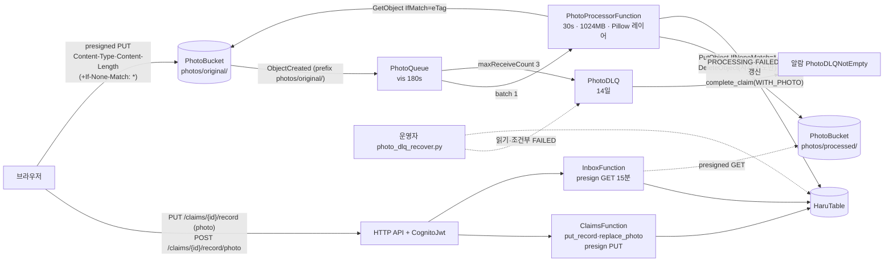
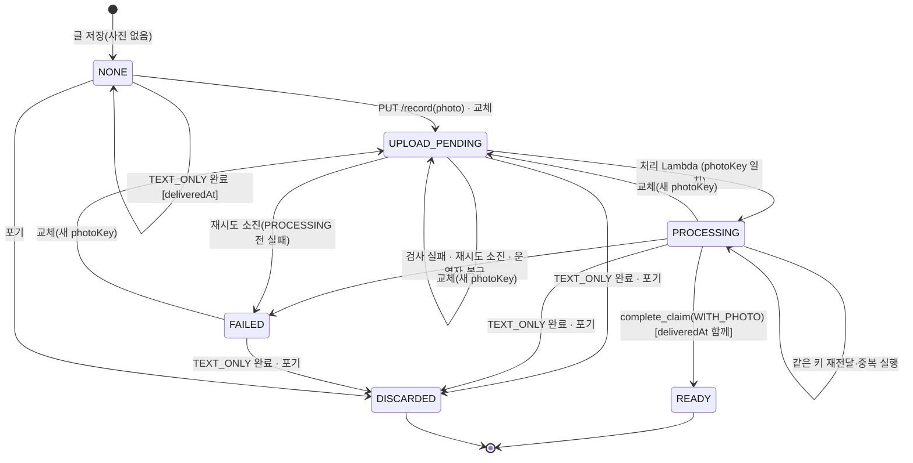

# Design Document: backend-stage5-photo-pipeline

## Overview

백엔드 5단계(사진 파이프라인)를 1–4단계(4단계는 묶음 A) 코드 위에 더한다. 근거는 같은 폴더의 `requirements.md`(승인됨), `docs/02-architecture.md` §2.4–§2.9, `docs/03-api-contract.md` §3.4–§3.6, `docs/06-requirements.md`, `docs/07-development-plan.md` §7.3·§7.5·§7.6이다.

설계 원칙
- 3단계 트랜잭션(`claim_plan`, `abandon`, `complete_claim`, `complete_by_user`)과 `common/ddb.py`의 `transact_with_retry`는 한 줄도 바꾸지 않는다. `put_record`는 Record Update 식에 사진 분기만 더한다(Requirement 15.3).
- API 계약(docs/03)과 DynamoDB 키 설계(docs/02 §2.6)는 바꾸지 않는다. 계약 변경이 필요한 결정(BE-Q65 조건부 업로드)은 기능 스위치로 꺼 둔 채 구현하고, 프론트엔드 승인 뒤 켠다.
- 사진의 "정확히 한 번 전달"은 새 장치를 만들지 않고 3단계 완료 트랜잭션에 맡긴다. 처리 Lambda는 그 앞뒤에서 (1) 처리해도 되는지 걸러내고 (2) 처리 결과를 확인해 자기 처리본만 정리한다.
- 처리본 삭제는 "이 시도의 처리본이 전달되지 않았음이 확실할 때"만 한다. 불확실하면 남긴다. 남은 고아 객체의 자동 정리는 이번 단계 밖이다(BE-Q67).
- 판단은 저장 상태(`ConsistentRead`)로 한다. 메시지 순서·중복·지연에 기대지 않는다.

### 요구사항 매핑

| 영역 | requirements.md | 이 문서 |
|---|---|---|
| 버킷·접근 정책 | Req 1 | "S3 객체 규칙", "SAM 리소스" |
| 업로드 URL·교체 | Req 2, 3 | "API 처리", "DynamoDB 조건식" |
| 알림·큐·DLQ | Req 4 | "SAM 리소스" |
| 처리 Lambda | Req 5–9 | "처리 Lambda 알고리즘", "상태 전이", "경합 시퀀스", "오류 분류" |
| 수신함 사진 | Req 10 | "API 처리" |
| IAM | Req 11 | "IAM" |
| 지표·알람 | Req 12 | "관측" |
| 로컬 | Req 13 | "로컬 환경과 Floci" |
| 테스트 | Req 14 | "Testing Strategy" |
| 계약·정합성·인계 | Req 15 | "불변식", "프론트엔드 승인 필요 사항" |

### 이번 설계의 권장 결정 (사용자 승인 반영)

| # | 결정 |
|---|---|
| BE-Q65 | presigned PUT에 `IfNoneMatch="*"`를 서명한다. 계약(`upload.headers`)에 헤더가 늘므로 **프론트 승인 전에는 스위치 `UploadIfNoneMatch=false`(기본)로 끈다.** 켜면 `upload.headers`에 `If-None-Match: *`, 버킷 CORS 허용 헤더, 버킷 정책(헤더 없는 원본 PUT 거부)이 함께 켜진다. 처리 Lambda의 ETag `IfMatch` 검사는 스위치와 무관하게 늘 한다 |
| BE-Q66 | `complete_claim`은 바꾸지 않는다. `READY`는 완료 트랜잭션이 `deliveredAt`과 함께만 쓴다. `READY`·미전달은 처리하지 않고 경고 로그(`unexpected_ready`)와 운영 확인 대상으로 둔다 |
| BE-Q67 | 처리 시도마다 고유 `attemptUuid`. "확실히 전달 안 됨"일 때만 그 시도의 처리본을 지운다. 불확실하면 남긴다. `photos/processed/`에 일괄 만료를 두지 않는다. 자동 고아 정리는 운영 개선 과제 |
| BE-Q68 | DLQ 처리 Lambda를 두지 않는다. 운영자 복구 스크립트(`backend/scripts/photo_dlq_recover.py`, 기본 dry-run)와 런북을 둔다. 복구 쓰기 조건: `photoKey` 일치, 미전달, `photoStatus = PROCESSING` |
| BE-Q69 | `FAULT_INJECT=photo-slow`(dev 전용): `PROCESSING` 전환 직후 5초(기본, `FAULT_DELAY_S`) 지연. T10·T15는 `PROCESSING`을 관측한 뒤 경쟁 요청을 보낸다. 관측 실패는 미검증으로 기록하고 재시험 |
| 시간·자원 | Lambda 30초·1024MB, 가시성 180초, batch 1, maxReceiveCount 3 유지. 처리 Lambda 한정 SDK 설정 connect 2초·read 5초·총 시도 2회, 종료 전 여유 5초(초기값, 측정으로 조정). BE-Q48 공통 설정은 건드리지 않는다 |

### 설계 전 확인한 사실 (2026-11-25)

| 항목 | 확인 방법 | 결과 |
|---|---|---|
| presigned PUT 서명 헤더 | botocore 1.44.11 `generate_presigned_url("put_object", ContentType, ContentLength[, IfNoneMatch])` | 서명 헤더 `content-length;content-type;host`, `IfNoneMatch`를 넣으면 `;if-none-match`가 더해진다. 쿼리로 올라가지 않으므로 브라우저가 같은 헤더를 보내야 한다(빠지면 서명 불일치 403) |
| S3 조건부 쓰기 | [AWS 문서 Conditional writes](https://docs.aws.amazon.com/AmazonS3/latest/userguide/conditional-writes.html) | `If-None-Match: *`는 같은 키가 있으면 412, 동시 쓰기는 먼저 끝난 쪽만 성공. 버킷 정책 조건 키 `s3:if-none-match`로 강제할 수 있다([Enforce](https://docs.aws.amazon.com/AmazonS3/latest/userguide/conditional-writes-enforce.html)) |
| 이벤트의 ETag | [이벤트 구조](https://docs.aws.amazon.com/AmazonS3/latest/userguide/notification-content-structure.html) | `s3.object.eTag`(따옴표 없음), 키는 URL 인코딩(`unquote_plus`), 테스트 메시지는 `Records` 없이 `"Event": "s3:TestEvent"` |
| Floci 2.5.0-compat (서명 검사 끔, 지금 compose) | 임시 버킷·큐로 프로브 후 삭제 | 버킷 알림(prefix 필터, `s3:TestEvent` 포함, `eTag` 있음) 동작, 수명 주기·CORS 설정 수락, presigned `If-None-Match` 재업로드 412, SDK `IfNoneMatch` 412, `GetObject IfMatch`(따옴표 유무 모두) 200/412, **잘못된 `Content-Length` 업로드는 200(서명 검사 꺼짐)** |
| Floci (`FLOCI_AUTH_VALIDATE_SIGNATURES=true`) | 임시 컨테이너(포트 4577)로 같은 프로브 후 중지 | 잘못된 `Content-Length` 업로드 403, 나머지 같음 |
| Pillow | Pillow 13.0.0, 약 40MP(7700×5194) 처리의 최대 RSS(생성 이미지 포함) | JPEG 전체 디코딩 325MB, JPEG `draft` 사용 173MB, PNG 324MB. 1024MB의 70%(717MB) 안. 실제 테스트는 Req 14.1대로 별도 프로세스로 다시 잰다 |
| 프론트 현재 코드(읽기만) | `frontend/src` | S3 업로드 코드는 아직 없다(프론트 5단계). `types.ts`의 `upload.headers`는 `{ [name: string]: string }` 맵 |

Floci 결과는 BE-Q64의 "실제 로컬 구동 결과로 판단"의 첫 근거다. 구현 때 compose 환경 그대로 다시 확인하고 README §5에 적는다(아래 "로컬 환경과 Floci").

## Architecture



- 원본(`photos/original/`)은 실행자가 presigned PUT으로만 쓴다. 처리본(`photos/processed/`)은 처리 Lambda만 쓰고 지운다. 알림은 `photos/original/`만 대상이라 처리본이 처리를 다시 부르지 않는다.
- Record의 사진 상태는 세 주체가 바꾼다: ClaimsFunction(업로드 URL 발급·교체 → `UPLOAD_PENDING`, 3단계 완료·포기 → `DISCARDED`/`NONE`), 처리 Lambda(`PROCESSING`·`FAILED`, 완료 트랜잭션으로 `READY`), 운영자 복구(`PROCESSING` → `FAILED`). 모두 조건부 쓰기다.

### 배포 단위

| 리소스 | 변경 |
|---|---|
| `ClaimsFunction` | 이벤트 `ReplacePhoto`(POST `/claims/{claimId}/record/photo`) 추가, `s3:PutObject`(`photos/original/*`) 추가, 환경 변수 `PHOTO_BUCKET`, `PUBLIC_S3_ENDPOINT`(빈 값), `PHOTO_UPLOAD_IF_NONE_MATCH` |
| `InboxFunction` | `s3:GetObject`(`photos/processed/*`) 추가, 환경 변수 `PHOTO_BUCKET`, `PUBLIC_S3_ENDPOINT` |
| `PhotoProcessorFunction`(신규) | SQS 이벤트, Pillow 레이어, 30s·1024MB·x86_64 |
| `PillowLayer`(신규) | `layers/pillow/`, `BuildMethod: python3.12`, x86_64 |
| `PhotoBucket`, `PhotoBucketPolicy`, `PhotoQueue`, `PhotoDLQ`, `PhotoQueuePolicy`, `PhotoDLQNotEmpty` 알람(신규) | 아래 "SAM 리소스" |
| `MeFunction`, `PlansFunction`, `PreSignUpFunction` | 변경 없음 |
| 묶음 B의 `GET /claims/{claimId}/record` | 이 브랜치에 없다. 없어도 이 설계는 동작한다("4단계 묶음 B 의존") |

## Components and Interfaces

### 파일 구성

```
backend/
  template.yaml                          # 버킷·큐·DLQ·알람·레이어·PhotoProcessorFunction, Parameters Stage/FaultInject/UploadIfNoneMatch, Rules
  samconfig.toml                         # dev: Stage=dev, demo: Stage=demo (FaultInject는 넣지 않는다)
  layers/pillow/requirements.txt         # Pillow==13.0.0 (sam build --use-container)
  src/
    common/
      s3.py                  (신규)      # photo_bucket(), presign_put(), presign_get(), 키 생성·해석, ETag 정규화
      metrics.py             (수정)      # emit(name, value, unit="Count") — 기존 3종 출력은 그대로
      validation.py          (수정)      # PhotoIn(contentType, size), RecordPut.photo: PhotoIn | None, PhotoRequest
      ddb.py                 (추가만)    # use_table(table): 처리 Lambda가 자기 설정의 리소스를 꽂는다
      responses.py           (수정)      # serialize_inbox_record(record, plan, has_photo, photo_url)
    domain/
      claim_service.py       (추가·수정) # put_record에 photo 분기, replace_photo 신규, photo_status_update 헬퍼
      inbox_service.py       (변경 없음)
      photo_image.py         (신규)      # 순수 함수 process_image(bytes) -> ProcessedImage | raise PhotoRejected(code)
    handlers/
      claims.py              (수정)      # _put_record photo 처리(BE-Q34 해제), _replace_photo 신규
      inbox.py               (수정)      # _detail이 photoUrl·photoCaption을 채운다
      routes.py              (수정)      # "POST /claims/{claimId}/record/photo"
    workers/
      __init__.py            (신규)
      photo_processor.py     (신규)      # SQS 핸들러: 해석 → 무시 조건 → PROCESSING → 검사·처리 → 완료 → 확인·정리
  scripts/
    photo_dlq_recover.py     (신규)      # 운영자 복구(기본 dry-run)
  local/
    init/01_haru.py          (수정)      # 버킷·CORS·수명 주기·DLQ·큐·알림
    adapter/app.py           (수정)      # SQS 폴러 스레드
    adapter/requirements.txt (수정)      # Pillow==13.0.0
  docker-compose.yml         (수정)      # FLOCI_AUTH_VALIDATE_SIGNATURES, PHOTO_*, PUBLIC_S3_ENDPOINT
  tests/
    unit/test_photo_image.py, test_photo_processor.py, test_photo_properties.py, test_photo_api.py,
         test_photo_memory.py(slow), test_photo_dlq_recover.py   (신규)
    unit/test_template.py, test_handlers_inbox.py, test_validation.py, test_errors.py, test_integration_cleanup.py (수정)
    local/test_local_photo.py            (신규)
    integration/test_photo.py            (신규), conftest.py (사진 prefix 정리 추가)
```

`src/requirements.txt`에는 Pillow를 넣지 않는다. 처리 Lambda만 레이어로 받는다(`test_no_stage3_dependencies` 유지).

### `common/s3.py`

```python
ORIGINAL_PREFIX = "photos/original/"
PROCESSED_PREFIX = "photos/processed/"
EXT = {"image/jpeg": "jpg", "image/png": "png"}
_ORIGINAL_RE = re.compile(r"^photos/original/(clm_[0-9A-Z]{26})/([0-9a-f]{32})\.(jpg|png)$")

def photo_bucket() -> str                                   # os.environ["PHOTO_BUCKET"]
def new_original_key(claim_id, content_type) -> str         # photos/original/{claimId}/{uuid4().hex}.{ext}
def parse_original_key(key) -> tuple[str, str] | None       # (claimId, uuid) 또는 None (BE-Q54)
def new_processed_key(claim_id) -> str                      # photos/processed/{claimId}/{uuid4().hex}.jpg (attemptUuid)
def quote_etag(etag) -> str                                 # 'abc' -> '"abc"'. 이미 따옴표면 그대로
def presign_put(key, content_type, size, now) -> dict       # Upload_Descriptor
def presign_get(key, expires=900) -> str
```

- presign 전용 클라이언트: `boto3.client("s3", endpoint_url=PUBLIC_S3_ENDPOINT or None, config=Config(signature_version="s3v4", s3={"addressing_style": "path" if PUBLIC_S3_ENDPOINT else "virtual"}))`. 서버 측 S3 호출(처리 Lambda)은 `AWS_ENDPOINT_URL`을 따르는 별도 클라이언트다(로컬에서 서버는 `http://aws:4566`, 브라우저는 `http://localhost:4566`).
- `presign_put`:
  ```python
  params = {"Bucket": photo_bucket(), "Key": key, "ContentType": content_type, "ContentLength": size}
  headers = {"Content-Type": content_type}
  if upload_if_none_match():                       # PHOTO_UPLOAD_IF_NONE_MATCH == "true" (BE-Q65 스위치)
      params["IfNoneMatch"] = "*"; headers["If-None-Match"] = "*"
  url = _presign_client().generate_presigned_url("put_object", Params=params, ExpiresIn=600)
  return {"url": url, "method": "PUT", "headers": headers, "expiresAt": iso_utc(now + timedelta(seconds=600))}
  ```
  `Content-Length`는 서명되지만 `headers`에 넣지 않는다. 브라우저가 본문 길이로 자동으로 보내고 스크립트로 정할 수 없는 헤더라서다(계약 예시와 같다).
- presigned URL은 Lambda 실행 역할의 임시 자격 증명으로 서명되므로 실제 유효 시간은 `min(10분, 세션 남은 시간)`이다. Lambda는 자격 증명을 미리 갱신하므로 보통 10분이 지켜지지만 보장은 아니다. 업로드가 403으로 실패하면 프론트는 교체 API로 새 URL을 받는다(아래 "프론트엔드 승인 필요 사항").

### `common/validation.py`

```python
class PhotoIn(BaseModel):          # PUT /record의 photo, POST /record/photo 본문 공용 (docs/02 §2.10의 PhotoRequest)
    model_config = _STRICT
    contentType: Literal["image/jpeg", "image/png"]
    size: Annotated[int, Field(ge=1, le=10_485_760)]       # strict라 True/1.5/"10"을 거부 (BE-Q50)

PhotoRequest = PhotoIn

class RecordPut(BaseModel):        # 3단계 모델에 photo만 더한다
    model_config = _STRICT
    letter: Annotated[str, Field(min_length=1, max_length=1000)]
    photo: PhotoIn | None = None
```
`details` 경로: `PUT /record`는 `photo.contentType`·`photo.size`·`photo`, `POST /record/photo`는 `contentType`·`size`·`body`(4단계 `to_details` 규칙 그대로). 메시지는 `_FIELD_MESSAGES`에 `contentType`("image/jpeg 또는 image/png여야 해요."), `size`("1–10,485,760바이트여야 해요.")를 더한다.

### `common/metrics.py`

```python
def emf_line(name, value=1, timestamp_ms=None, unit="Count") -> str
def emit(name, value=1, unit="Count") -> None
PHOTO_PROCESSING_MS = "PhotoProcessingMs"   # unit="Milliseconds"
PHOTO_FAILED = "PhotoFailed"                # unit="Count"
```
기존 호출(`emit(CLAIM_CONFLICT)` 등)과 `test_emf_line_format`의 출력은 그대로다(BE-Q37).

### `common/ddb.py` (추가만)

```python
def use_table(t: Any) -> None:
    """이 실행 환경의 HaruTable 리소스를 바꾼다. 처리 Lambda가 자기 SDK 설정(짧은 타임아웃)의 리소스를 꽂을 때만 쓴다."""
    global _table
    _table = t
```
`table()`, `transact_with_retry`, `ConditionFailed`, `_cancellation_codes`, `BACKOFF_SECONDS`는 바꾸지 않는다. 다른 함수는 `use_table`을 부르지 않으므로 기본 SDK 설정 그대로다(BE-Q48 미결 유지).

### `domain/photo_image.py` (순수 함수, Requirement 7)

```python
MAX_BYTES = 10_485_760
MAX_PIXELS = 40_000_000
LONG_EDGE = 1600
JPEG_QUALITY = 85

class PhotoRejected(Exception):
    code: str   # UNSUPPORTED_FORMAT | TOO_LARGE | TOO_MANY_PIXELS | CORRUPT_IMAGE

@dataclass(frozen=True)
class ProcessedImage:
    data: bytes; width: int; height: int; source_format: str   # "JPEG" | "PNG"

def sniff_format(head: bytes) -> str          # 매직 바이트. JPEG FF D8 FF, PNG 89 50 4E 47 0D 0A 1A 0A, 아니면 PhotoRejected(UNSUPPORTED_FORMAT)
def process_image(data: bytes) -> ProcessedImage
```

`process_image` 절차
1. `len(data) > MAX_BYTES` → `TOO_LARGE`(처리 Lambda가 HeadObject로 먼저 걸러도 순수 함수에서 다시 확인).
2. `sniff_format(data[:8])`.
3. `with warnings.catch_warnings(): warnings.simplefilter("error", Image.DecompressionBombWarning)` 안에서, 그리고 `Image.MAX_IMAGE_PIXELS`를 `MAX_PIXELS`로 잠시 바꾼 상태(`try/finally`로 원래 값 복원, 모듈 전역 값을 영구히 바꾸지 않는다)에서:
   - `im = Image.open(BytesIO(data))`. 실제 포맷이 `sniff_format`과 다르면 `UNSUPPORTED_FORMAT`.
   - `w*h > MAX_PIXELS` → `TOO_MANY_PIXELS`(헤더만 읽은 상태라 디코딩 전이다).
   - JPEG이면 `im.draft("RGB", (LONG_EDGE, LONG_EDGE))`로 DCT 축소 디코딩(메모리 절반, 위 측정). 이 호출은 긴 변이 `LONG_EDGE` 이상으로 남는 배율만 고른다.
   - `im.load()`. `DecompressionBombWarning`(오류로 바뀜)·`DecompressionBombError` → `TOO_MANY_PIXELS`. `OSError`, `SyntaxError`, `ValueError`, `Image.UnidentifiedImageError`, 잘린 파일 → `CORRUPT_IMAGE`.
4. `im = ImageOps.exif_transpose(im)`(Orientation 반영. 결과 이미지에는 EXIF가 붙지 않도록 아래 6에서 픽셀만 옮긴다).
5. 모드 정리: `RGBA`·`LA`·투명도 있는 `P` → 흰 배경(`(255,255,255)`)에 알파 합성 후 `RGB`. 그 밖(`L`, `P`, `CMYK`, `I;16` 등) → `convert("RGB")`.
6. 긴 변이 1600 초과면 `im.thumbnail((1600,1600), Image.Resampling.LANCZOS)`(비율 유지). 이하면 그대로.
7. 메타데이터 제거: `clean = Image.new("RGB", im.size); clean.paste(im)`로 픽셀만 새 이미지에 옮긴다. `clean.save(out, "JPEG", quality=85, optimize=True)`에 `exif`·`icc_profile`·`comment`를 넘기지 않는다. `clean.info`는 비어 있다. 결과 JPEG에는 APP1(EXIF/XMP)·APP2(ICC)·APP13(IPTC)·COM 세그먼트가 없다(Pillow는 JFIF APP0만 쓴다).
8. `ProcessedImage(data, *clean.size, source_format)`.

이 함수는 S3·DynamoDB·환경 변수를 모른다. 전역 경고 필터와 `MAX_IMAGE_PIXELS`는 함수가 끝나면 원래대로다.

### `domain/claim_service.py`

`put_record(claim_id, user, letter, now=None) -> record`(3단계 시그니처·반환 그대로)와 `put_record_with_photo(claim_id, user, letter, photo, now=None) -> (record, upload)`(신규). 둘은 내부 함수 `_write_record` 하나를 같이 쓴다.
- 3단계 호출부(위치 인자 `now`, dict 반환)를 깨지 않으려고 기존 함수의 시그니처를 바꾸지 않고 사진용 함수를 따로 둔다(구현 중 결정). 사진 없는 경로는 3단계와 같은 Update 식이다.
- `photo`가 있으면 Original_Key를 만들고 Record Update만 바꾼다(아래 "DynamoDB 조건식"). Plan·Claim ConditionCheck와 `attribute_not_exists(deliveredAt)`, 실패 분기(`ConditionFailed` → `_stale()`)는 3단계 그대로다.
- Transaction 성공 → Record `ConsistentRead` 재조회 → `presign_put(...)`. Transaction이 실패하면 presign을 부르지 않는다(Requirement 2.4).
- 3단계 호출부와 테스트는 고치지 않는다(시그니처·반환 불변).

`replace_photo(claim_id, user, photo, now=None) -> upload` (신규)
```python
lookup = _lookup(claim_id, user)                 # 404 / 403
key = new_original_key(claim_id, photo.contentType)
items = [plan_cc(plan_id, claim_id), claim_cc(plan_id, claim_id), record_photo_update(plan_id, claim_id, key, require_exists=True)]
try:
    ddb.transact_with_retry(items)
except ddb.ConditionFailed:
    plan = _get(PLAN); claim = _get(CLAIM); record = _get(RECORD)      # ConsistentRead
    if not (plan and plan.status == CLAIMED and plan.currentClaimId == claim_id and claim and claim.status == ACTIVE):
        raise _stale()                                                  # 409 CLAIM_NOT_ACTIVE + StaleRequestRejected
    if record is None:
        raise ApiError(RECORD_REQUIRED)                                 # 400 (BE-Q52)
    raise _stale()                                                      # 전달된 Record (deliveredAt 있음)
return presign_put(key, photo.contentType, photo.size, now)
```
- 판정 순서는 "이어받기가 끝났는가(409)"가 "기록이 없는가(400)"보다 먼저다. 끝난 이어받기에 기록이 없는 경우도 409다.
- `plan_cc`·`claim_cc`는 `put_record`가 쓰는 두 ConditionCheck와 같은 식이다. 중복을 줄이려 `put_record`에서 두 항목 생성 부분만 비공개 헬퍼로 뽑는다(식은 그대로, diff로 확인).
- 재시도 소진(503 `TRY_AGAIN`)은 `transact_with_retry`가 그대로 올린다.

`photo_status_update(plan_id, claim_id, *, key, to, allowed_from, error=None) -> bool` (신규, 처리 Lambda·복구 스크립트 공용)
- 단건 조건부 `UpdateItem`. 조건 실패면 `False`, 성공이면 `True`. 그 밖의 오류는 그대로 올린다.

### `handlers/claims.py`

```python
def _put_record(event):
    user = get_user(event)
    claim_id = path_param(event, "claimId")
    data = RecordPut.model_validate(json_body(event))       # photo 포함. BE-Q34의 400 분기를 지운다
    record, upload = claim_service.put_record(claim_id, user, data.letter, data.photo)
    return ok(200, {"record": serialize_record(record), "upload": upload})

def _replace_photo(event):
    user = get_user(event)
    claim_id = path_param(event, "claimId")
    data = PhotoRequest.model_validate(json_body(event))
    return ok(200, {"upload": claim_service.replace_photo(claim_id, user, data)})   # BE-Q51 { upload }

ROUTES["POST /claims/{claimId}/record/photo"] = _replace_photo
```
`POST /record/photo`의 성공 상태는 200이다(docs/03 §3.4에 별도 상태가 없고 "응답은 위와 같은 `upload`"이므로 `PUT /record`와 같은 200).

### `handlers/inbox.py`와 `responses.serialize_inbox_record`

```python
def serialize_inbox_record(record, *, photo_url=None, caption=None):
    return {"letter": record.get("letter"), "deliveredAt": record.get("deliveredAt"), "photoUrl": photo_url, "photoCaption": caption}

def _detail(event):   # 4단계 권한 검사(get_detail의 404)는 그대로 먼저 한다
    ...
    photo_url = caption = None
    if bool(item.get("hasPhoto")) and record.get("processedKey"):
        photo_url = presign_get(record["processedKey"], 900)
        last = (plan.get("places") or [{}])[-1]
        caption = f"{last['name']}에서" if last.get("name") else None
    elif item.get("hasPhoto"):
        _log.warning("inbox_photo_missing")                  # BE-Q60, 사유 코드만
    return ok(200, {..., "record": serialize_inbox_record(record, photo_url=photo_url, caption=caption)})
```
- presigned GET은 `get_detail`이 소유자 확인을 끝낸 뒤에만 만든다(Requirement 10.5). 처리본 키는 응답에 직접 나가지 않고 서명된 URL로만 나간다.
- `photoCaption`은 Requirement 10.2대로 `places` 배열의 마지막 원소 이름 + "에서"다.

## Data Models

### Record 사진 속성 (docs/02 §2.5, 키 변경 없음)

| 속성 | 쓰는 곳 | 의미 |
|---|---|---|
| `photoStatus` | 업로드 URL·교체(`UPLOAD_PENDING`), 처리 Lambda(`PROCESSING`·`FAILED`), 완료 트랜잭션(`READY`·`NONE`·`DISCARDED`), 포기(`DISCARDED`), 복구 스크립트(`FAILED`) | 사진 처리 상태 |
| `photoKey` | 업로드 URL·교체 | Current_Photo의 Original_Key |
| `processedKey` | 완료 트랜잭션(`WITH_PHOTO`)만 쓴다. 업로드 URL·교체가 `REMOVE` | 전달된 처리본(Delivered_Processed_Key). 미전달 상태에서는 없다 |
| `photoError` | 처리 Lambda·복구 스크립트가 쓴다. 업로드 URL·교체가 `REMOVE` | 사유 코드 5종(BE-Q55). 응답에 나가지 않는다 |
| `deliveredAt` | 완료 트랜잭션만 | 전달 시각 |

`processedKey`를 완료 트랜잭션만 쓰게 한 것이 중요하다. 처리 Lambda는 처리본 키를 Record에 미리 적지 않으므로, Record에 `processedKey`가 있으면 그것은 항상 전달된 처리본이다(`processedKey` 있음 ⇔ `READY` ⇔ 사진 전달). 그래서 "Record가 가리키지 않는 처리본"을 고아로 판정할 수 있다.

### DynamoDB 조건식

모든 분기용 재조회는 `ConsistentRead=True`다. Plan CC, Claim CC는 3단계 `put_record`의 두 ConditionCheck와 같다.

| 작업 | 형태 | 조건 | 갱신 |
|---|---|---|---|
| 글 저장(사진 없음, 3단계 그대로) | Transaction: Plan CC + Claim CC + Record Update | Plan `currentClaimId = :cid AND status = CLAIMED`, Claim `status = ACTIVE`, Record `attribute_not_exists(deliveredAt)` | `SET letter, updatedAt, claimId, planId, authorId, photoStatus = if_not_exists(photoStatus, :none)` |
| 글 저장 + 사진(Req 2) | 같은 Transaction | 같음 | `SET letter, updatedAt, claimId, planId, authorId, photoKey = :key, photoStatus = :pending REMOVE processedKey, photoError` |
| 사진 교체(Req 3) | Transaction: Plan CC + Claim CC + Record Update | 위 Plan·Claim 조건, Record `attribute_exists(PK) AND attribute_not_exists(deliveredAt)` | `SET photoKey = :key, photoStatus = :pending REMOVE processedKey, photoError` (`letter`·`updatedAt` 등은 건드리지 않는다) |
| `PROCESSING` 전환(Req 6.1) | 단건 UpdateItem | `photoKey = :key AND photoStatus IN (:upload_pending, :processing) AND attribute_not_exists(deliveredAt)` | `SET photoStatus = :processing` |
| 검사 실패 `FAILED`(Req 6.3) | 단건 UpdateItem | `photoKey = :key AND photoStatus = :processing AND attribute_not_exists(deliveredAt)` | `SET photoStatus = :failed, photoError = :code` |
| 재시도 소진 `FAILED`(Req 9.2) | 단건 UpdateItem | `photoKey = :key AND photoStatus IN (:upload_pending, :processing) AND attribute_not_exists(deliveredAt)` | `SET photoStatus = :failed, photoError = :retry_exhausted` |
| 운영자 복구(BE-Q68) | 단건 UpdateItem | `photoKey = :key AND photoStatus = :processing AND attribute_not_exists(deliveredAt)` | `SET photoStatus = :failed, photoError = :retry_exhausted` |
| 완료 `WITH_PHOTO`(3단계 그대로) | Transaction 4항목 | Plan·Claim 3단계 조건, Record `attribute_exists(letter) AND attribute_not_exists(deliveredAt) AND photoStatus = :prev AND photoKey = :key`(트랜잭션 전 `prev = PROCESSING` 확인) | Record `SET deliveredAt, photoStatus = READY, processedKey`, InboxItem Put `hasPhoto = true` |
| 완료 `TEXT_ONLY`(3단계 그대로) | Transaction 4항목 | 3단계 그대로 | `photoStatus`: 없음/`NONE` → `NONE`, 그 밖 → `DISCARDED` |
| 포기(3단계 그대로) | Transaction | 3단계 그대로 | Record가 있으면 `photoStatus = DISCARDED` |

- 업로드 URL·교체의 Record Update는 `photoStatus`가 무엇이든 덮는다(`FAILED`·`PROCESSING`도 교체 가능, Req 3.3). 전달된 Record와 끝난 이어받기는 조건에서 거부된다.
- `REMOVE processedKey`는 미전달 Record에는 원래 `processedKey`가 없으므로(위 성질) 방어 목적이다. 요구사항 3.1의 "이전 처리본 참조를 남기지 않는다"를 식으로 보장한다.
- 3단계 완료 트랜잭션의 Record 조건(BE-Q40 방어 조건 포함)은 바꾸지 않는다. `WITH_PHOTO`의 키·상태 불일치는 트랜잭션 전 검사에서 409 `CLAIM_NOT_ACTIVE`, 트랜잭션 중 바뀌면 조건 실패 → 재조회 → 3단계 분기다.

### S3 객체 생성·보존·삭제 규칙

| 객체 | 만드는 주체·방식 | 보존 | 지우는 주체·조건 |
|---|---|---|---|
| 원본 `photos/original/{claimId}/{uuid}.{ext}` | 브라우저, presigned PUT(서명: `Content-Type`, `Content-Length`, 스위치가 켜지면 `If-None-Match: *`) | 수명 주기 7일 만료 | 수명 주기만. API·처리 Lambda는 원본을 지우지 않는다(교체·포기·완료 모두) |
| 처리본 `photos/processed/{claimId}/{attemptUuid}.jpg` | 처리 Lambda, `PutObject(IfNoneMatch="*", ContentType="image/jpeg")` | 만료 없음. 전달된 처리본은 수신함에서 계속 보인다 | 처리 Lambda가 **이 시도에서 만든 키만**, "확실히 전달 안 됨"일 때(아래). 테스트 정리(Claim prefix). 그 밖에는 지우지 않는다 |
| 고아 처리본 | (불확실 뒤 재시도, 강제 종료, 진 시도의 삭제 실패) | 남는다 | 이번 단계에서 자동 정리하지 않는다(BE-Q67). 운영자 확인 절차만 README에 둔다 |

처리 Lambda의 삭제 판정(Requirement 8.2–8.5)

```python
def settle(attempt_key, rec_after, claim_after) -> "delivered" | "not_delivered" | "uncertain":
    if rec_after is None or claim_after is None:            # 읽기 실패는 예외로 올라오고 여기 오지 않는다
        return "uncertain"
    if rec_after.get("deliveredAt"):
        return "delivered" if rec_after.get("processedKey") == attempt_key else "not_delivered"
    if rec_after.get("photoKey") != original_key or rec_after.get("photoStatus") == "DISCARDED":
        return "not_delivered"
    if claim_after.get("status") in ("ABANDONED", "EXPIRED"):
        return "not_delivered"
    return "uncertain"                                       # 아직 PROCESSING·미전달: 커밋 여부를 알 수 없다
```
**삭제 허용 조건 (모두 만족할 때만 지운다)**
1. 이 실행이 만든 객체다: 이 실행의 `PutObject(attempt_key, IfNoneMatch="*")`가 **200으로 끝났다**(`created = True`). `PutObject`가 412를 돌려주면 그 키에 이미 다른 객체가 있다는 뜻이므로 자기 객체로 보지 않고 절대 지우지 않는다(새 `attemptUuid`로 1회 다시 만들고, 그것도 412면 예외). `PutObject`가 타임아웃·연결 오류로 끝나 생성 여부를 모르면 `created = False`로 두고 지우지 않으며 `complete_claim`도 부르지 않는다(예외 → 재시도).
2. 미전달이 확정됐다: `settle(...) == "not_delivered"`. 또는 `complete_claim`을 아예 부르지 않았다(검사 실패는 처리본을 만들기 전이므로 해당 없음. 남은 시간 부족으로 완료를 시작하지 않은 경우만 해당).

**보존하는 경우 (지우지 않는다)**
- 완료 결과 불확실(`complete_claim`의 503 `TRY_AGAIN`, 연결·읽기 타임아웃 등), 확인 재조회 실패, 재조회 결과가 여전히 `PROCESSING`·미전달(`uncertain`), 생성 여부를 모르는 처리본, 다른 실행이 만든 처리본, Record `processedKey`가 가리키는 처리본.
- 보존한 처리본이 끝내 전달되지 않으면 고아로 남는다(BE-Q67, 수신함에는 보이지 않음).
- 삭제(`DeleteObject`) 자체가 실패하면 예외로 올리지 않고 로그(`photo_cleanup_failed`)만 남긴다. 이미 판정이 끝났으므로 메시지는 정상 종료하고, 그 처리본은 고아가 된다.

### 사진 상태 전이



- `READY`는 완료 트랜잭션에서 `deliveredAt`·`processedKey`와 함께만 생긴다(BE-Q66). `READY`·미전달은 이 그림에 없는 상태이고, 처리 Lambda가 보면 처리하지 않고 경고 로그 `photo_unexpected_ready`를 남긴다. README 운영 확인 목록에 "이 로그가 1건이라도 있으면 Record를 확인한다"를 적는다.
- `DISCARDED`(포기·글로 완료)와 전달된 Record는 종료 상태다. 기한 지난 대체(`EXPIRED`)는 Record를 바꾸지 않으므로 Record는 그때 상태로 남지만 Claim이 `EXPIRED`라 완료 트랜잭션이 거부한다(3단계 동작).
- `FAILED`는 실행자 기준 종료가 아니다. 교체로 `UPLOAD_PENDING`, 글로 완료로 `DISCARDED`가 된다.

## 처리 Lambda 알고리즘 (`workers/photo_processor.py`)

### 콜드 스타트 초기화

```python
_CFG = Config(connect_timeout=env_float("PHOTO_SDK_CONNECT_TIMEOUT_S", 2),
              read_timeout=env_float("PHOTO_SDK_READ_TIMEOUT_S", 5),
              retries={"mode": "standard", "total_max_attempts": env_int("PHOTO_SDK_MAX_ATTEMPTS", 2)})
_s3 = boto3.client("s3", config=_CFG)                        # AWS_ENDPOINT_URL을 SDK가 읽는다(로컬)
ddb.use_table(boto3.resource("dynamodb", config=_CFG).Table(os.environ["TABLE_NAME"]))
```
- 이 설정은 이 함수의 실행 환경에만 적용된다. 3단계 `complete_claim`도 이 함수 안에서는 같은 짧은 설정의 리소스를 쓴다(코드 변경 없이 `ddb.table()`이 이 리소스를 돌려준다). 다른 함수는 기본 설정 그대로다(BE-Q48 미결).
- 재시도 모드는 `standard`, `total_max_attempts = 2`(첫 시도 포함 2회)다. SDK 자체 재시도(스로틀링·5xx·연결 오류)를 1회로 줄인다. `TransactionCanceledException`은 SDK가 재시도하지 않으므로 `transact_with_retry`의 재시도(최대 3회)는 그대로다.
- **중첩 재시도**: 처리 Lambda 안에서 재시도는 세 겹이다. 3단계 코드는 바꾸지 않으므로 이 구조를 그대로 받아들인다.

  | 층 | 횟수 | 대상 |
  |---|---|---|
  | `complete_claim`의 다시 읽어 판정 루프 | 최대 4회(`MAX_ATTEMPTS = 3` + 1). 마지막(4번째) 반복은 조회만 하고 트랜잭션 없이 503 | `ConditionFailed`, 재시도 소진 503 |
  | `transact_with_retry` | 트랜잭션을 실행하는 반복(최대 3회)마다 최대 4회, 대기 50·100·200ms | `TransactionConflict` |
  | botocore | API 호출 1회당 최대 2회 | 스로틀링·5xx·연결 오류 |

  `complete_claim` 한 번의 최악 호출 수는 GetItem 16회(4회 반복 × Lookup·Claim·Plan·Record) + TransactWriteItems 12회(3회 반복 × 4) = **API 호출 28회**이고, 각 호출이 SDK 2회 시도까지 늘면 **56회**다. `transact_with_retry` 대기는 반복마다 최대 350ms, 합계 최대 1.05초다. 호출 1회가 최악(연결 2초 + 읽기 5초)으로 걸리는 경우가 겹치면 30초를 훨씬 넘는다. 정상 조건(같은 리전, 충돌 드묾)에서는 수백 ms다. 시간 guard는 `complete_claim`을 **시작할지**만 정하고 그 안의 재시도를 끊지 못한다. 이 위험은 BE-Q71에 남기고, 테스트로 호출 수 상한과 guard 동작을 고정하며(아래 Testing Strategy), AWS 판정에서 `Duration` 최대값을 기록한다. 강제 종료되면 S8(운영자·사용자 복구)로 다룬다.

### 핸들러

```python
def handler(event, context):
    for msg in event["Records"]:                              # BatchSize 1이라 보통 1개
        receive_count = int(msg["attributes"].get("ApproximateReceiveCount", "1"))
        body = _parse(msg["body"])                            # JSON 아님 → None
        if body is None or "Records" not in body or body.get("Event") == "s3:TestEvent":
            log("photo_ignored reason=not_s3_record"); continue
        for rec in body["Records"]:
            _process_record(rec, receive_count, context)       # 예외는 그대로 올라가 메시지 실패
```

`_process_record(rec, receive_count, context)`

```text
 0. key = unquote_plus(rec.s3.object.key); etag = rec.s3.object.eTag
    parsed = parse_original_key(key) → 없으면 ignored(bad_key)                                        [Req 5.4]
 1. lookup = GetItem CLAIM#{claimId}/META (CR) → 없으면 ignored(no_lookup)
    record = GetItem PLAN#{planId}/RECORD#{claimId} (CR) → 없으면 ignored(no_record)
    deliveredAt 있음 → ignored(delivered) / DISCARDED → ignored(discarded) / photoKey ≠ key → ignored(stale_key)
    READY 미전달 → warning(unexpected_ready), ignored                                                     [Req 5.6–5.7, BE-Q66]
 2. guard(context, need=PRE_READ_MS)                    # 남은 시간 부족 → TimeBudgetExceeded(재시도 대상)
    head = HeadObject(key, IfMatch=quote(etag))         # 412 → ignored(etag_changed), 404 → ignored(gone)   [Req 5.9]
    head.ContentLength > 10MB → (3에서 PROCESSING 뒤) FAILED TOO_LARGE
 3. PROCESSING 전환 (조건부)  실패 → ignored(state_changed)                                               [Req 6.1–6.2]
 4. FAULT_INJECT (허용된 경우만, 아래)  photo → raise FaultInjected / photo-slow → sleep(FAULT_DELAY_S)
    크기 초과면 FAILED(TOO_LARGE), 종료
 5. guard(context, need=PRE_PROCESS_MS)
    data = GetObject(key, IfMatch=quote(etag), Range 없이 최대 10MB+1바이트까지만 읽음)  412/404 → ignored
    try: img = process_image(data) except PhotoRejected as r: FAILED(r.code), PhotoFailed+1, 종료         [Req 7]
 6. guard(context, need=PRE_UPLOAD_MS)
    attempt_key = new_processed_key(claimId)
    PutObject(attempt_key, img.data, IfNoneMatch="*", ContentType="image/jpeg") → 200이면 created=True        [Req 7.5]
    (412 → 그 키에 남의 객체가 있음. 자기 객체가 아니므로 건드리지 않고 새 키로 1회 다시 시도, 그래도 412면 예외)
    (타임아웃·연결 오류 → 생성 여부 모름. created=False로 두고 예외. 완료를 부르지 않는다)
 7. guard(context, need=PRE_COMPLETE_MS)  부족하면 created인 attempt_key만 삭제(완료 미호출이라 확실히 미전달) 후 TimeBudgetExceeded
    try: complete_claim(claimId, "WITH_PHOTO", key=key, processed_key=attempt_key)
    except ApiError(CLAIM_NOT_ACTIVE | RECORD_REQUIRED | NOT_FOUND): pass          # 판정은 8에서
    except (ApiError(TRY_AGAIN), ClientError, BotoCoreError): outcome_unknown = True  (삭제하지 않음)
 8. rec_after, claim_after = ConsistentRead 재조회 (실패하면 예외 → uncertain, 삭제하지 않음)
    outcome = settle(attempt_key, rec_after, claim_after)
    delivered     → PhotoProcessingMs 기록, log(photo_delivered)
    not_delivered → created이면 DeleteObject(attempt_key), log(photo_not_delivered reason=…)
    uncertain     → raise PhotoOutcomeUncertain (재시도. 처리본은 남긴다)                               [Req 8.2–8.5]
    7에서 outcome_unknown이었는데 8이 delivered/not_delivered로 확정되면 그 결과를 따른다(재시도 불필요).
```

- 재시도 소진 처리(Req 9.2): 2–8에서 재시도 대상 예외(아래 "오류 분류")가 나고 `receive_count >= 3`이면, 예외를 올리기 전에 재시도 소진 `FAILED` 조건부 갱신을 시도하고 `PhotoFailed`를 남긴다. 이 갱신이 실패해도 원래 예외를 올린다.
- 무시·검사 실패·전달 확정은 모두 정상 반환이다(메시지 삭제).
- 로그는 결과 코드와 사유 코드만: `photo_ignored reason=…`, `photo_failed code=…`, `photo_delivered`, `photo_not_delivered reason=…`, `photo_retry reason=… receive=n`. 키·`claimId`·사용자 ID·URL을 남기지 않는다(BE-NFR-03). EMF는 `PhotoProcessingMs`(Milliseconds), `PhotoFailed`(Count).

### 시간 예산 (초기값, 측정으로 조정)

| 이름 | 초기값 | 쓰임 |
|---|---|---|
| Lambda Timeout | 30초 | 유지 |
| `PHOTO_RESERVE_MS` | 5,000 | 모든 guard에 더하는 종료 전 여유. 예외를 올리고 로그·지표를 남길 시간 |
| `PRE_READ_MS` | 7,000 | HeadObject(연결 2 + 읽기 5) |
| `PRE_PROCESS_MS` | 12,000 | GetObject 10MB + 디코딩·축소·인코딩(40MP JPEG, 1024MB에서 측정 전 추정) |
| `PRE_UPLOAD_MS` | 7,000 | PutObject 처리본(보통 1MB 미만) |
| `PRE_COMPLETE_MS` | 10,000 | `complete_claim`(조회 4회 + 트랜잭션, 충돌 재시도 대기 최대 350ms) + 확인 재조회 2회 |

- `guard(context, need)`: `context.get_remaining_time_in_millis() < need + PHOTO_RESERVE_MS`이면 그 단계를 시작하지 않고 `TimeBudgetExceeded`(재시도 대상)를 올린다.
- 값은 환경 변수로 두어 배포 파라미터 없이 템플릿 환경 변수만 바꿔 조정한다. 측정 근거: AWS 판정 실행의 `PhotoProcessingMs`와 Lambda `Duration` 최대값, 단위 테스트의 40MP 처리 시간.
- **보장하지 못하는 것**: SDK 호출 1회의 최악 시간은 `total_max_attempts × (connect + read)` = 14초이고, `complete_claim`은 위 중첩 재시도로 그런 호출을 최대 28회(SDK 시도로는 56회) 한다. guard는 "시작 시점에 여유가 있는가"만 보므로 단계 도중의 지연으로 30초를 넘는 강제 종료를 완전히 막지 못한다. 강제 종료되면 `FAILED`를 못 쓰고, 3번째 수신에서도 그러면 DLQ로 가고 Record는 `PROCESSING`으로 남는다. 이 경우는 운영자 복구(아래)와 사용자 복구(교체·글로 완료)로 다룬다(Requirement 9.3).

### 장애·지연 주입 (dev 전용, BE-Q59·BE-Q69)

| `FAULT_INJECT` | 동작 | 쓰임 |
|---|---|---|
| 빈 값(기본) | 없음 | 모든 스택 |
| `photo` | 3단계(`PROCESSING` 전환) 직후 `FaultInjected` 예외 | T9: 3회 수신 → 3번째에 `FAILED RETRY_EXHAUSTED` → DLQ → 알람 |
| `photo-slow` | 3단계 직후 `time.sleep(FAULT_DELAY_S)`(기본 5초, 1–10초로 제한) | T10·T15 경합 재현 |

- `Stage` 파라미터 검증만으로는 부족하다. `Rules`는 파라미터 값만 검사하므로([Rules](https://docs.aws.amazon.com/AWSCloudFormation/latest/UserGuide/rules-section-structure.html)), 누군가 `haru-demo` 스택에 `Stage=dev`를 넘기면 통과한다. 그래서 세 겹으로 막는다.
  1. **배포 전 거부(파라미터)**: `Rules`가 `Stage ≠ dev`이면서 `FaultInject ≠ ""`인 배포를 거부한다. 실수 방지용이다.
  2. **템플릿 조건(실제 스택 이름)**: `Conditions.FaultAllowed = And(Equals(Stage, dev), Equals(AWS::StackName, "haru-dev"))`. `AWS::StackName`은 배포자가 바꿀 수 없는 실제 스택 이름이다. 이 조건이 거짓이면 PhotoProcessorFunction의 `FAULT_INJECT`는 `""`, `FAULT_INJECT_ALLOWED`는 `"false"`로 렌더링된다(`!If`). 즉 `haru-demo`에서는 `Stage`·`FaultInject`를 무엇으로 넘겨도 함수에 주입 값이 들어가지 않는다.
  3. **런타임 확인(실제 함수)**: 코드는 `FAULT_INJECT_ALLOWED == "true"`이고, Lambda 런타임이 넣는 `AWS_LAMBDA_FUNCTION_NAME`이 `haru-dev-`로 시작할 때만 주입을 켠다(SAM 기본 함수 이름은 `{스택}-{논리 ID}-{접미사}`). 하나라도 아니면 `FAULT_INJECT`를 무시하고 경고 로그 `fault_inject_blocked`를 콜드 스타트 때 1회 남긴다. 로컬은 `AWS_LAMBDA_FUNCTION_NAME`이 없으므로 `STAGE=local`이고 `FAULT_INJECT_ALLOWED=true`일 때만 허용한다.
  - 허용 스택 이름 `haru-dev`는 `samconfig.toml`의 dev `stack_name`과 같은 상수로 템플릿과 코드에 둔다. 다른 이름의 개인 dev 스택에서는 주입이 켜지지 않는다(의도). 이름을 바꾸려면 템플릿과 코드를 함께 고친다.
- 지연 5초는 `PRE_PROCESS_MS` 등 guard 계산 앞에서 소비되므로, 지연 뒤에도 남은 시간(약 24초)으로 정상 처리가 끝난다. 가시성 180초보다 훨씬 짧아 재전달을 부르지 않는다.

## 중복 이벤트와 경합 시퀀스

모든 시퀀스에서 InboxItem은 최대 1건, Record 전달은 최대 1회다(3단계 완료 트랜잭션). 아래는 처리본과 사진 상태가 어떻게 되는지다.

### S1. 정상

```
브라우저 → PUT /record(photo)  ─▶ Record: photoKey=K1, UPLOAD_PENDING
브라우저 → S3 PUT K1 (presigned)
S3 → SQS → Lambda A: 무시 조건 통과 → PROCESSING → 처리 → PutObject P_A → complete_claim(K1, P_A) 성공
         → 재조회: deliveredAt, processedKey=P_A → delivered
결과: READY, processedKey=P_A, InboxItem hasPhoto=true
```

### S2. 같은 원본 이벤트 두 번 (S3 중복 알림 또는 가시성 타임아웃 뒤 재전달), 동시 실행

```
Lambda A: PROCESSING → … → PutObject P_A ─┐
Lambda B: PROCESSING(PROCESSING→PROCESSING 허용) → … → PutObject P_B ─┐
A: complete_claim(K1,P_A) 커밋 ───────────────────────────────────────┘
B: complete_claim(K1,P_B): Claim COMPLETED → 멱등 결과(CompleteDuplicate+1)
B: 재조회 deliveredAt, processedKey=P_A ≠ P_B → not_delivered → Delete P_B
결과: P_A만 남음. B는 P_A를 덮어쓰거나 지우지 않는다(키가 다르고 IfNoneMatch)
```
B가 A보다 늦게 시작하면 1단계 무시 조건(`delivered`)에서 끝나고 처리본을 만들지 않는다.

### S3. 같은 키에 원본 재업로드 (presigned URL 재사용, 스위치 꺼짐)

```
S3 PUT K1 (v1, ETag E1) → 이벤트 e1(E1)
S3 PUT K1 (v2, ETag E2) → 이벤트 e2(E2)
Lambda(e1): HeadObject(K1, IfMatch=E1) → 412 → ignored(etag_changed)
Lambda(e2): HeadObject(K1, IfMatch=E2) → 200 → 처리 → 전달
결과: 전달된 처리본은 v2(전달 시점 객체)에서 만든 것
```
- e1 처리 도중(HeadObject 뒤, GetObject 전) v2가 올라오면 GetObject `IfMatch=E1`이 412 → 무시. GetObject 뒤에 올라오면 e1은 v1로 처리해 전달할 수 있고, e2는 1단계 `delivered`로 무시된다. 이 경우 전달된 사진은 v1이고 v2는 전달되지 않는다. 어느 쪽이든 "처리한 바이트 = 이벤트가 가리킨 객체"이고 전달은 1회다.
- 스위치를 켜면(BE-Q65) v2 PUT이 412로 실패해 이 시퀀스 자체가 생기지 않는다. 412 처리는 "프론트엔드 승인 필요 사항"의 응답별 처리를 따른다(412를 무조건 성공으로 보지 않는다).

**스위치가 꺼진 동안의 한계 (ETag `IfMatch`만으로는 원본 불변성을 보장하지 못한다)**
- `IfMatch`가 보장하는 것은 "처리 Lambda가 읽은 바이트 = 그 이벤트가 가리킨 객체"뿐이다. 같은 키의 객체 자체는 presigned URL 유효 시간(10분) 동안 덮어쓸 수 있다.
- 그래서 (1) 버킷의 원본이 전달된 처리본의 원천과 다를 수 있다(전달 뒤 v2로 덮어쓴 경우. 원본은 응답에 나가지 않으므로 노출은 없지만 감사 근거로 쓸 수 없다), (2) 사용자가 마지막에 올린 사진(v2)이 아니라 먼저 올린 사진(v1)이 전달될 수 있다(위 시퀀스의 두 번째 경우), (3) 서명이 `Content-Type`과 `Content-Length`를 고정하므로 길이가 같은 다른 내용으로만 덮어쓸 수 있다.
- 이 한계는 BE-Q65 스위치를 켜야(프론트 승인 뒤) 없어진다. 그 전까지는 README "알려진 한계"에 적는다.

### S4. 처리 중 TEXT_ONLY 완료 (T10)

```
Lambda A: PROCESSING → (photo-slow 5초) → …
실행자: POST /complete TEXT_ONLY → 3단계: photoStatus PROCESSING → DISCARDED, deliveredAt, InboxItem hasPhoto=false
Lambda A: … PutObject P_A → complete_claim(K1,P_A): Claim COMPLETED → 멱등 결과
         → 재조회: deliveredAt 있음, processedKey 없음 → not_delivered → Delete P_A
결과: 수신함 1건(사진 없음), 처리본 없음
```
A가 `TEXT_ONLY` 완료 뒤에 3단계(`PROCESSING` 전환)에 오면 조건 실패(`DISCARDED`)로 처리 전에 끝난다.

### S5. 처리 중 사진 교체 (T15)

```
Lambda A(K1): PROCESSING → (5초) …
실행자: POST /record/photo → photoKey=K2, UPLOAD_PENDING (processedKey·photoError REMOVE)
실행자: S3 PUT K2 → Lambda B(K2)
Lambda A: PutObject P_A → complete_claim(K1,P_A): 트랜잭션 전 검사 photoKey≠K1 → 409 CLAIM_NOT_ACTIVE
         → 재조회: photoKey=K2 ≠ K1 → not_delivered → Delete P_A
Lambda B: PROCESSING(K2) → … → complete_claim(K2,P_B) → delivered
결과: 수신함 사진 = P_B(두 번째 원본), P_A 없음
```
A가 교체 뒤 3단계에 오면 `photoKey = :key` 조건 실패로 처리 전에 끝난다.

### S6. 처리 중 포기 / 기한 지난 대체

```
포기: abandon → Claim ABANDONED, Record DISCARDED, Plan OPEN
Lambda A: complete_claim → 409 → 재조회: DISCARDED → not_delivered → Delete P_A
대체(EXPIRED): 다른 사용자의 claim_plan → 이전 Claim EXPIRED (Record는 그대로 PROCESSING)
Lambda A: complete_claim → 409 → 재조회: Record 미전달·PROCESSING, Claim EXPIRED → not_delivered → Delete P_A
```

### S7. 완료 결과 불확실

```
Lambda A: complete_claim(K1,P_A) → 트랜잭션 커밋됨, 그러나 응답 전에 연결 끊김(ReadTimeout)
         → outcome_unknown, 재조회 시도 → 재조회도 실패 → 예외(uncertain). P_A를 지우지 않는다
SQS 재전달 → Lambda A': 1단계 Record deliveredAt 있음 → ignored(delivered)
결과: P_A가 전달된 처리본으로 남음(삭제했다면 수신함 사진이 깨졌을 것)
```
트랜잭션이 커밋되지 않았던 경우: A'는 `PROCESSING`을 보고 처음부터 다시 처리해 P_A'로 전달한다. P_A는 고아로 남는다(BE-Q67, 수신함에 보이지 않음).

### S8. 강제 종료와 DLQ

```
수신 1·2: 처리 중 30초 초과로 강제 종료 (FAILED 못 씀)
수신 3: 강제 종료 → maxReceiveCount 3 초과 → DLQ, Record PROCESSING 남음
사용자: 60초 넘게 처리 중 → "글로 완료하기" 강조(docs/05) → TEXT_ONLY 완료 또는 교체로 스스로 복구
운영자: PhotoDLQNotEmpty 알람 → photo_dlq_recover.py(dry-run → --apply)로 조건부 FAILED
```

## 운영자 복구 절차 (BE-Q68)

`backend/scripts/photo_dlq_recover.py --stack haru-dev [--apply]`

- **기본은 dry-run이다.** `--apply`를 명시했을 때만 DynamoDB에 쓴다. DLQ 메시지를 지우거나 redrive하는 기능은 넣지 않는다(운영자가 판정을 확인한 뒤 콘솔·CLI로 직접 한다).

1. 스택에서 `PhotoDLQ`·`PhotoQueue` URL과 테이블 이름을 읽는다.
2. 안전 확인을 출력한다: `PhotoQueue`의 `ApproximateNumberOfMessages`·`ApproximateNumberOfMessagesNotVisible`, `PhotoProcessorFunction`의 최근 5분 `ConcurrentExecutions` 최대값(CloudWatch, 권한이 없으면 "확인 못 함"). 처리 중인 메시지가 있으면 경고한다.
3. DLQ 메시지를 `ReceiveMessage(VisibilityTimeout=60)`로 **읽기만** 한다(삭제·가시성 변경 없음. 60초 뒤 다시 보인다). 본문의 S3 레코드에서 Original_Key를 해석한다.
4. 메시지마다 ClaimLookup·Record를 `ConsistentRead`로 읽어 판정하고 표로 출력한다(`claimId`는 앞 8자만).

   | Record 상태 | 판정 | `--apply` 동작 |
   |---|---|---|
   | `photoKey = 이 키`, `PROCESSING`, 미전달 | 복구 대상 | 조건부 `FAILED RETRY_EXHAUSTED`: 조건 `photoKey = :key AND photoStatus = :processing AND attribute_not_exists(deliveredAt)`. 조건 실패면 "그새 바뀜"으로 표시하고 다음으로 |
   | `photoKey = 이 키`, `FAILED` | 이미 실패로 보임 | 없음 |
   | `photoKey ≠ 이 키`, 전달됨, `DISCARDED`, Record·ClaimLookup 없음 | 지난 메시지 | 없음 |
   | `photoKey = 이 키`, `UPLOAD_PENDING` | 처리 전 실패 | 없음(사용자가 교체·글로 완료 가능. 필요하면 재업로드 안내) |
   | `READY`·미전달 | 비정상(BE-Q66) | 없음. 개발 담당에게 넘긴다 |
5. 결과(판정별 개수, 쓴 건수, 조건 실패 건수)를 출력한다. 키·사용자 ID·URL은 출력하지 않는다.

런북(README에 둔다)
- **DLQ에 메시지가 있어도 같은 사진을 처리하는 Lambda가 실행 중일 수 있다.** 같은 키에 대한 S3 이벤트가 중복으로 와서 다른 메시지가 `PhotoQueue`에서 처리 중일 수 있고, 가시성 타임아웃 직후의 재전달과 DLQ 이동이 겹칠 수도 있다. 그래서 `--apply` 전에 2번 안전 확인에서 `PhotoQueue`의 처리 중 메시지가 0이고, DLQ 메시지가 들어온 뒤 가시성 타임아웃(180초) 이상 지났는지 본다.
- `ApproximateNumberOfMessages*`는 근사값이다(SQS가 정확한 수를 보장하지 않는다). 처리 중인 실행이 없다는 것을 확실히 해야 할 때는 다음 절차를 쓴다.
  1. `aws lambda list-event-source-mappings --function-name <PhotoProcessorFunction>`으로 PhotoQueue 매핑 UUID를 찾는다.
  2. `aws lambda update-event-source-mapping --uuid <UUID> --no-enabled`로 매핑을 끈다. `get-event-source-mapping`의 `State`가 `Disabled`가 될 때까지 기다린다.
  3. 실행 종료 확인: 함수 타임아웃(30초)보다 길게(최소 60초) 기다린 뒤, CloudWatch `AWS/Lambda` `ConcurrentExecutions`(함수 차원) 최근 1분 최대값이 0이고 함수 로그에 새 `START` 줄이 없는지 본다.
  4. `photo_dlq_recover.py`(dry-run → `--apply`)를 실행한다.
  5. `update-event-source-mapping --uuid <UUID> --enabled`로 다시 켜고 `State = Enabled`를 확인한다. 꺼 둔 동안 들어온 메시지는 큐에 남아 있다가 처리된다(가시성·보존 기간 안).
  - 매핑 끄기·켜기는 운영 변경이므로 AWS 담당이 하고 시각을 기록한다. 스크립트는 매핑을 바꾸지 않는다.
- 확인을 건너뛰고 `--apply`해도 데이터는 깨지지 않는다. 진행 중이던 Lambda가 나중에 완료를 시도하면 `photoStatus = PROCESSING` 조건이 맞지 않아 `complete_claim`이 409로 거부하고, 그 Lambda는 자기 처리본만 지운다. 다만 성공했을 사진이 `FAILED`로 보이게 될 수 있다(사용자는 교체·글로 완료 가능).
- 복구 뒤 DLQ 메시지 처리: 판정이 "복구 대상(적용됨)·이미 실패·지난 메시지"인 메시지는 운영자가 직접 지운다. "비정상"은 남겨 개발 담당에게 넘긴다. redrive(원래 큐로 다시 보내기)는 원인을 고친 뒤에만 운영자가 판단해 하고, redrive된 메시지는 무시 조건(키 불일치·`FAILED`는 `PROCESSING` 전환 조건 실패)으로 안전하게 끝난다.
- 사용자 복구 경로(교체, `TEXT_ONLY` 완료)는 운영자 복구와 무관하게 늘 열려 있다.
- 필요한 권한(운영자 주체): DLQ `ReceiveMessage`, `PhotoQueue` `GetQueueAttributes`, HaruTable `GetItem`·`UpdateItem`, CloudFormation `DescribeStacks`·`DescribeStackResource`, `cloudwatch:GetMetricStatistics`(선택).
- 단위 테스트(`test_photo_dlq_recover.py`, moto): 판정표 각 줄, dry-run이 아무것도 쓰지 않음, `--apply`의 조건 실패 처리, 스크립트가 `DeleteMessage`·`SendMessage`·`ChangeMessageVisibility`를 부르지 않음, 출력에 키·사용자 ID가 없음.

## 오류 분류와 재시도 정책

| 분류 | 예 | 처리 | 메시지 |
|---|---|---|---|
| 무시 | 테스트 이벤트, 잘못된 키, ClaimLookup·Record 없음, 전달됨, `DISCARDED`, 키 불일치, `READY` 미전달, ETag 불일치(412), 원본 없음(404), `PROCESSING` 조건 실패 | 아무것도 쓰지 않음 | 삭제(정상 반환) |
| 검사 실패(영구) | `UNSUPPORTED_FORMAT`, `TOO_LARGE`, `TOO_MANY_PIXELS`, `CORRUPT_IMAGE` | 조건부 `FAILED`, `PhotoFailed` | 삭제 |
| 전달 확정 | `delivered` / `not_delivered` | 지표 또는 자기 처리본 삭제 | 삭제 |
| 재시도 대상(일시) | S3·DynamoDB `ClientError`(412·404 제외), `BotoCoreError`(연결·읽기 타임아웃), `complete_claim`의 503 `TRY_AGAIN`, `TimeBudgetExceeded`, `PhotoOutcomeUncertain`, `FaultInjected`, 예기치 못한 예외 | 예외를 올림. `receive_count >= 3`이면 먼저 조건부 `FAILED RETRY_EXHAUSTED`·`PhotoFailed` | 남음 → 가시성 180초 뒤 재전달, 3회 초과 시 DLQ |
| 강제 종료 | Lambda 타임아웃·메모리 부족 | 코드 실행 안 됨 | 재전달, 3회 초과 시 DLQ, Record `PROCESSING` 남을 수 있음 |

- 처리본 `PutObject`의 412(이론상 uuid 충돌)만 새 키로 1회 다시 시도한다. 다른 S3 412·404는 "무시"다.
- 처리 Lambda는 `complete_claim`의 `ApiError` 중 `CLAIM_NOT_ACTIVE`, `RECORD_REQUIRED`, `NOT_FOUND`를 "판정은 재조회로" 넘긴다. `TRY_AGAIN`은 커밋 여부를 모르므로 불확실로 본다.
- API 쪽(`PUT /record`, `POST /record/photo`, `GET /inbox/{itemId}`)의 오류는 1–4단계 규칙 그대로다: 계약 코드(400·403·404·409·503)와 예기치 못한 오류의 500 `INTERNAL_ERROR`(BE-Q23). presign은 로컬 계산이라 네트워크 오류가 없다(자격 증명 오류는 500).

## SAM 리소스 (`template.yaml`)

### Parameters, Conditions, Rules

```yaml
Parameters:
  Stage:            { Type: String, AllowedValues: [dev, demo], Default: demo }   # samconfig dev/demo가 명시. 기본을 demo로 두어 주입이 기본 차단
  FaultInject:      { Type: String, AllowedValues: ["", photo, photo-slow], Default: "" }
  UploadIfNoneMatch:{ Type: String, AllowedValues: ["false", "true"], Default: "false" }   # BE-Q65 스위치, 프론트 승인 뒤 true
Conditions:
  IsDev: !Equals [!Ref Stage, dev]
  FaultAllowed: !And [!Condition IsDev, !Equals [!Ref "AWS::StackName", haru-dev]]   # 실제 스택 이름까지 확인
  UseIfNoneMatch: !Equals [!Ref UploadIfNoneMatch, "true"]
Rules:
  FaultInjectOnlyInDev:
    Assertions:
      - Assert: !Or [!Equals [!Ref Stage, dev], !Equals [!Ref FaultInject, ""]]
        AssertDescription: "FaultInject는 Stage=dev에서만 쓸 수 있다(BE-Q59)"
```
`samconfig.toml`: dev `parameter_overrides = "AllowedOrigins=http://localhost:5173 Stage=dev"`, demo `"... Stage=demo"`. `FaultInject`·`UploadIfNoneMatch`는 넣지 않는다.

### 리소스

| 리소스 | 주요 속성 |
|---|---|
| `PhotoQueuePolicy` | `Queues: [!Ref PhotoQueue]`, 주체 `s3.amazonaws.com`, `sqs:SendMessage`, 조건 `ArnEquals aws:SourceArn: !Sub arn:${AWS::Partition}:s3:::${AWS::StackName}-photos-${AWS::AccountId}`, `StringEquals aws:SourceAccount: !Ref AWS::AccountId` |
| `PhotoBucket` | `DependsOn: PhotoQueuePolicy`, `BucketName: !Sub ${AWS::StackName}-photos-${AWS::AccountId}`, `PublicAccessBlockConfiguration` 4개 true, `OwnershipControls: BucketOwnerEnforced`, `BucketEncryption: AES256`, CORS 1규칙(`AllowedOrigins: !Ref AllowedOrigins`, `AllowedMethods: [PUT, GET]`, `AllowedHeaders: !If [UseIfNoneMatch, [Content-Type, If-None-Match], [Content-Type]]`, `MaxAge: 3000`), Lifecycle `photos/original/` 7일 만료 + `AbortIncompleteMultipartUpload` 1일, `NotificationConfiguration.QueueConfigurations`(`s3:ObjectCreated:*`, prefix `photos/original/`) |
| `PhotoBucketPolicy` | TLS 강제: `Deny s3:*`, `aws:SecureTransport = false`. `UseIfNoneMatch`일 때만 추가 문장: `Deny s3:PutObject` on `photos/original/*`, 조건 `Null s3:if-none-match: true`(헤더 없는 원본 PUT 거부, [AWS 문서](https://docs.aws.amazon.com/AmazonS3/latest/userguide/conditional-writes-enforce.html)) |
| `PhotoDLQ` | `MessageRetentionPeriod: 1209600`(14일), `SqsManagedSseEnabled: true` |
| `PhotoQueue` | `VisibilityTimeout: 180`, `RedrivePolicy: { deadLetterTargetArn: !GetAtt PhotoDLQ.Arn, maxReceiveCount: 3 }`, `SqsManagedSseEnabled: true` |
| `PillowLayer` | `AWS::Serverless::LayerVersion`, `ContentUri: layers/pillow/`, `CompatibleRuntimes: [python3.12]`, `CompatibleArchitectures: [x86_64]`, `Metadata: { BuildMethod: python3.12, BuildArchitecture: x86_64 }` |
| `PhotoProcessorFunction` | `Handler: workers.photo_processor.handler`, `Timeout: 30`, `MemorySize: 1024`, `Architectures: [x86_64]`, `Layers: [!Ref PillowLayer]`, Events `PhotoQueueEvent: { Type: SQS, Properties: { Queue: !GetAtt PhotoQueue.Arn, BatchSize: 1 } }`, 환경 변수 `PHOTO_BUCKET`, `FAULT_INJECT: !If [FaultAllowed, !Ref FaultInject, ""]`, `FAULT_INJECT_ALLOWED: !If [FaultAllowed, "true", "false"]`, `FAULT_DELAY_S: "5"`, `PHOTO_SDK_*`, `PHOTO_RESERVE_MS` 등 시간 예산 |
| `PhotoDLQNotEmpty` | `AWS::CloudWatch::Alarm`, `Namespace: AWS/SQS`, `MetricName: ApproximateNumberOfMessagesVisible`, `Dimensions: QueueName = !GetAtt PhotoDLQ.QueueName`, `Statistic: Maximum`, `Period: 60`, `EvaluationPeriods: 1`, `Threshold: 0`, `ComparisonOperator: GreaterThanThreshold`, `TreatMissingData: notBreaching`, `AlarmActions` 없음(BE-Q62) |
| `ClaimsFunction` | 이벤트 `ReplacePhoto` 추가, 정책 문장 추가(아래), 환경 변수 `PHOTO_BUCKET`, `PUBLIC_S3_ENDPOINT: ""`, `PHOTO_UPLOAD_IF_NONE_MATCH: !If [UseIfNoneMatch, "true", "false"]` |
| `InboxFunction` | 정책 문장 추가(아래), 환경 변수 `PHOTO_BUCKET`, `PUBLIC_S3_ENDPOINT: ""` |
| Outputs | 바꾸지 않는다(사진 버킷 이름은 스택 이름으로 계산 가능. 테스트는 `DescribeStackResource`로 읽는다) |

- 순환 의존성: 큐 정책이 버킷 ARN을 `!GetAtt`가 아닌 문자열로 쓰고, 버킷이 `DependsOn: PhotoQueuePolicy`(BE-PHOTO-09). 버킷 정책은 `!Ref PhotoBucket`을 쓴다(버킷 → 정책 단방향).
- 버킷 이름에 스택 이름이 들어가므로 스택 이름은 소문자·하이픈이어야 한다(`haru-dev`, `haru-demo` 충족). 이름 길이 63자 이하(`haru-demo-photos-` + 12자리 = 29자).
- `AllowedOrigins`는 API CORS와 같은 파라미터다. 7단계에서 CloudFront 도메인을 더하면 두 CORS가 함께 바뀐다.
- `sam build --use-container`: Pillow 레이어를 Lambda 빌드 이미지(python3.12, x86_64)에서 빌드한다. 다른 함수는 순수 파이썬이라 영향이 없다. `samconfig.toml [default.build.parameters]`에 `use_container`를 넣지 않고(로컬 Docker가 없는 환경 대비) 런북의 명령으로 지정한다.

## IAM

| 함수 | DynamoDB(HaruTable) | S3(PhotoBucket) | SQS |
|---|---|---|---|
| `ClaimsFunction` | `GetItem`, `PutItem`, `UpdateItem`, `ConditionCheckItem` (3단계 그대로) | `s3:PutObject` on `photos/original/*` (presign PUT 서명용) | — |
| `InboxFunction` | `GetItem`, `Query`, `UpdateItem` (4단계 그대로) | `s3:GetObject` on `photos/processed/*` (presign GET 서명용) | — |
| `PhotoProcessorFunction`(신규) | `GetItem`, `PutItem`, `UpdateItem` on 테이블 ARN만(`index/*` 없음) | `s3:GetObject` on `photos/original/*` (HeadObject 포함), `s3:PutObject`·`s3:DeleteObject` on `photos/processed/*` | SAM `SQS` 이벤트가 만드는 `ReceiveMessage`·`DeleteMessage`·`GetQueueAttributes`(PhotoQueue만) |
| `MeFunction`, `PlansFunction`, `PreSignUpFunction` | 변경 없음 | 없음 | 없음 |

- 처리 Lambda의 DynamoDB 권한: `complete_claim`은 트랜잭션에서 Update 3개·Put 1개, 트랜잭션 전후로 GetItem을 쓴다. `ConditionCheck`를 쓰지 않으므로 `ConditionCheckItem`이 필요 없다(Req 11.5). AWS 판정에서 `AccessDenied`가 나오면 그 작업에 필요한 최소 권한만 더하고 근거를 남긴다.
- `HeadObject`는 `s3:GetObject` 권한으로 판정된다. `ListBucket`이 없으므로 없는 객체의 HeadObject는 404가 아니라 403이 될 수 있다. 처리 Lambda는 HeadObject의 403을 "원본 없음(무시)"으로 보지 않고 재시도 대상으로 둔다(권한 결함을 숨기지 않기 위해). 원본 없음은 수명 주기 만료(7일) 뒤의 재전달에서만 생기므로 실제로는 드물다. `ListBucket`(prefix 조건) 추가 여부는 AWS 판정 뒤 정한다(BE-Q70).
- 정책 문장은 함수마다 기존 DynamoDB 문장 하나 + S3 문장 하나로 두고, `tests/unit/test_template.py`가 함수별 Action·Resource 집합을 정확히 단언한다. 모든 함수에 `*`, DynamoDB `DeleteItem`, `Scan`이 없다는 기존 단언을 유지한다(S3 `DeleteObject`는 처리 Lambda의 `photos/processed/*`에만 있고 단언 대상에서 구분한다).

## 관측

| 항목 | 정의 | 위치 |
|---|---|---|
| `PhotoProcessingMs` | `delivered` 레코드마다, 5단계(GetObject 시작)부터 8단계(재조회 끝)까지, `Milliseconds` | EMF `Haru` |
| `PhotoFailed` | `FAILED`를 실제로 쓴 경우(검사 실패, 재시도 소진)마다 1, `Count` | EMF `Haru` |
| `PhotoDLQNotEmpty` | DLQ 보이는 메시지 최대값 > 0, 1분 1회 | CloudWatch 알람 |
| `CompleteDuplicate` | 3단계 지표. 처리 Lambda가 이미 완료된 Claim에 `complete_claim`을 부르면 오른다(S2·S4) | 해석 주의를 README에 적는다(BE-Q63) |
| 처리 로그 | `photo_ignored reason=`, `photo_failed code=`, `photo_delivered`, `photo_not_delivered reason=`, `photo_retry reason= receive=`, `photo_unexpected_ready`, `inbox_photo_missing` | CloudWatch Logs |

대시보드(BE-OBS-03)는 7단계다.

## 로컬 환경과 Floci (BE-Q64)

### 구성

- `local/init/01_haru.py`에 단계 추가: `create_photo_dlq` → `create_photo_queue`(가시성 180초, redrive 3) → `create_photo_bucket`(CORS `http://localhost:5173`, 수명 주기) → `put_photo_notification`(prefix `photos/original/`). 이미 있으면 건너뛰는 멱등 생성, 단계마다 `ok step=`. 버킷 이름 `PHOTO_BUCKET`(기본 `haru-photos-local`), 큐 URL은 `http://aws:4566/000000000000/haru-photo-queue` 형식으로 init이 출력한다.
- `docker-compose.yml`: `aws`에 `FLOCI_AUTH_VALIDATE_SIGNATURES: "true"`. `api`에 `PHOTO_BUCKET`, `PHOTO_QUEUE_URL`, `PUBLIC_S3_ENDPOINT: http://localhost:4566`, `FAULT_INJECT: ${FAULT_INJECT:-}`, `FAULT_INJECT_ALLOWED: "true"`, `PHOTO_UPLOAD_IF_NONE_MATCH: ${PHOTO_UPLOAD_IF_NONE_MATCH:-false}`.
- 어댑터 SQS 폴러: `STAGE=local`이고 `PHOTO_QUEUE_URL`이 있으면 데몬 스레드 1개가 `ReceiveMessage(WaitTimeSeconds=5, MaxNumberOfMessages=1, AttributeNames=["All"])`를 반복한다. 받은 메시지로 `{"Records": [{"messageId", "receiptHandle", "body", "attributes": {...ApproximateReceiveCount...}, "eventSource": "aws:sqs"}]}`을 만들어 `workers.photo_processor.handler`를 부르고(`FakeContext` 30초), 정상 반환이면 `DeleteMessage`, 예외면 남긴다. 예외 유형만 로그에 남긴다.
- presign 클라이언트는 `PUBLIC_S3_ENDPOINT`(`http://localhost:4566`)와 경로 방식으로 서명하고, 처리 Lambda·init은 `AWS_ENDPOINT_URL`(`http://aws:4566`)로 접근한다. 로컬 테스트(호스트)는 presigned URL의 `localhost:4566`으로 바로 PUT한다.

### 기능별 처리 (2026-11-25 프로브 기준, 구현 첫 구동 때 compose 환경 그대로 다시 확인)

| 기능 | 프로브 결과 | 로컬에서의 처리 |
|---|---|---|
| 버킷 알림 → SQS(prefix 필터, `s3:TestEvent`, `eTag`) | 동작 | 그대로 쓴다. 대체 구성 A의 우회(어댑터가 이벤트를 넣음)는 만들지 않는다. 다시 확인해 동작하지 않으면 그때 우회를 더하고 README에 적는다 |
| presigned PUT `Content-Length` 서명 검사 | 서명 검사 켜면 403, 끄면 200 | compose에서 켠다. 켠 상태에서 Cognito·DynamoDB 등 기존 로컬 테스트 23건이 그대로 도는지 첫 구동 때 확인한다. 깨지면 끄고 해당 사례를 "로컬 미지원"으로 둔다 |
| presigned·SDK `If-None-Match: *` | 412 | 스위치 켠 사례도 로컬에서 확인 가능 |
| `GetObject`/`HeadObject` `IfMatch` | 200/412(따옴표 유무 모두) | 그대로 |
| 수명 주기 | 설정 수락, 실제 만료는 확인 불가(7일) | "로컬 미지원(만료 동작)". 설정이 들어갔는지만 확인 |
| 버킷 CORS | 설정 수락, 브라우저 preflight는 미확인 | "로컬 미지원(브라우저 CORS)". AWS에서 확인 |
| SQS redrive(maxReceiveCount 3 → DLQ), `ApproximateReceiveCount` | 프로브하지 않음(수신 횟수 1 확인만) | 첫 구동 때 확인. 안 되면 재시도 소진 분기는 단위 테스트로만 확인하고 "로컬 미지원" |
| 버킷 정책(TLS 강제, `s3:if-none-match` 강제) | 프로브하지 않음 | 로컬 init은 버킷 정책을 두지 않는다. AWS에서만 확인 |

"로컬 미지원" 항목은 로컬 테스트에서 실패가 아니라 이유를 출력하는 skip으로 두고, AWS 판정 항목에 넣는다.

## 4단계 묶음 B 의존

| 대상 | 묶음 B 없이 | 묶음 B가 있으면 |
|---|---|---|
| 백엔드 구현 전부(이 문서) | 동작한다. `GET /record`를 부르지 않는다 | 바뀌지 않는다 |
| 단위·속성 테스트 | 전부 돈다. 상태는 테이블을 직접 읽는다 | 같다 |
| 로컬 `test_local_photo.py` | DynamoDB 직접 조회로 상태 확인 | 추가 사례 `test_record_polling_view`가 `GET /record`의 `photoStatus`·`delivered`를 확인한다. `ROUTES`에 경로가 없으면 skip(사유 출력) |
| AWS `test_photo.py` | DynamoDB 직접 조회(BE-Q38) | 같은 추가 사례 |
| 프론트 S3 연동(폴링 화면 5-1·5-2·5-4) | **할 수 없다**(폴링 API 없음) | BE-Q46 결정에 따른다. 대안 A면 한 응답 안의 `photoStatus`·`delivered`·`claimStatus`가 다른 시점일 수 있다(4단계 design 표 7행) |

5단계 PR은 base `feat/be-4-inbox`이고 `f3626c0`을 포함하지 않는다. 묶음 B가 승인돼 병합되면 그 위로 base를 옮기고, 위 추가 사례가 skip 없이 도는지 확인한다.

## 프론트엔드 승인 필요 사항

이 단계는 계약(docs/03)을 고치지 않는다. 아래는 프론트엔드 담당 리뷰·승인 대상이다. 승인되면 docs/03 수정 PR → 승인 → 반영 순서(docs/07 §7.2)로 진행한다.

| # | 내용 | 승인 전 동작 | 승인되면 |
|---|---|---|---|
| BE-Q65 | `upload.headers`에 `"If-None-Match": "*"`가 더해진다. 프론트는 `upload.headers`를 **빠짐없이 그대로** 보내야 한다(서명 헤더라 빠지면 403 `SignatureDoesNotMatch`). S3 응답별 처리는 아래 표 | 스위치 꺼짐. `headers`는 `Content-Type`만(지금 계약 예시와 같음). 재업로드 방어는 처리 Lambda의 ETag 검사뿐이고 한계가 있다(S3 시퀀스) | `UploadIfNoneMatch=true`로 배포, docs/03 §3.4 `upload.headers` 설명에 반영 |
| BE-Q51 | `POST /record/photo` 응답은 `{ upload }`만, 200 | 그대로 구현 | docs/03 §3.4에 명시 |
| BE-Q52 | `POST /record/photo`에 Record가 없으면 400 `RECORD_REQUIRED`(끝난 이어받기는 409가 먼저) | 그대로 구현 | docs/03 §3.4에 명시 |
| BE-Q61 | 실행자용 사진 조회(처리본 미리보기) 경로가 없다 | 만들지 않는다 | 계약 변경으로 정한다 |
| (참고) | `PUT /record`에 `photo`가 오면 이제 400이 아니라 `upload`가 온다(BE-Q34 해제). 화면 5-1의 `UPLOAD_PENDING` 30초 규칙, `PROCESSING` 60초 "글로 완료하기" 강조가 강제 종료(S8)의 사용자 복구 경로다 | — | — |

### presigned PUT의 S3 응답별 처리 (BE-Q65 리뷰 안건)

S3 오류 응답 본문은 XML `<Error><Code>…</Code><Message>…</Message></Error>`다. 브라우저가 본문을 읽으려면 오류 응답에도 CORS 헤더가 붙어야 한다. S3는 요청 Origin이 CORS 규칙과 맞으면 오류 응답에도 CORS 헤더를 붙이는 것으로 알려져 있으나, 이 버킷 구성에서 실제로 그런지는 AWS 판정 항목(`test_photo_iam_and_cors`)으로 확인한다. 본문을 읽지 못하면 프론트는 상태 코드만으로 아래 "코드 불명" 줄을 따른다.

| 상태·코드 | 뜻 | 프론트 처리(권장안) | 서버 쪽 |
|---|---|---|---|
| 200 | 업로드 성공 | 보내는 중(5-1)으로 가서 폴링 | 알림 → 처리 |
| 412 `PreconditionFailed` | 그 키에 이미 객체가 있다(같은 URL로 다시 올렸거나 다른 탭·중복 요청이 먼저 올림). **올라간 객체가 지금 고른 파일이라는 보장은 없다** | 성공으로 보지 않는다. ① `GET /claims/{claimId}/record`(묶음 B)로 서버 상태를 확인한다. `photoStatus`가 `PROCESSING`·`READY`이거나 `delivered`면 그 진행을 따른다(5-1·5-4). ② 그 밖이거나(`UPLOAD_PENDING`이 30초 넘게 그대로, `FAILED`) 묶음 B가 없거나 사용자가 지금 고른 사진을 확실히 보내려면 `POST /record/photo`로 새 URL을 받아 그 파일을 다시 올린다 | 서버는 412를 모른다(S3에서 끝난 요청). 먼저 올라간 객체는 정상 처리된다. 교체하면 그 처리 결과는 키 불일치로 전달되지 않는다 |
| 403 `AccessDenied` + 메시지 "Request has expired" | URL 만료(10분 또는 서명 자격 증명 만료) | `POST /record/photo`로 새 URL을 받아 다시 올린다(1회) | — |
| 403 `ExpiredToken` / `InvalidToken` | 서명에 쓴 Lambda 세션 토큰 만료(BE-Q72) | 위와 같다 | 반복되면 BE-Q72 검토 |
| 403 `SignatureDoesNotMatch` | 보낸 헤더·본문이 서명과 다름(`upload.headers` 누락·변경, `Content-Length` 다름 = 파일 크기가 요청의 `size`와 다름) | 자동 재시도하지 않는다. 같은 파일·같은 `size`로 `POST /record/photo`부터 다시 하고, 그래도 같으면 오류로 보고(클라이언트 결함) | 로그 없음(S3에서 끝남). 판정 실행표에 사례로 둔다 |
| 403 `AccessDenied`(그 밖: 버킷 정책 거부, 권한 결함) | 헤더 없는 원본 PUT(스위치 켠 뒤 정책 거부) 또는 서버 설정 결함 | 자동 재시도하지 않고 실패 화면(5-2)과 "글로 완료하기"를 보여 준다 | 운영 확인 대상 |
| 409 `ConditionalRequestConflict` | 같은 키에 대한 동시 요청 충돌(삭제와 겹침 등) | 짧게 기다렸다가 같은 URL로 1회 다시 올린다. 다시 409·412면 위 412 처리 | 원본을 지우는 경로가 없어 드물다 |
| 5xx, 네트워크 오류 | 일시 오류 | 같은 URL로 지수 대기 후 최대 2회 다시 올린다. 남은 유효 시간이 없으면 새 URL | — |
| 코드 불명(본문을 못 읽음) | — | 412는 412 줄, 403은 "새 URL로 1회 → 다시 403이면 실패 화면", 409는 409 줄 | — |

- 412 처리 ①은 묶음 B(`GET /record`)에 의존한다. 묶음 B 전에는 ②(새 URL로 다시 올림)만 쓸 수 있다.
- 이 표는 프론트 구현 권장안이고 계약이 아니다. 프론트 승인 때 확정해 docs/03 §3.4에 "업로드 실패 시 처리"로 적을지 함께 정한다.

## Correctness Properties

번호는 4단계(Property 16–24)에 이어 **Property 25**부터다. 3단계 Property 12–15와 4단계 묶음 A의 Property 18–23은 회귀로만 참조한다.

### Property 25: 처리본은 크기·형식 규칙을 지키고 메타데이터가 없다
*For any* 크기(1×1 ~ 4000×4000)·모드(RGB·RGBA·L·P)·Orientation(1–8)·EXIF(GPS 포함)·ICC를 가진 JPEG/PNG에 대해 `process_image`의 결과는 JPEG이고, 긴 변 ≤ 1600, 방향 보정 뒤 원래 비율과 1px 이내로 같으며, 다시 열었을 때 `getexif()`가 비어 있고 `info`에 `exif`·`icc_profile`·`xmp`·`comment`가 없다. **Validates: Requirements 7.4–7.6**

### Property 26: 거부 사유는 입력 결함과 일치하고 예외가 새지 않는다
*For any* 무작위 바이트, 잘린 이미지, 매직 바이트를 바꾼 이미지, 픽셀 수를 넘긴 헤더에 대해 `process_image`는 `ProcessedImage`를 돌려주거나 정해진 `PhotoRejected` 코드 중 하나를 낸다. 다른 예외나 경고를 밖으로 내지 않고, 끝난 뒤 `Image.MAX_IMAGE_PIXELS`와 경고 필터는 호출 전과 같다. **Validates: Requirements 7.1–7.3**

### Property 27: 사진 전달은 최대 한 번이고 전달된 사진은 그 시점의 현재 사진이다
*For any* 연산 열(사진 업로드, 원본 재업로드, 교체, 처리 메시지 전달·중복 전달·지연 전달, 시도 사이 끼어들기, 완료 직후 오류 주입, `TEXT_ONLY` 완료, 포기, 기한 지난 대체)에 대해, 열이 끝나고 남은 메시지를 모두 처리한 뒤:
- InboxItem은 최대 1건이고 Record `deliveredAt`과 1:1이다(3단계 Property 13 유지).
- `InboxItem.hasPhoto = true ⇔ Record.photoStatus = READY ⇔ Record.processedKey 있음`.
- `processedKey`가 있으면 그 객체가 존재하고, 전달 시점 Record의 `photoKey`·그 ETag의 원본에서 만든 처리본이다(지난 사진이 아니다).
- 전달된 처리본 객체는 이후 어떤 연산에도 지워지거나 내용이 바뀌지 않는다.
- Definitive_Outcome이 "확실히 전달 안 됨"이었던 시도의 처리본은 남지 않는다. 남은 처리본은 전달된 것이거나 불확실 시도의 것뿐이다.
**Validates: Requirements 5, 6, 8, 9.7, 14.2**

### Property 28: 업로드 URL 발급·교체는 글과 전달 상태를 지킨다
*For any* Claim 상태와 Record 상태에 대해 `PUT /record(photo)`·`POST /record/photo`가 성공하면 `photoStatus = UPLOAD_PENDING`, `photoKey`는 새 키, `processedKey`·`photoError`는 없음이고, 교체는 `letter`·`updatedAt`을 바꾸지 않는다. 실패하면(404·403·409·400) Record는 바뀌지 않고 presign이 불리지 않는다. 전달된 Record에는 어떤 경우에도 성공하지 않는다. **Validates: Requirements 2, 3**

## 불변식

### 기존 보장 (G1–G4)
- G1·G3: 3단계 이어받기·포기 트랜잭션과 조건은 그대로다. 사진 API는 Plan·Claim ConditionCheck를 거치므로 끝난 이어받기에 쓰지 못한다.
- G2: 처리 Lambda의 모든 완료는 3단계 `complete_claim` 한 함수를 지난다. InboxItem `attribute_not_exists(PK)`와 Record `attribute_not_exists(deliveredAt)`가 중복 이벤트·중복 실행·글로 완료와의 경합에서도 전달 1회를 지킨다.
- G4: 사진 전달 상태(`READY`, `processedKey`, `deliveredAt`, InboxItem `hasPhoto`)는 한 트랜잭션에서 함께 생긴다. 처리 Lambda는 `READY`·`processedKey`를 따로 쓰지 않는다.
- 검증: 3단계·4단계 회귀 단위 테스트, Property 27, AWS 회귀(`test_concurrency.py`, docs/07 §7.2).

### 사진 개인정보 (G7, BE-NFR-03)
- 전달되는 이미지는 처리본뿐이고, 처리본에는 EXIF·GPS·XMP·IPTC·ICC·주석이 없다(Property 25, T11).
- 원본(위치 정보가 있을 수 있음)은 수신함·API 응답에 나가지 않는다. 원본 키는 응답 허용 목록에 없고, presigned GET은 `photos/processed/*`에만 서명할 수 있다(InboxFunction 권한).
- 버킷은 퍼블릭 차단·ACL 비활성·TLS 강제다. 접근은 만료가 있는 presigned URL(PUT 10분, GET 15분)로만 한다.
- 원본은 7일 뒤 지워진다.
- 로그·지표·결과 파일에는 URL·서명·키·사용자 ID·글이 없다.

## Testing Strategy

### 단위 (pytest, moto S3·SQS·DynamoDB)

| 파일 | 대상 |
|---|---|
| `test_photo_image.py` | Requirement 14.1의 이미지 순수 함수 사례 전부. 테스트 이미지는 Pillow로 만든다. GPS·Orientation은 `Image.Exif()`(`0x8825` GPS IFD, `0x0112` Orientation), ICC는 `ImageCms.createProfile("sRGB")`. 처리본 메타데이터 확인은 Pillow로 다시 열기 + JPEG 세그먼트 직접 스캔(APP1·APP2·APP13·COM 마커 부재). `DecompressionBombWarning`은 `MAX_PIXELS` 초과~2배 헤더, `DecompressionBombError`는 2배 초과 헤더(작은 픽셀 데이터로 헤더만 크게 만든 PNG). 경고가 새지 않는지 `warnings.catch_warnings(record=True)`로 확인 |
| `test_photo_memory.py` (`slow`) | 40MP JPEG·PNG를 `subprocess`로 처리하고 `ru_maxrss`를 출력·단언(≤ 717MB). 처리 시간도 출력해 `PRE_PROCESS_MS` 근거로 쓴다 |
| `test_photo_processor.py` | 핸들러 분기·경합 순차판·완료 불확실·재시도·시간 guard·주입(Requirement 14.1의 해당 항목). 불확실은 `complete_claim`을 감싸 "트랜잭션은 실행하고 예외를 올리는" 래퍼로 만든다. 시간 부족은 남은 시간을 돌려주는 가짜 context |
| `test_photo_properties.py` | Property 25·26(Hypothesis, 이미지 생성기), Property 27(moto + 연산열 상태 기계, 메시지 큐를 테스트가 쥐고 처리 순서·끼어들기를 생성. 각 시도를 단계별 제너레이터로 쪼개 시도 사이에 다른 연산을 끼운다), Property 28. 최소 100회, 태그 `Feature: backend-stage5-photo-pipeline, Property {n}` |
| `test_photo_api.py` | `PUT /record`·`POST /record/photo`·`GET /inbox/{itemId}` 사례, presign 인자 스파이(`ContentType`, `ContentLength`, 스위치별 `IfNoneMatch`, `ExpiresIn`), `token_use != "id"` 401 |
| `test_photo_dlq_recover.py` | 판정표 각 줄, dry-run 무쓰기, `--apply` 조건 실패, `DeleteMessage`·`SendMessage`·`ChangeMessageVisibility` 미호출, 출력에 키·사용자 ID 없음 |
| `test_photo_retry_budget.py` | 중첩 재시도 상한: 처리 Lambda 설정의 클라이언트로 `complete_claim`을 부르고 Stubber·moto 래퍼로 `TransactionConflict`·`ConditionFailed`·스로틀링을 주입해 API 호출 수가 설계 상한(GetItem 16 + TransactWriteItems 12 = 28회, SDK 시도 포함 56회 이하)을 넘지 않는지, 대기 합이 1.05초 이하인지 센다. 지연을 주입한 가짜 클라이언트로 guard가 완료 시작 전에 멈추는지, 시작 뒤에는 멈추지 못한다는 사실(완료까지 진행)을 고정한다. 처리 Lambda의 `Config`가 `standard`·`total_max_attempts=2`·connect 2·read 5인지 확인 |
| `test_photo_fault_guard.py` | 주입 허용 조건: `FAULT_INJECT_ALLOWED`·`AWS_LAMBDA_FUNCTION_NAME`(`haru-dev-…` / `haru-demo-…` / 없음)·`STAGE=local` 조합별 허용 여부, 차단 시 경고 1회 |
| 기존 수정 | `test_template.py`(리소스·권한·Rules·조건·알람), `test_validation.py`(`PhotoIn`), `test_errors.py`(EMF 단위), `test_handlers_claims.py`(BE-Q34 사례를 새 동작으로), `test_handlers_inbox.py`(사진 필드), `test_adapter.py`(폴러·새 경로), `test_local_init.py`(새 단계), `test_integration_cleanup.py`(사진 prefix 정리) |

moto의 S3 조건부 요청(`IfNoneMatch`, `IfMatch`) 지원은 구현 첫 단계에서 확인한다. 지원하지 않으면 해당 사례만 botocore Stubber로 412를 주입한다. 처리본 `PutObject`가 412일 때 그 키를 지우지 않는지, 타임아웃일 때 완료를 부르지 않고 지우지 않는지를 단위 테스트에 둔다.

### 로컬 (`tests/local/test_local_photo.py`, 마커 `local`)
Requirement 14.3의 흐름. 폴러를 기다릴 때는 Record를 200ms 간격으로 최대 20초 읽는다. 재업로드 사례는 스위치 꺼짐(같은 URL 두 번 PUT, 두 번째도 200)과 켜짐(`PHOTO_UPLOAD_IF_NONE_MATCH=true`로 어댑터 재기동 시 두 번째 412)을 둘 다 확인하되, 켜짐 사례는 환경 변수가 켜졌을 때만 돈다. "로컬 미지원" 항목은 skip 사유를 출력한다.

### AWS (`tests/integration/test_photo.py`, AWS 담당 실행)

| 테스트 | 배포 | 절차·판정 |
|---|---|---|
| `test_T8_corrupt_image` | 기본 | 잘린 JPEG 업로드 → `FAILED CORRUPT_IMAGE`, `letter` 유지, `TEXT_ONLY` 200, InboxItem 1건 `hasPhoto = false` |
| `test_T11_gps_stripped` | 기본 | GPS EXIF JPEG 업로드 → 완료 → 계획자 `GET /inbox/{itemId}`의 `photoUrl`로 받기 → `exiftool -G -a`(있으면) 또는 Pillow로 EXIF·GPS·XMP·ICC 부재. 결과에 도구 이름 |
| `test_T10_text_only_during_processing` | 기본(관측 시도) / `photo-slow`(판정) | 업로드 → Record를 100ms 간격으로 읽다 `PROCESSING`을 보면 즉시 `TEXT_ONLY` 완료 → 처리 종료 대기(최대 60초, 처리 로그 대신 Claim prefix의 처리본 개수와 Record로 판단) → InboxItem 1건 `hasPhoto = false`, 처리본 0개. `PROCESSING`을 못 보면 `verdict: unverified`로 기록하고 skip |
| `test_T15_replace_during_processing` | 같음 | 첫 사진 업로드 → `PROCESSING` 관측 → `POST /record/photo` → 두 번째 업로드 → 완료 대기 → 수신함 사진이 두 번째 원본에서 만든 처리본(픽셀 해시 비교: 두 원본을 다른 단색으로 만든다), 처리본 1개. 관측 실패는 unverified |
| `test_T9_dlq` (`fault`) | `FaultInject=photo` | 업로드 → Record `FAILED RETRY_EXHAUSTED`까지 대기(최대 10분: 가시성 180초 × 3) → DLQ에서 그 키의 메시지 확인 → `PhotoDLQNotEmpty`가 `ALARM`이 될 때까지 대기(최대 5분) → 테스트 메시지 삭제 |
| `test_T10_T15_with_delay` (`fault`) | `FaultInject=photo-slow` | 위 T10·T15를 지연 주입 아래에서 실행. 이 결과가 최종 판정 근거다 |
| `test_photo_reupload` | 기본 | 같은 presigned URL로 두 번 PUT(스위치 꺼짐) → 전달 1회, 전달된 처리본은 둘째 객체 또는 첫 객체에서 만든 것이고 처리본 1개(Property 27의 AWS판). 스위치를 켠 스택이면 두 번째 PUT 412 |
| `test_photo_iam_and_cors` | 기본 | presigned PUT·GET이 실제로 동작(권한), `Origin: http://localhost:5173` preflight에 `PUT` 허용 헤더(브라우저 CORS의 근사 확인), `Origin`을 붙인 실패 PUT(잘못된 `Content-Length` → 403, 만료 URL은 `ExpiresIn=1`로 서명해 2초 뒤 → 403)의 응답에 `Access-Control-Allow-Origin`이 붙는지와 오류 코드(`SignatureDoesNotMatch`, `AccessDenied` "Request has expired")를 기록 |
| `test_photo_fault_blocked` | 기본 | 위 "주입 차단 검증"의 읽기 전용 부분(함수 이름 접두사, 처리된 템플릿의 조건). 변경 세트 시도는 AWS 담당이 수동으로 한다 |

- 관측 실패(unverified)는 `save_result`에 `verdict`와 관측한 상태 열을 남기고 pytest는 사유 있는 skip이다. 미검증이면 같은 테스트를 다시 실행한다(재시험). 기본 배포에서 unverified가 나오면 지연 주입 배포의 결과로 판정한다. 단위 테스트의 순차 재현으로 판정을 대신하지 않는다.
- **장애 주입 배포와 복원 절차** (dev만, AWS 담당):
  1. 기본 판정(`pytest -m "integration and not fault"`)을 먼저 끝낸다.
  2. `sam deploy --config-env dev --parameter-overrides "AllowedOrigins=http://localhost:5173 Stage=dev FaultInject=photo-slow"` (CLI의 `--parameter-overrides`는 samconfig 값을 대신하므로 모든 값을 다시 적는다) → `test_T10_T15_with_delay`.
  3. 같은 방식으로 `FaultInject=photo` → `test_T9_dlq`.
  4. **복원**: `sam deploy --config-env dev --parameter-overrides "AllowedOrigins=http://localhost:5173 Stage=dev FaultInject="` 후, `aws cloudformation describe-stacks`의 `FaultInject` 파라미터가 빈 값이고 `aws lambda get-function-configuration`의 `FAULT_INJECT`가 빈 값인지 확인해 결과에 남긴다. DLQ에 테스트 메시지가 남지 않았는지, 알람이 `OK`로 돌아오는지 확인한다.
  5. `demo`에는 주입 배포를 하지 않는다.
  6. **주입 차단 검증(AWS 담당 확인 항목)**: 새 스택을 만들지 않고 확인한다.
     - `Rules`: `haru-dev`에 `Stage=demo FaultInject=photo`로 `sam deploy --no-execute-changeset`을 시도해 변경 세트 생성이 규칙 위반으로 실패하는지 본다(실행하지 않으므로 리소스 변화 없음). 실패 메시지를 결과에 남긴다.
     - 템플릿 조건: `sam build` 산출물 또는 `aws cloudformation get-template --template-stage Processed`로 `FAULT_INJECT`가 `FaultAllowed` 조건으로 감싸였는지 확인한다. `haru-demo`가 이미 있으면 그 함수의 `get-function-configuration`에서 `FAULT_INJECT`가 빈 값, `FAULT_INJECT_ALLOWED`가 `false`인지 기록한다(읽기만).
     - 런타임: `haru-dev`의 기본 배포(주입 끔)에서 함수 이름이 `haru-dev-`로 시작하는지 기록한다. 런타임 차단 분기는 단위 테스트(`AWS_LAMBDA_FUNCTION_NAME`을 `haru-demo-…`로 둔 경우 주입 무시)로 확인한다.
- 정리 전 대기: 각 사진 테스트는 끝나기 전에 그 Claim의 비동기 처리가 끝났는지 확인한다(`wait_photo_settled`). 조건: Record가 전달됐거나 `FAILED`·`DISCARDED`이고, 마지막 상태 변화 뒤 30초(함수 타임아웃) 동안 Claim prefix의 처리본 목록과 Record가 바뀌지 않음. 이 확인이 시간 안에 안 되면(최대 5분) 정리 대상에서 빼지 않고 결과 파일에 `cleanup_after_unsettled`로 남긴다.
- 정리 뒤 재생성 방지: 정리는 사진 객체보다 DynamoDB를 먼저 지운다(Plan 파티션·ClaimLookup 삭제 뒤 S3 prefix 삭제). 지연된 Lambda가 정리 뒤에 와도 ClaimLookup·Record가 없으면 무시 조건(`no_lookup`/`no_record`)으로 끝나 처리본을 만들지 않는다. ClaimLookup을 읽은 직후 정리가 끼어드는 좁은 구간에서 처리본이 생길 수 있으므로, `_cleanup`은 S3 prefix 삭제를 한 번 더(30초 뒤) 반복하고 그때 새로 생긴 객체를 `cleanup-late-objects` 항목으로 기록한다.
- 정리: `_cleanup`에 `created_photo_claim_ids`를 더해 Claim prefix(`photos/original/{id}/`, `photos/processed/{id}/`)만 `ListObjectsV2` → `DeleteObject`. 실패는 `cleanup-failures-*.json`(종류 `s3_prefix`)에 남는다. 버킷 정책의 TLS 강제는 boto3가 HTTPS라 영향이 없다. 기존 Cognito·DynamoDB·멱등 키 정리는 그대로다.
- 실행 주체 추가 권한(README 2.1절): 사진 버킷 `s3:GetObject`·`s3:DeleteObject`·`s3:ListBucket`(prefix `photos/`), DLQ `sqs:ReceiveMessage`·`sqs:DeleteMessage`, `cloudwatch:DescribeAlarms`, `lambda:GetFunctionConfiguration`(복원 확인).
- 판정 순서: 4단계 묶음 A(T1 확장·T2·T17) → 5단계 기본(T8·T11·T10·T15·재업로드·IAM/CORS) → 회귀(T3–T7·T14·T16) → 주입(T10·T15 지연, T9) → 복원 확인.

## 미결 사항

requirements.md의 BE-Q는 그대로 유지한다. 이 설계에서 상태가 바뀌거나 새로 생긴 것만 적는다.

| # | 상태 | 내용 |
|---|---|---|
| BE-Q51, BE-Q52 | 권장안으로 구현, **프론트 리뷰 대기** | `{ upload }` 200, Record 없음 400 `RECORD_REQUIRED` |
| BE-Q59 | 설계 확정 | 세 겹: `Rules`(파라미터), `FaultAllowed` 조건(`Stage = dev` ∧ 실제 `AWS::StackName = haru-dev`), 런타임 `AWS_LAMBDA_FUNCTION_NAME` 접두사 확인. 복원 절차와 AWS 담당 차단 검증 항목 |
| BE-Q64 | **부분 확인**(프로브) | 알림·조건부 요청·서명 검사는 동작. redrive·수명 주기 만료·브라우저 CORS·버킷 정책은 구현 때 확인 또는 로컬 미지원 |
| BE-Q65 | 권장안 설계, **프론트 승인 대기** | 서명된 `If-None-Match: *`를 스위치 뒤에 구현(기본 꺼짐). 켜면 CORS·버킷 정책이 함께 켜진다. ETag `IfMatch` 검사는 늘 한다. 412는 성공이 아니며 서버 상태 확인(묶음 B) 또는 새 URL로 다시 올린다. 403은 코드별로, 409는 1회 재시도. 스위치가 꺼진 동안 원본 불변성은 보장되지 않는다 |
| BE-Q66 | 설계 확정 | `complete_claim` 불변. `READY` 미전달은 처리하지 않고 경고 로그·운영 확인. docs/02 §2.7 문구 수정 여부는 팀 결정으로 남김 |
| BE-Q67 | 설계 확정, **자동 정리는 운영 개선 과제** | 시도별 `attemptUuid`, 확정 미전달만 삭제, 불확실은 남김, `photos/processed/` 일괄 만료 없음. 수동 확인 절차만 README |
| BE-Q68 | 설계 확정 | DLQ Lambda 없음, `photo_dlq_recover.py`(기본 dry-run, `--apply`로만 쓰기) + 런북. 조건부 쓰기 `photoKey` 일치·미전달·`PROCESSING`. 메시지 삭제·redrive는 자동으로 하지 않는다. 처리 중 Lambda가 있을 수 있음을 런북에 명시 |
| BE-Q69 | 설계 확정 | `photo-slow` 5초(`FAULT_DELAY_S`, 1–10), `PROCESSING` 관측 뒤 경쟁 요청, unverified 재시험 |
| BE-Q70 (신규) | 미결 | 처리 Lambda에 `s3:ListBucket`이 없어 없는 원본의 HeadObject가 403이 된다. 지금은 403을 재시도 대상으로 둔다(권한 결함을 숨기지 않음). AWS 판정 뒤 prefix 조건 `ListBucket` 추가 여부를 정한다 |
| BE-Q71 (신규) | 미결 | 시간 예산 초기값(`PHOTO_RESERVE_MS` 5초, 단계별 7·12·7·10초)과 SDK 설정(`standard`, `total_max_attempts=2`, connect 2초, read 5초)의 조정. `complete_claim` 루프(최대 4회) × `transact_with_retry`(최대 4회) × botocore(최대 2회)의 중첩 재시도로 한 번의 완료 호출이 예산을 크게 넘을 수 있고, guard는 완료를 시작할지만 정한다. 3단계 코드는 바꾸지 않는다. AWS `Duration`·`PhotoProcessingMs`, 40MP 측정, `test_photo_retry_budget.py`의 호출 수로 정한다 |
| BE-Q72 (신규) | 미결 | presigned URL은 Lambda 역할의 임시 자격 증명으로 서명되므로 실제 유효 시간이 10분보다 짧을 수 있다. 프론트는 403에 새 URL로 대응한다(프론트 승인 사항 표). 문제로 보이면 서명 전용 역할 등을 검토한다 |
| BE-Q45, BE-Q46, BE-Q48 | 바꾸지 않음 | BE-Q46은 프론트 폴링의 전제, BE-Q48은 처리 Lambda 한정 설정과 별개 |
| BE-Q2, BE-Q34, BE-Q37, BE-Q38, BE-Q42, BE-Q49, BE-Q50, BE-Q53–BE-Q58, BE-Q60–BE-Q63 | requirements.md 그대로 | — |
