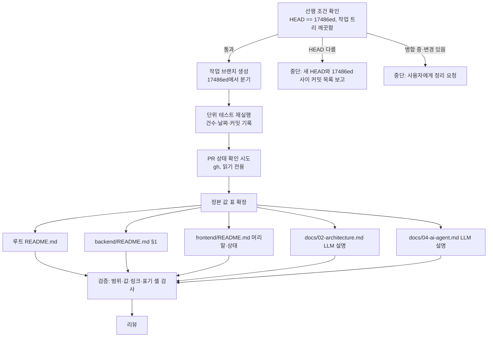

# Design Document

## Overview

`main` HEAD `17486ed`(Main_Snapshot, "Merge branch 'feat/be-5-photo-pipeline'", 2026-11-27 15:19)의 사실에 맞춰 Target_Docs 다섯 곳의 지정된 절만 고친다. 코드, 설정, 다른 문서, 지정되지 않은 절은 바꾸지 않는다(요구사항 1.6).

이 문서는 다음을 정한다.

- 구현 전 선행 조건 (HEAD가 `17486ed`인지, 작업 트리가 깨끗한지)
- 문서 사이에서 맞춰야 할 사실 값 표(정본 값)와 단위 테스트 재실행 규칙
- 대상 절마다 `17486ed`에서의 현재 위치(줄 번호)와 바꿀 내용의 개요
- 오류 처리, 셸 명령으로 확인하는 정확성 속성, 테스트 전략

모든 사실은 `git show 17486ed:<파일>`과 `git log 17486ed`로 확인했다. 줄 번호는 모두 `17486ed` 기준이다. `bef1702`→`17486ed` 사이에 Target_Docs 중 바뀐 파일은 `backend/README.md`뿐이다(`git diff --stat bef1702 17486ed`, 276줄 추가·21줄 삭제). 그래서 루트 README, frontend README, docs/02, docs/04의 줄 번호는 `bef1702`와 같다.

## Architecture

문서 변경 작업이므로 런타임 구조는 없다. 작업 흐름은 다음과 같다.

### 선행 조건 (구현 시작 전 필수)

1. **HEAD 확인(요구사항 1.1, 1.2).** `git rev-parse --short main`이 `17486ed`여야 한다. 다르면 문서를 고치지 않고 `git log --oneline 17486ed..main` 결과를 보고한 뒤 멈춘다.
2. **작업 트리 확인.** `.git/MERGE_HEAD`가 없고 `git status --porcelain`이 이 spec 폴더(`.kiro/specs/readme-update-main/`) 밖에 변경을 보이지 않아야 한다. 병합 중이면 Doc_Updater는 병합을 대신 끝내거나 중단하지 않고 사용자에게 요청한다.
3. **작업 브랜치.** `17486ed`에서 분기한 브랜치에서 편집한다. 예: `git switch -c docs/readme-update-main 17486ed`. 브랜치 이름은 사용자가 정한다.

설계 시점(2026-11-27) 확인 결과: `main`=`origin/main`=`17486ed`, 병합 진행 없음. 작업 트리 변경은 이 spec 폴더의 `requirements.md`, `design.md`뿐이다.

## Components and Interfaces

각 문서의 기존 문체를 따른다. 루트 README 본문은 "~합니다", 루트 README 표 칸과 나머지 네 문서는 "~다"다(요구사항 7.4). 표의 열 수는 바꾸지 않는다.

### 1. 루트 `README.md`

#### 1.1 "구성" 표 AI 행 (43행, 요구사항 2.1)

- 현재: "LangGraph `StateGraph` 에이전트가 외부 OpenAI 호환 LLM API를 호출. 공급자는 설정으로 교체하고, 문제가 있으면 `AGENT_MODE=pipeline`(레벨 0)으로 낮춘다"
- 바꿀 내용: "LangGraph `StateGraph` 에이전트가 LLM을 호출한다. 기본 공급자는 `bedrock`(Amazon Bedrock Converse, IAM 인증)이고 설정으로 `openai_compat`(외부 OpenAI 호환 API)·`fake`를 고를 수 있다. 문제가 있으면 `AGENT_MODE=pipeline`(레벨 0)으로 낮춘다"

#### 1.2 "참고 자료" 아래 안내 문장 (83행, 요구사항 2.2)

- 현재: "AI 구현 방식이 그 뒤에 바뀌었으므로(Amazon Bedrock → 외부 OpenAI 호환 API와 LangGraph) 현재 설계는 `docs/`를 따릅니다."
- 바꿀 내용: "AI 구현 방식은 그 뒤에 바뀌었습니다. 2026-11-21에 외부 OpenAI 호환 API와 LangGraph로 바꿨고, 2026-11-27부터는 Amazon Bedrock Converse(`bedrock`)가 다시 기본 공급자입니다. 에이전트 루프는 계속 LangGraph가 맡습니다. 현재 설계는 `docs/`를 따릅니다." 그림 다시 생성 문장(`docs/images/architecture-ai-agent.png`)은 그대로 둔다.

#### 1.3 "진행 현황" (90–96행)

- 90행 제목: `## 진행 현황 (2026-11-27)` (요구사항 2.3). 본문 첫 항목 앞에 "`main` `17486ed` 기준입니다." 한 줄을 둘 수 있다.
- 92행 "문서": 그대로 둔다.
- 93행 "구현" 한 줄을 아래 항목으로 나눈다.
  - **백엔드(`main`에 병합됨)**: 1·2단계(인증, 계획), 3단계(이어받기·완료 트랜잭션), 4단계(수신함), 5단계(사진 파이프라인), 6a단계(AI 레벨 0), 6b단계(AI 에이전트), LLM 기본 공급자의 Bedrock 전환. 링크 `[backend/README.md §1](./backend/README.md#1-인계-상태-요약)` (요구사항 2.4, 2.8)
  - **백엔드(`main`에 없음)**: 7단계(웹 배포·관측·시연 준비)는 시작 전이고 spec도 없습니다. 4단계의 `GET /claims/{claimId}/record`는 계약 변경 승인 대기(BE-Q46)라 `main`에 없습니다. 링크 같은 절 (요구사항 2.4, 1.8)
  - **백엔드 AWS 검증**: 1–3단계는 2026-11-25 `haru-dev`에서 15건 모두 통과했습니다. 4단계, 5단계, 6a단계, 6b단계와 Bedrock 경로는 AWS 배포·판정 전입니다. 링크 `backend/README.md` §1 (요구사항 2.7, 2.8)
  - **프론트엔드**: 1–6단계 완료(MSW 목업으로 전 화면 동작), 7단계는 로그인·Amplify 연동 코드까지입니다(`main` 병합 `33aea80`). 실제 Cognito 연동·실제 API 전환·배포는 남아 있습니다. 링크 `[frontend/README.md 상태](./frontend/README.md#상태)` (요구사항 2.5, 2.8)
- 94행 "일정": 그대로 둔다(Main_Snapshot에서 바뀐 사실이 없다).
- 95행 "LLM 공급자와 모델": "기본 공급자는 `bedrock`(Amazon Bedrock Converse, IAM 인증)이고 `openai_compat`·`fake`는 선택 경로로 남아 있습니다. 운영 공급자·모델은 아직 정하지 않았습니다(BE-Q6)." 링크 `backend/README.md` §1과 10.2절, `docs/08-open-questions.md` (요구사항 2.6, 2.8). BE-Q6의 `17486ed` 상태는 "운영 공급자는 여전히 미결"이다(`docs/08-open-questions.md` 16행).
- 96행 "데모 링크": 그대로 둔다.

#### 1.4 "최근 변경" (98–104행)

- 101행(구분선) 바로 아래에 새 행을 넣는다(요구사항 2.9).
  - `| 2026-11-27 | LLM 기본 공급자를 Amazon Bedrock(Converse, `bedrock`)으로 전환(`openai_compat`·`fake` 경로 유지). 프론트엔드 1–7단계(7단계는 인증 코드까지)와 백엔드 4단계(수신함), 5단계(사진 파이프라인), 6a단계(AI 레벨 0), 6b단계(AI 에이전트)를 `main`에 병합 |`
- 102–104행 기존 세 행은 글자 그대로 둔다(요구사항 2.10).

#### 1.5 범위 밖 불일치 (고치지 않음)

지정된 절이 아니므로 바꾸지 않고 리뷰 메모에 후속 작업 후보로 남긴다(요구사항 1.6).

- 57행: "`backend/`와 `frontend/`는 구현을 시작하면서 만듭니다."
- 70행: 미결 질문 범위 "`BE-Q1`–`BE-Q33`, `FE-Q1`–`FE-Q9`"(실제는 BE-Q129까지 있다)

### 2. `backend/README.md` §1 "인계 상태 요약"

#### 2.1 현재 위치 (`17486ed`)

- 5행 제목 `## 1. 인계 상태 요약`, 3행 머리말은 그대로 둔다.
- 7–24행 표(18행): 범위, 브랜치, 브랜치(5단계), spec, 단위 테스트, 단위 테스트(4단계), 단위 테스트(5단계), SAM, 로컬 환경(Docker), AWS 판정, AWS 판정(4단계), AWS 판정(5단계), 다음 단계 조건, PR, 6a단계, 6b단계.
- 26행 안내 문단: "AWS에서만 확인되는 것은 4절, 로컬 환경 구동 기록과 절차는 5절, 테스트 데이터 정리 보완은 3.2절에 있다."

현재 표의 문제(`17486ed` 기준)

| 행 | 문제 |
|---|---|
| 9 범위 | 5단계 상세를 "10절"로 가리킨다. `17486ed`에서 10절은 6a이고 5단계는 12절이다 |
| 10–11 브랜치 | 병합 전 브랜치 관계("이 PR", "base `feat/be-4-inbox`, 병합 전")를 적는다. `main` 병합 커밋이 없다 |
| 12 spec | 6a·6b spec 경로가 빠졌다 |
| 13–15 단위 테스트 | 단계별 브랜치 시점 값(296·385·647)만 있고 병합 뒤 건수와 1154건(Bedrock)이 없다 |
| 16 SAM | 5단계 Pillow 레이어를 "10.2절"로 가리킨다(실제 12.2절). 6a·6b·Bedrock 결과가 없다 |
| 22 PR | "병합된 것은 없다(2026-11-26)"로 끝난다 |
| 23–24 6a·6b | 병합 전 브랜치·Draft PR 상태를 적는다 |
| 전체 | Bedrock 전환 행, 백엔드 7단계 행, 병합 뒤 AWS 통합 회귀 미실행 사실이 없다 |

#### 2.2 바꿀 내용 (7–26행 전체를 덮어쓴다, 요구사항 3.1)

표는 `| 항목 | 상태 |` 2열 형식을 유지한다. 행 순서와 내용 개요는 다음과 같다.

| 항목 | 내용 개요 | 요구사항 |
|---|---|---|
| 기준·브랜치 | 기준 브랜치 `main`, HEAD `17486ed`(2026-11-27). 4단계 병합 `8f4c288`(`feat/be-4-inbox`), 5단계 병합 `17486ed`(`feat/be-5-photo-pipeline`), Bedrock 전환 병합 `bef1702`(전환 커밋 `2b9af27`, `feat/be-bedrock`). 1–3단계와 6a·6b단계 브랜치는 병합 커밋 없이 fast-forward로 들어왔다 | 3.4 |
| 범위(1·2단계) | 인증, `GET /me`, 계획 생성·목록·상세, 멱등 키, 원문 충실도·개인정보 함수 | 3.2 |
| 범위(3단계) | 이어받기·포기·완료 트랜잭션, 방문 기록 글 저장 최소 구현, `GET /me/claims`, EMF 지표 3종 | 3.2 |
| 범위(4단계) | 수신함 4종(`GET /inbox`, `GET /inbox/{itemId}`, 읽음, 답장), `GET /me`의 `unreadInboxCount`, `InboxFunction`. 판정 실행표 3.3절 | 3.2 |
| 범위(5단계) | 사진 업로드 URL·교체, 사진 처리 Lambda·큐·DLQ, 수신함 `photoUrl`·`photoCaption`, 운영자 복구 스크립트. 상세 12절 | 3.2, 3.16 |
| 범위(6a단계, AI 레벨 0) | `/ai/card-sessions*` 세 경로, `POST /plans` AI 세션 지표, `AiCardFunction`(SAM Makefile 빌드). 상세 10절 | 3.2, 3.16 |
| 범위(6b단계, AI 에이전트) | `AGENT_MODE=agent` LangGraph 에이전트, 턴 잠금, 질문 `interrupt`/`Command(resume)`, 체크포인트 테이블 `HaruAgentCheckpoints`. 기본 모드는 `pipeline`. 상세 11절 | 3.2, 3.16 |
| 범위(Bedrock 전환) | 2026-11-27 `2b9af27`. `LLM_PROVIDER=bedrock` 기본, `ChatBedrockConverse`, IAM `bedrock:InvokeModel`(키·SSM 없음), `LLM_REGION`(빈 값이면 `AWS_REGION`). 별도 spec 없음 | 3.2 |
| `main`에 없는 것 | `GET /claims/{claimId}/record`: 계약 변경 승인 대기(BE-Q46). 구현은 `feat/be-4-record-inbox`의 `f3626c0`에만 있다(3.3절·8절). 백엔드 7단계(웹 배포·관측·시연 준비): `main`에 없고 spec도 아직 없다 | 3.5, 3.6 |
| spec | `.kiro/specs/backend-stage1-2-foundation/`, `backend-stage3-claim/`, `backend-stage4-record-inbox/`, `backend-stage5-photo-pipeline/`, `backend-stage6a-ai-pipeline/`, `backend-stage6b-ai-agent/`(여섯 폴더 모두 `17486ed` 트리에 있다) | 3.3 |
| 단위 테스트 | `pytest tests/unit` **{통과}건 통과, {skip}건 skip, {deselect}건 deselect**({실행 날짜}, `17486ed`). deselect는 `slow` 표시 테스트(40MP 메모리 측정)이고 `pytest -m slow tests/unit`로 따로 돈다. 이전 기록 1154건은 4·5단계 병합 전 Bedrock 전환 커밋 `2b9af27` 기준 값이다. 단계별 브랜치 시점 건수는 3.1·5·10.1·11.1·12.1절에 남아 있다 | 3.7, 3.8 |
| SAM | 1–3단계: `cfn-lint` 0건, `sam validate --lint`, `sam build` 성공, 2026-11-25 `haru-dev` 배포(3.1절). 4단계: `sam validate --lint`·`sam build`(2026-11-25, `feat/be-4-inbox`), 배포 안 함. 5단계: `cfn-lint` 0건, `sam validate --lint`, `sam build --use-container` 성공(Pillow 레이어, `feat/be-5-photo-pipeline`, 12.1·12.2절), 배포 안 함. 6a·6b: `cfn-lint` 0건, `sam validate --lint`, `sam build --use-container` 성공(각 브랜치, 10.1·11.1절). Bedrock 전환: `cfn-lint` 통과(`2b9af27` 커밋 메시지). 병합 뒤 `17486ed` 템플릿의 검사·빌드는 기록 없음(병합 뒤 미확인) | 3.13, 1.5 |
| 로컬 환경(Docker) | 1–3단계 16건(2026-11-25, 5절). 4단계 23건(`feat/be-4-record-inbox` 작업 트리, 5.4절). 5단계 28건 통과·8건 사유 skip(`feat/be-5-photo-pipeline` `cfc65a7`, 5.5절). 6a 23건(10.1절), 6b `agent` 모드 새 9건(11.1절). 모두 `llmMode: fake`이고 판정 근거가 아니다(BE-Q15). 병합 뒤 `17486ed`의 로컬 통합 테스트는 기록 없음(병합 뒤 미확인) | 3.13, 1.5 |
| AWS 판정(1–3단계) | T1·T13·T3·T4·T5·T6·T7·T14·T16 **15건 모두 통과**(2026-11-25, `haru-dev`, AWS 담당). T1 액세스 토큰 1건 수정 뒤 통과 문장 유지(3.1절) | 3.9 |
| AWS 판정(4·5단계) | 4단계 T1 확장·T2·T17: 테스트 작성, 미실행(3.3절). 5단계 T8·T9·T10·T11·T15와 재업로드·IAM·CORS·주입 차단: 테스트 작성·수집만, 미실행(3.4절). 둘 다 AWS 배포 전 | 3.10 |
| AWS 판정(6a·6b·Bedrock) | 6a: `tests/integration/test_ai.py` 작성·수집만(10.1·10.3절). 6b: T18–T22 작성·수집만(11.1·11.4절). Bedrock 경로: 테스트·배포·판정 기록 없음. 모두 AWS 배포·판정 전 | 3.10 |
| LLM 공급자 | 기본 `bedrock`. `openai_compat`(AWS는 SSM SecureString 키, 로컬은 `.env`의 `LLM_API_KEY`)과 `fake`(AWS는 `Stage=dev`이고 스택 `haru-dev`일 때만, 로컬 `docker-compose.yml` 기본값)를 유지한다. 운영 공급자·모델은 미결(BE-Q6). 배포 전 확인은 10.2절 | 3.12 |
| 다음 단계 조건 | 기존 문장 유지: T3–T7 AWS 통과 뒤 4단계 시작(docs/07 §7.2), 2026-11-25 충족. 추가: 4·5단계 병합 뒤 AWS 통합 회귀(`tests/integration/test_concurrency.py` 재실행, 10.8절 작업 22)는 아직 실행하지 않았다 | 3.11 |
| PR | 아래 "PR 행 문구" | 3.14, 3.15 |

**PR 행 문구(개요).** `git log 17486ed`로 확인한 사실만 쓴다.

> 4단계(`8f4c288`), 5단계(`17486ed`), Bedrock 전환(`bef1702`), 프론트엔드 1–7단계(`33aea80`)는 `main`에 병합 커밋으로 들어왔다. 병합 커밋 메시지는 `Merge branch '…'` 형식이다. 1–3단계와 6a·6b단계는 fast-forward로 들어왔다. GitHub PR #1–#8의 상태: {확인 결과와 확인 날짜 | 미확인}. 리뷰 순서 기록은 8절(2026-11-26 시점 기록).

- PR 상태는 Doc_Updater가 `gh pr list --repo creatingweb123/knu-aws-2026 --state all --limit 20 --json number,state,title,headRefName`(읽기 전용)으로 확인한 경우에만 번호별 상태와 확인 날짜를 적는다(요구사항 3.14).
- 명령이 실패하거나(인증 없음, 네트워크) 실행하지 않았으면 "미확인"이라고 적는다(요구사항 3.15). "PR로 병합했다", "PR이 닫혔다"를 추정해 쓰지 않는다.

**안내 문단(26행).** 실제 절 번호로 고친다(요구사항 3.16): "AWS에서만 확인되는 것은 4절, 로컬 환경은 5절, 테스트 데이터 정리 보완은 3.2절, 4·5단계 판정 실행표는 3.3·3.4절, PR 순서는 8절, 6a는 10절, 6b는 11절, 5단계는 12절에 있다." 인용하는 절 번호(3.1·3.2·3.3·3.4·4·5·5.4·5.5·8·10·10.1·10.2·10.3·10.8·11·11.1·11.4·12·12.1·12.2)는 모두 `17486ed` 제목 목록에 있다.

**§1 밖은 바꾸지 않는다.** 8절 첫 문단(407행 "2026-11-26 기준 … 병합된 것은 없다"), 10.8절(585행 "이 브랜치는 … 4·5단계 변경이 없다"), 11.1절 1125건, 12.1절 "Draft PR #7"은 그 시점 기록이다. §1과 다른 숫자·상태를 보이는 것은 요구사항 7.1 위반으로 보지 않는다. 7.1은 고친 위치끼리의 일치를 요구한다. 리뷰 메모에는 남긴다.

### 3. `frontend/README.md`

#### 3.1 머리말 (3행, 요구사항 4.5)

- 현재: "…, 이번 단계 spec은 `.kiro/specs/frontend-stage1-setup/`이다."
- 바꿀 내용: "…, 단계별 spec은 `.kiro/specs/frontend-stage*/`(1–6단계는 `frontend-stage1-setup`부터 `frontend-stage6-ai-card`까지, 7단계는 `frontend-stage7a-auth`)이다." 일곱 폴더 모두 `17486ed` 트리에 있다.

#### 3.2 "상태" (5–11행)

| 행 | 현재(9–11행) | 바꿀 내용 |
|---|---|---|
| 단계 | "1–6단계 완료(MSW 목업으로 전 화면 동작). 7단계는 로그인·Amplify 연동 코드까지(실제 Cognito·배포는 AWS 계정 필요)" | 앞에 "1–7단계 `main` 병합(`33aea80`, 2026-11-27)."을 더한다. 나머지 문장 유지 (요구사항 4.1, 4.2) |
| 연동 | "MSW 목업 모드에서 확인. 실제 API·Cognito 전환은 백엔드 dev 스택 배포 후(S1–S5)" | 내용 유지. `dev`를 코드 표기로 바꾸는 정도만 허용 (요구사항 4.3) |
| 스타일 | CSS Modules(FE-Q3), 토큰, 색 추정값(FE-Q5, FE-Q14) | 글자 그대로 (요구사항 4.4) |

표는 Prettier 정렬 형식이다. 고친 뒤 `frontend/`에서 `npx prettier --write README.md`로 열 너비만 다시 맞춘다. 표 정렬 외 변경이 생기면 되돌린다.

### 4. `docs/02-architecture.md`

`bef1702`와 `17486ed`에서 내용이 같다(`git diff --quiet bef1702 17486ed -- docs/02-architecture.md`). 근거 파일의 줄 번호는 `17486ed` 기준이다.

| 위치(행) | 현재 내용 요지 | 바꿀 내용 개요 | 요구사항 |
|---|---|---|---|
| 11 그림 안내 인용문 | 그림은 이전 설계(Bedrock Converse, Guardrails). 현재는 외부 OpenAI 호환 API | 그림의 Bedrock Converse는 현재 기본 공급자(`bedrock`)와 같다. 다만 그림에는 LangGraph 에이전트와 체크포인트 테이블이 없고 현재 구현은 Guardrails를 쓰지 않으므로 다시 생성해야 한다 | 5.3 |
| 21–22 텍스트 도식 | `외부 OpenAI 호환 LLM API (Chat Completions tools)` / `API 키: SSM …` | `Amazon Bedrock Converse (기본 bedrock, IAM bedrock:InvokeModel)` 한 줄, 그 아래 `선택: 외부 OpenAI 호환 API(openai_compat, 키는 SSM SecureString)` | 5.4 |
| 37 요청 경로 3 | 에이전트가 외부 OpenAI 호환 LLM API를 호출 | 기본은 Bedrock Converse(`bedrock`) 호출이고 설정으로 `openai_compat`으로 바꿀 수 있다 | 5.1, 5.2 |
| 46 리전 항목 | LLM은 AWS 밖 외부 공급자라 사연이 공급자 서버로 간다 | `bedrock`은 AWS 안 호출(리전 `LLM_REGION`, 빈 값이면 함수 리전. 교차 리전 추론 프로필이면 다른 리전에서 처리될 수 있다). `openai_compat`이면 외부 공급자 서버로 간다. 동의 문구(BE-Q7) 문장은 유지 | 5.1, 5.2 |
| 48 모델 연결 | `ChatOpenAI`만 설명 | 세 경로로 나눈다. `bedrock`(기본): `langchain-aws`의 `ChatBedrockConverse`, `LLM_MODEL`은 모델 ID 또는 추론 프로필 ID, 인증은 실행 역할 IAM. `openai_compat`: 기존 `ChatOpenAI` 문장 유지. `fake`: Fake 채팅 모델 | 5.1, 5.2, 5.7, 5.10 |
| 50 의존성 | `langchain-aws` 없음 | 목록에 `langchain-aws==1.10.0` 추가(`backend/src/ai-requirements.in` 11행). 나머지 유지 | 7.1 |
| 97 Lambda 표 `AiCardFunction` | `LangGraph StateGraph + ChatOpenAI` | `+ ChatBedrockConverse(기본) / ChatOpenAI` | 5.10 |
| 111 로컬 도식 | Fake(기본) / 외부 OpenAI 호환 / Ollama | 설정 값 표기만 더한다: Fake(`fake`, 기본) / 외부 OpenAI 호환 API·로컬 Ollama(`openai_compat`). 호스트 실모델 `bedrock`(AWS 프로필, `scripts/eval_agent.py --env-file .env`)을 한 줄 더하고, 컨테이너 쪽 Bedrock은 401이라고 적는다(아래 247행 근거) | 5.11, 7.2 |
| 124, 142 로컬 대체 표 LLM 행 | Fake(기본, 컨테이너), 외부 OpenAI 호환·ollama(`openai_compat`), 호스트 실모델 bedrock | 111행과 같은 방식으로 설정 값 표기를 더한다. 호스트 실행임을 행 안에 적는다 | 5.11, 7.2 |
| 143 SSM 행 | `.env`의 `LLM_API_KEY` | 뒤에 "(`openai_compat` 전용)" | 5.8 |
| 183–186 compose 예시 | `LLM_PROVIDER: ${LLM_PROVIDER:-fake}` … `LLM_MODEL` | 그대로 두고 186행 다음에 `LLM_REGION: ${LLM_REGION:-}` 한 줄 추가(실제 `docker-compose.yml` 81행) | 5.6 |
| 223 `LLM_PROVIDER` 행 | 로컬 `fake`(기본) / `openai_compat`, AWS `openai_compat` | 허용 값 `bedrock`/`openai_compat`/`fake`. 로컬 컨테이너: `fake`(기본, `docker-compose.yml`) / `openai_compat`. 호스트 실모델: `bedrock`(247행). AWS: `bedrock`(기본, `template.yaml` `LlmProvider`) / `openai_compat` / `fake`(`Stage=dev`이고 스택 `haru-dev`일 때만) | 5.5 |
| 224 `LLM_BASE_URL` / `LLM_MODEL` 행 | 개발 키 공급자 또는 Ollama / samconfig 파라미터 | `LLM_MODEL`은 `bedrock`이면 Bedrock 모델 ID 또는 추론 프로필 ID, `openai_compat`이면 공급자 모델명. `LLM_BASE_URL`은 `openai_compat` 전용 | 5.7 |
| 224 다음 새 행 | 없음 | 3열 새 행: 이름 `LLM_REGION` / 로컬 컨테이너 빈 값(`docker-compose.yml` 기본), 호스트 실모델은 `.env`에 `LLM_REGION` 지정 / AWS `LlmRegion` 파라미터, 빈 값이면 함수 리전 `AWS_REGION` | 5.6 |
| 225 `LLM_API_KEY` / `LLM_API_KEY_PARAM` 행 | `.env` / SSM 이름 | 뒤에 "`openai_compat` 전용. `bedrock`은 키 없이 IAM" | 5.8 |
| 247 §2.4.5 첫 항목 | 기본 Fake(컨테이너), 실모델은 호스트 bedrock, 컨테이너 실모델은 openai_compat | 기본값 문장 유지(`${LLM_PROVIDER:-fake}`). 호스트 실모델: `LLM_PROVIDER=bedrock`으로 AWS 프로필을 켠 호스트에서 `scripts/eval_agent.py --env-file .env`를 실행한다(합성 사연만). `LLM_MODEL`과 `LLM_REGION`은 `.env`에 둔다. 컨테이너 실모델: `LLM_PROVIDER=openai_compat`과 `LLM_BASE_URL`·`LLM_MODEL`·`LLM_API_KEY`를 채운다(Ollama 포함). 컨테이너의 `bedrock`은 AWS 자격 증명이 Floci용 `test` 값이라 401로 끝난다(`docker-compose.yml` 63–64행 주석). 주의: `.env`는 compose의 `env_file`과 `${LLM_PROVIDER:-fake}` 치환에도 쓰이므로 `.env`에 `LLM_PROVIDER=bedrock`을 두면 컨테이너도 401이 된다. 이 작업은 이 문제의 해결 방식을 정하지 않는다 | 5.11 |
| 497–501 §2.8 `AiCardFunction` IAM | "세 가지", `ssm:GetParameter`, "LLM 호출은 IAM 밖 외부 HTTPS" | "네 가지"로 고친다. `bedrock:InvokeModel`(기반 모델·추론 프로필·애플리케이션 추론 프로필 ARN, 리전 와일드카드, `template.yaml` 378–384행) 항목 추가. `ssm:GetParameter`는 `LlmApiKeyParam`이 있을 때만(조건 `HasLlmKeyParam`, `openai_compat`). 501행은 "`openai_compat`일 때 LLM 호출은 IAM 밖 외부 HTTPS 호출이다"로 한정 | 5.9, 5.8 |
| 561 저장소 구조 주석 | `llm.py(ChatOpenAI 생성·Fake 채팅 모델)` | `llm.py(ChatBedrockConverse·ChatOpenAI 생성·Fake 채팅 모델)` | 5.10 |
| 587 `agent/llm.py` 설명 | `ChatOpenAI`, SSM 키 캐시, fake | `bedrock`(기본)은 `ChatBedrockConverse`(재시도 없는 bedrock-runtime 클라이언트, connect/read 타임아웃 명시), `openai_compat`은 `ChatOpenAI`와 SSM 키 캐시(기존 문장), `fake`는 Fake 모델 | 5.10 |

docs/02의 다른 절(도메인 모델, DynamoDB, 사진, 관측, 프론트엔드 구조)과 LLM 공급자와 무관한 문장은 바꾸지 않는다.

**출처 정리(불일치 아님).** `backend/.env.example` 29–37행은 실모델 확인을 호스트에서 `LLM_PROVIDER=bedrock`과 `scripts/eval_agent.py --env-file .env`로 한다고 적는다. 36–37행은 컨테이너 안의 bedrock이 401로 끝난다고 적는다. `docker-compose.yml` 63–64행 주석은 컨테이너 안의 실모델을 `openai_compat`으로 적고 bedrock이 401이라고 적는다. 두 출처는 실행 위치(호스트 대 컨테이너)가 달라 함께 맞다. docs/02는 호스트 bedrock과 컨테이너 openai_compat을 모두 적는다(247행). `.env.example`과 compose 주석은 이 작업 범위 밖이라 고치지 않는다.

### 5. `docs/04-ai-agent.md`

`bef1702`와 `17486ed`에서 내용이 같다.

| 위치(행) | 현재 내용 요지 | 바꿀 내용 개요 | 요구사항 |
|---|---|---|---|
| 5 도입 배경 인용문 | "구현 수단(Bedrock Converse, Global CRIS, Guardrails)은 그 뒤에 바뀌었으므로 3.5절을 따른다" | "구현 수단은 그 뒤에 바뀌었다. 2026-11-27부터 Bedrock Converse가 다시 기본 공급자이지만 루프는 LangGraph가 맡고 Guardrails는 쓰지 않는다. 현재 구현은 4.5절을 따른다." 잘못된 절 번호 "3.5절"을 이 문서의 "4.5절"(142행 `## 4.5 구현 선택`)로 고친다 | 6.2, 7.3 |
| 24 "현재" 행 | `LangGraph StateGraph + OpenAI 호환 Chat Completions API` | 이 행의 시점 칸을 `2026-11-21`로 바꿔 기록으로 남기고(기존 바뀐 이유 문장 유지), 그 아래 새 "현재(2026-11-27)" 행: `LangGraph StateGraph + Amazon Bedrock Converse(bedrock 기본), openai_compat·fake 유지` / 바뀐 이유: AWS 안에서 IAM으로 호출해 API 키 관리를 없애기 위해(`2b9af27`) | 6.1 |
| 26 표 뒤 문단 | "세 번째 변경은 서버 내부만 바꾼다" | "세 번째·네 번째 변경은 서버 내부만 바꾼다" | 6.1 |
| 147 모델 연결 행 | `ChatOpenAI(base_url=…)` | `bedrock`(기본): `langchain-aws`의 `ChatBedrockConverse`. `openai_compat`: 기존 `ChatOpenAI` 문장 유지 | 6.6 |
| 148 공급자 교체 행 | `LLM_BASE_URL`, API 키, `LLM_MODEL` | `LLM_PROVIDER`(`bedrock`/`openai_compat`/`fake`)로 경로를 고른다. `bedrock`은 `LLM_MODEL`(모델 ID 또는 추론 프로필 ID)과 `LLM_REGION`(빈 값이면 `AWS_REGION`). `openai_compat`은 기존 설명 유지 | 6.5, 6.6 |
| 150 API 키 행 | SSM SecureString | "`openai_compat`만 SSM SecureString을 쓴다. `bedrock`은 실행 역할의 IAM `bedrock:InvokeModel`로 인증하고 API 키·SSM 파라미터를 쓰지 않는다" | 6.4 |
| 151 네트워크 행 | VPC 밖, NAT 없이 외부 API | 그대로 둔다(VPC 밖이라 Bedrock 공개 엔드포인트도 NAT 없이 호출된다) | — |
| 153 로컬 개발 행 | Fake 기본, 실모델은 외부 호환 API 개발 키나 Ollama | 기본값 문장에 "로컬 `docker-compose.yml`의 기본값"을 명시한다. 호스트 실모델은 `bedrock`(AWS 프로필, `scripts/eval_agent.py --env-file .env`, 합성 사연만)이다. 컨테이너 실모델은 `openai_compat`(외부 호환 API 개발 키, 로컬 Ollama)으로 표기한다. 컨테이너 안의 `bedrock`은 401이다(docs/02 247행) | 6.7 |
| 155 의존성 문단 | 이름 5개, 버전 없음 | `langchain-aws`를 더하고 목록 전체를 docs/02 50행과 같은 `==` 값으로 적는다(`langgraph==1.2.24`, `langgraph-checkpoint==4.3.2`, `langchain-core==1.8.4`, `langchain-openai==1.8.5`, `langgraph-checkpoint-aws==1.3.0`, `langchain-aws==1.10.0`). 기존 다섯 이름은 유지 | 6.3 |
| 157 모델 문단 | 공급자와 모델 미정, Chat Completions 조건 | "기본 공급자는 `bedrock`이고 운영 모델 ID는 아직 정하지 않았다(BE-Q6)". Chat Completions 조건 문장은 `openai_compat` 경로 조건으로 한정 | 6.1, 6.6 |
| 166 가드레일 개인정보 행 | "OpenAI 호환 API에는 공통 PII 판정 기능이 없다" | 바꾸지 않는다(정규식만 차단 기준이라는 사실은 Bedrock에서도 같다) | — |

docs/04의 4.2–4.4, 4.6–4.9절은 바꾸지 않는다. 의존성 값은 구현 시 `git show 17486ed:backend/src/ai-requirements.in`으로 다시 확인한다.

## Data Models

### 정본 값 표 (요구사항 7.1, 7.2)

고친 모든 문단은 아래 값만 쓴다.

| 사실 | 정본 표기 | 출처(`17486ed`) |
|---|---|---|
| 기준 커밋 | `main` HEAD `17486ed` | `git log 17486ed` |
| 기준 날짜 | 2026-11-27 | `17486ed` 커밋 날짜 |
| 4단계 병합 | `8f4c288` | `git log --first-parent` |
| 5단계 병합 | `17486ed` | 같음 |
| Bedrock 전환 | 병합 `bef1702`, 전환 커밋 `2b9af27` | 같음 |
| 프론트엔드 병합 | `33aea80` | 같음 |
| 단위 테스트(병합 뒤) | `pytest tests/unit` 1505건 통과, 1건 skip, 2건 deselect(`17486ed`, 실행 날짜 병기) | 요구사항 작성 시 실행 결과. 구현 시 재실행 값으로 대체(아래) |
| 단위 테스트(병합 전) | 1154건 통과(`2b9af27`, 4·5단계 병합 전) | `2b9af27` 커밋 메시지 11행 |
| AWS 판정 | 1–3단계 15건 모두 통과(2026-11-25, `haru-dev`), T1·T13·T3·T4·T5·T6·T7·T14·T16 | `backend/README.md` 18행·3.1절 |
| 4·5·6a·6b·Bedrock AWS 상태 | AWS 배포·판정 전 | `backend/README.md` 19–20·23–24행, 10.1·11.1·12.1절 |
| Merged_Backend_Stages | 1·2단계, 3단계, 4단계, 5단계, 6a단계, 6b단계, Bedrock 전환 | `git log --first-parent 17486ed` |
| Unmerged_Items | 백엔드 7단계, 프론트엔드 7단계의 실제 Cognito 연동·실제 API 전환·배포, `GET /claims/{claimId}/record`(BE-Q46) | requirements.md |
| 공급자 설정 값 | `bedrock`(기본), `openai_compat`, `fake` | `template.yaml` 28–31행 |
| 제품명 병기 | `bedrock` 옆 괄호로 "Amazon Bedrock Converse"를 쓸 수 있다 | — |
| 로컬 기본 공급자 | `fake` | `docker-compose.yml` 65행 |
| 로컬 실모델 경로 | 호스트: `bedrock`(AWS 프로필, `scripts/eval_agent.py --env-file .env`, 합성 사연만). 컨테이너: 기본 `fake`, 실모델은 `openai_compat`(`bedrock`은 401) | `backend/.env.example` 29–37행, `docker-compose.yml` 63–64행 |
| AWS 기본 공급자 | `bedrock` | `template.yaml` 31행 |
| 의존성 | `langchain-aws==1.10.0` | `backend/src/ai-requirements.in` 11행 |
| IAM 권한 | `bedrock:InvokeModel` | `template.yaml` 380행 |
| 리전 규칙 | `LLM_REGION`, 빈 값이면 `AWS_REGION` | `llm.py` 125행, `template.yaml` 41–45·328행 |
| 운영 공급자·모델 | 미결(BE-Q6) | `docs/08-open-questions.md` 16행 |
| backend README 절 번호 | 6a=10절, 6b=11절, 5단계=12절 | `backend/README.md` 462·642·1031행 |

### 단위 테스트 건수 규칙 (요구사항 3.7, 3.8)

1. 구현 시작 때 `17486ed` 작업 트리의 `backend/`에서 다시 돈다: `.venv/bin/pytest tests/unit -q -rs`. `pytest.ini`의 `addopts`가 `local`·`integration`·`slow`·`fault`를 기본 제외하므로 deselect 2건은 `slow` 표시 테스트다. `-rs`로 skip 1건의 사유를 확인해 리뷰 메모에 남긴다.
2. 결과의 통과·skip·deselect 건수, 실행 날짜, 기준 커밋 `17486ed`를 Backend_Summary 단위 테스트 행에 적는다. 재실행 결과가 1505/1/2와 다르면 재실행 값을 쓰고 차이를 리뷰 메모에 적는다.
3. 1154건은 "4·5단계 병합 전 `2b9af27` 기준"이라는 설명과 함께만 쓴다. 병합 뒤 건수로 쓰지 않는다.
4. 재실행이 실패하면(환경 문제, 실패 테스트) 건수를 적지 않고 오류 처리 표를 따른다.

## Error Handling

| 상황 | 처리 |
|---|---|
| `main` HEAD가 `17486ed`가 아님 | 편집을 시작하지 않는다. `git log --oneline 17486ed..main`을 보고하고 멈춘다(요구사항 1.2) |
| 작업 트리가 병합 중이거나 spec 폴더 밖에 변경이 있음 | 편집을 시작하지 않는다. 사용자에게 정리를 요청한다. 병합·리셋 명령을 대신 실행하지 않는다 |
| 단위 테스트 재실행이 실패하거나 실패 테스트가 있음 | 건수를 문서에 적지 않고 실패 내용을 보고한다. 1505건을 대신 적지 않는다 |
| 재실행 건수가 1505/1/2와 다름 | 재실행 값을 쓰고 차이를 리뷰 메모에 적는다 |
| `gh`로 PR 상태를 확인하지 못함 | PR 상태를 "미확인"으로 적는다(요구사항 3.15) |
| 병합 뒤 검증 기록이 없음(SAM, 로컬, AWS 회귀) | 마지막 기록 결과와 그 브랜치를 적고 "병합 뒤 미확인"을 붙인다(요구사항 1.5). 직접 실행해 새 결과를 만들지 않는다(문서 작업 범위 밖) |
| 필요한 결정이 `docs/`에 없음 | 새 결정을 만들지 않고 `docs/08-open-questions.md`의 질문 번호(BE-Q6, BE-Q7, BE-Q46 등)와 함께 미결로 적는다(요구사항 1.8) |
| 고치려는 문장이 지정 절 밖에 있음 | 고치지 않고 리뷰 메모에 "범위 밖 불일치"로 남긴다(1.5절, 2.2절 끝, 4절 끝 목록) |
| 로컬 실모델 경로 표기가 호스트와 컨테이너에서 달라 보임 | 불일치가 아니다. 실행 위치로 나눠 적는다(4절 '출처 정리'). `.env`를 compose가 함께 읽는 문제는 미결로 남기고 리뷰 메모에 적는다 |
| Prettier가 frontend 표 외 내용을 바꿈 | 표 정렬 외 변경을 되돌린다 |

## Correctness Properties

*A property is a characteristic or behavior that should hold true across all valid executions of a system-essentially, a formal statement about what the system should do. Properties serve as the bridge between human-readable specifications and machine-verifiable correctness guarantees.*

결과물이 문서라서 무작위 입력 생성(PBT)은 맞지 않는다. 아래 속성은 `git diff 17486ed..HEAD`와 결과 문서 전체에 대한 전칭 검사이고, 결정적 셸 명령으로 1회 확인한다. 검사 명령은 저장소에 커밋하지 않는다(요구사항 1.6). 명령의 `$T`는 Target_Docs 다섯 경로(`README.md backend/README.md frontend/README.md docs/02-architecture.md docs/04-ai-agent.md`)다.

### Property 1: 변경 범위 보존

*For any* `git diff --name-only 17486ed..HEAD`의 파일, 그 파일은 Target_Docs 다섯 개 중 하나다. *For any* 변경 hunk, 그 hunk의 `17486ed` 쪽 줄 범위는 Components 절이 지정한 위치(루트 README 43·83·90–104행, backend README 7–26행, frontend README 3·5–11행, docs/02 표의 행, docs/04 표의 행) 안에 있다.

확인: `git diff --name-only 17486ed..HEAD`, `git diff -U0 17486ed..HEAD -- $T | grep '^@@'`의 `-a,b`를 지정 범위와 대조.

**Validates: Requirements 1.6**

### Property 2: 미병합 항목은 미병합으로만 적힘

*For any* 고친 줄 중 Unmerged_Items(백엔드 7단계, `GET /claims/{claimId}/record`, 프론트엔드 7단계의 실제 Cognito·실제 API·배포)를 가리키는 줄, 그 줄은 "`main`에 없다/시작 전/승인 대기/남아 있다" 문맥이고 "병합"·"완료"를 긍정으로 쓰지 않는다.

확인: `git diff -U0 17486ed..HEAD -- $T | grep '^+' | grep -nE '7단계|/record|BE-Q46|Cognito'`의 각 줄을 확인.

**Validates: Requirements 1.4, 2.4, 3.5, 3.6**

### Property 3: 병합 뒤 미기록 결과는 기록 시점과 함께 적힘

*For any* Backend_Summary의 SAM·로컬 환경·AWS 판정·다음 단계 조건·PR 행, 그 행은 (a) 병합 뒤 결과가 있으면 그 결과와 날짜, (b) 없으면 마지막 기록의 브랜치(또는 커밋)와 "병합 뒤 미확인"·"미실행"·"미확인" 중 하나를 담는다.

확인: `git show HEAD:backend/README.md | sed -n '/^## 1\./,/^## 2\./p' | grep -E '^\| (SAM|로컬|AWS 판정|다음 단계|PR)'`의 각 행에서 브랜치·커밋 표기와 미확인 문구 존재를 확인.

**Validates: Requirements 1.5, 3.11, 3.13, 3.14, 3.15**

### Property 4: 사실 값 일관성

*For any* 정본 값 표의 사실과 *for any* 고친 줄 안의 그 사실 출현, 출현 값은 정본 표기와 같다. 병합 뒤 단위 테스트 건수는 재실행 값 하나만, 1154는 `2b9af27`·병합 전 문맥에서만, 기준 커밋은 `17486ed`만, AWS 판정 건수는 15만, 로컬 기본 공급자는 `fake`만, AWS 기본 공급자는 `bedrock`만, `langchain-aws` 버전은 `1.10.0`만 나온다.

확인: `git diff -U0 17486ed..HEAD -- $T | grep '^+' | grep -nE '[0-9]{3,4}건|1505|1154|17486ed|bef1702|15건|LLM_PROVIDER|langchain-aws'`를 정본 값과 대조. `1154`가 나온 줄에 `2b9af27`이 함께 있는지 `grep 1154 | grep -v 2b9af27`이 빈 출력인지 확인.

**Validates: Requirements 1.3, 3.7, 3.8, 5.5, 5.11, 6.3, 6.7, 7.1**

### Property 5: 공급자 표기 통일

*For any* 고친 줄에서 LLM 공급자 경로를 가리키는 표기, 그 표기는 `bedrock`, `openai_compat`, `fake` 중 하나다. 제품명("Amazon Bedrock Converse")은 `bedrock` 옆 괄호 병기나 설명 문장 안에서만 쓰이고, "OpenAI 호환"은 `openai_compat` 경로 설명 안에서만 쓰인다.

확인: `git diff -U0 17486ed..HEAD -- $T | grep '^+' | grep -nE 'OpenAI 호환|Bedrock|Fake'`의 각 줄에 해당 설정 값 표기가 같이 있는지 확인.

**Validates: Requirements 7.2, 2.1, 2.6, 3.12, 5.2, 6.6**

### Property 6: 참조 유효성

*For any* 고친 줄의 상대 링크, 대상 파일이 `git ls-tree -r --name-only 17486ed`에 있다. *For any* 고친 줄이 인용하는 절 번호(backend README의 "N절"·"N.M절", 문서의 "§N.M", docs/04의 "4.5절"), 같은 번호의 제목이 해당 문서의 `17486ed` 제목 목록에 있다. *For any* spec 경로, 그 폴더가 `17486ed` 트리에 있다. *For any* 루트 README "진행 현황"의 구현·검증·공급자 항목, 그 항목은 하위 README 링크를 하나 이상 가진다.

확인: 링크 경로마다 `git cat-file -e 17486ed:<경로>`. 절 번호는 `git show 17486ed:<파일> | grep '^#'`과 대조. spec 경로는 `git ls-tree -d 17486ed .kiro/specs/`와 대조.

**Validates: Requirements 7.3, 2.8, 3.3, 3.16, 4.5**

### Property 7: 기존 기록 보존과 표 형식

*For any* `17486ed` 루트 README "최근 변경" 표의 기존 행(102–104행), 그 행은 결과 문서에 글자 그대로 남는다. *For any* frontend README "상태" 표의 스타일 행, 결정 내용(CSS Modules, FE-Q3, FE-Q5, FE-Q14)이 그대로 남는다. *For any* 고친 표의 줄, `|` 개수는 원래 표의 머리 줄과 같다.

확인: `git show 17486ed:README.md | sed -n '102,104p'`의 각 줄을 `grep -Fx`로 결과 파일에서 찾는다. 고친 표 줄마다 `awk -F'|' '{print NF}'`를 머리 줄과 비교한다.

**Validates: Requirements 2.10, 4.4, 7.4**

### Property 8: 식별자 표기 보존

*For any* 고친 줄의 요구사항 ID, 보장, 검증 시나리오, 연동 지점, 미결 질문 번호, 그 표기는 `BE-*`, `FE-*`, `G1`–`G8`, `T1`–`T22`, `S0`–`S5`, `BE-Q*`, `FE-Q*` 형식이고 해당 번호가 `17486ed` docs에 있다.

확인: `git diff -U0 17486ed..HEAD -- $T | grep '^+' | grep -oE '\b(BE|FE)-Q?[0-9A-Z-]+|\bT[0-9]+|\bG[0-9]\b|\bS[0-9]\b'`를 뽑아 범위 밖 번호(예: `T23`, `G9`, `S6`)나 docs/08에 없는 질문 번호가 없는지 확인.

**Validates: Requirements 7.5, 1.8**

## Testing Strategy

PBT 라이브러리는 쓰지 않는다. 바뀌는 코드가 없으므로 단위 테스트는 정본 값(건수)을 얻기 위해 한 번만 돈다. 확인은 다음 네 가지로 한다.

**사전 측정 (1회).**

| 대상 | 명령 | 기록 |
|---|---|---|
| HEAD | `git rev-parse --short main` | `17486ed`인지 |
| 단위 테스트 | `backend/`에서 `.venv/bin/pytest tests/unit -q -rs` | 통과·skip·deselect 건수, skip 사유, 실행 날짜, 커밋 |
| PR 상태 | `gh pr list --repo creatingweb123/knu-aws-2026 --state all --limit 20 --json number,state,title,headRefName` | 번호별 상태와 확인 날짜. 실패하면 "미확인" |

**속성 검사 (결정적 명령, 1회).** Correctness Properties의 "확인" 명령을 돌리고 결과를 PR 설명에 붙인다. 눈으로 판정하는 속성(2, 3, 5)은 명령이 뽑은 줄 목록과 판정을 함께 붙인다.

**예시 검사 (리뷰 체크리스트).** 요구사항 2.1–2.9, 3.1–3.16, 4.1–4.5, 5.1–5.11, 6.1–6.7의 각 항목을 Components 절의 표 행과 하나씩 맞춰 본다. 문체(7.4)와 날짜 병기(1.7)는 사람이 읽고 확인한다.

**형식 검사.** `frontend/`에서 `npx prettier --check README.md`. 다섯 문서의 표가 GitHub 미리보기에서 깨지지 않는지 본다.

## 미결 사항

- 운영 공급자·모델(BE-Q6)과 외부 전송 동의 문구(BE-Q7)는 미결이다. 문서에는 미결로만 적는다.
- `GET /claims/{claimId}/record`는 프론트엔드 담당의 계약 변경 승인 대기(BE-Q46)다.
- 범위 밖 불일치(루트 README 57·70행, backend README 8·10.8·11.1·12.1절의 시점 기록)는 이 작업에서 고치지 않는다. 후속 작업 여부는 사용자가 정한다.
- `.env` 공유 문제: `LLM_PROVIDER=bedrock`을 `.env`에 두면 compose 컨테이너도 401이 된다(4절 주의). 호스트 실행만 bedrock으로 두는 방법은 정하지 않았다.
