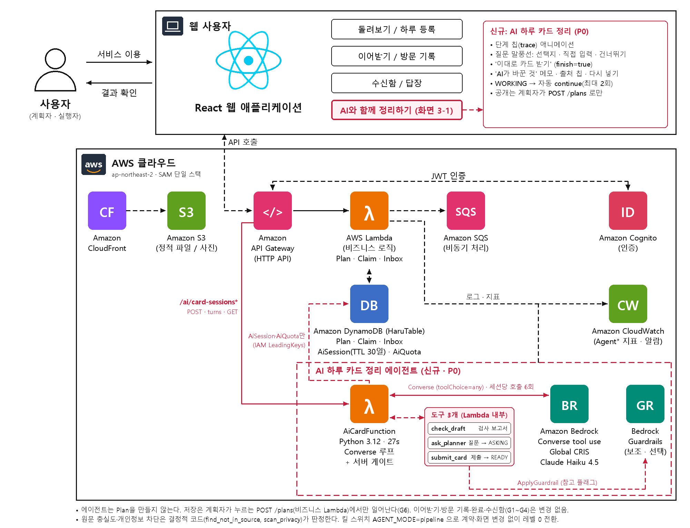

# 2. 아키텍처와 데이터 모델

시스템 구성, 기술 스택, 로컬 개발 환경, 도메인 모델, DynamoDB 설계, 사진 처리, 권한, 관측을 다룬다. API 요청·응답 형식은 [§3](./03-api-contract.md)에 있다.

## 2.1 아키텍처



> 그림은 [`scripts/draw_architecture.py`](../scripts/draw_architecture.py)로 생성한다(`python scripts/draw_architecture.py`).
>
> 이 그림의 AI 부분은 이전 설계(Amazon Bedrock Converse, Guardrails)로 그려져 있다. 현재 기본 공급자도 Bedrock Converse(`bedrock`)이지만, 그림에는 LangGraph 에이전트와 체크포인트 테이블이 없고 백엔드 코드에는 Guardrails 호출이 없으므로 그림은 다시 생성해야 한다. 현재 구조는 아래 텍스트 도식을 따른다.

```
브라우저(React) ──▶ CloudFront ──▶ S3 (비공개, 정적 파일, OAC)
     │
     ├─ Cognito User Pool (로그인 → ID 토큰)
     │
     └─▶ API Gateway (HTTP API, JWT authorizer)
            └─▶ API Lambda들 ──▶ DynamoDB (단일 테이블 HaruTable)
                    ├─▶ 하루 카드 에이전트(LangGraph) ──▶ DynamoDB 체크포인트 테이블 HaruAgentCheckpoints
                    │     └─▶ Amazon Bedrock Converse (기본 bedrock, IAM bedrock:InvokeModel, 키 없음)
                    │     └─▶ 선택: 외부 OpenAI 호환 LLM API (openai_compat, Chat Completions tools)
                    │           └ API 키(openai_compat만): SSM Parameter Store SecureString
                    └─▶ S3 사진 버킷 presigned PUT/GET URL 발급

사진: 브라우저 ──PUT──▶ S3 photos/original/ ──이벤트──▶ SQS ──▶ 사진 처리 Lambda
                                                        │        ├ 검사·축소·메타데이터 제거 → photos/processed/
                                                        │        └ DynamoDB 사진 상태 갱신 + 완료 트랜잭션
                                                        └─(3회 초과)─▶ SQS DLQ ──▶ CloudWatch 알람

CloudWatch Logs/Metrics/Alarms, 배포: AWS SAM
```

요청 경로는 네 갈래다.

1. **정적 파일**: CloudFront가 비공개 S3의 React 빌드 산출물을 제공한다. 웹 버킷과 배포는 백엔드 SAM 스택이 만들고, `frontend/`의 빌드 결과를 sync한다.
2. **API**: 브라우저가 Cognito ID 토큰으로 API Gateway를 직접 호출한다. Lambda가 계획별 작성자·실행자 권한을 검사한다.
3. **AI 정리**: Lambda 안의 LangGraph 에이전트 그래프가 LLM을 호출한다. 기본은 Amazon Bedrock Converse(`bedrock`, IAM 인증)이고, 설정으로 외부 OpenAI 호환 API(`openai_compat`)를 쓸 수 있다. HTTP 요청 1번이 에이전트 1턴이고, 턴 사이의 대화·그래프 상태는 체크포인트 테이블에 남는다.
4. **사진**: 브라우저가 presigned URL로 S3에 직접 올리면 SQS를 거쳐 사진 처리 Lambda가 비동기로 처리한다.

## 2.2 기술 스택

### 백엔드

- 런타임: **Python 3.12** (boto3, Pillow 레이어, pydantic으로 입력/AI 응답 검증) — 팀 합의 시 Node.js 20(sharp)로 변경 가능
- IaC: AWS SAM (`template.yaml`, `samconfig.toml`에 `dev`/`demo` 환경)
- 리전: `ap-northeast-2`. LLM 호출 위치는 공급자에 따라 다르다. `bedrock`은 AWS 안에서 호출하며 리전은 `LLM_REGION`(빈 값이면 함수 리전)이다. 추론 프로필을 쓰면 요청이 다른 리전에서 처리될 수 있다. `openai_compat`은 AWS 밖의 외부 공급자 서버로 사연을 보낸다. 외부 공급자는 처리 국가와 보존 정책이 달라 시범 운영 동의 문구에 적는다(BE-Q7).
- AI 에이전트: `AiCardFunction` 안에서 **LangGraph `StateGraph`로 노드를 명시적으로 연결**한다(`src/agent/graph.py`, `nodes.py`, `tools.py`). 범용 prebuilt 에이전트(`create_agent` 등)는 쓰지 않는다. 그래프 도식·노드·엣지는 [§3.2](./03-api-contract.md).
  - 모델 연결: 설정 `LLM_PROVIDER`로 세 경로 중 하나를 고른다.
    - `bedrock`(기본): `langchain-aws`의 `ChatBedrockConverse`로 Amazon Bedrock Converse를 부른다. `LLM_MODEL`은 Bedrock 모델 ID 또는 추론 프로필 ID이고, 호출 리전은 `LLM_REGION`(빈 값이면 `AWS_REGION`)이다. 인증은 함수 실행 역할의 IAM `bedrock:InvokeModel`이며 API 키와 SSM 파라미터를 쓰지 않는다.
    - `openai_compat`(선택): `langchain-openai`의 `ChatOpenAI(base_url=LLM_BASE_URL, api_key=…, model=LLM_MODEL)`로 임의의 OpenAI 호환 Chat Completions API를 부른다. 공급자는 `LLM_BASE_URL`·`LLM_API_KEY`(AWS에서는 `LLM_API_KEY_PARAM`)·`LLM_MODEL` 설정만 바꿔 교체한다(OpenAI, 상용 호환 API, 로컬 Ollama·vLLM 등). `use_responses_api=False`를 명시해 Chat Completions로만 보낸다.
    - `fake`(선택, 로컬 compose 기본값): 시나리오별 Fake 채팅 모델. AWS에서는 `Stage=dev`이고 스택 이름이 `haru-dev`일 때만 쓴다.
  - 상태 저장: `langgraph-checkpoint-aws`의 `DynamoDBSaver` 체크포인터, `thread_id = sessionId`. 체크포인트는 별도 테이블 `HaruAgentCheckpoints`에 둔다(§2.6). Lambda는 상태가 없으므로 `InMemorySaver`는 쓸 수 없다. 커뮤니티 패키지 `langgraph-checkpoint-dynamodb`와 혼동하지 않는다.
  - 의존성(에이전트 함수 전용, `==`로 고정): `langgraph==1.2.24`, `langgraph-checkpoint==4.3.2`, `langchain-core==1.8.4`, `langchain-openai==1.8.5`, `langchain-aws==1.10.0`, `langgraph-checkpoint-aws==1.3.0`, `boto3>=1.43.64`(checkpoint-aws 요구 버전이라 런타임 내장본 대신 함께 묶는다). 릴리스 주기가 빨라 실제 고정값은 6a에서 의존성을 고정할 때 다시 확인한다. `langchain-core`·`langchain-openai`·`langgraph-checkpoint-aws`는 Python 3.11 이상을 요구하므로 3.12를 유지한다.
  - 패키지 크기·콜드 스타트: 의존성 wheel 합계 약 37MB(압축), 압축 해제 약 90~170MB로 추정한다(250MB 한도 안, Layer 불필요). 네이티브 wheel(pydantic-core, zstandard, tiktoken, xxhash, ormsgpack, jiter, orjson 등)이 있어 `sam build --use-container`로 Lambda 아키텍처에 맞춰 빌드한다. import로 콜드 스타트가 수백 ms~수 초 늘 수 있으므로 6a(레벨 0 첫 배포)에서 `du -sh .aws-sam/build/AiCardFunction`과 Init Duration을 기록한다(BE-Q18). 레벨 0도 같은 의존성 위에서 돌므로 이 문제는 `AGENT_MODE=pipeline` 전환으로 피할 수 없고, 그래서 6a에서 먼저 드러낸다.
  - LangSmith 추적은 사연 원문을 외부로 보내므로 끈다. SAM `Globals.Function.Environment`와 docker compose에 `LANGSMITH_TRACING=false`, `LANGCHAIN_TRACING_V2=false`를 **둘 다** 명시하고(`LANGCHAIN_TRACING_V2=true`가 남아 있으면 우선 적용돼 켜진다), `LANGSMITH_API_KEY`는 두지 않는다. 핸들러는 그래프 실행을 `langsmith.tracing_context(enabled=False)`로 감싼다.
  - 대안(채택 안 함): LangGraph 없이 Chat Completions tool calling 루프를 직접 짜는 방식. 의존성은 줄지만 일시정지·재개와 상태 저장을 직접 만들어야 한다.

### 프론트엔드

| 영역 | 선택 | 비고 |
|---|---|---|
| 프레임워크 | React 18 + TypeScript + Vite | |
| 라우팅 | React Router | |
| 서버 상태 | TanStack Query | 폴링(사진 처리 상태)에 `refetchInterval` 사용 |
| 인증 | AWS Amplify `aws-amplify/auth` (Auth 모듈만) | Cognito User Pool, ID 토큰을 `Authorization` 헤더로 전달 |
| 스타일 | CSS Modules 또는 Tailwind (팀 합의) | 모바일 우선, 최대 폭 480px 가운데 정렬 |
| API 목업 | MSW | 백엔드 배포 전 계약 기준으로 개발 |
| 로컬 백엔드 (선택) | 백엔드 docker compose (API `http://localhost:3000`, Floci Cognito·S3 `http://localhost:4566`) | 백엔드 기능이 로컬에 올라온 뒤 실제 흐름 확인. §2.4.6 |
| 배포 | S3(비공개) + CloudFront | 버킷·배포는 백엔드 SAM 스택이 생성, `frontend/` 빌드 산출물을 sync |

환경 변수
```
VITE_API_BASE_URL=
VITE_AWS_REGION=ap-northeast-2
VITE_COGNITO_USER_POOL_ID=
VITE_COGNITO_CLIENT_ID=
VITE_COGNITO_ENDPOINT=        # 로컬 백엔드 모드만 http://localhost:4566, dev/demo 스택은 비움
VITE_AUTH_MODE=cognito        # cognito / dev-jwt (로컬 백엔드 모드 전용)
VITE_USE_MOCK=false
```
- `VITE_*` 값은 빌드 산출물에 그대로 들어가므로 비밀값(LLM API 키 등)을 두지 않는다. LLM 공급자 설정(`LLM_*`)은 백엔드에만 있다.

#### 개발 연동 모드

| 모드 | API | 인증 | 쓰는 때 |
|---|---|---|---|
| MSW 목업 | 브라우저 안 목업 | 목업 | S0부터, 계약 기준 화면 개발 |
| 로컬 백엔드 | `http://localhost:3000`(어댑터) 또는 Vite 프록시 | Floci Cognito(`http://localhost:4566`)의 시드 사용자, 또는 dev JWT | 백엔드 기능이 로컬에 올라온 뒤 실제 흐름 확인 |
| `dev`/`demo` 스택 | SAM 출력 `ApiUrl` | 실제 Cognito(`UserPoolId`, `UserPoolClientId`) | S1–S5 연동, 리허설, 시연 |

- 로컬 백엔드(docker compose)는 개발과 단위·로컬 통합 테스트용이다. 데모·시범 운영은 실제 AWS에 SAM으로 배포한 `dev`/`demo` 스택에서 하고, 계약 비교(S2·S3·S4)도 `dev` 스택 응답으로 한다(데모까지 Docker로 운영하는 대안은 FE-Q9).
- 모드별 설정값, 로컬 인증(시드 사용자·dev JWT), 로컬에서 확인할 수 없는 항목은 §2.4.7을 따른다.

## 2.3 Lambda 구성

| 함수 | 트리거 | 역할 |
|---|---|---|
| `MeFunction` | `GET /me`, `GET /me/claims`, `GET /me/plans`(P1) | 내 정보, 내 하루 |
| `PlansFunction` | `/plans*` | 계획 생성·조회·목록, 이어받기 |
| `AiCardFunction` | `/ai/card-sessions*` | 하루 카드 에이전트 그래프(LangGraph `StateGraph` + `ChatBedrockConverse`(기본) / `ChatOpenAI`)·레벨 0, 세션·체크포인트 저장 (메모리 1024MB부터 시작해 측정으로 조정, 타임아웃 27s, VPC 밖. LangGraph 의존성은 이 함수 빌드에만 넣는다) |
| `ClaimsFunction` | `/claims/*` | 포기, 방문 기록 저장, 업로드 URL, 완료 |
| `InboxFunction` | `/inbox*` | 수신함, 읽음, 답장 |
| `PhotoProcessorFunction` | SQS | 사진 검사·축소·메타데이터 제거, 완료 트랜잭션 |

## 2.4 로컬 개발 환경 (docker compose)

예산 문제로 개발 단계에서는 AWS 서비스 대신 AWS 호환 에뮬레이터 컨테이너를 쓴다. 데모·시범 운영·동시성 통합 테스트(T3/T5 등)는 실제 AWS에 SAM으로 배포한 스택에서 한다(데모까지 Docker로 운영하는 대안은 BE-Q15). 자세한 구성·전환 방법·AWS 전용 검증 항목은 §2.4을 따른다.

```
브라우저(Vite dev, :5173) ──▶ 로컬 어댑터 api (:3000, Python 3.12)
     │                          ├ HTTP → API Gateway v2(payload 2.0) 이벤트로 변환해 같은 Lambda 핸들러 호출
     │                          ├ ID 토큰(Floci User Pool 또는 dev JWT)을 JWKS로 검증 → requestContext.authorizer.jwt.claims 주입
     │                          ├ SQS 폴러 → Lambda SQS 이벤트 형태로 사진 처리 핸들러 호출
     │                          └─▶ LLM: Fake 채팅 모델(`fake`, 기본) / 외부 OpenAI 호환 API·로컬 Ollama(`openai_compat`) / 호스트 실모델 Bedrock(`bedrock`, 컨테이너 안은 401)
     ├─ 로그인 ──▶ Floci Cognito (:4566)
     └─ 사진 PUT ─▶ Floci S3 (:4566) ──ObjectCreated──▶ Floci SQS(+DLQ) ──▶ 어댑터 폴러
                    Floci DynamoDB (:4566): HaruTable, HaruAgentCheckpoints
```

| AWS 구성요소 | 로컬 대체 | 주요 차이 |
|---|---|---|
| DynamoDB, S3, SQS, Cognito User Pool | `floci/floci` 컨테이너 1개(MIT, 계정·토큰 없음, 버전 고정) | Floci는 TransactionConflict를 재현한다는 언급이 없고(DynamoDB Local은 공식적으로 던지지 않는다), 실제 병렬성·GSI 지연은 재현되지 않는다. S3 서명 검사는 `FLOCI_AUTH_VALIDATE_SIGNATURES=true`일 때만 |
| DynamoDB 체크포인트 테이블 | 같은 에뮬레이터에 init 스크립트로 생성(`DynamoDBSaver`는 테이블을 만들지 않는다) | `DynamoDBSaver`의 업스트림 적합성 테스트는 `amazon/dynamodb-local`에서 돈다. Floci 기본 엔진에서 동작하는지는 확인이 필요하다(BE-Q21) |
| API Gateway HTTP API + JWT authorizer, Lambda | 얇은 Python HTTP 어댑터 + SQS 폴러(자체 빌드) | 실제 authorizer·IAM·콜드 스타트는 AWS에서만 확인 |
| CloudWatch EMF | stdout 로그(`AWS_EMF_ENVIRONMENT=Local`) | 메트릭 추출·대시보드·알람은 AWS에서만 |
| CloudFront + 웹 버킷 | 호스트의 Vite dev 서버(5173) | OAC·SPA 대체 응답·캐시는 AWS에서만 |
| LLM | Fake 채팅 모델(`LLM_PROVIDER=fake`, 기본), 외부 OpenAI 호환 API(`openai_compat`), 선택 `ollama` 프로필(`openai_compat`). 호스트 실모델은 `bedrock`(컨테이너 안은 401) | Ollama `/v1`은 `tool_choice`를 지원하지 않는다 |

- 같은 핸들러 코드를 쓰고 엔드포인트만 환경 변수로 바꾼다(`AWS_ENDPOINT_URL`, presign 전용 `PUBLIC_S3_ENDPOINT`, 체크포인터용 `CHECKPOINT_DDB_ENDPOINT`, `LLM_BASE_URL` 등). AWS 배포에서는 SDK 표준 변수(`AWS_ENDPOINT_URL`, `AWS_EMF_ENVIRONMENT`)를 SAM 환경 변수에 아예 정의하지 않고, 앱 전용 변수(`PUBLIC_S3_ENDPOINT`, `CHECKPOINT_DDB_ENDPOINT`)는 빈 값이면 코드가 `None`으로 처리해 실제 엔드포인트를 쓴다.
- LocalStack(2026-03-23부터 계정·인증 토큰 필요, 무료 Hobby 플랜에 HTTP API v2·Cognito 없음)과 MinIO(무료 이미지 배포 중단, SQS 알림 없음)는 쓰지 않는다. `sam local start-api`는 HTTP API JWT authorizer를 실행하지 않아(Lambda authorizer만 지원) 기본 경로로 쓰지 않는다.

예산 문제로 개발 단계에서는 AWS 서비스 대신 AWS 호환 소프트웨어의 Docker 컨테이너를 쓴다. 로컬 환경은 **개발과 단위·로컬 통합 테스트용**이다. 데모, 시범 운영, 동시성 통합 테스트(T3/T5 등)를 포함한 T1–T22 판정은 실제 AWS에 SAM으로 배포한 스택에서 한다. 데모까지 Docker로 운영하는 대안은 BE-Q15.

### 2.4.1 구성

| AWS 서비스 | 로컬 대체 | 제약 |
|---|---|---|
| DynamoDB(HaruTable, `HaruAgentCheckpoints`) | `floci/floci:2.5.0-compat` (MIT, 계정·토큰 없음) | TransactionConflict를 재현한다는 언급이 없고, 실제 병렬성·GSI 지연은 재현되지 않는다. TTL은 60초 주기 스윕. `DynamoDBSaver` 동작은 BE-Q21 |
| S3(presigned PUT/GET, ObjectCreated → SQS, CORS, 수명 주기) | 같은 Floci 컨테이너 | 서명 검사는 `FLOCI_AUTH_VALIDATE_SIGNATURES=true`일 때만. presign은 브라우저가 접근할 수 있는 `http://localhost:4566` 호스트와 경로 방식 주소(`addressing_style='path'`)로 만든다(host도 서명에 들어간다) |
| SQS(+DLQ, maxReceiveCount, ApproximateReceiveCount) | 같은 Floci 컨테이너 | Lambda 이벤트 소스 매핑은 어댑터의 폴러로 대신한다 |
| Cognito User Pool | 같은 Floci 컨테이너 + 시드 사용자(`AdminCreateUser`, `AdminSetUserPassword --permanent`, `nickname`) | 트리거는 Floci에 Lambda를 배포해야 동작하므로 PreSignUp은 단위 테스트와 AWS에서 확인. `nickname` 클레임 포함 여부는 BE-Q17 |
| API Gateway HTTP API(JWT authorizer) + Lambda | 자체 빌드 Python 3.12 HTTP 어댑터(`local/adapter`) | 실제 authorizer·IAM·콜드 스타트·레이어 호환은 AWS에서 확인 |
| CloudWatch EMF | stdout 로그(`AWS_EMF_ENVIRONMENT=Local`) | 지표 이름·차원 오타만 잡는다 |
| CloudFront + 웹 버킷 | 호스트의 Vite dev 서버(5173) | OAC·SPA 대체 응답·캐시는 AWS에서만 |
| LLM | Fake 채팅 모델(`fake`, 기본), 외부 OpenAI 호환 API(`openai_compat`, 개발 키), 선택 `ollama` 프로필(`openai_compat`). 호스트 실모델은 `bedrock` | §2.4.5 |
| SSM Parameter Store(LLM 키) | `.env`의 `LLM_API_KEY` | `openai_compat` 전용. `bedrock`은 키 없이 IAM |

어댑터(`local/adapter`)가 하는 일
1. HTTP 요청을 API Gateway v2(payload 2.0) 이벤트로 바꿔 같은 Lambda 핸들러를 호출한다. 핸들러에 넘기는 context는 `get_remaining_time_in_millis()`를 제공한다(기본 27초, 12초 규칙 확인용).
2. `Authorization` ID 토큰을 검증해 `iss`, `aud`(= client id), `exp`, `token_use=id`를 확인하고, 결과를 `requestContext.authorizer.jwt.claims`에 넣는다. 실패하면 401 `UNAUTHORIZED`. `STAGE=local`에서는 Floci User Pool JWKS와 dev JWT 공개키를 둘 다 신뢰한다. 브라우저는 `http://localhost:4566`에서, 어댑터는 `http://aws:4566`으로 접근하므로 `iss` 기대값과 JWKS URL은 `AWS_ENDPOINT_URL`에서 만들지 않고 별도 설정(`LOCAL_JWT_ISSUER`, `LOCAL_JWKS_URL`)으로 둔다. init 스크립트가 이 값을 출력한다.
3. SQS 폴러: `ReceiveMessage(AttributeNames=[All])`로 받은 메시지를 Lambda SQS 이벤트 형태(`attributes.ApproximateReceiveCount` 포함)로 만들어 사진 처리 핸들러에 넘긴다. 성공하면 삭제하고, 예외면 그대로 둔다. 가시성 타임아웃 뒤 다시 받고, maxReceiveCount를 넘으면 에뮬레이터가 DLQ로 옮긴다.
4. CORS 허용 Origin `http://localhost:5173`(또는 Vite 프록시).
5. `STAGE=local`에서만 켜지는 dev JWT 발급 엔드포인트(자동화 테스트용, 로컬 RSA 키로 `sub`/`nickname`/`aud`/`iss` 서명). 이 키의 공개키를 2번 검증의 신뢰 목록에 넣으므로 dev JWT도 같은 검증을 통과한다.

`sam local start-api`는 HTTP API JWT authorizer를 실행하지 않고(Lambda authorizer만 지원, `requestContext.authorizer.jwt.claims`가 비어 있음) 요청마다 컨테이너를 띄워 느리므로 기본 경로로 쓰지 않는다. LocalStack은 2026-03-23부터 계정·인증 토큰이 필요하고 무료 Hobby 플랜(비상업용)에 HTTP API v2와 Cognito가 없어 기본에서 뺀다. MinIO는 무료 Docker 이미지 배포가 중단됐고 SQS 알림 대상이 없어 쓰지 않는다.

```yaml
# docker-compose.yml (예시. 태그는 작성 시점에 고정, latest 금지)
services:
  aws:            # DynamoDB·S3·SQS·Cognito
    image: floci/floci:2.5.0-compat       # 초기화 스크립트에서 aws CLI를 쓰려면 -compat
    ports: ["4566:4566"]
    environment:
      FLOCI_STORAGE_MODE: hybrid          # 재시작 후에도 데이터 유지(테스트는 memory)
      FLOCI_AUTH_VALIDATE_SIGNATURES: "true"   # presigned 서명/ContentLength 검사
    volumes:
      - ./local/init:/etc/floci/init/ready.d   # HaruTable+GSI+TTL, HaruAgentCheckpoints(PK/SK, TTL ttl),
                                               # 버킷+CORS+수명 주기+알림, 큐+DLQ(maxReceiveCount 3), 유저 풀+시드 사용자
      - floci-data:/app/data
  api:            # HTTP 어댑터 + SQS 폴러(같은 Lambda 핸들러)
    build: ./local/adapter                # python:3.12 + 프로젝트 requirements(에이전트 의존성 포함)
    ports: ["3000:3000"]
    env_file: .env                        # LLM_API_KEY 등(gitignore)
    environment:
      STAGE: local
      AWS_ENDPOINT_URL: http://aws:4566
      PUBLIC_S3_ENDPOINT: http://localhost:4566   # presign 전용
      CHECKPOINT_DDB_ENDPOINT: http://aws:4566
      CHECKPOINT_TABLE: HaruAgentCheckpoints
      AWS_ACCESS_KEY_ID: test
      AWS_SECRET_ACCESS_KEY: test
      AWS_REGION: ap-northeast-2
      AWS_EMF_ENVIRONMENT: Local
      LANGSMITH_TRACING: "false"
      LANGCHAIN_TRACING_V2: "false"
      LLM_PROVIDER: ${LLM_PROVIDER:-fake}
      LLM_BASE_URL: ${LLM_BASE_URL:-}     # OpenAI / 호환 API / 맥 네이티브 Ollama http://host.docker.internal:11434/v1
                                          # / llm-local 프로필 컨테이너 http://ollama:11434/v1
      LLM_MODEL: ${LLM_MODEL:-}
      LLM_REGION: ${LLM_REGION:-}
    depends_on: [aws]
  ollama:         # 선택(Linux + NVIDIA, NVIDIA Container Toolkit 필요): docker compose --profile llm-local up
    image: ollama/ollama:0.40.17
    profiles: ["llm-local"]
    environment:
      OLLAMA_CONTEXT_LENGTH: "16384"      # 기본 4k로는 프롬프트·도구 스키마·히스토리가 넘칠 수 있다
    volumes:
      - ollama-models:/root/.ollama
    deploy:
      resources:
        reservations:
          devices:
            - driver: nvidia
              count: all
              capabilities: [gpu]
volumes: { floci-data: {}, ollama-models: {} }
# 프런트: 호스트에서 `npm run dev`(Vite 5173), API = http://localhost:3000
```

### 2.4.2 대체 구성

- 대체 구성 A(Floci에 문제가 생길 때): `amazon/dynamodb-local:3.3.2`, `softwaremill/elasticmq-native:1.7.1`, `localstack/localstack:4.14`(S3만, 토큰 없음, 동결 버전, 보안 패치 없음)에 어댑터의 dev JWT를 붙인다. LocalStack S3에서 ElasticMQ로 버킷 알림을 직접 보낼 수 없으므로 S3와 SQS를 둘 다 LocalStack에 두거나, 업로드 확인 시 어댑터가 S3 이벤트 형태의 메시지를 SQS에 넣는다. `DynamoDBSaver`의 업스트림 적합성 테스트가 `amazon/dynamodb-local`에서 돌므로 체크포인터는 이 구성에서 연결이 확인된 상태다.
- Floci만 바꾸고 싶을 때: `FLOCI_SERVICES_DYNAMODB_BACKEND=local`로 DynamoDB 요청을 DynamoDB Local에 넘길 수 있다.
- 대체 구성 B: 팀원 전원이 LocalStack Student 플랜(GitHub Student Developer Pack 인증, 사람마다 계정)을 받으면 LocalStack 하나로 HTTP API와 Cognito까지 쓸 수 있다(토큰 관리 필요).

### 2.4.3 설정 전환

같은 핸들러 코드를 쓰고 환경 변수만 바꾼다. boto3는 `AWS_ENDPOINT_URL`(서비스별 `AWS_ENDPOINT_URL_S3` 등)로 엔드포인트를 바꾼다.

| 키 | 로컬 | AWS(SAM) |
|---|---|---|
| `AWS_ENDPOINT_URL` | `http://aws:4566` | 정의하지 않음(SAM 환경 변수에 넣지 않음. 앱 코드가 아니라 SDK가 직접 읽는 표준 변수다) |
| `PUBLIC_S3_ENDPOINT` | `http://localhost:4566` (presign 전용) | 빈 값(코드가 `None`으로 처리) |
| `CHECKPOINT_DDB_ENDPOINT` | `http://aws:4566` | 빈 값(코드가 `None`으로 바꿔 `DynamoDBSaver`에 넘김) |
| `LOCAL_JWT_ISSUER` / `LOCAL_JWKS_URL` | init 스크립트가 출력한 Floci User Pool 값 | 정의하지 않음(어댑터 전용) |
| `AWS_ACCESS_KEY_ID` / `AWS_SECRET_ACCESS_KEY` | 더미 `test` | Lambda 실행 역할 |
| `LLM_PROVIDER` | 허용 값 `bedrock`·`openai_compat`·`fake`. 컨테이너 기본 `fake`(`docker-compose.yml`), 호스트 실모델은 `bedrock`(§2.4.5) | 기본 `bedrock`(`template.yaml` `LlmProvider`). `openai_compat`도 고를 수 있다. `fake`는 `Stage=dev`이고 스택 이름이 `haru-dev`일 때만 쓰며, 그 밖에서는 `bedrock`으로 바뀐다 |
| `LLM_BASE_URL` / `LLM_MODEL` | `openai_compat`이면 개발 키 공급자 또는 Ollama(`LLM_BASE_URL`). 호스트 `bedrock`이면 `.env`의 `LLM_MODEL`(Bedrock 모델 ID 또는 추론 프로필 ID) | `samconfig.toml` 파라미터(BE-Q6). `bedrock`이면 Bedrock 모델 ID 또는 추론 프로필 ID, `openai_compat`이면 공급자 모델명. `LLM_BASE_URL`은 `openai_compat` 전용 |
| `LLM_REGION` | 호스트 `bedrock`이면 `.env`에 지정. 컨테이너 기본은 빈 값(`docker-compose.yml`) | `LlmRegion` 파라미터, 빈 값이면 함수 리전(`AWS_REGION`) |
| `LLM_API_KEY` / `LLM_API_KEY_PARAM` | `.env`의 `LLM_API_KEY` | SSM SecureString 이름. `openai_compat` 전용. `bedrock`은 키 없이 IAM |
| `LLM_READ_TIMEOUT_S` | `8`(네이티브 Ollama는 `30`~`60`, 어댑터 context 시간도 함께 늘린다) | `8` |
| `AWS_EMF_ENVIRONMENT` | `Local` | 정의하지 않음(SDK 표준 변수) |
| `LANGSMITH_TRACING` / `LANGCHAIN_TRACING_V2` | `false` / `false` | `false` / `false` |

### 2.4.4 AWS(SAM 배포)에서만 검증하는 항목

로컬에서 재현되지 않으므로 해당 단계의 `dev` 배포 때 확인한다.

1. HTTP API JWT authorizer의 실제 동작: aud·만료 검사, 401 응답 형태, API Gateway 수준의 CORS preflight와 오류 응답의 CORS 헤더
2. Cognito: PreSignUp 트리거 연결(autoConfirmUser/autoVerifyEmail), `nickname` 필수 속성, 실제 ID 토큰 클레임과 만료
3. DynamoDB: **T3/T5 동시성 판정**(TransactionConflict, 실제 병렬성과 지연), GSI 최종 일관성 지연, 실제 TTL 삭제 시점, 스로틀링과 온디맨드 한도, IAM 최소 권한(`LeadingKeys` 포함), 체크포인트 테이블의 `consistent_read` 재개
4. S3: presigned PUT의 ContentType/ContentLength 서명 강제, CloudFront Origin 기준 버킷 CORS, 퍼블릭 차단과 OAC, 7일 수명 주기 만료, 버킷 알림과 큐 정책(순환 의존성 회피 구성)
5. SQS와 Lambda 이벤트 소스 매핑: 배치, 가시성 타임아웃(6배), maxReceiveCount 3에서 DLQ 이동, `ApproximateReceiveCount >= 3` 처리, DLQ 알람(T9)
6. Lambda 런타임: Python 3.12와 Pillow 레이어·LangGraph 네이티브 wheel의 아키텍처 호환, 메모리와 타임아웃, 콜드 스타트(Init Duration), 환경 변수와 역할, SSM 키 읽기
7. CloudWatch: EMF 메트릭 추출, 대시보드, 알람
8. CloudFront: OAC, SPA 대체 응답, 캐시 무효화, HTTPS 도메인
9. SAM 템플릿 자체의 배포 가능성(로컬에서는 `sam validate --lint`까지만)
10. 데모에 쓸 실제 LLM 공급자의 도구 호출 동작, 지연, 요금 한도, 데이터 처리 위치(로컬 Ollama로 대신할 수 없다)

### 2.4.5 로컬 LLM

- 기본은 Fake 채팅 모델(`LLM_PROVIDER=fake`, `FAKE_LLM_SCENARIO`)이다. 호스트 실모델 확인은 `LLM_PROVIDER=bedrock`으로 AWS 프로필을 켠 호스트에서 `scripts/eval_agent.py --env-file .env`를 실행한다(합성 사연만). `LLM_MODEL`과 `LLM_REGION`은 `.env`에 둔다. 컨테이너 안에서 실모델을 쓰면 `openai_compat`(외부 OpenAI 호환 API 개발 키, 로컬 Ollama)을 쓴다(BE-Q16).
- 컨테이너 안의 `bedrock`은 AWS 자격 증명이 Floci용 고정 `test` 값이라 호출이 401로 끝난다(`docker-compose.yml` 63–64행 주석, `.env.example` 36–37행). `.env`는 compose 서비스의 `env_file`과 변수 치환(`${LLM_PROVIDER:-fake}`)에도 읽히므로, `.env`에 `LLM_PROVIDER=bedrock`을 두면 컨테이너도 401이 된다. 이 충돌을 피하는 방법은 아직 정하지 않았다.
- Ollama `/v1`은 `tools`는 지원하지만 `tool_choice`는 지원하지 않는다. `LLM_TOOL_CHOICE`는 비워 두고, 도구 호출 없는 응답은 재촉 1회 → 결정적 폴백 경로로 처리된다. `max_completion_tokens`가 무시될 수 있으므로 `LLM_EXTRA_BODY={"max_tokens":800}`을 함께 보낸다(BE-Q9). 키가 필요 없지만 `LLM_API_KEY`에는 더미 값(`ollama`)을 넣는다.
- macOS Docker Desktop에서는 GPU를 쓸 수 없다. 맥에서는 Ollama를 네이티브로 설치(Metal)하고 컨테이너에서 `http://host.docker.internal:11434/v1`로 붙는다. Linux + NVIDIA는 NVIDIA Container Toolkit을 설치하고 `llm-local` 프로필 컨테이너(GPU 예약 포함)로 GPU를 쓸 수 있다. 이때 `LLM_BASE_URL`은 `http://ollama:11434/v1`이다. CPU만으로는 호출 1회가 read 8초와 Lambda 27초를 넘기기 쉬우므로(추정) 전체 세션 확인에 쓰지 않는다.
- 기본 컨텍스트가 4k(VRAM 24GiB 미만)라 시스템 프롬프트·도구 3개 스키마·사연·히스토리를 넣으면 넘칠 수 있다. 서버를 `OLLAMA_CONTEXT_LENGTH=16384` 정도로 띄운다.
- 모델 후보(Ollama `tools` 태그): `qwen2.5:3b`(1.9GB)·`qwen2.5:7b`(4.7GB)가 공식 지원 언어에 한국어를 명시한다. `llama3.2:3b`는 공식 지원 언어에 한국어가 없고, `exaone3.5`는 `tools` 태그가 없어 도구 루프에 쓸 수 없다.

### 2.4.6 프론트 연동 모드

| 모드 | API | 인증 | 쓰는 때 |
|---|---|---|---|
| MSW 목업 | 브라우저 안 목업 | 목업 | S0부터, 계약 기준 화면 개발 |
| 로컬 백엔드 | `http://localhost:3000`(어댑터) 또는 Vite 프록시 | Floci Cognito(`http://localhost:4566`)의 시드 사용자, 또는 dev JWT | 백엔드 기능이 로컬에 올라온 뒤 실제 흐름 확인 |
| `dev`/`demo` 스택 | SAM 출력 `ApiUrl` | 실제 Cognito(`UserPoolId`, `UserPoolClientId`) | S1–S5 연동, 리허설, 시연 |

- 로컬 백엔드 모드에서 프론트는 API 주소와 Cognito 설정(User Pool ID, App Client ID, 엔드포인트)을 init 스크립트가 출력한 로컬 값으로 바꾼다. 로그인 SDK가 사용자 지정 엔드포인트를 지원하는지(Amplify v6의 `userPoolEndpoint` 등)는 프론트엔드 구현(`frontend/`)에서 확인한다(BE-Q17). 지원하지 않으면 로컬 모드에서는 dev JWT를 쓴다.
- 사진 업로드는 presigned URL의 호스트(`http://localhost:4566`)로 직접 PUT한다. init 스크립트가 사진 버킷 CORS에 `http://localhost:5173`을 넣는다.
- 로컬 백엔드 모드의 동작이 계약 일치의 근거는 아니다. 계약 비교(S2·S3·S4)는 `dev` 스택 응답으로 한다.

### 2.4.7 프론트엔드 연동 모드 설정

백엔드 §2.4.6과 같다. 백엔드는 예산 문제로 개발 단계에서 AWS 서비스 대신 AWS 호환 에뮬레이터(Floci) 컨테이너를 쓴다. 로컬 환경은 개발과 단위·로컬 통합 테스트용이고, 데모·시범 운영·동시성 통합 테스트는 실제 AWS에 SAM으로 배포한 스택에서 한다(데모까지 Docker로 운영하는 대안은 FE-Q9).

| 모드 | API | 인증 | 쓰는 때 |
|---|---|---|---|
| MSW 목업 | 브라우저 안 목업 | 목업 | S0부터, 계약 기준 화면 개발 |
| 로컬 백엔드 | `http://localhost:3000`(어댑터) 또는 Vite 프록시 | Floci Cognito(`http://localhost:4566`)의 시드 사용자, 또는 dev JWT | 백엔드 기능이 로컬에 올라온 뒤 실제 흐름 확인 |
| `dev`/`demo` 스택 | SAM 출력 `ApiUrl` | 실제 Cognito(`UserPoolId`, `UserPoolClientId`) | S1–S5 연동, 리허설, 시연 |

모드별 `.env.local` 값

| 변수 | MSW 목업 | 로컬 백엔드 | `dev`/`demo` 스택 |
|---|---|---|---|
| `VITE_USE_MOCK` | `true` | `false` | `false` |
| `VITE_API_BASE_URL` | (쓰지 않음) | `http://localhost:3000` (Vite 프록시를 쓰면 프록시 경로) | SAM 출력 `ApiUrl` |
| `VITE_AWS_REGION` | `ap-northeast-2` | `ap-northeast-2` | `ap-northeast-2` |
| `VITE_COGNITO_USER_POOL_ID` / `VITE_COGNITO_CLIENT_ID` | (쓰지 않음) | init 스크립트가 출력한 로컬 값 | SAM 출력 `UserPoolId` / `UserPoolClientId` |
| `VITE_COGNITO_ENDPOINT` | (쓰지 않음) | `http://localhost:4566` | 비움 |
| `VITE_AUTH_MODE` | (쓰지 않음) | `cognito`(기본) / `dev-jwt`(FE-Q8) | `cognito` |

로컬 백엔드 모드 사용 방법
- `backend/`에서 `docker compose up`을 실행하면 init 스크립트가 테이블·버킷·큐·유저 풀·시드 사용자를 만든다. 프론트는 호스트에서 `npm run dev`(Vite `http://localhost:5173`)로 띄운다. 어댑터의 CORS 허용 Origin은 `http://localhost:5173`이다(또는 Vite 프록시).
- 인증: Floci Cognito의 시드 사용자(`AdminCreateUser`, `AdminSetUserPassword --permanent`, `nickname`)로 로그인한다. 어댑터가 ID 토큰을 로컬 User Pool JWKS로 검증해 클레임을 넣으므로, API 호출 방식(`Authorization: Bearer {ID token}`)은 AWS와 같다. Amplify가 사용자 지정 엔드포인트를 지원하지 않거나 ID 토큰에 `nickname`이 없으면(FE-Q8) `VITE_AUTH_MODE=dev-jwt`로 어댑터의 dev JWT 발급 엔드포인트(`STAGE=local` 전용)에서 토큰을 받는다. 어댑터는 `STAGE=local`에서 Floci User Pool JWKS와 dev JWT 공개키를 둘 다 신뢰하므로 dev JWT도 같은 검증을 통과하고, API 호출 방식은 바뀌지 않는다. 발급 경로와 요청 형식은 백엔드 1단계에서 정해지는 대로 `auth/devJwt.ts`에 맞춘다. 자동화 테스트(Playwright)도 dev JWT를 쓴다.
- 회원가입: 자동 확인(PreSignUp 트리거)이 로컬에서 동작하지 않으므로 로컬에서는 시드 사용자로만 로그인하고, FE-AUTH-02는 `dev` 스택에서 확인한다.
- 사진: presigned URL은 `http://localhost:4566` 호스트와 경로 방식 주소로 서명되어 온다. `upload.url`과 `upload.headers`를 그대로 쓴다. init 스크립트가 사진 버킷 CORS에 `http://localhost:5173`을 넣는다.
- AI 정리: 로컬 백엔드의 LLM 기본값은 Fake 채팅 모델(`LLM_PROVIDER=fake`)이라 응답은 백엔드 `.env`의 `FAKE_LLM_SCENARIO`로 정해진다. 화면 분기 확인은 MSW `?mock=ai-*`로 한다. 백엔드가 네이티브 Ollama를 붙이면 요청당 30초 상한이 지켜지지 않을 수 있으므로 타임아웃 동작은 `dev` 스택에서 확인한다.

로컬 백엔드 모드에서 확인할 수 없어 `dev` 스택에서 확인하는 항목(§2.4.4 중 프론트 관련)
1. HTTP API JWT authorizer의 401 응답 형태, API Gateway 수준의 CORS preflight와 오류 응답의 CORS 헤더
2. Cognito: 회원가입 자동 확인, `nickname` 필수 속성, 실제 ID 토큰 클레임과 만료
3. 동시 이어받기 경합 판정(T3, 수현·민준 두 브라우저). 로컬 에뮬레이터는 TransactionConflict와 실제 병렬성을 재현하지 않는다(DynamoDB Local 기준. Floci는 재현 언급이 없어 미확인)
4. S3: presigned PUT의 ContentType/ContentLength 서명 강제, CloudFront Origin 기준 버킷 CORS
5. CloudFront: SPA 대체 응답(FE-Q4), 캐시 무효화, HTTPS 도메인
6. AI 정리의 실제 LLM 공급자 지연과 도구 호출 동작(질문 1개 경로 재현, 콜드 스타트)

로컬 백엔드 모드의 동작은 계약 일치의 근거가 아니다. 계약 비교(S2·S3·S4)는 `dev` 스택 응답으로 한다.

## 2.5 도메인 모델

### 상태

| 엔티티 | 상태 | 의미 |
|---|---|---|
| Plan | `OPEN` | 이어받기 가능 |
| | `CLAIMED` | 누군가 이어받음 (기한 내) |
| | `COMPLETED` | 방문 기록이 수신함에 전달됨 |
| Claim | `ACTIVE` → `COMPLETED` / `ABANDONED` / `EXPIRED` | 한 번의 이어받기 시도 |
| Record.photoStatus | `NONE` / `UPLOAD_PENDING` / `PROCESSING` / `READY` / `FAILED` / `DISCARDED` | 사진 처리 상태 |

```
Plan:  OPEN ──claim──▶ CLAIMED ──complete──▶ COMPLETED
         ▲               │
         └──abandon──────┘
         └──(dueAt 경과 후 다른 사용자가 claim 시 이전 Claim은 EXPIRED)
```

기한: `dueAt = claimedAt + CLAIM_DURATION_DAYS(기본 3일)`. 별도 스케줄러 없이 **지연 해제** 방식으로 처리한다. 기한이 지난 `CLAIMED` 계획은 새 이어받기 요청이 들어오면 인수 가능하며, 그 전까지는 기존 실행자가 늦게라도 완료할 수 있다(`late = true`로 기록). 둘러보기 목록에는 `OPEN`과 기한 지난 `CLAIMED`를 함께 "이어받기 가능"으로 노출한다.

### Plan (하루 계획)
```json
{
  "planId": "pln_01H...",
  "areaId": "default",
  "owner": { "userId": "cognito-sub", "nickname": "지연" },
  "title": "이사 전, 마지막 동네 산책",
  "summary": "출근길 빵집에 들르고, 저녁마다 걷던 하천 벤치에 앉아 쉬고 싶었어요.",
  "reason": "이삿짐 정리가 길어져 5년간 살던 동네에서 마지막 산책을 하지 못했어요.",
  "estimatedMinutes": 45,
  "places": [
    { "order": 1, "name": "출근길 빵집", "activity": "들러서 빵 사기", "whyChosen": "출근길에 지나치던 곳이에요." },
    { "order": 2, "name": "하천 산책로 벤치", "activity": "벤치에 앉아 쉬기", "whyChosen": "저녁마다 걷던 길이에요." }
  ],
  "question": "벤치에 앉았을 때 어떤 소리가 들렸나요?",
  "status": "OPEN",
  "currentClaimId": null,
  "createdAt": "2026-11-17T09:00:00Z",
  "completedAt": null,
  "metrics": {
    "authoringMode": "AI_EDITED", "durationMs": 183000, "agentMode": "AGENT",
    "addedNotInSource": 0, "addedNotInSourceOrAnswers": 0,
    "firstProposalNotInSource": 1, "deliveredNotInSource": 0, "agentSelfRepairs": 1,
    "missingFirst": 1, "missingDelivered": 0,
    "questionsAsked": 1, "questionsSkipped": 0,
    "privacyDetected": 0, "privacyInPublished": 0,
    "agentWaitMs": 9000, "answerWaitMs": 5000, "editMs": 140000,
    "fieldsEditedAfterHandoff": 1, "modelCalls": 3
  }
}
```

검증 규칙: `title` 1–40자, `summary` 1–120자, `reason` 1–300자, `estimatedMinutes` 10–240, `places` 1–3개(`name` 1–30자, `activity` 1–60자, `whyChosen` 0–120자), `question` 1–80자(하루 카드의 방문 질문은 정확히 1개, 필수).

필드 쓰임 (시안 기준)
- `summary` — 하고 싶었던 일 한두 문장. 둘러보기 카드 본문, 돌아온 하루의 "내가 남긴 계획" 칸.
- `reason` — 취소한 이유. 하루 상세의 "{계획자} · 취소한 이유" 박스.
- `question` — 방문 기록 작성 화면에서 다시 보여주는 질문.
- `metrics` — 측정용. API 응답에서는 소유자에게만 포함한다. 필드 계산은 [§3.3](./03-api-contract.md), AI 세션 관련 필드는 `MANUAL`이면 저장하지 않는다.

### Claim (이어받기)
`claimId`, `planId`, `claimer {userId, nickname}`, `status`, `claimedAt`, `dueAt`, `completedAt`, `late`.

### Record (방문 기록) — Claim당 1개, 키는 `claimId`
`claimId`, `planId`, `authorId`, `letter`(1–1000자), `photoStatus`, `photoKey`(현재 유효한 원본 키), `processedKey`, `photoError`, `updatedAt`, `deliveredAt`.

### InboxItem (수신함) — Claim당 최대 1개, `itemId = claimId`
`ownerId`, `itemId`, `planId`, `planTitle`, `claimerNickname`, `hasPhoto`, `read`, `createdAt`, `reply {text, sentAt} | null`.

> 저장 시 `reply` 속성은 **쓰지 않는다**(DynamoDB `NULL` 타입으로 저장하면 `attribute_not_exists(reply)`가 항상 거짓이 된다). API 응답에서만 없으면 `null`로 직렬화한다.

## 2.6 DynamoDB 설계

| 엔티티 | PK | SK | GSI1PK / GSI1SK | GSI2PK / GSI2SK |
|---|---|---|---|---|
| Plan | `PLAN#{planId}` | `META` | `AREA#{areaId}#STATUS#{status}` / `{createdAt}` | `USER#{ownerId}` / `PLAN#{createdAt}` |
| Claim | `PLAN#{planId}` | `CLAIM#{claimId}` | — | `USER#{claimerId}` / `CLAIM#{claimedAt}` |
| Record | `PLAN#{planId}` | `RECORD#{claimId}` | — | — |
| ClaimLookup | `CLAIM#{claimId}` | `META` | — | — |
| InboxItem | `USER#{ownerId}` | `INBOX#{claimId}` | — | — |
| AiSession | `AISESSION#{sessionId}` | `META` (TTL 30일) | — | — |
| AiQuota | `AIQUOTA#{userId}#{yyyymmdd}` | `META` (TTL 2일) | — | — |
| IdempotencyKey | `IDEM#{userId}#{key}` | `META` (TTL 24시간) | — | — |

- `ClaimLookup`은 `claimId`만으로 `planId`를 찾기 위한 항목 (`/claims/{claimId}/*` 경로용).
- `AiSession`은 하루 카드 에이전트 세션 1개의 메타·지표·잠금이다. 모델 대화와 그래프 상태는 여기 두지 않고 체크포인트 테이블(아래)에 둔다. 주요 속성: `ownerId`, `story`, `answers[{questionId, path, choice|text|skipped, askedAt, answeredAt}]`, `status`, `turn`, `version`, `lockedUntil`, `finishRequested`, `modelCalls`, `tokenIn`/`tokenOut`, `firstProposal`(첫 `check_draft` 입력), `firstReport`(그 검사 결과), `card`, `flags`, `notes`, `trace`, `degraded`, `agentMode`, `createdAt`, `readyAt`. TTL 30일은 시범 운영 최종 집계까지 근거를 보존하기 위한 값이다.
- `AiSession` 턴 잠금: 턴을 시작할 때 조건부 갱신 `attribute_exists(PK) AND ownerId = :me AND turn = :expectedTurn AND status IN ('ASKING','WORKING') AND (attribute_not_exists(lockedUntil) OR lockedUntil < :now)`으로 `lockedUntil = now + 30s`를 건다. 같은 갱신에서 `status = WORKING`으로 바꾸고 요청의 `answer`·`finish`를 기록한다. 따라서 처리 중인 세션의 `GET`은 처리 전 `turn`과 `WORKING`을 돌려준다. 실패 시 분기는 [§3.2](./03-api-contract.md).
- `AiQuota`는 세션 생성 시 `ADD sessions 1`, 조건 `attribute_not_exists(sessions) OR sessions < :limit`(기본 10)로 갱신한다. 조건 실패는 429 `AI_QUOTA_EXCEEDED`.
- 계획 `status`가 바뀔 때 `GSI1PK`도 함께 갱신한다.
- 모든 Plan 갱신은 `version` 속성을 1씩 올린다(디버깅·낙관적 잠금용).
- 수신함은 사용자당 항목이 적으므로 `Query` 후 Lambda에서 `createdAt` 역순 정렬.

### 체크포인트 테이블 `HaruAgentCheckpoints` (LangGraph `DynamoDBSaver`)

- 키 `PK`(S, HASH) + `SK`(S, RANGE), GSI 없음, TTL 속성 `ttl`(epoch 초), on-demand, PITR. 키 형식(`CHECKPOINT_{thread_id}`, `CHUNK_…`, `WRITES_…`)은 라이브러리가 정한다. `thread_id = sessionId`.
- `DynamoDBSaver`는 테이블을 만들지 않으므로 SAM 리소스와 로컬 init 스크립트로 직접 만든다.
- HaruTable과 키·TTL 이름이 같아 공유도 가능하지만 분리한다. 라이브러리 버전이 키 형식을 바꿔도 메인 테이블을 건드리지 않고, 대화 원문이 담긴 큰 아이템의 백업·초기화를 따로 다루며, IAM을 테이블 단위로 `AiCardFunction`에만 준다.
- 설정: `DynamoDBSaver(table_name=CHECKPOINT_TABLE, endpoint_url=CHECKPOINT_DDB_ENDPOINT or None, ttl_seconds=30*86400, consistent_read=True)`.
  - `consistent_read=True`: 다음 턴이 다른 실행 환경에서 바로 재개될 수 있으므로 꼭 켠다(끄면 이전 체크포인트를 읽을 수 있다).
  - `ttl_seconds`는 AiSession TTL(30일)과 맞추거나 더 짧게 잡는다. 지표는 AiSession에 남으므로 READY 뒤 `delete_thread`로 원문을 일찍 지울지는 BE-Q20.
  - S3 오프로드(`s3_offload_config`)는 끈다. 상태는 보통 30KB 미만이고 세션 예산으로 상한이 걸려 있다. 끈 상태에서 아이템이 400KB를 넘으면 PutItem이 실패하므로 체크포인트 크기를 지표로 남긴다. 켜더라도 사진 버킷은 쓰지 않는다(라이브러리가 버킷 lifecycle을 고친다).
- 사용 연산: GetItem, PutItem, Query, BatchGetItem, BatchWriteItem. Scan은 쓰지 않는다.

### 핵심 트랜잭션

**공통: 트랜잭션 실패 처리**
1. `TransactionCanceledException`이면 `CancellationReasons`를 먼저 본다.
2. `TransactionConflict`(동시 트랜잭션 충돌)가 하나라도 있으면 트랜잭션 전체를 지수 백오프(50·100·200ms, 최대 3회)로 재시도한다.
3. 모든 실패 사유가 `ConditionalCheckFailed`일 때만 아래 각 트랜잭션의 "조건 실패 시" 분기로 간다. 분기용 재조회는 반드시 `ConsistentRead=True`.
4. 재시도를 다 써도 판정할 수 없으면 503 `TRY_AGAIN`.

**이어받기 (G1)** — `POST /plans/{planId}/claims`
```
TransactWriteItems:
  Update PLAN#{planId}/META
    Condition: ownerId <> :me AND
               (status = 'OPEN' OR (status = 'CLAIMED' AND dueAt < :now))
    Set: status='CLAIMED', currentClaimId=:claimId, claimerId=:me, dueAt=:dueAt,
         GSI1PK=AREA#..#STATUS#CLAIMED, version = version + 1
  Put  PLAN#{planId}/CLAIM#{claimId}        Condition: attribute_not_exists(PK)
  Put  CLAIM#{claimId}/META                  Condition: attribute_not_exists(PK)
```
- 조건 실패 시 계획을 다시 읽어 분기: `claimerId = :me`이고 Claim이 ACTIVE면 **기존 Claim을 200으로 반환**(중복 클릭 멱등), 소유자면 `CANNOT_CLAIM_OWN_PLAN`, 그 외 `ALREADY_CLAIMED`(409).
- 기한 지난 Claim을 대체한 경우 이전 Claim을 `EXPIRED`로 표시(같은 트랜잭션에 `Update` 추가, 조건 `status = 'ACTIVE'`).

**포기 (G3)** — `POST /claims/{claimId}/abandon`
```
Update PLAN META   Condition: currentClaimId = :claimId AND status = 'CLAIMED' AND claimerId = :me
                   Set: status='OPEN', GSI1PK=AREA#..#STATUS#OPEN, version = version + 1
                   REMOVE currentClaimId, claimerId, dueAt
Update CLAIM       Condition: status = 'ACTIVE'   Set: status='ABANDONED'
Update RECORD(있으면) Set: photoStatus='DISCARDED'   (Record가 없으면 이 항목은 트랜잭션에서 뺀다)
```
실패 시 `CLAIM_NOT_ACTIVE`(409).

**완료 (G2, G3, G4)** — `POST /claims/{claimId}/complete` 와 사진 처리 Lambda가 공통 함수 `complete_claim(claimId, mode)`를 사용
```
TransactWriteItems:
  Update PLAN META   Condition: currentClaimId = :claimId AND status = 'CLAIMED'
                     Set: status='COMPLETED', completedAt, GSI1PK=..#STATUS#COMPLETED
  Update CLAIM       Condition: status = 'ACTIVE'
                     Set: status='COMPLETED', completedAt, late=(now > dueAt)
  Update RECORD      Condition: attribute_exists(letter)
                                (WITH_PHOTO일 때 추가: AND photoKey = :key AND photoStatus = 'PROCESSING')
                     Set: deliveredAt, photoStatus = 아래 규칙
                       - mode = WITH_PHOTO → 'READY' + processedKey (사진 처리 Lambda가 넘긴 값)
                       - mode = TEXT_ONLY, 사진이 없었음 → 'NONE'
                       - mode = TEXT_ONLY, 사진이 UPLOAD_PENDING/PROCESSING/FAILED → 'DISCARDED'
  Put    USER#{ownerId}/INBOX#{claimId}
                     Condition: attribute_not_exists(PK)
```
- 조건 실패 시 Claim을 다시 읽어 분기:
  - `COMPLETED` → **이미 완료된 결과를 200으로 반환** (중복 완료 멱등, `CompleteDuplicate` 메트릭 +1)
  - `ABANDONED` / `EXPIRED` 또는 currentClaimId 불일치 → `CLAIM_NOT_ACTIVE`(409)
  - 기록 없음 → `RECORD_REQUIRED`(400)
- 사진 처리 Lambda가 완료하려는 시점에 이미 글로 완료되어 있으면 아무것도 하지 않고 종료한다(사진은 버리고 처리본 삭제).

## 2.7 사진 처리 파이프라인

1. `PUT /record`(또는 `/record/photo`)가 presigned PUT URL 발급 → 브라우저가 `photos/original/...`에 업로드.
2. S3 `ObjectCreated` 이벤트(prefix `photos/original/`) → SQS `PhotoQueue` (visibility timeout 6×Lambda timeout, `maxReceiveCount` 3 → `PhotoDLQ`).
3. `PhotoProcessorFunction` (batch size 1, timeout 30s, 메모리 1024MB):
   0. 메시지 본문에 `Records`가 없거나 `Event == "s3:TestEvent"`(알림 설정 시 S3가 보내는 테스트 메시지)이면 정상 종료. S3 키는 `unquote_plus`로 디코딩해서 쓴다.
   1. 키에서 `claimId` 추출 → Record를 `ConsistentRead`로 조회.
      - `deliveredAt`이 있거나, `photoStatus = DISCARDED`이거나, `photoKey`가 이 키와 다르면 **무시하고 종료**(처리본이 있으면 삭제).
      - `photoStatus = READY`이고 `deliveredAt`이 없으면(이전 시도에서 완료 트랜잭션만 실패) 처리를 건너뛰고 6단계로.
   2. 조건부 갱신 `photoStatus = PROCESSING` (Condition: `photoKey = :key AND photoStatus IN ('UPLOAD_PENDING','PROCESSING') AND attribute_not_exists(deliveredAt)`). 조건 실패 → 무시하고 종료.
   3. 매직 바이트로 JPEG/PNG 확인, 실제 객체 크기 ≤ 10MB, 최대 해상도 검사. 실패 → 조건부로 `FAILED` + `photoError`(재시도하지 않음).
   4. EXIF 방향 반영 후 긴 변 1600px로 축소, **EXIF/GPS 포함 모든 메타데이터 제거**하여 JPEG로 재인코딩 → `photos/processed/{claimId}/{uuid}.jpg`.
   5. `complete_claim(claimId, WITH_PHOTO, key, processedKey)` 호출. 별도의 READY 쓰기 없이 완료 트랜잭션의 Record Update가 `photoStatus = READY`, `processedKey`를 함께 설정한다(§2.6 조건 참고). 사진 교체·글로 완료와 경합하면 조건 실패로 끝나고, 처리본은 삭제한다.
   6. (재시도 경로) `complete_claim`만 다시 호출. Claim이 이미 `ABANDONED`/`EXPIRED`면 종료.
   7. 일시 오류(S3/DynamoDB/트랜잭션 충돌)는 예외를 던져 SQS 재시도. `ApproximateReceiveCount >= 3`이면 예외를 던지기 전에 조건부로 `photoStatus = FAILED`, `photoError` 기록 → 메시지는 DLQ로 이동.
4. `PhotoDLQ` 메시지 수 > 0이면 CloudWatch 알람. 운영자는 DLQ에서 원인을 확인한다.
5. 사용자는 `FAILED` 상태에서 사진 교체 또는 `TEXT_ONLY` 완료 가능.
6. 원본은 S3 수명 주기로 7일 후 삭제. 버킷은 퍼블릭 차단, 접근은 presigned URL로만.
7. 사진 버킷 CORS: API와 같은 Origin에 `PUT`, `GET` 메서드와 `Content-Type` 헤더 허용 (브라우저가 presigned URL로 직접 업로드하므로 필수).

SAM 주의: 버킷 알림(QueueConfiguration)은 SQS 큐 정책이 먼저 있어야 생성된다. 큐 정책에서 `!GetAtt PhotoBucket.Arn`을 참조하면 순환 의존성이 생기므로, 버킷 이름을 `!Sub '${AWS::StackName}-photos-${AWS::AccountId}'`로 고정하고 큐 정책의 `aws:SourceArn`도 같은 문자열로 쓴 뒤 버킷에 `DependsOn: PhotoQueuePolicy`를 지정한다.

## 2.8 권한 규칙

| 리소스 | 읽기 | 쓰기 |
|---|---|---|
| Plan (OPEN/CLAIMED) | 로그인 사용자 전체 | 생성: 로그인 사용자 / 수정·삭제: MVP 미지원 |
| Plan (COMPLETED) | 소유자, 해당 실행자 | — |
| Claim | 해당 실행자 | 생성: 소유자 외 사용자 / 포기: 해당 실행자 |
| Record | 해당 실행자, 전달 후 계획 소유자 | 해당 실행자 (Claim ACTIVE일 때만) |
| InboxItem / Reply | 계획 소유자 | 읽음·답장: 계획 소유자 |
| 사진 GET URL | 해당 실행자, 전달 후 계획 소유자 | — |
| AiSession | 세션 소유자 (그 외 404) | 생성: 로그인 사용자 / 턴: 세션 소유자 (그 외 404) |

모든 판단은 Lambda에서 JWT `sub`와 저장된 `ownerId`/`claimerId` 비교로 한다. 클라이언트가 보낸 사용자 ID는 신뢰하지 않는다.

`AiCardFunction`의 IAM 권한은 네 가지로 한정한다. 프롬프트 인젝션이 성공해도 피해는 자기 세션 초안에 그치고, 그 초안도 게이트와 계획자 확인을 거친다.
- HaruTable: DynamoDB `GetItem`/`PutItem`/`UpdateItem` + `dynamodb:LeadingKeys` 조건 `AISESSION#*`, `AIQUOTA#*`. Plan·Claim·Inbox에는 IAM 수준에서 쓸 수 없다.
- `HaruAgentCheckpoints`: `GetItem`/`PutItem`/`Query`/`BatchGetItem`/`BatchWriteItem`(이 테이블만, `delete_thread` 포함).
- `bedrock:InvokeModel`: Bedrock 기반 모델, 추론 프로필, 애플리케이션 추론 프로필 ARN으로 한정한다. 리전은 와일드카드다(교차 리전 추론 프로필에 맞춘다). API 키가 없다.
- `ssm:GetParameter`: `openai_compat`일 때만, LLM API 키 파라미터 ARN 하나만(`LlmApiKeyParam`이 있을 때 정책에 들어간다).
- `openai_compat` 호출은 AWS IAM 밖의 외부 HTTPS 호출이다. 키 노출에 대비해 공급자가 사용량 한도 설정을 지원하면 월 한도를 건다.

## 2.9 관측과 측정

### 운영 지표 (CloudWatch, EMF 로그)
- `ClaimConflict` (409 ALREADY_CLAIMED 수), `CompleteDuplicate` (멱등 응답 수), `StaleRequestRejected` (CLAIM_NOT_ACTIVE 수)
- `PhotoProcessingMs`, `PhotoFailed`, `PhotoDLQDepth`(알람)
- `AiLatencyMs`, `AiFailure`, `AiInvalidOutput`
- `AgentModelCalls`, `AgentTokens`, `AgentTurnMs`, `AgentQuestionsAsked`, `AgentGateRejected`, `AgentDegraded`, `AgentSelfRepairs`, `AgentCheckpointBytes`(체크포인트 아이템 크기, 400KB 한도 감시)
- `AiCardFunction` Init Duration(콜드 스타트, LangGraph import 영향)
- API Gateway 5xx, Lambda Errors/Duration 알람, `AgentTokens` 알람, AWS Budgets 월 알림
- `AiCardFunction` 경로별 스로틀(HTTP API)
- 로그와 `trace`에는 사연·답변 원문 대신 유형과 개수만 남긴다.

### 시범 운영 지표 (DynamoDB에 저장된 값으로 집계, `scripts/report.py`)
| 지표 | 목표 | 계산 |
|---|---|---|
| 기한 내 방문 기록 | 최초 확정 5건 중 3건 이상 | 처음 5개 Claim(ABANDONED 제외 여부는 팀 결정) 중 `COMPLETED && !late` |
| 답장률 | 완료 건 중 2건 이상 | `InboxItem.reply != null` |
| 작성 시간 비교 | — | `metrics.authoringMode`별 `durationMs` 중앙값. `AI_EDITED`는 `agentWaitMs`·`answerWaitMs`·`editMs`로 나눠 질문이 시간을 늘렸는지 본다 |
| 원문에 없던 장소·활동 추가 건수 | — | 모드별 `metrics.addedNotInSource` 합계/평균 비교 (사연 기준, MANUAL과 비교 가능) + `addedNotInSourceOrAnswers` |
| AI 카드 원문 충실도 | degraded 제외 `deliveredNotInSource` 0 | `firstProposalNotInSource` → `deliveredNotInSource`, `agentSelfRepairs` |
| 빈칸 해소 | — | `missingFirst` → `missingDelivered`, `questionsAsked`, `questionsSkipped` |
| 개인정보 | `privacyInPublished` 0 | `privacyDetected`, `privacyInPublished` |
| 넘겨받은 뒤 수정 | — | `fieldsEditedAfterHandoff` |
| AI 호출·모드 | — | `modelCalls`, `agentMode`(AGENT·PIPELINE·DEGRADED) 분포 |
| AI 턴 응답 시간 | p95 15초 이하 | CloudWatch `AgentTurnMs` p95(대시보드, DynamoDB 저장 값 아님) |
| 전달 불변식 감사 (`check_invariants`, 선택) | 위반 0건 | Plan `COMPLETED` ↔ Claim `COMPLETED` ↔ Record `deliveredAt` ↔ InboxItem 1건이 서로 맞는지 결정적으로 대조. "정확히 한 번 전달"의 운영 데이터 근거 |

**오프라인 평가** (`scripts/eval_agent.py`): 시범 운영 표본(5~10건)만으로는 통계가 나오지 않으므로 함께 낸다.
- `tests/fixtures/stories.json`에 15건(데모 사연, 비공개 장소·연락처·인젝션 함정 사연 포함)을 두고 같은 모델로 ① 기존 단발 프롬프트 ② 레벨 0 ③ 에이전트를 비교한다.
- 비교 항목: `NOT_IN_SOURCE`·`MISSING`·`PRIVACY` 잔존 수, 호출 수, 지연. 에이전트가 낫지 않은 유형도 그대로 적는다.
- 기준선은 ①이다. `firstProposal`은 에이전트 프롬프트에서 나온 초안이라 단발 기준선으로 쓰지 않는다.

## 2.10 저장소 구조

문서와 백엔드·프론트엔드 코드를 한 저장소에 둔다.

```
README.md
docs/          # 기획·명세·API 계약·개발 계획 (기준 문서)
references/    # 초안 PDF, 화면 시안, AI 에이전트 권고안
scripts/       # 문서용 스크립트 (draw_architecture.py)
backend/       # 백엔드 코드 (아래 "백엔드" 트리)
frontend/      # 프론트엔드 코드 (아래 "프론트엔드" 트리)
```

문서에 나오는 코드 경로는 영역 폴더 기준이다. 백엔드 경로(`src/domain/claim_service.py`, `tests/integration/`, `scripts/seed.py` 등)는 `backend/` 아래, 프론트엔드 경로(`src/api/client.ts`, `src/mocks/` 등)는 `frontend/` 아래를 가리킨다. 루트 `scripts/`는 문서용이고 백엔드 스크립트는 `backend/scripts/`에 둔다.

### 백엔드 (`backend/`)

```
template.yaml               # SAM: HttpApi, Cognito, DynamoDB(HaruTable, HaruAgentCheckpoints), S3(웹·사진), CloudFront(OAC), SQS+DLQ, Lambda, 알람
samconfig.toml              # dev / demo
docker-compose.yml          # 로컬 개발 환경 (§2.4)
.env.example                # LLM_* 등 로컬 값 예시 (실제 .env는 gitignore)
src/
  common/                   # auth.py, ddb.py(트랜잭션·재시도 헬퍼), errors.py, responses.py, validation.py, metrics.py
  handlers/                 # me.py, plans.py, ai_card.py(/ai/card-sessions*), claims.py, inbox.py, pre_signup.py
  agent/                    # graph.py(StateGraph·조건부 엣지·체크포인터·레벨 0), nodes.py(draft, decide, check_draft, ask_planner, gate, fallback, pause),
                            # tools.py(도구 스키마·게이트 판정), state.py(AgentState), llm.py(ChatBedrockConverse·ChatOpenAI 생성·Fake 채팅 모델)
  domain/                   # claim_service.py, plan_service.py, inbox_service.py,
                            # fidelity.py(find_not_in_source(sources, targets)), privacy.py(scan_privacy)
  workers/photo_processor.py
  prompts/                  # day_card_agent.md(에이전트), day_card.md(레벨 0·단발 기준선)
layers/pillow/
local/
  init/                     # 에뮬레이터 초기화 스크립트 (테이블·버킷·큐·유저 풀·시드 사용자)
  adapter/                  # HTTP 어댑터 + SQS 폴러 (Dockerfile)
tests/
  unit/                     # pytest, Fake 채팅 모델, botocore Stubber, 필요 시 로컬 에뮬레이터
  local/                    # docker compose 대상 로컬 통합 테스트 (조건식 로직, 사진 파이프라인 흐름, 세션 API)
  integration/              # 배포 스택 대상: test_authz, test_concurrency, test_idempotency, test_photo, test_ai
  fixtures/stories.json     # 오프라인 평가 사연 15건
scripts/
  seed.py
  report.py                 # 시범 운영 지표, check_invariants(선택)
  eval_agent.py             # 오프라인 평가: 단발·레벨 0·에이전트 비교
```

공통 모듈 역할
- `errors.py`: `ApiError(code, status, message, details)`와 [§3.6](./03-api-contract.md) 코드 상수. 핸들러는 예외만 던지고 `responses.py`가 에러 형식으로 바꾼다.
- `ddb.py`: `transact_with_retry(items)` — `TransactionConflict` 백오프(50·100·200ms) 재시도, `ConditionalCheckFailed`만 남으면 `ConditionFailed` 예외로 올려 서비스 계층이 분기하게 한다(BE-REC-10).
- `validation.py`: pydantic 모델(PlanCreate, RecordPut, PhotoRequest, Reply, AiCard, AiSessionCreate, AiTurn, SessionView). 검증 오류를 `details`의 `places[0].name` 형식 경로로 바꾼다. `check_draft`의 스키마 검증도 같은 경로 표기를 쓴다.
- `agent/graph.py`·`nodes.py`: LangGraph `StateGraph`로 노드를 명시적으로 연결한다([§3.2](./03-api-contract.md) 도식). LLM 노드는 `draft`, `decide`뿐이고, 예산·시간 가드(`pause`)·`finish`는 조건부 엣지로 처리한다. 체크포인터는 `DynamoDBSaver`(`HaruAgentCheckpoints`, `consistent_read=True`).
- `agent/tools.py`: 도구 3개와 서버 게이트 판정은 DynamoDB를 직접 부르지 않는 순수 함수다. 단위 테스트는 Fake 채팅 모델로 돌린다.
- `agent/llm.py`: `LLM_PROVIDER`로 모델을 고른다. `bedrock`(기본)은 `ChatBedrockConverse`를 만든다(호출 리전 `LLM_REGION`, 빈 값이면 `AWS_REGION`. 재시도 없는 bedrock-runtime 클라이언트에 connect/read 타임아웃을 명시한다). `openai_compat`은 `ChatOpenAI`를 만들고(`timeout`·`max_retries=0` 명시), AWS에서는 SSM SecureString 키를 콜드 스타트 때 1회 읽어 캐시한다. `LLM_PROVIDER=fake`면 시나리오별 Fake 채팅 모델을 돌려준다.
- `handlers/ai_card.py`: 턴 잠금, `AiQuota`, 그래프 실행(`thread_id = sessionId`, `durability="sync"`, `tracing_context(enabled=False)`), 그래프 상태 → `SessionView` 변환, trace 생성.
- `responses.py`: Plan·Claim·Record·InboxItem 직렬화. 허용 목록 방식으로 내부 속성을 걸러낸다(BE-PLAN-08).

### 프론트엔드 (`frontend/`)

```
src/
  api/
    client.ts           # fetch 래퍼: ID 토큰 부착, ApiError 변환, 401 → 로그인, TRY_AGAIN 1회 재시도
    types.ts            # Plan, PlanSummary, Claim, Record, InboxItem, SessionView, AiQuestion, AiNote, AiTraceStep(step, tool, summary), Flag, ErrorCode (§3과 같은 이름)
    queries/            # usePlans, usePlan, useMyClaims, useRecord(폴링), useInbox, useInboxItem, useMe
    mutations/          # useCreatePlan, useClaim, useAbandon, usePutRecord, useReplacePhoto, useComplete, useReply, useAiSession(start/turn/get)
  auth/                 # amplify.ts(설정, VITE_COGNITO_ENDPOINT가 있으면 로컬 엔드포인트), AuthProvider, RequireAuth(redirect 처리),
                        # devJwt.ts(VITE_AUTH_MODE=dev-jwt, 개발 빌드 전용)
  components/           # Header, BottomTab, StatusBadge, RouteTimeline, PrimaryButton, TextField, TextArea, Toast, ResultScreen
  pages/
    login/
    browse/             # 둘러보기
    plan/               # 상세, 작성(사연·AI 정리·폼·장소 추가·공개 완료)
    me/                 # 내 하루, 포기
    record/             # 작성, 보내는 중, 실패, 교체, 완료, 종료 안내
    inbox/              # 목록, 돌아온 하루
  state/
    planDraft.ts        # 하루 남기기 작성 상태 (sessionStorage)
    letterDraft.ts      # 방문 기록 임시 글 (localStorage, claimId별)
  mocks/
    handlers/           # 경로별 MSW 핸들러
    db.ts               # 메모리 상태 (지연·수현·민준, 예시 계획)
    browser.ts
  styles/               # tokens.css, global.css
  utils/                # 날짜(KST), 검증 규칙, uuid
.env.example            # 세 연동 모드의 예시 값(4.1). 실제 .env.local은 gitignore
```

핵심 모듈 설계
- `client.ts`: 응답이 4xx/5xx면 `{ error: { code, message, details } }`를 `ApiError`로 던진다. 화면은 `error.code`로만 분기한다.
- `mocks/db.ts`: 메모리 상태 머신으로 Plan·Claim·Record·InboxItem·AI 세션 상태 전이를 흉내 낸다. 경합(`ALREADY_CLAIMED`), 사진 처리 지연·실패, AI 경로를 쿼리 파라미터나 개발용 토글로 재현할 수 있게 한다(예: `?mock=photo-fail`).
  - AI 세션(`/ai/card-sessions*`)은 `turn`·`expectedTurn` 규칙을 계약대로 지킨다. 파라미터가 없으면 레벨 0처럼 생성 응답에서 바로 `READY`.
  - `?mock=ai-ask`: 데모 사연 경로. 생성 → `ASKING`(소요 시간 질문 1개, [30분][45분][1시간]) → 답변 → `READY`(`REWRITTEN`·`ASKED` 메모). 건너뛰기·`finish`도 같은 핸들러가 처리한다.
  - `?mock=ai-working`: 생성 → `WORKING` 연속 2회 → `finish: true` 요청 → `READY`.
  - `?mock=ai-degraded`: `READY` + `degraded: true`, 남은 `NOT_IN_SOURCE`·`PRIVACY` 플래그와 `REMOVED`·`KEPT_FLAGGED` 메모.
  - `?mock=ai-busy`: 첫 `turns`에 409 `AI_SESSION_BUSY`, 이어지는 첫 `GET`은 같은 `turn`의 `WORKING`(처리 중), 그다음 `GET`은 진행된 `SessionView`. `READY` 뒤 같은 `expectedTurn`의 `turns`에는 409 `AI_SESSION_CLOSED`.
  - `?mock=ai-fail`: 생성에 503 `AI_UNAVAILABLE`(세션 `FAILED`). `?mock=ai-fail-turn`: 생성은 `ASKING`, 답변 `turns`에 503 `AI_UNAVAILABLE`, 이후 `GET`은 `FAILED`.
  - `?mock=ai-quota`: 생성에 429 `AI_QUOTA_EXCEEDED`. `?mock=ai-invalid`: 생성에 502 `AI_INVALID_OUTPUT`(레벨 0).
- `planDraft.ts`: `{ story, sessionId, turn, card, flags, notes, form, mode, startedAt, idempotencyKey, keyBodyHash }`를 저장·복원한다. 본문 해시가 바뀌면 키를 새로 만든다(FE-CRT-10).
- `useAiSession`: `start`(`POST /ai/card-sessions`), `turn`(`POST .../turns`), `get`(`GET .../{sessionId}`)을 묶는다. 받은 `SessionView`로 다음 요청을 정하는 함수 `decideAiNextStep(view, consecutiveWorking, finishRequested)`를 따로 두고 단위 테스트한다(FE-CRT-02, 12, 13).
- `useRecord`: TanStack Query `refetchInterval: 2000`. 판정 함수 `decideSendingState(response, elapsedMs)`를 따로 두고 단위 테스트한다(FE-REC-06, 07).

## 2.11 화면과 API·Lambda·요구사항 대응

화면 번호는 [§5.1](./05-screens.md)의 `#`이다.

| 화면 | 경로 | 호출하는 API | Lambda | 요구사항 |
|---|---|---|---|---|
| 0 로그인·회원가입 | `/login` | Cognito(Amplify), `GET /me` | PreSignUp, `MeFunction` | FE-AUTH-01–03 / BE-AUTH-01–05 |
| 1 둘러보기 | `/` | `GET /plans?status=OPEN` | `PlansFunction` | FE-BRW-01–04 / BE-PLAN-04 |
| 2 하루 들여다보기, 2-1 이미 이어받은 하루 | `/plans/:planId` | `GET /plans/{planId}`, `POST /plans/{planId}/claims` | `PlansFunction` | FE-PLN-01–05 / BE-PLAN-05–07, BE-CLAIM-01–05 |
| 3 사연 입력, 3-1 AI와 함께 정리하기 | `/plans/new`, `/plans/new/card` | `/ai/card-sessions*` 3종 | `AiCardFunction` | FE-CRT-01–04, 12–14 / BE-AI-01–12 |
| 3-2 폼, 3-3 장소 추가, 3-4 공개 완료 | `/plans/new/form`, `/plans/new/place`, `/plans/:planId/published` | `POST /plans` | `PlansFunction` | FE-CRT-05–11 / BE-PLAN-01–03 |
| 4 내 하루, 4-1 포기 확인 | `/me`, `/claims/:claimId/abandon` | `GET /me/claims`, `POST /claims/{claimId}/abandon` | `MeFunction`, `ClaimsFunction` | FE-ME-01–04 / BE-CLAIM-06, 07 |
| 5 방문 기록 작성, 5-1 보내는 중, 5-2 실패, 5-3 사진 교체, 5-4 전송 완료, 8 종료 안내 | `/claims/:claimId/record` 등 | `PUT`·`GET /claims/{claimId}/record`, `POST …/record/photo`, `POST …/complete`, S3 presigned PUT | `ClaimsFunction`, `PhotoProcessorFunction` | FE-REC-01–11 / BE-REC-01–10, BE-PHOTO-01–09 |
| 6 수신함, 7 돌아온 하루, 7-1 답장 보낸 상태 | `/inbox`, `/inbox/:itemId` | `GET /inbox`, `GET /inbox/{itemId}`, `POST …/read`, `POST …/reply` | `InboxFunction` | FE-INB-01–05 / BE-INBOX-01–04 |

공통 요구사항은 FE-COM-01–06, FE-TECH-01–07, FE-NFR-01–07과 BE-INFRA-01–06, BE-OBS-01–05, BE-NFR-01–07이다.

**화면 분기 원칙.** 화면은 누른 버튼이 아니라 서버 응답 값으로 분기한다. 이어받기 버튼은 `claimable`, 전송 완료 문구는 `hasPhoto`, 종료 판단은 `claimStatus`, AI 정리 단계는 세션 `status`로 정한다.
