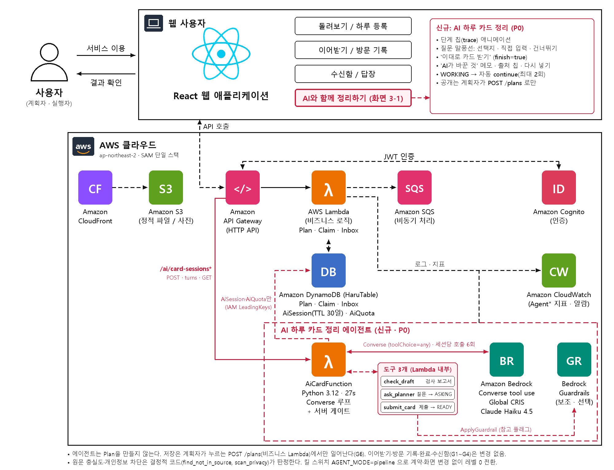

# 2. 시스템 구성

> 세부 명세: [`spec/backend.md`](./spec/backend.md) §4–10, [`spec/frontend.md`](./spec/frontend.md) §4–7, [`aws1조_초안.pdf`](../references/aws1조_초안.pdf) 4장
>
> 이 문서는 전체 구성을 한눈에 보기 위한 요약이다. 스키마, 트랜잭션 식, 에러 분기의 정확한 정의는 `spec/backend.md`의 해당 절에 있다.

## 2.1 아키텍처



> 그림은 [`scripts/draw_architecture.py`](../scripts/draw_architecture.py)로 생성한다(`python scripts/draw_architecture.py`).

```
브라우저(React) ──▶ CloudFront ──▶ S3 (비공개, 정적 파일, OAC)
     │
     ├─ Cognito User Pool (로그인 → ID 토큰)
     │
     └─▶ API Gateway (HTTP API, JWT authorizer)
            └─▶ API Lambda들 ──▶ DynamoDB (단일 테이블 HaruTable)
                    ├─▶ 하루 카드 에이전트(LangGraph) ──▶ DynamoDB 체크포인트 테이블 HaruAgentCheckpoints
                    │     └─▶ 외부 OpenAI 호환 LLM API (Chat Completions tools)
                    │           └ API 키: SSM Parameter Store SecureString
                    └─▶ S3 사진 버킷 presigned PUT/GET URL 발급

사진: 브라우저 ──PUT──▶ S3 photos/original/ ──이벤트──▶ SQS ──▶ 사진 처리 Lambda
                                                        │        ├ 검사·축소·메타데이터 제거 → photos/processed/
                                                        │        └ DynamoDB 사진 상태 갱신 + 완료 트랜잭션
                                                        └─(3회 초과)─▶ SQS DLQ ──▶ CloudWatch 알람

CloudWatch Logs/Metrics/Alarms, 배포: AWS SAM
```

요청 경로는 네 갈래다.

1. **정적 파일**: CloudFront가 비공개 S3의 React 빌드 산출물을 제공한다. 웹 버킷과 배포는 백엔드 SAM 스택이 만들고, 프론트엔드 저장소는 빌드 결과를 sync한다.
2. **API**: 브라우저가 Cognito ID 토큰으로 API Gateway를 직접 호출한다. Lambda가 계획별 작성자·실행자 권한을 검사한다.
3. **AI 정리**: Lambda 안의 LangGraph 에이전트 그래프가 외부 OpenAI 호환 LLM API를 호출한다. HTTP 요청 1번이 에이전트 1턴이고, 턴 사이의 대화·그래프 상태는 체크포인트 테이블에 남는다.
4. **사진**: 브라우저가 presigned URL로 S3에 직접 올리면 SQS를 거쳐 사진 처리 Lambda가 비동기로 처리한다.

## 2.2 기술 스택

| 영역 | 프론트엔드 | 백엔드 |
|---|---|---|
| 언어·런타임 | TypeScript, React 18, Vite | Python 3.12 (boto3, pydantic, Pillow 레이어, 에이전트 함수에만 LangGraph·langchain-openai) |
| 구조 | React Router, TanStack Query | API Gateway HTTP API, Lambda 6개, DynamoDB 단일 테이블 |
| 인증 | AWS Amplify `aws-amplify/auth` (Auth 모듈만) | Cognito User Pool, JWT authorizer (audience = App Client ID) |
| AI | — | LangGraph `StateGraph` + `ChatOpenAI`(OpenAI 호환 Chat Completions), 체크포인터 `DynamoDBSaver` |
| 사진 | presigned PUT으로 직접 업로드, 2초 간격 폴링 | S3 → SQS → Lambda, DLQ |
| 로컬 개발 | MSW 목업(`VITE_USE_MOCK=true`), 로컬 백엔드 연동 모드 | docker compose: AWS 호환 에뮬레이터(Floci), HTTP 어댑터, Fake 채팅 모델 |
| 배포 | S3 sync + CloudFront 캐시 무효화 | AWS SAM (`dev` / `demo` 환경) |
| 관측 | — | CloudWatch (EMF 로그, 알람, 대시보드), AWS Budgets |
| 비밀값 | `VITE_*`에는 비밀값을 두지 않는다 | LLM API 키는 SSM Parameter Store SecureString |
| 스타일 | CSS Modules 또는 Tailwind (미정, 프론트 Q3) | — |

- 리전은 `ap-northeast-2`다. LLM은 AWS 밖의 외부 공급자이므로 AI 정리를 요청하면 사연이 공급자 서버로 전송된다. 처리 국가와 보존 정책이 공급자마다 다르므로 사연 입력 화면과 시범 운영 동의 문구에 안내를 넣는다.
- LLM 공급자는 `LLM_BASE_URL`, API 키, `LLM_MODEL` 설정만 바꿔 교체한다(OpenAI, 상용 호환 API, 로컬 Ollama·vLLM 등). 공급자와 모델은 아직 정하지 않았다.
- 닉네임이 ID 토큰의 `nickname` 클레임에만 있으므로, API 호출에는 액세스 토큰이 아니라 **ID 토큰**을 쓴다.

프론트엔드 환경 변수는 `VITE_API_BASE_URL`, `VITE_AWS_REGION`, `VITE_COGNITO_USER_POOL_ID`, `VITE_COGNITO_CLIENT_ID`, `VITE_USE_MOCK`이고, 로컬 백엔드 모드에서만 `VITE_COGNITO_ENDPOINT`, `VITE_AUTH_MODE`를 더 쓴다. 배포 환경의 값은 백엔드 SAM 출력값(`ApiUrl`, `UserPoolId`, `UserPoolClientId`)에서 온다.

### 로컬 개발 환경

예산 문제로 개발 단계에서는 AWS 서비스 대신 docker compose로 띄운 에뮬레이터를 쓴다. **데모, 시범 운영, 검증 시나리오 T1–T22의 판정은 실제 AWS에 SAM으로 배포한 스택에서 한다.** 로컬 환경의 통과는 인수 기준으로 치지 않는다.

| AWS 구성요소 | 로컬 대체 |
|---|---|
| DynamoDB, S3, SQS, Cognito User Pool | `floci/floci` 컨테이너 1개 |
| API Gateway HTTP API + JWT authorizer, Lambda | 자체 빌드 Python HTTP 어댑터(`:3000`)와 SQS 폴러. 같은 Lambda 핸들러 코드를 호출한다 |
| CloudFront + 웹 버킷 | 호스트의 Vite dev 서버(`:5173`) |
| CloudWatch EMF | stdout 로그 |
| LLM | Fake 채팅 모델(기본), 외부 OpenAI 호환 API(개발 키), 선택으로 Ollama |
| SSM Parameter Store | gitignore된 `.env`의 `LLM_API_KEY` |

프론트엔드는 세 가지 연동 모드로 개발한다.

| 모드 | API | 쓰는 때 |
|---|---|---|
| MSW 목업 | 브라우저 안 목업 | 처음부터. 계약 기준으로 화면 개발 |
| 로컬 백엔드 | `http://localhost:3000` (어댑터) | 백엔드 기능이 로컬에 올라온 뒤 실제 흐름 확인 |
| `dev` / `demo` 스택 | SAM 출력 `ApiUrl` | 연동 지점 S1–S5, 계약 비교, 리허설, 시연 |

로컬에서 재현되지 않아 AWS에서만 확인하는 항목(JWT authorizer, 동시성 판정, presigned URL 서명 강제, DLQ 이동, 콜드 스타트, CloudFront 등)은 `spec/backend-development-plan.md` 10.4에 있다. 구성과 설정 전환은 같은 문서 10장, 프론트엔드 쪽 설정은 `spec/frontend-development-plan.md` 4.1에 있다.

## 2.3 Lambda 구성

| 함수 | 트리거 | 역할 |
|---|---|---|
| `MeFunction` | `GET /me`, `GET /me/claims` | 내 정보, 내 하루 |
| `PlansFunction` | `/plans*` | 계획 생성·조회·목록, 이어받기 |
| `AiCardFunction` | `/ai/card-sessions*` | 하루 카드 에이전트 그래프와 레벨 0, 세션·체크포인트 저장 (1024MB에서 시작해 측정으로 조정, 타임아웃 27s, VPC 밖) |
| `ClaimsFunction` | `/claims/*` | 포기, 방문 기록 저장, 업로드 URL, 완료 |
| `InboxFunction` | `/inbox*` | 수신함, 읽음, 답장 |
| `PhotoProcessorFunction` | SQS | 사진 검사·축소·메타데이터 제거, 완료 트랜잭션 (batch 1, 1024MB, 30s) |

이 밖에 Cognito PreSignUp 트리거 Lambda가 가입을 자동 확인한다.

## 2.4 도메인 모델

| 엔티티 | 상태 | 의미 |
|---|---|---|
| Plan (하루 계획) | `OPEN` → `CLAIMED` → `COMPLETED` | 이어받기 가능 → 누군가 이어받음 → 방문 기록 전달됨 |
| Claim (이어받기) | `ACTIVE` → `COMPLETED` / `ABANDONED` / `EXPIRED` | 한 번의 이어받기 시도 |
| Record (방문 기록) | `photoStatus`: `NONE` / `UPLOAD_PENDING` / `PROCESSING` / `READY` / `FAILED` / `DISCARDED` | Claim당 1개. 글(1–1,000자) + 사진 상태 |
| InboxItem (수신함) | `read`, `reply` | Claim당 최대 1개. `itemId = claimId` |
| AiSession | `WORKING` / `ASKING` → `READY` / `FAILED` | 하루 카드 에이전트 세션 1개의 메타·지표·잠금 |

```
Plan:  OPEN ──claim──▶ CLAIMED ──complete──▶ COMPLETED
         ▲               │
         └──abandon──────┘
         └──(기한 경과 후 다른 사용자가 claim하면 이전 Claim은 EXPIRED)
```

**기한과 지연 해제.** `dueAt = claimedAt + 3일`(환경 변수 `CLAIM_DURATION_DAYS`)이다. 별도 스케줄러가 없다. 기한이 지난 `CLAIMED` 계획은 새 이어받기 요청이 들어오는 시점에 인수할 수 있게 되고, 그 전까지는 기존 실행자가 늦게라도 완료할 수 있다(`late = true`). 둘러보기 목록은 `OPEN`과 기한 지난 `CLAIMED`를 함께 "이어받기 가능"으로 보여 준다.

**Plan 입력 규칙.** 프론트 폼 검증과 백엔드 검증이 같다.

| 필드 | 규칙 | 화면에서의 쓰임 |
|---|---|---|
| `title` | 1–40자 | 하루 제목 |
| `summary` | 1–120자 | 하고 싶었던 일 한두 문장. 둘러보기 카드 본문, 돌아온 하루의 "내가 남긴 계획" |
| `reason` | 1–300자 | 취소한 이유. 하루 상세의 계획자 박스 |
| `estimatedMinutes` | 10–240 | 예상 소요 시간 |
| `places` | 1–3개. `name` 1–30자, `activity` 1–60자, `whyChosen` 0–120자 | 산책 동선 타임라인 |
| `question` | 1–80자, 정확히 1개 | 방문 기록 작성 화면에서 다시 보여 주는 질문 |
| `authoring.story` | 1–1,000자, 두 작성 모드 모두 필수 | 사연 원문. 원문 충실도 지표의 기준 |

Plan JSON 예시와 `metrics` 필드는 `spec/backend.md` §5에 있다.

## 2.5 DynamoDB

메인 테이블 `HaruTable`은 단일 테이블 설계다.

| 엔티티 | PK | SK | 비고 |
|---|---|---|---|
| Plan | `PLAN#{planId}` | `META` | GSI1(동네·상태별 목록), GSI2(사용자별) |
| Claim | `PLAN#{planId}` | `CLAIM#{claimId}` | GSI2(사용자별 Claim) |
| Record | `PLAN#{planId}` | `RECORD#{claimId}` | |
| ClaimLookup | `CLAIM#{claimId}` | `META` | `claimId`만으로 `planId`를 찾는 용도 |
| InboxItem | `USER#{ownerId}` | `INBOX#{claimId}` | |
| AiSession | `AISESSION#{sessionId}` | `META` | TTL 30일 |
| AiQuota | `AIQUOTA#{userId}#{yyyymmdd}` | `META` | TTL 2일 |
| IdempotencyKey | `IDEM#{userId}#{key}` | `META` | TTL 24시간 |

에이전트의 대화와 그래프 상태는 별도 테이블 `HaruAgentCheckpoints`에 둔다. LangGraph `DynamoDBSaver`가 쓰는 테이블로, 키 형식은 라이브러리가 정하고 `thread_id = sessionId`다. TTL은 AiSession(30일) 이하로 맞춘다. 메인 테이블과 분리해서 라이브러리 버전이 키 형식을 바꿔도 영향이 없고, IAM을 테이블 단위로 `AiCardFunction`에만 줄 수 있다.

핵심 트랜잭션은 세 가지이며 모두 `src/domain/claim_service.py` 한 곳에 둔다. 식과 조건 실패 분기는 `spec/backend.md` §6에 있다.

| 트랜잭션 | 보장 | 조건 실패 시 |
|---|---|---|
| 이어받기 | G1 | 본인의 ACTIVE Claim이 있으면 그 Claim을 200으로 반환(중복 클릭 멱등), 소유자면 `CANNOT_CLAIM_OWN_PLAN`, 그 외 `ALREADY_CLAIMED` |
| 포기 | G3 | `CLAIM_NOT_ACTIVE` |
| 완료 | G2, G3, G4 | 이미 완료면 기존 결과를 200으로 반환, 포기·만료·불일치면 `CLAIM_NOT_ACTIVE`, 글이 없으면 `RECORD_REQUIRED` |

완료는 API(`POST /complete`, 글로 완료)와 사진 처리 Lambda(사진 포함 완료)가 같은 함수 `complete_claim()`을 호출한다. 클라이언트가 직접 호출하는 완료는 `TEXT_ONLY`뿐이다.

## 2.6 API 목록

모든 경로에 `Authorization: Bearer {Cognito ID token}`이 필요하다. 에러 형식은 `{ "error": { "code", "message", "details"? } }`이고 시간은 ISO 8601 UTC다. 요청·응답 스키마는 `spec/backend.md` §7에 있다.

| 메서드 | 경로 | 용도 | 명세 절 |
|---|---|---|---|
| GET | `/me` | 닉네임, 미확인 수신함 수 | §7.1 |
| GET | `/me/claims?status=ACTIVE\|COMPLETED` | 내 하루 | §7.1 |
| POST | `/ai/card-sessions` | 사연으로 AI 정리 세션 생성 | §7.2 |
| POST | `/ai/card-sessions/{sessionId}/turns` | 다음 턴 (`expectedTurn`, `answer?`, `finish?`) | §7.2 |
| GET | `/ai/card-sessions/{sessionId}` | 세션 상태 조회 (새로고침 복구, 재동기화) | §7.2 |
| POST | `/plans` | 하루 공개 (`Idempotency-Key` 필수) | §7.3 |
| GET | `/plans?status=OPEN` | 둘러보기 목록 | §7.3 |
| GET | `/plans/{planId}` | 하루 상세 (`isOwner`, `myClaim`, `claimable`) | §7.3 |
| POST | `/plans/{planId}/claims` | 이어받기 | §7.3 |
| POST | `/claims/{claimId}/abandon` | 이어받기 포기 | §7.4 |
| PUT | `/claims/{claimId}/record` | 방문 기록 저장, 사진 업로드 URL 발급 | §7.4 |
| POST | `/claims/{claimId}/record/photo` | 사진 교체용 업로드 URL 재발급 | §7.4 |
| GET | `/claims/{claimId}/record` | 기록, `claimStatus`, 사진 처리 상태 (폴링) | §7.4 |
| POST | `/claims/{claimId}/complete` | 글로 완료 (멱등) | §7.4 |
| GET | `/inbox` | 수신함 목록 | §7.5 |
| GET | `/inbox/{itemId}` | 돌아온 하루 상세 | §7.5 |
| POST | `/inbox/{itemId}/read` | 읽음 처리 | §7.5 |
| POST | `/inbox/{itemId}/reply` | 한 줄 답장 (1회) | §7.5 |

에러 코드 16종과 프론트엔드의 처리 방법은 `spec/backend.md` §7.6, `spec/frontend.md` §7의 표를 본다. 프론트엔드는 `error.code`로만 분기한다.

## 2.7 화면과 API·Lambda·요구사항 대응

화면 번호는 `spec/frontend.md` §5의 `#`이다.

| 화면 | 경로 | 호출하는 API | Lambda | 요구사항 |
|---|---|---|---|---|
| 0 로그인·회원가입 | `/login` | Cognito(Amplify), `GET /me` | PreSignUp, `MeFunction` | FE-AUTH-01–03 / BE-AUTH-01–05 |
| 1 둘러보기 | `/` | `GET /plans?status=OPEN` | `PlansFunction` | FE-BRW-01–04 / BE-PLAN-04 |
| 2 하루 들여다보기, 2-1 이미 이어받은 하루 | `/plans/:planId` | `GET /plans/{planId}`, `POST /plans/{planId}/claims` | `PlansFunction` | FE-PLN-01–05 / BE-PLAN-05–07, BE-CLAIM-01–05 |
| 3 사연 입력, 3-1 AI와 함께 정리하기 | `/plans/new`, `/plans/new/card` | `/ai/card-sessions*` 3종 | `AiCardFunction` | FE-CRT-01–04, 12–14 / BE-AI-01–12 |
| 3-2 폼, 3-3 장소 추가, 3-4 공개 완료 | `/plans/new/form`, `/plans/new/place`, `/plans/:planId/published` | `POST /plans` | `PlansFunction` | FE-CRT-05–11 / BE-PLAN-01–03 |
| 4 내 하루, 4-1 포기 확인 | `/me`, `/claims/:claimId/abandon` | `GET /me/claims`, `POST /claims/{claimId}/abandon` | `MeFunction`, `ClaimsFunction` | FE-ME-01–04 / BE-CLAIM-06, 07 |
| 5 방문 기록 작성, 5-1 보내는 중, 5-2 실패, 5-3 사진 교체, 5-4 전송 완료, 8 종료 안내 | `/claims/:claimId/record` 등 | `PUT`·`GET /claims/{claimId}/record`, `POST …/record/photo`, `POST …/complete`, S3 presigned PUT | `ClaimsFunction`, `PhotoProcessorFunction` | FE-REC-01–11 / BE-REC-01–10, BE-PHOTO-01–09 |
| 6 수신함, 7 돌아온 하루, 7-1 답장 보낸 상태 | `/inbox`, `/inbox/:itemId` | `GET /inbox`, `GET /inbox/{itemId}`, `POST …/read`, `POST …/reply` | `InboxFunction` | FE-INB-01–05 / BE-INBOX-01–04 |

공통 요구사항은 FE-COM-01–06, FE-TECH-01–07, FE-NFR-01–07과 BE-INFRA-01–06, BE-OBS-01–05, BE-NFR-01–07이다.

**화면 분기 원칙.** 화면은 누른 버튼이 아니라 서버 응답 값으로 분기한다. 이어받기 버튼은 `claimable`, 전송 완료 문구는 `hasPhoto`, 종료 판단은 `claimStatus`, AI 정리 단계는 세션 `status`로 정한다.

## 2.8 사진 처리

1. `PUT /record`가 presigned PUT URL을 발급한다(10분, `Content-Type`과 `Content-Length`를 서명에 포함). 브라우저는 응답의 `upload.headers`를 그대로 써서 `photos/original/`에 올린다.
2. S3 이벤트가 SQS로 가고, 사진 처리 Lambda가 매직 바이트(JPEG/PNG), 실제 크기(10MB 이하), 해상도를 검사한다.
3. EXIF 방향을 반영해 긴 변 1600px로 줄이고, **EXIF·GPS를 포함한 모든 메타데이터를 제거**해 JPEG로 다시 인코딩한다.
4. 완료 트랜잭션을 호출한다. 이때 `photoStatus = READY`가 함께 기록되고 수신함에 도착한다.
5. 검사에 실패하면 `FAILED`로 표시하고 재시도하지 않는다. 일시 오류는 SQS가 3회까지 재시도하고 그 뒤에는 DLQ로 보낸다. DLQ에 메시지가 있으면 알람이 울린다.

사용자 쪽에서는 보내는 중 화면이 `GET /record`를 2초 간격으로 폴링한다. 실패하면 사진을 바꾸거나 글로 완료할 수 있고, 처리 중에도 언제든 글로 완료할 수 있다. 사진 교체·글로 완료와 사진 처리가 경합하면 완료 트랜잭션의 조건으로 한쪽만 반영된다. 세부 단계는 `spec/backend.md` §8, 폴링 판정 순서는 `spec/frontend.md` §6.5에 있다.

## 2.9 권한

모든 판단은 Lambda에서 JWT `sub`와 저장된 `ownerId`·`claimerId`를 비교해서 한다. 클라이언트가 보낸 사용자 ID는 쓰지 않는다.

| 리소스 | 읽기 | 쓰기 |
|---|---|---|
| Plan (OPEN/CLAIMED) | 로그인 사용자 전체 | 생성만 가능 (수정·삭제는 MVP 미지원) |
| Plan (COMPLETED) | 소유자, 해당 실행자 | — |
| Claim | 해당 실행자 | 생성: 소유자 외 사용자 / 포기: 해당 실행자 |
| Record | 해당 실행자, 전달 후 계획 소유자 | 해당 실행자 (Claim이 ACTIVE일 때만) |
| InboxItem, 답장 | 계획 소유자 | 계획 소유자 |
| AiSession | 세션 소유자 (그 외 404) | 세션 소유자 |

`AiCardFunction`의 IAM은 세 가지로 한정한다. 메인 테이블에서는 `dynamodb:LeadingKeys` 조건으로 `AISESSION#*`, `AIQUOTA#*` 키에만 쓸 수 있고, 체크포인트 테이블과 LLM API 키 파라미터 하나(`ssm:GetParameter`)에 접근한다. 프롬프트 인젝션이 성공해도 Plan·Claim·Inbox에는 IAM 수준에서 쓸 수 없다. LLM 호출 자체는 IAM 밖의 외부 HTTPS 호출이므로, 공급자가 지원하면 사용량 월 한도를 건다.

## 2.10 관측과 측정

**운영 지표(CloudWatch).** `ClaimConflict`, `CompleteDuplicate`, `StaleRequestRejected`, `PhotoProcessingMs`, `PhotoFailed`, `PhotoDLQDepth`, `AiLatencyMs`, `AiFailure`, `AiInvalidOutput`, `Agent*` 8종(체크포인트 크기 `AgentCheckpointBytes` 포함)을 EMF 로그로 남긴다. `AiCardFunction`의 콜드 스타트(Init Duration)도 기록한다. 알람은 DLQ 메시지 수, API 5xx, Lambda 오류·지연, `AgentTokens`에 건다. 로그와 `trace`에는 사연·답변 원문을 남기지 않고 유형과 개수만 남긴다. LangSmith 추적은 사연 원문을 외부로 보내므로 끈다.

**시범 운영 지표(`scripts/report.py`).** DynamoDB에 저장된 값으로 집계한다.

| 지표 | 목표 |
|---|---|
| 기한 내 방문 기록 | 최초 확정 5건 중 3건 이상 |
| 답장률 | 완료 건 중 2건 이상 |
| 작성 시간 비교 (직접 작성 / AI 정리 후 편집) | 목표 없음. 모드별 `durationMs` 중앙값 비교 |
| 원문에 없던 장소·활동 추가 건수 | 목표 없음. 모드별 `addedNotInSource` 비교 |
| AI 카드 원문 충실도 | degraded 제외 `deliveredNotInSource` 0 |
| 개인정보 | `privacyInPublished` 0 |
| AI 턴 응답 시간 | p95 15초 이하 |
| 전달 불변식 감사 (`check_invariants`, 선택) | 위반 0건 |

지표 계산식 전체는 `spec/backend.md` §7.3, §10에 있다.
